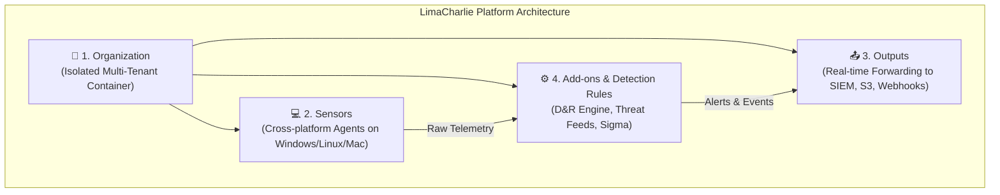

# Lab 10: Endpoint Security Part III — EDR Fundamentals & LimaCharlie Hands-on

> **Course:** Cybersecurity Operations (SOC Lab)  
> **Instructor:** Hussein Al-Selwi  
> **Total Slides:** 10 Slides  
> **Source Presentation:** `Endpoint_Security_Part3_Lab10.html`  

### 📋 Overview
Next-generation endpoint defense: behavioral telemetry streaming, EDR vs traditional Antivirus, multi-tenant cloud organization setup, sensor deployment, detection engineering, and real-time response inside LimaCharlie.

---

## 📑 Table of Contents

- [Slide 01: Introduction](#slide-01-introduction)
- [Slide 02: Why Endpoint Security Matters](#slide-02-why-endpoint-security-matters)
- [Slide 03: What Is EDR?](#slide-03-what-is-edr)
- [Slide 04: Introducing LimaCharlie](#slide-04-introducing-limacharlie)
- [Slide 05: LimaCharlie — Core Components](#slide-05-limacharlie-core-components)
- [Slide 06: Component — Organization](#slide-06-component-organization)
- [Slide 07: Component — Sensors](#slide-07-component-sensors)
- [Slide 08: Component — Output](#slide-08-component-output)
- [Slide 09: Component — Add-ons](#slide-09-component-add-ons)
- [Slide 10: Summary — How It All Fits Together](#slide-10-summary-how-it-all-fits-together)

---

## Slide 01: Introduction

> **Category:** `INCIDENT DETECTION & RESPONSE`

### Endpoint Security Part III

A hands-on Endpoint Detection & Response demo — why EDR matters, and getting oriented inside LimaCharlie, our cloud-based EDR platform.

Lab 10 – Endpoint Detection & Response Demo

> [!NOTE] 🎙️ **Instructor Lecture Notes**
> Welcome students to Part III of Endpoint Security. Part I covered baseline process behavior, Part II covered how attackers achieve persistence. Part III is our hands-on EDR demo — we introduce EDR conceptually, then deploy and explore LimaCharlie as our cloud-based EDR platform.

---

## Slide 02: Why Endpoint Security Matters

> **Category:** `ENDPOINT SECURITY`

Every laptop, server, and workstation is an endpoint — where employees do real work, and where attackers most often land first. As we saw in Part II, once they're in, the endpoint is also where they try to stay hidden and persist.

- The endpoint sees everything an attacker actually does — every process, file, and command.
- Watching it closely means catching an attacker early, before they can do real damage.

That's exactly the job of Endpoint Detection & Response (EDR) : it turns that visibility into ongoing detection and response.

> [!NOTE] 🎙️ **Instructor Lecture Notes**
> Set the stage before defining EDR. Endpoints — laptops, servers, workstations — are where users actually work, and where attackers actually land. In Parts I and II we saw normal process behavior and how attackers persist; now emphasize that the endpoint is the closest possible vantage point to what an attacker is doing, which is why watching it closely (EDR) matters.

---

## Slide 03: What Is EDR?

> **Category:** `EDR FUNDAMENTALS`

Endpoint Detection & Response (EDR) is security software that continuously monitors endpoint activity — processes, files, network connections, registry changes — and gives analysts the tools to detect suspicious behavior, investigate it, and respond, all from one platform.

1. **Collect**: Stream verbose telemetry from every endpoint in real time.
2. **Detect**: Match behavior against rules and threat intel, not just file hashes.
3. **Investigate**: Pivot into process trees, file systems, and live sensor state.
4. **Respond**: Kill a process, isolate the host, or run a script — right from the platform.

> [!NOTE] 🎙️ **Instructor Lecture Notes**
> Define EDR formally, then contrast it with traditional antivirus. Traditional AV is signature-based and reactive — it scans files against known-bad hashes. EDR is behavior-based and continuous — it streams telemetry constantly and lets analysts detect, investigate, and respond to activity that no signature would ever catch, including the persistence techniques from Part II.

---

## Slide 04: Introducing LimaCharlie

> **Category:** `THE PLATFORM`

LimaCharlie is a cloud-based Security Operations (SecOps) platform built around real-time EDR. You deploy sensors to endpoints, telemetry streams to the cloud over a persistent connection, and you decide what detection logic runs and where the results go.

- **Cloud-Native**: Runs entirely in the cloud — no on-prem management server to maintain or patch.
- **True Real-Time**: Telemetry streams continuously over a semi-persistent connection, not on a scan schedule.
- **Fully Configurable**: Detection rules, outputs, and integrations are all yours to define — nothing is a black box.

> [!IMPORTANT]
> Why this lab uses it: LimaCharlie's free tier supports a small number of sensors with full platform functionality, making it practical to deploy a real EDR agent and watch live detections without a licensing budget.

> [!NOTE] 🎙️ **Instructor Lecture Notes**
> Introduce LimaCharlie as the specific EDR platform used for this lab. It's a cloud-based, cloud-native Security Operations (SecOps) platform — not a single boxed product, but infrastructure you assemble: sensors feed it telemetry, you write detection logic, and you route the results wherever you need them. Mention its open EDR roots and that it offers a free tier for learning, which is why it's a good fit for this lab.

---

## Slide 05: LimaCharlie — Core Components

> **Category:** `PLATFORM ARCHITECTURE`

### LimaCharlie's Four Core Components

Everything in LimaCharlie is built from four building blocks. We'll take each one in turn, but here's the map:

- **1. Organization**: The isolated workspace that contains everything else.
- **2. Sensors**: The agents that bring telemetry in from endpoints.
- **3. Output**: Where processed data and detections get forwarded to.
- **4. Add-ons**: Extensions that add capability on top of the base platform.

> [!NOTE] 🎙️ **Instructor Lecture Notes**
> Preview the four building blocks of the platform before going deep on each: Organization, Sensors, Output, Add-ons. Frame it as: Organization is the container everything lives in, Sensors bring data in, Output sends data out, and Add-ons extend what the platform can do in between. The next four slides take each one in turn.

---

## Slide 06: Component — Organization

> **Category:** `COMPONENT 1 OF 4`

### Organization

An Organization is an isolated workspace within LimaCharlie — its own self-contained environment with its own sensors, detection rules, and outputs.

This is what lets one provider run many separate client environments, side by side, with nothing crossing between them.

> [!NOTE] 🎙️ **Instructor Lecture Notes**
> Deep dive on Organization. It's the top-level tenant: an isolated environment holding its own sensors, detection rules, data, and outputs. Explain the multi-tenant benefit for MSSPs or enterprises managing multiple clients or departments, where each gets its own fully separate Organization.

---

## Slide 07: Component — Sensors

> **Category:** `COMPONENT 2 OF 4`

### Sensors

Sensors are the agents that sit on an endpoint and do the watching. Once installed, a sensor registers with the cloud and streams telemetry back to its Organization in real time.

They run on Windows, macOS, Linux, and ChromeOS, and can also pull in logs from other sources like cloud platforms or other EDRs.

> [!NOTE] 🎙️ **Instructor Lecture Notes**
> Deep dive on Sensors. These are the lightweight agents installed on endpoints (Windows, macOS, Linux, ChromeOS) or configured as adapters for cloud/log sources (AWS, Microsoft Defender, other EDRs). They register with the cloud, stay connected, and stream telemetry. Mention they're serverless and scalable, and billed by concurrent online sensor count / quota.

---

## Slide 08: Component — Output

> **Category:** `COMPONENT 3 OF 4`

### Output

Outputs are how data leaves LimaCharlie. You choose which streams to forward — events, detections, audit logs — and where they go, such as a SIEM, cloud storage, or a webhook.

This is what lets the data flow into whatever tools your team already relies on, instead of staying trapped in one dashboard.

> [!NOTE] 🎙️ **Instructor Lecture Notes**
> Deep dive on Output. This is how data leaves LimaCharlie. You choose which streams to forward (events, detections, audit logs, deployment info, artifacts) and where — a SIEM, cloud storage like S3, Slack, a webhook, and so on. Setup is done from the Outputs page in the Organization by adding an output and pointing it somewhere.

---

## Slide 09: Component — Add-ons

> **Category:** `COMPONENT 4 OF 4`

### Add-ons (Extensions)

Add-ons , also called Extensions, let an Organization expand what the platform can do — managed detection rulesets, third-party integrations, and automated workflows — without changing the core platform.

An Organization subscribes to each one individually, and each is only granted the specific permissions it needs.

> [!NOTE] 🎙️ **Instructor Lecture Notes**
> Deep dive on Add-ons / Extensions. These expand what the platform can do beyond the base sensor + rules + output pipeline: managed detection rulesets (Sigma, YARA, SOC Prime), API integrations with threat intel or third-party tools, and automation workflows. Organizations subscribe to extensions individually, and extensions can be private or shared publicly through a marketplace.

---

## Slide 10: Summary — How It All Fits Together

> **Category:** `SUMMARY`

### How the Four Pieces Fit Together

One Organization contains everything else. Inside it, Sensors stream telemetry in, Add-ons enhance detection, and Output sends the results wherever the team needs them.

1. **Step 1**: Sensors
2. **Step 2**: Detection + Add-ons
3. **Step 3**: Output

> [!IMPORTANT]
> Next: in the live demo, we'll create an Organization, install a sensor on our lab endpoint, and watch real telemetry.

> [!NOTE] 🎙️ **Instructor Lecture Notes**
> Recap slide tying the four components together into one mental model before moving into the hands-on deployment. Organization is the container; Sensors bring telemetry in; detection rules (enhanced by Add-ons) process it; Output sends the results wherever the team needs them. This is the model students will actually build in the live demo.

---

## 🎯 Summary & Key Takeaways

- **Module:** Lab 10: Endpoint Security Part III — EDR Fundamentals & LimaCharlie Hands-on

- **Core Competencies Developed:** Hands-on triage, log analysis, threat hunting, and defensive incident response.

- **Course Reference:** Cybersecurity Operations Practical Labs by **Hussein Al-Selwi**.
