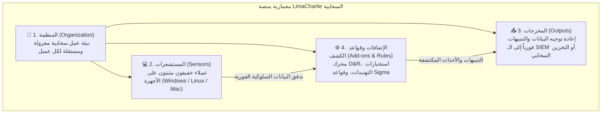

# المعمل 10: أمان النقاط الطرفية - الجزء الثالث: أنظمة الـ EDR وتطبيق عملي على منصة LimaCharlie

> **المقرر:** عمليات الأمن السيبراني (مختبر الـ SOC - Cybersecurity Operations)  
> **المحاضر:** Hussein Al-Selwi  
> **إجمالي عدد الشرائح:** 10 شريحة  
> **العرض التقديمي المصدري:** `Endpoint_Security_Part3_Lab10_AR.html`  

### 📋 نبذة عامة وأهداف الوحدة التدريبية
تقنيات الحماية الحديثة للنقاط الطرفية: تدفق البيانات السلوكية الحية، الفروق الجوهرية بين الـ EDR ومضادات الفيروسات التقليدية، بنية المنظمة السحابية المعزولة (Multi-Tenant Org)، نشر المستشعرات (Sensors)، بناء قواعد الكشف والاستجابة (D&R Rules)، والتحقيق الحي والاحتواء داخل منصة LimaCharlie.

---

## 📑 جدول المحتويات

- [الشريحة 01: المقدمة](#slide-01-المقدمة)
- [الشريحة 02: أهمية أمن الأجهزة (Endpoint Security)](#slide-02-أهمية-أمن-الأجهزة-endpoint-security)
- [الشريحة 03: ما هي أنظمة EDR؟](#slide-03-ما-هي-أنظمة-edr؟)
- [الشريحة 04: مقدمة إلى منصة LimaCharlie](#slide-04-مقدمة-إلى-منصة-limacharlie)
- [الشريحة 05: المكونات الأساسية لـ LimaCharlie](#slide-05-المكونات-الأساسية-لـ-limacharlie)
- [الشريحة 06: المكون 1: المنظمة (المنظمة (Organization))](#slide-06-المكون-1-المنظمة-المنظمة-organization)
- [الشريحة 07: المكون 2: المستشعرات (المستشعرات (Sensors))](#slide-07-المكون-2-المستشعرات-المستشعرات-sensors)
- [الشريحة 08: المكون 3: المخرجات وتوجيه البيانات (Output)](#slide-08-المكون-3-المخرجات-وتوجيه-البيانات-output)
- [الشريحة 09: المكون 4: الإضافات والامتدادات (الإضافات (Add-ons))](#slide-09-المكون-4-الإضافات-والامتدادات-الإضافات-add-ons)
- [الشريحة 10: ملخص: كيف تترابط المكونات الأربعة؟](#slide-10-ملخص-كيف-تترابط-المكونات-الأربعة؟)

---

## الشريحة 01: المقدمة

> **التصنيف / الفئة:** `كشف التهديدات والاستجابة للحوادث · IDR`

### Endpoint Security Part III

عرض عملي لأنظمة Endpoint الكشف (Detect)ion & Response (EDR) — لماذا تعد أنظمة EDR مهمة، والتعرف على منصة LimaCharlie السحابية.

المعمل 10 – عرض عملي لأنظمة EDR

> [!NOTE] 🎙️ **ملاحظات وتوجيهات المحاضر (Instructor Lecture Notes)**
> رحب بالطلاب في الجزء الثالث من أمن الأجهزة (Endpoint Security). غطى الجزء الأول السلوك الأساسي للعمليات، وغطى الجزء الثاني كيفية تحقيق المهاجمين لآليات الثبات (Persistence). الجزء الثالث هو العرض العملي لأنظمة EDR — نقدم فيه مفهوم EDR نظرياً، ثم ننشر ونستكشف منصة LimaCharlie كمنصة EDR سحابية.

---

## الشريحة 02: أهمية أمن الأجهزة (Endpoint Security)

> **التصنيف / الفئة:** `أمن الأجهزة والأنظمة الطرفية`

### لماذا يعد أمن الأجهزة (Endpoint Security) أمراً جوهرياً؟

كل حاسوب محمول، أو خادم (Server)، أو محطة عمل يمثل Endpoint (نقطة طرفية) — حيث ينفذ الموظفون أعمالهم الحقيقية، وحيث يهبط المهاجمون غالباً كنقطة دخول أولى. وكما رأينا في الجزء الثاني، بمجرد دخولهم، تكون الـ Endpoint هي المكان الذي يحاولون الاختباء فيه وتثبيت وجودهم (Persistence).

- ترى الـ Endpoint كل ما يفعله المهاجم فعلياً — كل عملية تُنفذ، وكل ملف يُنشأ، وكل أمر يُكتب.
- مراقبة الأجهزة بدقة تعني اكتشاف المهاجم في وقت مبكر جداً، قبل أن يتمكن من إحداث ضرر حقيقي أو تسريب البيانات.

That's exactly the job of Endpoint الكشف (Detect)ion & Response (EDR) : it turns that visibility into ongoing detection and response.

> [!NOTE] 🎙️ **ملاحظات وتوجيهات المحاضر (Instructor Lecture Notes)**
> مهّد للموضوع قبل تعريف EDR. الأجهزة الطرفية (Endpoints) — مثل الحواسيب المحمولة والسيرفرات ومحطات العمل — هي المكان الذي يعمل فيه الموظفون فعلياً، وحيث يهبط المهاجمون أولاً. في الجزأين الأول والثاني رأينا السلوك الطبيعي للعمليات وكيف يثبت المهاجمون وجودهم؛ أكد الآن أن الـ Endpoint هي أقرب نقطة مراقبة لما يفعله المهاجم، ولهذا تعد مراقبتها الدقيقة عبر EDR أمراً حيوياً.

---

## الشريحة 03: ما هي أنظمة EDR؟

> **التصنيف / الفئة:** `أساسيات أنظمة EDR`

### ما هي أنظمة كشف واستجابة الأجهزة الطرفية (EDR)؟

تعد أنظمة Endpoint الكشف (Detect)ion & Response (EDR) برمجيات أمنية متقدمة تراقب باستمرار كافة أنشطة الأجهزة — العمليات الجارية، الملفات، الاتصالات الشبكية، وتعديلات الـ Registry — وتمنح المحللين الأدوات اللازمة لاكتشاف السلوكيات المشبوهة، والتحقيق فيها، والاستجابة الفورية لها، وكل ذلك من منصة واحدة موحدة.

1. **Collect**: بث القياسات والأحداث الأمنية (Telemetry) من كل جهاز طرفي بشكل لحظي ومستمر.
2. **الكشف (Detect)**: مطابقة السلوكيات مع قواعد الكشف ومعلومات التهديدات (Threat Intel)، وليس فقط هاشات الملفات.
3. **التحقيق (Investigate)**: التعمق في شجرة العمليات (Process Trees)، وملفات النظام، وحالة الأجهزة المباشرة.
4. **الاستجابة (Respond)**: إنهاء العمليات المشبوهة، عزل الجهاز عن الشبكة، أو تشغيل سكربتات علاجية — مباشرة من المنصة.

> [!NOTE] 🎙️ **ملاحظات وتوجيهات المحاضر (Instructor Lecture Notes)**
> عرّف الـ EDR بشكل رسمي، ثم قارنه بمضادات الفيروسات التقليدية (Antivirus). الـ AV التقليدي يعتمد على التواقيع (Signature-based) وتفاعلي فقط — يفحص الملفات بمقارنة الهاشات المعروفة بأنها خبيثة. أما الـ EDR فيعتمد على السلوك (Behavior-based) ومستمر — يبث القياسات والبيانات اللحظية (Telemetry) باستمرار ويتيح للمحللين الكشف والتحقيق والاستجابة للأنشطة التي لا يمكن لأي توقيع تقليدي رصدها، بما في ذلك تقنيات الـ Persistence من الجزء الثاني.

---

## الشريحة 04: مقدمة إلى منصة LimaCharlie

> **التصنيف / الفئة:** `THE PLATFORM`

LimaCharlie is a cloud-based Security Operations (SecOps) platform built around real-time EDR. You deploy sensors to endpoints, telemetry streams to the cloud over a persistent connection, and you decide what detection logic runs and where the results go.

- **Cloud-Native**: تعمل بالكامل في السحابة — دون الحاجة لصيانة أو إدارة خوادم محلية (On-Premises).
- **True Real-Time**: تتدفق البيانات والقياسات (Telemetry) باستمرار عبر اتصال شبه دائم، وليس وفق جدول فحص مؤقت.
- **قابلة للتخصيص الكامل (Fully Configurable)**: الكشف (Detect)ion rules, outputs, and integrations are all yours to define — nothing is a black box.

> [!IMPORTANT]
> Why this lab uses it: LimaCharlie's free tier supports a small number of sensors with full platform functionality, making it practical to deploy a real EDR agent and watch live detections without a licensing budget.

> [!NOTE] 🎙️ **ملاحظات وتوجيهات المحاضر (Instructor Lecture Notes)**
> قدّم LimaCharlie كالمنصة التطبيقية المستخدمة في هذا المعمل. هي منصة عمليات أمنية (SecOps) سحابية بالكامل — ليست مجرد برنامج معزول، بل بنية تحتية مرنة: المستشعرات تزودها بالأحداث، وأنت تكتب قواعد الكشف، وتوجه النتائج أينما تريد. اذكر جذورها في الـ Open EDR وأنها تقدم باقة مجانية مثالية للتعلم والتطبيق العملي.

---

## الشريحة 05: المكونات الأساسية لـ LimaCharlie

> **التصنيف / الفئة:** `PLATFORM بنية المنصة الهندسية`

### المكونات الأساسية الأربعة لمنصة LimaCharlie

تُبنى كل عمليات LimaCharlie من أربع لبنات أساسية. سنتناول كل واحدة بالتفصيل، ولكن إليك المخطط العام:

- **1. المنظمة (Organization)**: مساحة العمل المعزولة التي تحتوي على كل شيء داخل المنصة.
- **2. المستشعرات (Sensors)**: العملاء (Agents) الذين يجمعون القياسات والأحداث من الأجهزة الطرفية.
- **3. Output**: الوجهات التي يتم توجيه البيانات المعالجة والتنبيهات إليها.
- **4. الإضافات (Add-ons)**: إضافات وامتدادات تمنح المنصة قدرات كشف وأتمتة إضافية.

> [!NOTE] 🎙️ **ملاحظات وتوجيهات المحاضر (Instructor Lecture Notes)**
> استعرض اللبنات الأساسية الأربع للمنصة قبل التفصيل في كل منها: المنظمة (Organization) و المستشعرات (Sensors) و Output و الإضافات (Add-ons). وضحها للطلاب كالآتي: الـ المنظمة (Organization) هي الحاوية الكبرى، والـ المستشعرات (Sensors) تجلب البيانات للداخل، والـ Output يرسل البيانات للخارج، والـ الإضافات (Add-ons) تضيف إمكانيات ذكية بينهما. السلايدات الأربعة التالية ستفصل في كل لبنة.

---

## الشريحة 06: المكون 1: المنظمة (المنظمة (Organization))

> **التصنيف / الفئة:** `المكون 1 من 4`

### المنظمة (Organization)

An المنظمة (Organization) is an isolated workspace within LimaCharlie — its own self-contained environment with its own sensors, detection rules, and outputs.

هذا ما يتيح لمزود الخدمة تشغيل بيئات عمل لعدة عملاء جنباً إلى جنب وبأمان تام دون أي تداخل في البيانات.

> [!NOTE] 🎙️ **ملاحظات وتوجيهات المحاضر (Instructor Lecture Notes)**
> شرح متعمق لـ المنظمة (Organization). هي المستأجر الأعلى (Top-level Tenant): بيئة معزولة تحتوي على أجهزتها وقواعد كشفها وبياناتها ومخرجاتها الخاصة. اشرح فائدة الـ تعدد المستأجرين (Multi-Tenancy) لمزودي خدمات الأمان المدارة (MSSPs) أو الشركات الكبرى التي تدير عدة أقسام أو عملاء، حيث يحصل كل طرف على المنظمة (Organization) مستقلة تماماً.

---

## الشريحة 07: المكون 2: المستشعرات (المستشعرات (Sensors))

> **التصنيف / الفئة:** `المكون 2 من 4`

### المستشعرات (Sensors)

المستشعرات (Sensors) are the agents that sit on an endpoint and do the watching. Once installed, a sensor registers with the cloud and streams telemetry back to its المنظمة (Organization) in real time.

يعمل على Windows و macOS و Linux و ChromeOS، ويمكنه أيضاً استيراد السجلات من مصادر سحابية أو أنظمة EDR أخرى.

> [!NOTE] 🎙️ **ملاحظات وتوجيهات المحاضر (Instructor Lecture Notes)**
> شرح متعمق لـ المستشعرات (Sensors). هذه هي البرمجيات الخفيفة (Lightweight Agents) المثبتة على الأجهزة (ويندوز، ماك، لينكس) أو المجهزة كـ Adapters لربط سحب الحوسبة وسجلات الأنظمة (AWS، Microsoft Defender). تسجل نفسها في السحابة وتبث الأحداث لحظياً. اذكر أنها تدعم التوسع السحابي وتوفر كفاءة عالية باستهلاك موارد الجهاز.

---

## الشريحة 08: المكون 3: المخرجات وتوجيه البيانات (Output)

> **التصنيف / الفئة:** `المكون 3 من 4`

### Output

المخرجات (Outputs) are how data leaves LimaCharlie. You choose which streams to forward — events, detections, audit logs — and where they go, such as a SIEM, cloud storage, or a webhook.

هذا ما يسمح بتدفق البيانات للأدوات التي يعتمد عليها فريقك بالفعل (مثل Splunk/ELK)، بدلاً من حصرها في لوحة تحكم واحدة.

> [!NOTE] 🎙️ **ملاحظات وتوجيهات المحاضر (Instructor Lecture Notes)**
> شرح متعمق لـ Output. هذا هو المسار الذي تخرج به البيانات من LimaCharlie. أنت تختار أي تدفقات تريد إعادة توجيهها (أحداث، تنبيهات، سجلات تدقيق، ملفات) وإلى أين — مثل نظام SIEM، أو مساحة تخزين سحابية مثل AWS S3، أو تنبيهات Slack، أو Webhook. يتم الإعداد بسهولة من صفحة المخرجات (Outputs).

---

## الشريحة 09: المكون 4: الإضافات والامتدادات (الإضافات (Add-ons))

> **التصنيف / الفئة:** `المكون 4 من 4`

### الإضافات والامتدادات (الإضافات (Add-ons) / Extensions)

الإضافات (Add-ons) , also called Extensions, let an المنظمة (Organization) expand what the platform can do — managed detection rulesets, third-party integrations, and automated workflows — without changing the core platform.

تشترك المنظمة في كل إضافة بشكل فردي، ولا تُمنح الإضافة إلا الصلاحيات المحددة التي تحتاجها فقط للعمل.

> [!NOTE] 🎙️ **ملاحظات وتوجيهات المحاضر (Instructor Lecture Notes)**
> شرح متعمق لـ الإضافات (Add-ons) والإضافات. توسع هذه المكونات إمكانيات المنصة إلى ما هو أبعد من مجرد جمع البيانات: قواعد كشف جاهزة ومحدثة (مثل Sigma و YARA)، تكاملات مع منصات استخبارات التهديدات (Threat Intel)، وسير عمل مؤتمت. تشترك المنظمة في كل إضافة حسب الحاجة، وتمنح فقط الصلاحيات اللازمة.

---

## الشريحة 10: ملخص: كيف تترابط المكونات الأربعة؟

> **التصنيف / الفئة:** `ملخص المعمل`

### كيف تترابط المكونات الأربعة معاً؟

One المنظمة (Organization) contains everything else. Inside it, المستشعرات (Sensors) stream telemetry in, الإضافات (Add-ons) enhance detection, and Output sends the results wherever the team needs them.

1. **خطوة 1**: المستشعرات (Sensors)
2. **خطوة 2**: الكشف (Detect)ion + الإضافات (Add-ons)
3. **خطوة 3**: Output

> [!IMPORTANT]
> Next: in the live demo, we'll create an المنظمة (Organization), install a sensor on our lab endpoint, and watch real telemetry.

> [!NOTE] 🎙️ **ملاحظات وتوجيهات المحاضر (Instructor Lecture Notes)**
> شريحة تلخيصية تربط المكونات الأربعة في نموذج ذهني موحد قبل الانتقال للتطبيق العملي. المنظمة هي الحاوية الكبرى؛ المستشعرات تجمع القياسات؛ قواعد الكشف (المعززة بالإضافات) تعالجها؛ والمخرجات ترسل النتائج لأي وجهة يحتاجها الفريق. هذا هو النموذج الذي سيطبقه الطلاب عملياً.

---

## 🎯 الخلاصة ومخرجات التعلم

- **الوحدة التدريبية:** المعمل 10: أمان النقاط الطرفية - الجزء الثالث: أنظمة الـ EDR وتطبيق عملي على منصة LimaCharlie

- **المهارات المكتسبة:** فهم عملي وتطبيقي عميق لكيفية الكشف، التحقيق، الاستجابة، وإدارة التهديدات الأمنية باحترافية داخل بيئة العمليات.

- **مرجع التدريب:** مختبر عمليات الأمن السيبراني العملي — إعداد وتقديم: **Hussein Al-Selwi**.
