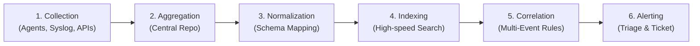

# Lab 11: SIEM Fundamentals — Architecture, Log Analysis & Web Attack Detection

> **Course:** Cybersecurity Operations (SOC Lab)  
> **Instructor:** Hussein Al-Selwi  
> **Total Slides:** 23 Slides  
> **Source Presentation:** `lab11_siem_fundamentals.html`  

### 📋 Overview
The central nervous system of the SOC: the 6-stage SIEM data lifecycle (Collection, Aggregation, Parsing, Indexing, Correlation, Alerting), web access log triage, and detecting live web attack signatures (SQLi, XSS, Command Injection).

---

## 📑 Table of Contents

- [Slide 01: Introduction](#slide-01-introduction)
- [Slide 02: Domain Objectives](#slide-02-domain-objectives)
- [Slide 03: What Is a SIEM?](#slide-03-what-is-a-siem)
- [Slide 04: SIEM Log Management](#slide-04-siem-log-management)
- [Slide 05: Step 1: Collection](#slide-05-step-1-collection)
- [Slide 06: Step 2: Aggregation](#slide-06-step-2-aggregation)
- [Slide 07: Step 3: Parsing & Normalization](#slide-07-step-3-parsing-normalization)
- [Slide 08: Step 4: Indexing](#slide-08-step-4-indexing)
- [Slide 09: Step 5: Correlation & Analysis](#slide-09-step-5-correlation-analysis)
- [Slide 10: Step 6: Alerting](#slide-10-step-6-alerting)
- [Slide 11: SIEM Components](#slide-11-siem-components)
- [Slide 12: SIEM Deployment Models](#slide-12-siem-deployment-models)
- [Slide 13: Log Types](#slide-13-log-types)
- [Slide 14: Web App Log Example](#slide-14-web-app-log-example)
- [Slide 15: User Behavior Signatures](#slide-15-user-behavior-signatures)
- [Slide 16: SQL Injection: What It Is](#slide-16-sql-injection-what-it-is)
- [Slide 17: SQL Injection: What To Look For](#slide-17-sql-injection-what-to-look-for)
- [Slide 18: SQL Injection: Encoded Payloads](#slide-18-sql-injection-encoded-payloads)
- [Slide 19: Cross-Site Scripting: What It Is](#slide-19-cross-site-scripting-what-it-is)
- [Slide 20: Cross-Site Scripting: What To Look For](#slide-20-cross-site-scripting-what-to-look-for)
- [Slide 21: Cross-Site Scripting: Examples](#slide-21-cross-site-scripting-examples)
- [Slide 22: Command Injection](#slide-22-command-injection)
- [Slide 23: Command Injection: Example](#slide-23-command-injection-example)

---

## Slide 01: Introduction

> **Category:** `INCIDENT DETECTION & RESPONSE`

### Security Information & Event Management

Bringing logs from across the organization into one place to detect, correlate, and respond to threats in real time.

Lab 11 – SIEM Fundamentals

> [!NOTE] 🎙️ **Instructor Lecture Notes**
> Welcome students to the SIEM domain. Frame it as the natural next step after endpoint and network monitoring: once you're collecting signals from everywhere, you need one place to bring it all together, correlate it, and act on it.

---

## Slide 02: Domain Objectives

> **Category:** `LECTURE OVERVIEW`

- Understand log management and SIEM deployment architecture
- Identify common attack signatures and patterns within log events
- Learn to manually parse , extract , and analyze logs from various sources
- Deploy, configure, and operate an enterprise-grade SIEM solution
- Install a log collection agent and work with real-time events

> [!NOTE] 🎙️ **Instructor Lecture Notes**
> Walk through each objective briefly. This lab moves from understanding SIEM architecture conceptually, to recognizing attack patterns in logs, to manually parsing logs by hand, and finally to deploying a real SIEM and working with live events.

---

## Slide 03: What Is a SIEM?

> **Category:** `INTRODUCTION`

Security Information and Event Management (SIEM) is a centralized platform that collects log data from across an organization, normalizes it into a consistent format, and correlates events to detect threats that wouldn't be visible from any single source alone — all displayed through a central dashboard analysts can monitor and act on.

> [!IMPORTANT]
> The heart of the SOC: its core job is converting raw, scattered events into insights an analyst can actually act on — every other tool feeds it, and analysts work from it.

Popular SIEM Platforms

Splunk IBM QRadar SolarWinds SEM Microsoft Sentinel

> [!NOTE] 🎙️ **Instructor Lecture Notes**
> Define SIEM plainly, then land the core idea: it's the heart of the SOC because it's the one place that takes raw, noisy events from every corner of the network and turns them into insights an analyst can actually act on. Then ground it with the real products students will hear about in the field.

---

## Slide 04: SIEM Log Management

> **Category:** `LOG MANAGEMENT`

### The SIEM Log Management Pipeline

Before a SIEM can detect anything, log data has to move through six stages — from raw collection all the way to an alert reaching an analyst.

- **Collection**: Gathering raw logs directly from the devices and events that matter.
- 1
- **Aggregation**: Bringing logs from every source into one centralized location.
- 2
- **Parsing & Normalization**: Converting different log formats into one consistent, shared structure.
- 3
- **Indexing**: Organizing normalized logs so they can be searched and retrieved quickly.
- 4
- **Correlation & Analysis**: Connecting related events to reveal patterns and possible threats.
- 5
- **Alerting**: Notifying analysts when a rule identifies something suspicious.
- 6

> [!NOTE] 🎙️ **Instructor Lecture Notes**
> Give students the big picture before diving into each stage individually. Emphasize that raw logs have to pass through all six stages before they become something an analyst can act on.

---

## Slide 05: Step 1: Collection

> **Category:** `LOG MANAGEMENT — STEP 1`

Collection is the first stage of log management — it's where the SIEM gathers raw log data directly from the source, before anything is combined or analyzed.

Which devices to collect from Servers, firewalls, endpoints, routers, and cloud services can all generate logs. The goal is to pick the devices that actually matter for security visibility — not just collect from everything. Which events to collect Not every event needs to be logged. Focus on events that matter for security, like logins, failed login attempts, file changes, and configuration changes.

Method of Collection

- **Agent**: A small piece of software is installed directly on the device. It reads the local logs and forwards them to the SIEM automatically.
- A
- **Agentless**: Used when an agent can't be installed on the device — like on a router. The SIEM pulls logs remotely instead, for example over Syslog, SNMP, or an API.
- B

> [!NOTE] 🎙️ **Instructor Lecture Notes**
> Explain that collection is about being deliberate: not every device and not every event needs to be logged. Then contrast agent vs agentless collection methods.

---

## Slide 06: Step 2: Aggregation

> **Category:** `LOG MANAGEMENT — STEP 2`

Aggregation takes the logs gathered from every different source and brings them together into one centralized location inside the SIEM.

> [!IMPORTANT]
> Why it matters: once the logs are combined, aggregation lines them up on a single, unified timeline — so events from a firewall, a server, and an endpoint can all be viewed in the order they actually happened, giving analysts one holistic view of the environment instead of scattered, disconnected pieces.

> [!NOTE] 🎙️ **Instructor Lecture Notes**
> Emphasize the two payoffs of aggregation: a single unified timeline across sources, and one holistic view of the environment instead of scattered logs.

---

## Slide 07: Step 3: Parsing & Normalization

> **Category:** `LOG MANAGEMENT — STEP 3`

Every device speaks its own "language" — a firewall log looks nothing like a Windows event log. Parsing and normalization take these inconsistent formats and convert them into one common schema.

> [!IMPORTANT]
> The goal is consistency: once every log shares the same structure — the same fields for timestamp, source IP, user, and action — the SIEM can read, compare, and correlate logs the same way, no matter where they came from.

Many SIEMs normalize logs into Common Event Format (CEF) — a standard schema built for exactly this purpose, so logs from completely different vendors can all be read the same way.

Example: Normalizing a Field

Firewall Log ip_source: 40.11.187.1 Proxy Log source_ip: 40.11.187.1 SIEM src_ip: 40.11.187.1

> [!NOTE] 🎙️ **Instructor Lecture Notes**
> Ground this with the idea that every device speaks its own log format, and normalization is what makes them all comparable in the same schema.

---

## Slide 08: Step 4: Indexing

> **Category:** `LOG MANAGEMENT — STEP 4`

Indexing is the process of converting normalized logs into something searchable, and grouping related events together so logs can be retrieved efficiently.

> [!IMPORTANT]
> Why it matters: without an index, finding one event would mean scanning through millions of raw logs one by one. Indexing organizes logs ahead of time so an analyst can search and pull up exactly what they need in seconds.

> [!NOTE] 🎙️ **Instructor Lecture Notes**
> Explain indexing as the step that makes normalized logs efficiently searchable, by organizing and grouping events rather than leaving them as a flat, unsorted pile.

---

## Slide 09: Step 5: Correlation & Analysis

> **Category:** `LOG MANAGEMENT — STEP 5`

Correlation links related logs together using correlation rules — on their own, individual events can look harmless, but linked together they can reveal an attack.

> [!IMPORTANT]
> Analysis is then performed on these correlated events using the rules to determine whether they represent real, meaningful activity.

- **Pattern Recognition**: Matching linked events against known attack patterns, like a login failure repeated across many accounts.
- ◈
- **Anomaly Detection**: Flagging activity that deviates from normal behavior, like a user logging in from an unusual location.
- △

> [!NOTE] 🎙️ **Instructor Lecture Notes**
> Explain correlation as linking related logs together using correlation rules, then explain that analysis is what happens with those linked events — pattern recognition and anomaly detection.

---

## Slide 10: Step 6: Alerting

> **Category:** `LOG MANAGEMENT — STEP 6`

Alerting is the final stage — once correlation and analysis identify something suspicious, the SIEM notifies analysts so they can respond quickly.

> [!IMPORTANT]
> Why it matters: alerts are usually prioritized by severity, so analysts know what to investigate first instead of getting buried under thousands of raw events with no clear starting point.

> [!NOTE] 🎙️ **Instructor Lecture Notes**
> Explain alerting as the final, action-facing stage: once analysis flags something meaningful, the SIEM notifies analysts so they can respond, typically prioritized by severity.

---

## Slide 11: SIEM Components

> **Category:** `SIEM ARCHITECTURE`

Every SIEM platform shares the same core components, though the details can differ slightly between vendors. We'll walk through Splunk's architecture, since it's the platform we'll be using in this lab.

collects → relay across the network search → alerts → Endpoint (Data Source) SOURCE Forwarder (Splunk UF) AGENT Indexer (Splunk) STORAGE Search Head (Dashboard) INTERFACE Analyst (SOC Team) USER

Endpoint — the device generating raw data. Forwarder — agent that sends data onward. Indexer — stores and organizes the data. Search Head — dashboard the user interacts with to search and run queries. Analyst — the person who investigates.

> [!NOTE] 🎙️ **Instructor Lecture Notes**
> Explain that every SIEM shares this core architecture, but the exact naming and boundaries between components can shift slightly from vendor to vendor. We'll use Splunk's terminology since that's the platform for this lab, and walk left to right through how data physically moves through the system.

---

## Slide 12: SIEM Deployment Models

> **Category:** `SIEM ARCHITECTURE`

A SIEM can be deployed in different ways depending on the size of the environment and how much redundancy is needed.

Indexer Search Head ONE MACHINE Single Instance All components — forwarding, indexing, and the search head — run on one machine . It's the simplest setup to deploy and manage, but there's no redundancy: if that machine goes down, the whole SIEM goes down with it.

Forwarder Indexer Search Head DEDICATED MACHINES Distributed Each component runs on its own dedicated machine . This spreads out the workload, so a heavy search doesn't slow down data collection, and each part can scale independently.

INDEXER CLUSTER SEARCH HEAD CLUSTER FAULT TOLERANT LOAD BALANCED Clustered Multiple indexers and search heads are grouped into clusters that replicate data across nodes. Load balancing spreads incoming traffic across the cluster, and fault tolerance means the SIEM keeps running even if one node fails.

> [!NOTE] 🎙️ **Instructor Lecture Notes**
> Walk through the three deployment models in order of increasing scale and complexity. Single instance is simplest but has no redundancy. Distributed splits the workload across dedicated machines. Clustered adds redundancy on top of that — emphasize load balancing (spreading queries/traffic across nodes) and fault tolerance (the system keeps running if a node fails).

---

## Slide 13: Log Types

> **Category:** `LOG SOURCES`

Logs come from many different layers of the environment. Knowing where a log comes from helps you understand what it can (and can't) tell you.

- **System Logs**: From the OS itself — host-level activity.
- **Network Logs**: Traffic moving across the network.
- **Application Logs**: From specific software's own activity.
- **Security Logs**: From dedicated security tooling.

> [!NOTE] 🎙️ **Instructor Lecture Notes**
> Walk through each category: System Logs come from the OS itself, Network Logs come from traffic crossing the network, Application Logs come from specific software, and Security Logs come from dedicated security tooling. For each sub-item, give a one-line example of what it captures and why it matters for detection.

---

## Slide 14: Web App Log Example

> **Category:** `LOG SOURCES · WORKED EXAMPLE`

Here's a real-world Application Log entry — a web server access log line.

200.96.104.241 - - [12/Sep/2023:09:44:28 -0300] "GET /modules.php?name=Downloads&&%20lid=-1%20UNION%20SELECT%200,username,user_id,user_password,name,%20user_email,user_level,0,0%20FROM%20admin_users HTTP/1.1" 200 9918 "-" "Mozilla/4.0"

This line follows the standard Common Log Format . Here's what each field represents:

- **200.96.104.241**: 200.96.104.241 — the client's source IP address [12/Sep/2023:09:44:28 -0300] — timestamp of the request "GET ... HTTP/1.1" — the request line: method, requested path with its parameters, and protocol version
- **200**: 200 — the HTTP status code returned by the server 9918 — size of the response, in bytes "-" "Mozilla/4.0" — the referrer (none here) and the client's user agent

> [!IMPORTANT]
> Over to you: look closely at the request path and its parameters. What do you notice, and why might this line be worth an analyst's attention?

> [!NOTE] 🎙️ **Instructor Lecture Notes**
> Walk through a real Apache/NGINX access-log line as a worked example of an Application Log. Point out the anatomy of the line first (client IP, timestamp, request, status, size, user agent), then zoom into the request field itself, which contains a SQL injection attempt against the modules.php endpoint. Explain why a SIEM analyst reading raw web server logs would flag this: it's a UNION SELECT trying to pull username/password columns out of an admin_users table by riding along on a 'name' parameter.

---

## Slide 15: User Behavior Signatures

> **Category:** `COMMON ATTACK SIGNATURES`

### User Behavior

Attacks often leave a trace in how a user (or account) behaves. These are the patterns a SIEM watches for first.

- **Multiple Failed Login Attempts**: Repeated attempts with an incorrect username or password A sudden spike in failures from a single user account A spike in failures spread across multiple user accounts at once
- **Login Times**: Logons or access requests happening at unusual times of day Activity that deviates from a user's established baseline
- **Login / Access Locations**: The geographic origin of logons or access requests Access originating from unexpected countries or regions Impossible travel — logons from two distant locations too close together in time to be the same person
- **File Access Patterns**: Access to sensitive or restricted files outside a user's normal scope A sudden spike in file reads, downloads, or modifications Mass file renames, deletions, or encryption — a possible sign of ransomware File access happening at unusual times or from unfamiliar devices

> [!NOTE] 🎙️ **Instructor Lecture Notes**
> Introduce this as the first category of common attack signatures: patterns in user behavior. Walk through the four groups — failed logins, login timing, login location, and file access — and for each, explain what a SIEM would be watching for and why it matters. Multiple failed logins can indicate password guessing or brute-forcing; unusual login times can indicate a compromised account being used outside someone's normal working hours; location anomalies, especially impossible travel, are a strong signal that a credential is being used from two places at once; and abnormal file access — especially mass renames, deletions, or encryption — can indicate data theft or ransomware in progress.

---

## Slide 16: SQL Injection: What It Is

> **Category:** `COMMON ATTACK SIGNATURES`

### SQL Injection

Inserting or injecting malicious SQL statements to manipulate a database query the application expects to run in a fixed, harmless form.

> [!IMPORTANT]
> The goal is to manipulate expected database queries — bending a query the developer wrote into one the attacker wrote.

A successful injection can let an attacker:

- **Retrieve sensitive information**: 
- **Extract hashed passwords**: 
- **Bypass authentication logic**: 

> [!NOTE] 🎙️ **Instructor Lecture Notes**
> Define SQL injection before showing detection signatures. It's the act of inserting or injecting malicious SQL statements into an input field to manipulate the query the application expects to run. Walk through what an attacker is typically after: pulling out sensitive information, extracting hashed passwords they can crack offline, or bypassing the login/authentication logic entirely.

---

## Slide 17: SQL Injection: What To Look For

> **Category:** `COMMON ATTACK SIGNATURES`

### Spotting It In Logs

Two things give SQL injection away in raw logs: the keywords, and the characters used to break out of a query.

- **Look for SQL Keywords**: SELECT, FROM, WHERE, UNION
- **Look for Injection Characters**: Single/double quotes, semicolons, comment indicators (dashes)

> [!NOTE] 🎙️ **Instructor Lecture Notes**
> Now cover the signatures analysts scan for in logs: SQL keywords (SELECT, FROM, WHERE, UNION) appearing where they shouldn't, and injection characters — single/double quotes, semicolons, and comment indicators like double dashes — that let an attacker break out of the intended query.

---

## Slide 18: SQL Injection: Encoded Payloads

> **Category:** `COMMON ATTACK SIGNATURES`

### URL-Encoded Payloads

Keywords and injection characters are often URL-encoded to slip past basic filters — so it pays to recognize the encoded forms too.

| Character | Normal | URL-Encoded |
| --- | --- | --- |
| Single Quote | ' | %27 |
| Double Quote | " | %22 |
| Space | %20 |
| Semicolon | ; | %3B |
| Dash | - | %2D |

Decoding an example

"GET /index.php?id=1 %20 OR %20 1=1; -- SELECT * FROM users WHERE id = 1; SELECT * FROM users WHERE id = 1 OR 1=1; --

> [!NOTE] 🎙️ **Instructor Lecture Notes**
> Attackers often URL-encode keywords and injection characters to slip past basic filters, so analysts need to recognize the encoded forms too. Walk through the table, then decode the example log line together: %20 is a space and OR%201=1 decodes to OR 1=1, turning a query that should return one row into one that returns every row in the table.

---

## Slide 19: Cross-Site Scripting: What It Is

> **Category:** `COMMON ATTACK SIGNATURES`

### Cross-Site Scripting

Executing malicious code by injecting JavaScript into a page so it runs in another user's browser.

A successful injection can let an attacker:

- **Hijack user sessions**: 
- **Steal cookies**: 
- **Deface websites**: 

> [!NOTE] 🎙️ **Instructor Lecture Notes**
> Define XSS before showing detection signatures. It's executing malicious code by injecting JavaScript into a page that other users will load. Walk through what an attacker is typically after: hijacking a victim's session, stealing their cookies, or defacing the site they've injected into.

---

## Slide 20: Cross-Site Scripting: What To Look For

> **Category:** `COMMON ATTACK SIGNATURES`

### Spotting It In Logs

XSS relies on a handful of recurring building blocks — tags, handlers, and the characters that assemble them.

- **Look for  HTTP/1.1" 200 2326 "-" "Mozilla/5.0 (Windows NT 10.0; Win64; x64) AppleWebKit/537.36 (KHTML, like Gecko) Chrome/91.0.4472.124 Safari/537.36"

URL-encoded payload

192.168.1.101 - - [15/Jul/2024:14:56:45 +0000] "GET /profile?name= %3Cimg%20src%3Dx%20onerror%3Dalert('XSS')%3E HTTP/1.1" 200 2326 "-" "Mozilla/5.0 (Windows NT 10.0; Win64; x64) AppleWebKit/537.36 (KHTML, like Gecko) Chrome/91.0.4472.124 Safari/537.36"

> [!NOTE] 🎙️ **Instructor Lecture Notes**
> Walk through two real access-log lines. The first carries a plain <script> tag directly in the query string. The second is URL-encoded — %3C is <, %20 is space, %3D is =, %3E is > — so students should decode it the same way they decoded the SQL injection example: an  tag with a broken src attribute whose onerror handler fires JavaScript when the image fails to load.

---

## Slide 22: Command Injection

> **Category:** `COMMON ATTACK SIGNATURES`

Executing arbitrary OS commands by injecting them into an input that gets passed through to the underlying shell.

- **Look for Special Characters That Separate Commands**: ; , || , &&
- **Look for References to Commands or Utilities**: ls, echo, bash, cat, cd, cmd.exe, curl, wget ping, sudo, chmod, rm, nc, nc.exe, sh

> [!NOTE] 🎙️ **Instructor Lecture Notes**
> Define command injection: executing arbitrary OS commands by injecting them into an application input that gets passed to a shell. Then cover the two things that give it away in logs: the special characters used to chain or separate commands (semicolon, double pipe, double ampersand), and references to common commands or utilities that a normal web request would have no reason to contain.

---

## Slide 23: Command Injection: Example

> **Category:** `COMMON ATTACK SIGNATURES`

### Example in Logs

A real access-log line carrying a command injection payload.

192.168.1.103 - - [15/Jul/2024:15:30:00 +0000] "GET /execute? cmd=ls;cat%20/etc/passwd HTTP/1.1" 200 4123 "-" "Mozilla/5.0 (Windows NT 10.0; Win64; x64) AppleWebKit/537.36 (KHTML, like Gecko) Chrome/91.0.4472.124 Safari/537.36"

> [!NOTE] 🎙️ **Instructor Lecture Notes**
> Walk through the example log line. The cmd parameter carries two commands chained with a semicolon: 'ls' and 'cat /etc/passwd' (the %20 decodes to a space). Reading /etc/passwd is a classic post-exploitation step on Linux systems — it's not sensitive by permissions, but it confirms command execution and gives the attacker a list of valid usernames to target next.

---

## 🎯 Summary & Key Takeaways

- **Module:** Lab 11: SIEM Fundamentals — Architecture, Log Analysis & Web Attack Detection

- **Core Competencies Developed:** Hands-on triage, log analysis, threat hunting, and defensive incident response.

- **Course Reference:** Cybersecurity Operations Practical Labs by **Hussein Al-Selwi**.
