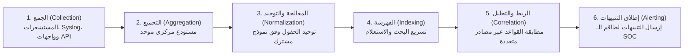

# المعمل 11: أساسيات أنظمة الـ SIEM - المعمارية، إدارة السجلات، وكشف هجمات الويب الحقيقية

> **المقرر:** عمليات الأمن السيبراني (مختبر الـ SOC - Cybersecurity Operations)  
> **المحاضر:** Hussein Al-Selwi  
> **إجمالي عدد الشرائح:** 23 شريحة  
> **العرض التقديمي المصدري:** `lab11_siem_fundamentals_AR.html`  

### 📋 نبذة عامة وأهداف الوحدة التدريبية
الجهاز العصبي المركزي لمركز العمليات (SOC): المراحل الست لدورة حياة السجلات (الجمع، التجميع، المعالجة والتوحيد، الفهرسة، الربط والتحليل، وإطلاق التنبيهات)، تحليل سجلات خوادم الويب، وكشف تواقيع الهجمات الشائعة (حقن الـ SQLi، الهجمات عبر المواقع XSS، وحقن أوامر النظام Command Injection).

---

## 📑 جدول المحتويات

- [الشريحة 01: المقدمة](#slide-01-المقدمة)
- [الشريحة 02: أهداف المعمل](#slide-02-أهداف-المعمل)
- [الشريحة 03: ما هو نظام SIEM؟](#slide-03-ما-هو-نظام-siem؟)
- [الشريحة 04: مسار معالجة السجلات في الـ SIEM](#slide-04-مسار-معالجة-السجلات-في-الـ-siem)
- [الشريحة 05: المرحلة 1: الجمع (Collection)](#slide-05-المرحلة-1-الجمع-collection)
- [الشريحة 06: المرحلة 2: التجميع المركزي (Aggregation)](#slide-06-المرحلة-2-التجميع-المركزي-aggregation)
- [الشريحة 07: Step 3: Parsing & Normalization](#slide-07-step-3-parsing-normalization)
- [الشريحة 08: المرحلة 4: الفهرسة (Indexing)](#slide-08-المرحلة-4-الفهرسة-indexing)
- [الشريحة 09: Step 5: Correlation & Analysis](#slide-09-step-5-correlation-analysis)
- [الشريحة 10: المرحلة 6: التنبيه (Alerting)](#slide-10-المرحلة-6-التنبيه-alerting)
- [الشريحة 11: مكونات معمارية نظام الـ SIEM](#slide-11-مكونات-معمارية-نظام-الـ-siem)
- [الشريحة 12: نماذج نشر وتثبيت أنظمة الـ SIEM](#slide-12-نماذج-نشر-وتثبيت-أنظمة-الـ-siem)
- [الشريحة 13: أنواع وتصنيفات سجلات الأحداث](#slide-13-أنواع-وتصنيفات-سجلات-الأحداث)
- [الشريحة 14: تشريح سجل خادم الويب (Web Log)](#slide-14-تشريح-سجل-خادم-الويب-web-log)
- [الشريحة 15: بصمات سلوك المستخدمين وهجمات التخمين](#slide-15-بصمات-سلوك-المستخدمين-وهجمات-التخمين)
- [الشريحة 16: ما هي هجمات حقن قواعد البيانات (SQLi)؟](#slide-16-ما-هي-هجمات-حقن-قواعد-البيانات-sqli-؟)
- [الشريحة 17: كيف تكتشف هجمات SQLi في السجلات؟](#slide-17-كيف-تكتشف-هجمات-sqli-في-السجلات؟)
- [الشريحة 18: الحمولات المشفرة بـ URL Encoding](#slide-18-الحمولات-المشفرة-بـ-url-encoding)
- [الشريحة 19: ما هي هجمات Cross-Site Scripting (XSS)؟](#slide-19-ما-هي-هجمات-cross-site-scripting-xss-؟)
- [الشريحة 20: كيف تكتشف هجمات XSS في السجلات؟](#slide-20-كيف-تكتشف-هجمات-xss-في-السجلات؟)
- [الشريحة 21: أمثلة حية لهجمات XSS في السجلات](#slide-21-أمثلة-حية-لهجمات-xss-في-السجلات)
- [الشريحة 22: ما هي هجمات حقن أوامر نظام التشغيل (Command Injection)؟](#slide-22-ما-هي-هجمات-حقن-أوامر-نظام-التشغيل-command-injection-؟)
- [الشريحة 23: حقن أوامر نظام التشغيل (Command Injection): Example](#slide-23-حقن-أوامر-نظام-التشغيل-command-injection-example)

---

## الشريحة 01: المقدمة

> **التصنيف / الفئة:** `كشف التهديدات والاستجابة للحوادث · IDR`

### Security Information & Event Management

تجميع سجلات الأحداث من كافة أرجاء المؤسسة في منصة مركزية موحدة لكشف التهديدات وربطها والاستجابة لها في الوقت الفعلي.

المعمل 11 – أساسيات أنظمة SIEM وتحليل السجلات

> [!NOTE] 🎙️ **ملاحظات وتوجيهات المحاضر (Instructor Lecture Notes)**
> رحب بالطلاب في محور أنظمة SIEM. مهّد للموضوع بأنه الخطوة المنطقية الكبرى بعد مراقبة الأجهزة والشبكة: فبمجرد جمع الإشارات والأحداث من كل مكان، تحتاج إلى منصة مركزية موحدة تجمع كل شيء وتربط الأحداث ببعضها وتتيح اتخاذ إجراءات فورية.

---

## الشريحة 02: أهداف المعمل

> **التصنيف / الفئة:** `نظرة عامة على المعمل`

### الأهداف التعليمية للمعمل

- Understand log management and SIEM deployment architecture
- Identify common attack signatures and patterns within log events
- Learn to manually parse , extract , and analyze logs from various sources
- Deploy, configure, and operate an enterprise-grade SIEM solution
- Install a log collection agent and work with real-time events

> [!NOTE] 🎙️ **ملاحظات وتوجيهات المحاضر (Instructor Lecture Notes)**
> استعرض أهداف المعمل بإيجاز. يتدرج هذا المعمل من فهم معمارية أنظمة SIEM نظرياً، إلى التعرف على أنماط الهجمات الشائعة في السجلات، ثم تحليل السجلات يدوياً، وأخيراً التفاعل مع أنظمة SIEM والأحداث المباشرة.

---

## الشريحة 03: ما هو نظام SIEM؟

> **التصنيف / الفئة:** `INTRODUCTION`

### ما هو نظام الـ SIEM؟

Security Information and Event Management (SIEM) is a centralized platform that collects log data from across an organization, normalizes it into a consistent format, and correlates events to detect threats that wouldn't be visible from any single source alone — all displayed through a central dashboard analysts can monitor and act on.

> [!IMPORTANT]
> قلب مركز عمليات الأمن (SOC): its core job is converting raw, scattered events into insights an analyst can actually act on — every other tool feeds it, and analysts work from it.

أشهر منصات الـ SIEM في سوق العمل:

Splunk IBM QRadar SolarWinds SEM Microsoft Sentinel

> [!NOTE] 🎙️ **ملاحظات وتوجيهات المحاضر (Instructor Lecture Notes)**
> عرّف الـ SIEM بوضوح، ورسخ الفكرة الجوهرية: إنه قلب مركز العمليات (SOC) لأنه المكان الوحيد الذي يحول ملايين الأحداث الصاخبة من كل زاوية في الشبكة إلى رؤى أمنية واضحة للمحلل. ثم اذكر أشهر المنتجات العالمية في السوق.

---

## الشريحة 04: مسار معالجة السجلات في الـ SIEM

> **التصنيف / الفئة:** `LOG MANAGEMENT`

### المراحل الست لإدارة ومعالجة السجلات في الـ SIEM

قبل أن يتمكن نظام الـ SIEM من كشف أي تهديد، يجب أن تمر بيانات السجلات عبر 6 مراحل متتالية — من الجمع الأولي وحتى وصول التنبيه للمحلل:

- **Collection**: جمع السجلات الأولية مباشرة من الأجهزة والأحداث الأمنية الهامة.
- 1
- **Aggregation**: تجميع السجلات من كافة المصادر المتفرقة في موقع مركزي موحد.
- 2
- **Parsing & Normalization**: تحويل صيغ السجلات المختلفة إلى هيكل وقالب حقول موحد ومشترك.
- 3
- **Indexing**: فهرسة وتنظيم السجلات لتسريع عمليات البحث والاسترجاع اللحظي.
- 4
- **Correlation & Analysis**: ربط الأحداث المتفرقة ببعضها لكشف الأنماط المعقدة والهجمات.
- 5
- **Alerting**: إشعار محللي الـ SOC فور رصد سلوك مشبوه بواسطة قواعد الكشف.
- 6

> [!NOTE] 🎙️ **ملاحظات وتوجيهات المحاضر (Instructor Lecture Notes)**
> أعط الطلاب الصورة الشاملة لمسار معالجة السجلات قبل التفصيل في كل مرحلة. أكد أن السجلات الخام يجب أن تعبر المراحل الست كاملة لتتحول من مجرد نصوص إلى تنبيه أمني دقيق يتعامل معه المحلل.

---

## الشريحة 05: المرحلة 1: الجمع (Collection)

> **التصنيف / الفئة:** `LOG MANAGEMENT — STEP 1`

Collection is the first stage of log management — it's where the SIEM gathers raw log data directly from the source, before anything is combined or analyzed.

Which devices to collect from الخوادم، جدران الحماية، محطات العمل، والموجهات، والخدمات السحابية. الهدف هو اختيار الأجهزة التي تحقق الرؤية الأمنية دون استهلاك عشوائي. Which events to collect التركيز على الأحداث الحرجة أمنياً: تسجيل الدخول، المحاولات الفاشلة، تعديلات الصلاحيات، تغيير الملفات الحساسة، والتعديلات الإدارية.

طرق جمع السجلات

- **Agent**: برمجية خفيفة تُثبت مباشرة على الجهاز، تقرأ السجلات المحلية وترسلها تلقائياً للـ SIEM.
- A
- **بدون عميل (Agentless)**: يستخدم عندما يتعذر تثبيت برنامج (مثل الموجهات وأجهزة الشبكة). يسحب الـ SIEM السجلات عن بُعد عبر بروتوكولات مثل Syslog أو SNMP أو APIs.
- B

> [!NOTE] 🎙️ **ملاحظات وتوجيهات المحاضر (Instructor Lecture Notes)**
> اشرح أن جمع السجلات يتطلب تخطيطاً ذكياً: فليس كل جهاز وكل حدث يستحق الجمع والتخزين لتجنب التكلفة والضوضاء. ثم قارن بين طريقتي الجمع: عبر تثبيت العميل (Agent) أو الجمع بدون عميل (بدون عميل (Agentless)) عبر البروتوكولات.

---

## الشريحة 06: المرحلة 2: التجميع المركزي (Aggregation)

> **التصنيف / الفئة:** `LOG MANAGEMENT — STEP 2`

Aggregation takes the logs gathered from every different source and brings them together into one centralized location inside the SIEM.

> [!IMPORTANT]
> أهمية التجميع المركزي: once the logs are combined, aggregation lines them up on a single, unified timeline — so events from a firewall, a server, and an endpoint can all be viewed in the order they actually happened, giving analysts one holistic view of the environment instead of scattered, disconnected pieces.

> [!NOTE] 🎙️ **ملاحظات وتوجيهات المحاضر (Instructor Lecture Notes)**
> أكد على فائدتي التجميع المركزي (Aggregation): الحصول على خط زمني موحد (خط زمني أمني موحد (Unified Timeline)) يربط أحداث الشبكة بالأجهزة بالسيرفرات، وتوفير رؤية شاملة واحدة للبيئة بدلاً من تشتت السجلات في خوادم منفصلة.

---

## الشريحة 07: Step 3: Parsing & Normalization

> **التصنيف / الفئة:** `LOG MANAGEMENT — STEP 3`

### المرحلة 3: التحليل وتوحيد البنية (Normalization)

Every device speaks its own "language" — a firewall log looks nothing like a Windows event log. Parsing and normalization take these inconsistent formats and convert them into one common schema.

> [!IMPORTANT]
> الهدف هو توحيد المعايير: once every log shares the same structure — the same fields for timestamp, source IP, user, and action — the SIEM can read, compare, and correlate logs the same way, no matter where they came from.

Many SIEMs normalize logs into Common Event Format (CEF) — a standard schema built for exactly this purpose, so logs from completely different vendors can all be read the same way.

مثال عملي: توحيد تسمية حقل عنوان IP المصدر:

Firewall Log ip_source: 40.11.187.1 Proxy Log source_ip: 40.11.187.1 SIEM src_ip: 40.11.187.1

> [!NOTE] 🎙️ **ملاحظات وتوجيهات المحاضر (Instructor Lecture Notes)**
> رسخ فكرة أن كل جهاز ونظام تشغيل يكتب السجلات بصيغته الخاصة، وعملية التحليل وتوحيد البنية (Parsing & Normalization) هي المترجم الذي يحول كل هذه الصيغ المختلفة إلى حقول موحدة (مثل src_ip و dst_ip) في مخطط قياسي مثل CEF.

---

## الشريحة 08: المرحلة 4: الفهرسة (Indexing)

> **التصنيف / الفئة:** `LOG MANAGEMENT — STEP 4`

Indexing is the process of converting normalized logs into something searchable, and grouping related events together so logs can be retrieved efficiently.

> [!IMPORTANT]
> أهمية التجميع المركزي: without an index, finding one event would mean scanning through millions of raw logs one by one. Indexing organizes logs ahead of time so an analyst can search and pull up exactly what they need in seconds.

> [!NOTE] 🎙️ **ملاحظات وتوجيهات المحاضر (Instructor Lecture Notes)**
> اشرح الفهرسة (Indexing) كالمرحلة التي تجعل السجلات الموحدة قابلة للبحث فائق السرعة، تماماً كفهرس الكتب الضخمة، حيث تصنف الأحداث حسب الوقت والمصدر والنوع بدلاً من مسح ملايين السطور عشوائياً.

---

## الشريحة 09: Step 5: Correlation & Analysis

> **التصنيف / الفئة:** `LOG MANAGEMENT — STEP 5`

### المرحلة 5: الارتباط والتحليل (Correlation)

Correlation links related logs together using correlation rules — on their own, individual events can look harmless, but linked together they can reveal an attack.

> [!IMPORTANT]
> Analysis is then performed on these correlated events using the rules to determine whether they represent real, meaningful activity.

- **التعرف على الأنماط (Pattern Recognition)**: Matching linked events against known attack patterns, like a login failure repeated across many accounts.
- ◈
- **كشف السلوكيات الشاذة (Anomaly Detection)**: Flagging activity that deviates from normal behavior, like a user logging in from an unusual location.
- △

> [!NOTE] 🎙️ **ملاحظات وتوجيهات المحاضر (Instructor Lecture Notes)**
> اشرح الارتباط الأمني (Correlation) كربط السجلات المتعلقة ببعضها عبر قواعد ذكية (قواعد الارتباط (Correlation Rules))، ثم وضح أن التحليل (Analysis) هو التعرف على الأنماط المشبوهة والسلوكيات الشاذة الناتجة عن هذا الربط.

---

## الشريحة 10: المرحلة 6: التنبيه (Alerting)

> **التصنيف / الفئة:** `LOG MANAGEMENT — STEP 6`

Alerting is the final stage — once correlation and analysis identify something suspicious, the SIEM notifies analysts so they can respond quickly.

> [!IMPORTANT]
> أهمية التجميع المركزي: alerts are usually prioritized by severity, so analysts know what to investigate first instead of getting buried under thousands of raw events with no clear starting point.

> [!NOTE] 🎙️ **ملاحظات وتوجيهات المحاضر (Instructor Lecture Notes)**
> Explain alerting as the final, action-facing stage: once analysis flags something meaningful, the SIEM notifies analysts so they can respond, typically prioritized by severity.

---

## الشريحة 11: مكونات معمارية نظام الـ SIEM

> **التصنيف / الفئة:** `SIEM المكونات الهندسية`

### المكونات الأساسية لنظام الـ SIEM

Every SIEM platform shares the same core components, though the details can differ slightly between vendors. We'll walk through Splunk's architecture, since it's the platform we'll be using in this lab.

collects → relay across the network search → alerts → Endpoint (Data Source) SOURCE Forwarder (Splunk UF) AGENT Indexer (Splunk) STORAGE Search Head (Dashboard) INTERFACE Analyst (SOC Team) USER

Endpoint — the device generating raw data. Forwarder — agent that sends data onward. Indexer — stores and organizes the data. Search Head — dashboard the user interacts with to search and run queries. Analyst — the person who investigates.

> [!NOTE] 🎙️ **ملاحظات وتوجيهات المحاضر (Instructor Lecture Notes)**
> Explain that every SIEM shares this core architecture, but the exact naming and boundaries between components can shift slightly from vendor to vendor. We'll use Splunk's terminology since that's the platform for this lab, and walk left to right through how data physically moves through the system.

---

## الشريحة 12: نماذج نشر وتثبيت أنظمة الـ SIEM

> **التصنيف / الفئة:** `SIEM المكونات الهندسية`

A SIEM can be deployed in different ways depending on the size of the environment and how much redundancy is needed.

Indexer Search Head ONE MACHINE Single Instance All components — forwarding, indexing, and the search head — run on one machine . It's the simplest setup to deploy and manage, but there's no redundancy: if that machine goes down, the whole SIEM goes down with it.

Forwarder Indexer Search Head DEDICATED MACHINES Distributed Each component runs on its own dedicated machine . This spreads out the workload, so a heavy search doesn't slow down data collection, and each part can scale independently.

INDEXER CLUSTER SEARCH HEAD CLUSTER FAULT TOLERANT LOAD BALANCED Clustered Multiple indexers and search heads are grouped into clusters that replicate data across nodes. Load balancing spreads incoming traffic across the cluster, and fault tolerance means the SIEM keeps running even if one node fails.

> [!NOTE] 🎙️ **ملاحظات وتوجيهات المحاضر (Instructor Lecture Notes)**
> Walk through the three deployment models in order of increasing scale and complexity. Single instance is simplest but has no redundancy. Distributed splits the workload across dedicated machines. Clustered adds redundancy on top of that — emphasize load balancing (spreading queries/traffic across nodes) and fault tolerance (the system keeps running if a node fails).

---

## الشريحة 13: أنواع وتصنيفات سجلات الأحداث

> **التصنيف / الفئة:** `مصادر السجلات`

### Log Types

Logs come from many different layers of the environment. Knowing where a log comes from helps you understand what it can (and can't) tell you.

- **System Logs**: From the OS itself — host-level activity.
- **سجلات الشبكة (Network Logs)**: Traffic moving across the network.
- **سجلات التطبيقات (Application Logs)**: From specific software's own activity.
- **Security Logs**: From dedicated security tooling.

> [!NOTE] 🎙️ **ملاحظات وتوجيهات المحاضر (Instructor Lecture Notes)**
> Walk through each category: System Logs come from the OS itself, سجلات الشبكة (Network Logs) come from traffic crossing the network, سجلات التطبيقات (Application Logs) come from specific software, and Security Logs come from dedicated security tooling. For each sub-item, give a one-line example of what it captures and why it matters for detection.

---

## الشريحة 14: تشريح سجل خادم الويب (Web Log)

> **التصنيف / الفئة:** `مصادر السجلات · WORKED EXAMPLE`

### تشريح سطر سجل حقيقي لخادم ويب (Apache Log)

Here's a real-world Application Log entry — a web server access log line.

200.96.104.241 - - [12/Sep/2023:09:44:28 -0300] "GET /modules.php?name=Downloads&&%20lid=-1%20UNION%20SELECT%200,username,user_id,user_password,name,%20user_email,user_level,0,0%20FROM%20admin_users HTTP/1.1" 200 9918 "-" "Mozilla/4.0"

This line follows the standard Common Log Format . Here's what each field represents:

- **200.96.104.241**: 200.96.104.241 — the client's source IP address [12/Sep/2023:09:44:28 -0300] — timestamp of the request "GET ... HTTP/1.1" — the request line: method, requested path with its parameters, and protocol version
- **200**: 200 — the HTTP status code returned by the server 9918 — size of the response, in bytes "-" "Mozilla/4.0" — the referrer (none here) and the client's user agent

> [!IMPORTANT]
> Over to you: look closely at the request path and its parameters. What do you notice, and why might this line be worth an analyst's attention?

> [!NOTE] 🎙️ **ملاحظات وتوجيهات المحاضر (Instructor Lecture Notes)**
> Walk through a real Apache/NGINX access-log line as a worked example of an Application Log. Point out the anatomy of the line first (client IP, timestamp, request, status, size, user agent), then zoom into the request field itself, which contains a SQL injection attempt against the modules.php endpoint. Explain why a SIEM analyst reading raw web server logs would flag this: it's a UNION SELECT trying to pull username/password columns out of an admin_users table by riding along on a 'name' parameter.

---

## الشريحة 15: بصمات سلوك المستخدمين وهجمات التخمين

> **التصنيف / الفئة:** `COMMON بصمات الهجمات`

### User Behavior

Attacks often leave a trace in how a user (or account) behaves. These are the patterns a SIEM watches for first.

- **Multiple Failed Login Attempts**: Repeated attempts with an incorrect username or password A sudden spike in failures from a single user account A spike in failures spread across multiple user accounts at once
- **Login Times**: Logons or access requests happening at unusual times of day Activity that deviates from a user's established baseline
- **Login / Access Locations**: The geographic origin of logons or access requests Access originating from unexpected countries or regions Impossible travel — logons from two distant locations too close together in time to be the same person
- **File Access Patterns**: Access to sensitive or restricted files outside a user's normal scope A sudden spike in file reads, downloads, or modifications Mass file renames, deletions, or encryption — a possible sign of ransomware File access happening at unusual times or from unfamiliar devices

> [!NOTE] 🎙️ **ملاحظات وتوجيهات المحاضر (Instructor Lecture Notes)**
> Introduce this as the first category of common attack signatures: patterns in user behavior. Walk through the four groups — failed logins, login timing, login location, and file access — and for each, explain what a SIEM would be watching for and why it matters. Multiple failed logins can indicate password guessing or brute-forcing; unusual login times can indicate a compromised account being used outside someone's normal working hours; location anomalies, especially impossible travel, are a strong signal that a credential is being used from two places at once; and abnormal file access — especially mass renames, deletions, or encryption — can indicate data theft or ransomware in progress.

---

## الشريحة 16: ما هي هجمات حقن قواعد البيانات (SQLi)؟

> **التصنيف / الفئة:** `COMMON بصمات الهجمات`

### SQL Injection

Inserting or injecting malicious SQL statements to manipulate a database query the application expects to run in a fixed, harmless form.

> [!IMPORTANT]
> The goal is to manipulate expected database queries — bending a query the developer wrote into one the attacker wrote.

A successful injection can let an attacker:

- **استرجاع وسرقة البيانات الحساسة والسرية**: 
- **استخراج هاشات كلمات مرور المستخدمين**: 
- **تجاوز شاشات تسجيل الدخول والتحقق**: 

> [!NOTE] 🎙️ **ملاحظات وتوجيهات المحاضر (Instructor Lecture Notes)**
> Define SQL injection before showing detection signatures. It's the act of inserting or injecting malicious SQL statements into an input field to manipulate the query the application expects to run. Walk through what an attacker is typically after: pulling out sensitive information, extracting hashed passwords they can crack offline, or bypassing the login/authentication logic entirely.

---

## الشريحة 17: كيف تكتشف هجمات SQLi في السجلات؟

> **التصنيف / الفئة:** `COMMON بصمات الهجمات`

### كيف تكتشف هجمات SQL Injection في السجلات؟

يكشف أمران رئيسيان عن هجمات SQL Injection في السجلات الخام: الكلمات المفتاحية، والرموز المستخدمة لكسر سياق الاستعلام:

- **1. ابحث عن كلمات SQL المفتاحية**: SELECT, FROM, WHERE, UNION
- **2. ابحث عن رموز الحقن وكسر الاستعلام**: الفواصل (', ")، الفاصلة المنقوطة (;)، ورموز التعليق (--) لإلغاء باقي الاستعلام

> [!NOTE] 🎙️ **ملاحظات وتوجيهات المحاضر (Instructor Lecture Notes)**
> اشرح البصمات التي يبحث عنها المحلل في السجلات: كلمات SQL المفتاحية (SELECT, FROM, WHERE, UNION) في مسارات الويب، والرموز الخاصة كالفواصل الفردية والمزدوجة والفاصلة المنقوطة ورموز التعليق (--) لكسر الاستعلام.

---

## الشريحة 18: الحمولات المشفرة بـ URL Encoding

> **التصنيف / الفئة:** `COMMON بصمات الهجمات`

### التعامل مع الحمولات المشفرة بـ (URL Encoding)

Keywords and injection characters are often URL-encoded to slip past basic filters — so it pays to recognize the encoded forms too.

| الرمز العادي | Normal | URL-Encoded |
| --- | --- | --- |
| Single Quote | ' | %27 |
| Double Quote | " | %22 |
| المسافة (Space) | %20 |
| الفاصلة المنقوطة (;) | ; | %3B |
| Dash | - | %2D |

تفكيك وقراءة مثال واقعي من السجلات:

"GET /index.php?id=1 %20 OR %20 1=1; -- SELECT * FROM users WHERE id = 1; SELECT * FROM users WHERE id = 1 OR 1=1; --

> [!NOTE] 🎙️ **ملاحظات وتوجيهات المحاضر (Instructor Lecture Notes)**
> غالباً ما يشفر المهاجمون الكلمات والرموز بصيغة URL Encoding لتجاوز فلاتر الحماية، ولذلك يجب على المحلل معرفة الرموز المشفرة. وضح جدول التشفير، ثم فك تشفير سطر السجل مع الطلاب: %20 تعني مسافة، و %27 تعني فاصلة عليا، مما يحول الاستعلام لشرط صحيح دائماً.

---

## الشريحة 19: ما هي هجمات Cross-Site Scripting (XSS)؟

> **التصنيف / الفئة:** `COMMON بصمات الهجمات`

### Cross-Site Scripting

تنفيذ أكواد خبيثة عبر حقن لغة JavaScript: into a page so it runs in another user's browser.

A successful injection can let an attacker:

- **اختطاف جلسات المستخدمين (Session Hijacking)**: 
- **سرقة ملفات تعريف الارتباط (Steal Cookies)**: 
- **تشويه واجهات المواقع وتغيير المحتوى**: 

> [!NOTE] 🎙️ **ملاحظات وتوجيهات المحاضر (Instructor Lecture Notes)**
> عرّف هجمات XSS: تنفيذ أكواد جافاسكربت خبيثة في متصفح الضحية عبر حقنها في صفحات يزورها المستخدمون. استعرض أهداف المهاجم: سرقة ملفات تعريف الارتباط (Cookies)، اختطاف الجلسات (Session Hijacking)، وتشويه واجهات المواقع.

---

## الشريحة 20: كيف تكتشف هجمات XSS في السجلات؟

> **التصنيف / الفئة:** `COMMON بصمات الهجمات`

### كيف تكتشف هجمات SQL Injection في السجلات؟

تعتمد هجمات XSS على مجموعة من اللبنات المتكررة — الوسوم البرمجية، محفزات الأحداث، والرموز الخاصة:

- **1. ابحث عن وسوم السكربت ( HTTP/1.1" 200 2326 "-" "Mozilla/5.0 (Windows NT 10.0; Win64; x64) AppleWebKit/537.36 (KHTML, like Gecko) Chrome/91.0.4472.124 Safari/537.36"

2. حمولة مشفرة تستغل حدث onerror:

192.168.1.101 - - [15/Jul/2024:14:56:45 +0000] "GET /profile?name= %3Cimg%20src%3Dx%20onerror%3Dalert('XSS')%3E HTTP/1.1" 200 2326 "-" "Mozilla/5.0 (Windows NT 10.0; Win64; x64) AppleWebKit/537.36 (KHTML, like Gecko) Chrome/91.0.4472.124 Safari/537.36"

> [!NOTE] 🎙️ **ملاحظات وتوجيهات المحاضر (Instructor Lecture Notes)**
> استعرض سطرين حقيقيين من سجلات الويب. الأول يحمل وسم script صريح داخل الرابط. والثاني مشفر بـ URL Encoding (%3C تعني < و %3E تعني >)، وضح للطلاب كيفية فك تشفيره: وسم img برابط صورة معطوب ليعمل حدث onerror ويشغل كود الجافاسكربت فور فشل تحميل الصورة.

---

## الشريحة 22: ما هي هجمات حقن أوامر نظام التشغيل (Command Injection)؟

> **التصنيف / الفئة:** `COMMON بصمات الهجمات`

### حقن أوامر نظام التشغيل (Command Injection)

تنفيذ أوامر نظام التشغيل العشوائية: by injecting them into an input that gets passed through to the underlying shell.

- **Look for Special الرمز العاديs That Separate Commands**: ; , || , &&
- **2. ابحث عن أسماء أوامر ومسارات ملفات النظام**: ls, echo, bash, cat, cd, cmd.exe, curl, wget ping, sudo, chmod, rm, nc, nc.exe, sh

> [!NOTE] 🎙️ **ملاحظات وتوجيهات المحاضر (Instructor Lecture Notes)**
> عرّف حقن أوامر نظام التشغيل (حقن أوامر نظام التشغيل (Command Injection)): تنفيذ أوامر نظام عشوائية عبر تمريرها لمدخلات تطبيق يمررها بدوره للـ Shell. اذكر ما يكشفها: الرموز المستخدمة لدمج الأوامر (; و && و ||) وأسماء أوامر النظام الشهيرة (whoami, cat, ls).

---

## الشريحة 23: حقن أوامر نظام التشغيل (Command Injection): Example

> **التصنيف / الفئة:** `COMMON بصمات الهجمات`

### مثال عملي لهجوم Command Injection في سجلات الويب

سطر سجل وصول حقيقي يحمل حمولة حقن أوامر نظام التشغيل:

192.168.1.103 - - [15/Jul/2024:15:30:00 +0000] "GET /execute? cmd=ls;cat%20/etc/passwd HTTP/1.1" 200 4123 "-" "Mozilla/5.0 (Windows NT 10.0; Win64; x64) AppleWebKit/537.36 (KHTML, like Gecko) Chrome/91.0.4472.124 Safari/537.36"

> [!NOTE] 🎙️ **ملاحظات وتوجيهات المحاضر (Instructor Lecture Notes)**
> استعرض سطر السجل العملي لحقن الأوامر. يحمل المعامل cmd أمرين مدموجين بفاصلة منقوطة: ls ثم cat /etc/passwd (مع تشفير المسافة بـ %20). قراءة ملف passwd خطوة كلاسيكية في لينكس لتأكيد نجاح تشغيل الأوامر واستخراج قائمة بأسماء مستخدمي النظام.

---

## 🎯 الخلاصة ومخرجات التعلم

- **الوحدة التدريبية:** المعمل 11: أساسيات أنظمة الـ SIEM - المعمارية، إدارة السجلات، وكشف هجمات الويب الحقيقية

- **المهارات المكتسبة:** فهم عملي وتطبيقي عميق لكيفية الكشف، التحقيق، الاستجابة، وإدارة التهديدات الأمنية باحترافية داخل بيئة العمليات.

- **مرجع التدريب:** مختبر عمليات الأمن السيبراني العملي — إعداد وتقديم: **Hussein Al-Selwi**.
