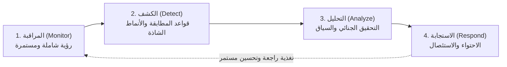
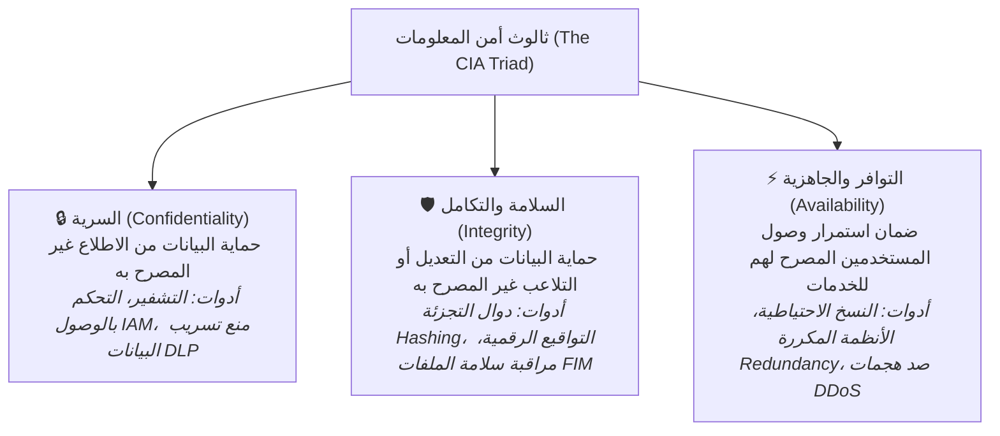
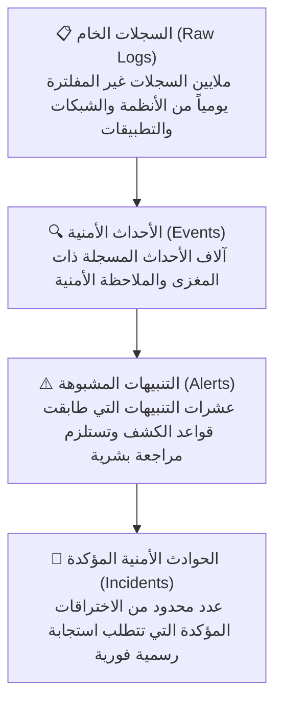
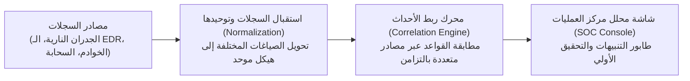

# المعمل 01: أساسيات عمليات مركز الأمن السيبراني والاستجابة للحوادث (SOC / IR Fundamentals)

> **المقرر:** عمليات الأمن السيبراني (مختبر الـ SOC - Cybersecurity Operations)  
> **المحاضر:** Hussein Al-Selwi  
> **إجمالي عدد الشرائح:** 30 شريحة  
> **العرض التقديمي المصدري:** `lab1_IDR_AR.html`  

### 📋 نبذة عامة وأهداف الوحدة التدريبية
دليل تأسيسي وتطبيقي شامل يغطي المعمارية التشغيلية لمركز الـ SOC، حماية ثالوث أمن المعلومات (CIA Triad)، دورة حياة عمل المحلل الدفاعي، التدرج الهرمي (السجلات -> الأحداث -> التنبيهات -> الحوادث)، وأهم الأنظمة والتقنيات الدفاعية (SIEM, SOAR, EDR, IDS/IPS, Firewalls).

---

## 📑 جدول المحتويات

- [الشريحة 01: المقدمة](#slide-01-المقدمة)
- [الشريحة 02: أهداف المعمل](#slide-02-أهداف-المعمل)
- [الشريحة 03: ما هو مركز عمليات الأمن (SOC)؟](#slide-03-ما-هو-مركز-عمليات-الأمن-soc-؟)
- [الشريحة 04: الدورة التشغيلية الأساسية للـ SOC](#slide-04-الدورة-التشغيلية-الأساسية-للـ-soc)
- [الشريحة 05: SOC Models & Structures](#slide-05-soc-models-structures)
- [الشريحة 06: People, Process & Technology](#slide-06-people-process-technology)
- [الشريحة 07: حماية ثالوث أمن المعلومات (CIA Triad)](#slide-07-حماية-ثالوث-أمن-المعلومات-cia-triad)
- [الشريحة 08: العمليات الأمنية التفاعلية (Reactive)](#slide-08-العمليات-الأمنية-التفاعلية-reactive)
- [الشريحة 09: العمليات الأمنية الاستباقية (Proactive)](#slide-09-العمليات-الأمنية-الاستباقية-proactive)
- [الشريحة 10: يوم في حياة محلل الـ SOC](#slide-10-يوم-في-حياة-محلل-الـ-soc)
- [الشريحة 11: أدوار ومستويات فريق الـ SOC](#slide-11-أدوار-ومستويات-فريق-الـ-soc)
- [الشريحة 12: سيناريو تطبيقي: تسريب بيانات داخلية](#slide-12-سيناريو-تطبيقي-تسريب-بيانات-داخلية)
- [الشريحة 13: Logs, Events, Alerts, and Incidents](#slide-13-logs-events-alerts-and-incidents)
- [الشريحة 14: نظام إدارة المعلومات والأحداث الأمنية (SIEM)](#slide-14-نظام-إدارة-المعلومات-والأحداث-الأمنية-siem)
- [الشريحة 15: الأتمتة وتنسيق الاستجابة الأمنية (SOAR)](#slide-15-الأتمتة-وتنسيق-الاستجابة-الأمنية-soar)
- [الشريحة 16: أنظمة إدارة وتوثيق الحوادث](#slide-16-أنظمة-إدارة-وتوثيق-الحوادث)
- [الشريحة 17: مراقبة أمن الشبكات (NSM)](#slide-17-مراقبة-أمن-الشبكات-nsm)
- [الشريحة 18: جدران الحماية: الشبكية و NGFW و WAF](#slide-18-جدران-الحماية-الشبكية-و-ngfw-و-waf)
- [الشريحة 19: نظام كشف التطفل (IDS)](#slide-19-نظام-كشف-التطفل-ids)
- [الشريحة 20: نظام منع التطفل (IPS)](#slide-20-نظام-منع-التطفل-ips)
- [الشريحة 21: أنظمة كشف واستجابة الأجهزة (EDR)](#slide-21-أنظمة-كشف-واستجابة-الأجهزة-edr)
- [الشريحة 22: 2. استخبارات التهديدات (Threat Intelligence) Platform (TIP)](#slide-22-2-استخبارات-التهديدات-threat-intelligence-platform-tip)
- [الشريحة 23: أدوات التحقيق الجنائي الرقمي (Forensics)](#slide-23-أدوات-التحقيق-الجنائي-الرقمي-forensics)
- [الشريحة 24: أدوات فحص وتحليل البرمجيات الخبيثة](#slide-24-أدوات-فحص-وتحليل-البرمجيات-الخبيثة)
- [الشريحة 25: مقاييس أداء مركز العمليات (Metrics)](#slide-25-مقاييس-أداء-مركز-العمليات-metrics)
- [الشريحة 26: Common Threats: Social & Software-Based](#slide-26-common-threats-social-software-based)
- [الشريحة 27: Common Threats: Identity & Insider Risk](#slide-27-common-threats-identity-insider-risk)
- [الشريحة 28: مجموعات التهديد المتقدمة المستمرة (APTs)](#slide-28-مجموعات-التهديد-المتقدمة-المستمرة-apts)
- [الشريحة 29: Common Threats: Network, Data & Supply Chain](#slide-29-common-threats-network-data-supply-chain)
- [الشريحة 30: الخلاصة والدروس المستفادة](#slide-30-الخلاصة-والدروس-المستفادة)

---

## الشريحة 01: المقدمة

> **التصنيف / الفئة:** `عمليات الأمن السيبراني والاستجابة للحوادث · SOC / IR`

### Introduction to Security Operations and Incident Response

المعمل 1 — أساسيات عمليات مركز الأمن (SOC Fundamentals)

المحاضر: Hussein Al-Selwi

> [!NOTE] 🎙️ **ملاحظات وتوجيهات المحاضر (Instructor Lecture Notes)**
> رحب بالطلاب في بداية المقرر العملي. وضح لهم أن عمليات الأمن السيبراني (Security Operations) والاستجابة للحوادث (Incident Response) هما الركيزتان الأهم في الأمن الدفاعي (Blue Team). سيزودهم هذا المقرر بالمعرفة والمهارات العملية الحقيقية لكشف التهديدات والتحقيق فيها والاستجابة للحوادث الأمنية.

---

## الشريحة 02: أهداف المعمل

> **التصنيف / الفئة:** `أهداف المعمل`

### الأهداف التعليمية للمعمل

- Understand the core functions of a SOC and its role.
- استكشاف المهام والمسؤوليات اليومية لمحلل مركز العمليات (SOC Analyst)
- Familiarize with different SOC models, roles, and organizational structures .
- Learn metrics which evaluate the effectiveness of security operations.
- Understand various tools used within SOCs for monitoring, detection, analysis, and response.
- Identify and understand common threats faced by organizations.

> [!NOTE] 🎙️ **ملاحظات وتوجيهات المحاضر (Instructor Lecture Notes)**
> استعرض أهداف المعمل ليعرف الطلاب ما سيكتسبونه بنهاية الجلسة: فهم دور الـ SOC، مهام المحلل اليومية، الهياكل والنماذج، المفاهيم الأساسية، مقاييس الأداء، والأدوات الشائعة.

---

## الشريحة 03: ما هو مركز عمليات الأمن (SOC)؟

> **التصنيف / الفئة:** `FOUNDATIONS`

### ما هو مركز عمليات الأمن (Security Operations Center — SOC)؟

A Security Operations Center (SOC) is a centralized unit responsible for monitoring, detecting, analyzing, and responding to cybersecurity threats.

- **Primary Responsibilities**: المراقبة المستمرة، اكتشاف الأنشطة المشبوهة، التحقيق في التنبيهات، وتنسيق الاستجابة للحوادث.
- **Asset Protection**: حماية بيانات المؤسسة وأنظمتها وبنيتها التحتية الحيوية من التهديدات الداخلية والخارجية.
- **Key Goal**: Reduce organizational risk through continuous monitoring and rapid response.

> [!IMPORTANT]
> Cybersecurity is not a one-time activity — a SOC runs 24/7 and operates in two modes: proactive (threat hunting, hardening) and reactive (triage, investigation, response).

> [!NOTE] 🎙️ **ملاحظات وتوجيهات المحاضر (Instructor Lecture Notes)**
> أكد على أن مركز العمليات (SOC) ليس مجرد غرفة مادية بشاشات ضخمة، بل هو منظومة متكاملة وفريق متخصص (قد يعمل حضورياً أو عن بُعد) لحماية المؤسسة على مدار الساعة 24/7 من التهديدات الداخلية والخارجية.

---

## الشريحة 04: الدورة التشغيلية الأساسية للـ SOC

> **التصنيف / الفئة:** `MISSION`

### الدورة التشغيلية الأساسية لمركز عمليات الأمن (The SOC Lifecycle)

The SOC operational cycle is the fundamental mission of every Security Operations Center and the foundation of all SOC activities.

01. **Monitor**: Observe systems, endpoints, networks, and logs 24/7
02. **Detect**: Identify suspicious or malicious activity
03. **Analyze**: Investigate alerts and determine their significance
04. **Respond**: Contain, mitigate, and recover from threats

1. **خطوة 1**: Monitor
2. **خطوة 2**: Detect
3. **خطوة 3**: Analyze
4. **خطوة 4**: Respond

> [!NOTE] 🎙️ **ملاحظات وتوجيهات المحاضر (Instructor Lecture Notes)**
> تمثل هذه الدورة الرباعية (المراقبة -> الكشف -> التحليل -> الاستجابة) المهمة الأساسية والجوهرية لكل مركز عمليات أمن في العالم، وهي الأساس الذي تنبثق منه كافة إجراءات العمل.

---

## الشريحة 05: SOC Models & Structures

> **التصنيف / الفئة:** `ORGANIZATIONAL STRUCTURES`

### نماذج وهياكل تنظيم مراكز عمليات الأمن

Organizations choose different SOC structures based on budget , expertise , and operational requirements .

- **Internal SOC** `[IN-HOUSE]`: Security operations managed entirely by the organization . Full control, direct integration with internal teams and systems.
- **Managed Security Service Provider** `[MSSP]`: Security monitoring and operations outsourced to a third-party provider . Cost-effective with access to specialized expertise.
- **Hybrid SOC** `[HYBRID]`: Combines internal security teams with external security services . Balances control with scalability and cost efficiency.

> [!IMPORTANT]
> The choice of SOC model depends on an organization's size, budget, regulatory requirements , and the maturity of its internal security capabilities.

> [!NOTE] 🎙️ **ملاحظات وتوجيهات المحاضر (Instructor Lecture Notes)**
> ناقش مزايا وتحديات كل نموذج تشغيلي: الـ SOC الداخلي (Internal) لتحكم كامل ولكنه عالي التكلفة، الـ SOC الخارجي المدار (MSSP) لتوفير التكاليف مع تغطية 24/7، والنموذج الهجين (Hybrid) الذي يجمع بين ميزات النموذجين.

---

## الشريحة 06: People, Process & Technology

> **التصنيف / الفئة:** `THREE PILLARS`

### الأركان الثلاثة لنجاح مركز عمليات الأمن

يعتمد نجاح أي مركز عمليات أمن على تناغم ثلاثة مكونات أساسية لا غنى عنها:

PEOPLE PROCESS TECHNOLOGY SOC SUCCESS

- **الكوادر البشرية (People)**: محللو SOC · مستجيبو الحوادث · صائدو التهديدات · مهندسو الأمان · مديرو المركز
- **الإجراءات والعمليات (Process)**: إجراءات المراقبة · فرز التنبيهات · مسارات الاستجابة · آليات التصعيد · معايير إعداد التقارير
- **التقنيات والأدوات (Technology)**: منصات SIEM · حلول EDR · أنظمة IDS/IPS · منصات Threat Intel · أدوات التحقيق الجنائي

> [!NOTE] 🎙️ **ملاحظات وتوجيهات المحاضر (Instructor Lecture Notes)**
> أكد بشدة على أن الأدوات وحدها لا تحمي أي مؤسسة! العمليات الأمنية الناجحة تقوم على ثالوث متوازن: الكوادر البشرية المؤهلة (People)، الإجراءات وسياسات العمل الواضحة (Process)، والتقنيات والأدوات الداعمة (Technology). نقص أي ركن يؤدي لفشل المنظومة.

---

## الشريحة 07: حماية ثالوث أمن المعلومات (CIA Triad)

> **التصنيف / الفئة:** `المبادئ الأمنية`

### كيف يحمي مركز العمليات ثالوث أمن المعلومات (CIA)؟

الهدف الأسمى لمركز العمليات هو حماية الأركان الثلاثة لأمن المعلومات: السرية، السلامة، والتوافر:

مثال تطبيقي: كيف يتعامل الـ SOC مع هجوم الفدية لحماية الـ CIA؟ Ransomware encrypts files and demands payment — it primarily attacks توافر وجاهزية الخدمات (Availability) (data and systems become unusable). If the attacker also exfiltrates data before encrypting, السرية (Confidentiality) is compromised too. How People, Process & Technology Respond الكوادر البشرية (People) الكوادر: يرصد المحلل نشاط التشفير، يعزل الجهاز فوراً، ويخطر فريق الاستجابة والإدارة. الإجراءات والعمليات (Process) الإجراءات: تفعيل سيناريو الاستجابة الخاص ببرمجيات الفدية: الاحتواء، التطهير، والاستعادة وفق دليل معتمد. التقنيات والأدوات (Technology) التقنيات: يقوم نظام EDR بعزل الجهاز، ويربط الـ SIEM الأحداث، وتستعيد النسخ الاحتياطية الملفات لإنقاذ التوافر. Outcome توافر وجاهزية الخدمات (Availability) is restored from backups

> [!NOTE] 🎙️ **ملاحظات وتوجيهات المحاضر (Instructor Lecture Notes)**
> استخدم مثال هجوم برمجيات الفدية (Ransomware) لتوضيح كيف يهدد الهجوم ثالوث أمن المعلومات CIA (يضرب التوافر بالتشفير، والسرية بالابتزاز). ثم وضح دور الأركان الثلاثة (People, Process, Technology) في التصدي له واستعادة البيانات من النسخ الاحتياطية.

---

## الشريحة 08: العمليات الأمنية التفاعلية (Reactive)

> **التصنيف / الفئة:** `REACTIVE OPS`

### العمليات الأمنية التفاعلية (رد الفعل بعد وقوع التنبيه)

Reactive activities occur after suspicious activity or an alert has been identified.

Security Monitoring مراقبة ومتابعة حركة الأنظمة والشبكات لاكتشاف أي شذوذ. Threat Detection التعرف على الأنشطة الخبيثة عبر التنبيهات وقواعد الارتباط. Incident Response Contain and mitigate security incidents to limit damage. Digital Forensics Collect and analyze evidence to determine what happened. Malware Analysis Analyze malicious software to understand its behavior and impact. INCIDENT TIMELINE 1 Alert Triggered ↓ 2 Investigation ↓ 3 Response ↓ ✓ Recovery Goal: Respond quickly and effectively to security incidents.

> [!NOTE] 🎙️ **ملاحظات وتوجيهات المحاضر (Instructor Lecture Notes)**
> اشرح العمليات التفاعلية (Reactive Operations): العمليات التي تبدأ بعد وقوع الحدث أو إطلاق التنبيه — المراقبة المستمرة، الكشف، الفرز الأولي، التحقيق، الاستجابة السريعة، والتطهير.

---

## الشريحة 09: العمليات الأمنية الاستباقية (Proactive)

> **التصنيف / الفئة:** `PROACTIVE OPS`

### العمليات الأمنية الاستباقية (المبادرة قبل وقوع الهجوم)

Proactive activities help identify and reduce threats before incidents occur.

THREAT INTEL HUNTING VULN MGMT INTEL 2. استخبارات التهديدات (Threat Intelligence) Collect and analyze information about current and emerging threats to stay ahead of adversaries. HUNT 1. صيد التهديدات النشط (Threat Hunting) Actively search for hidden threats within the environment that evade automated detection. VULN 3. إدارة ومعالجة الثغرات (Vulnerability Mgmt) Identify, assess, and remediate security weaknesses before they can be exploited. Improved visibility Earlier threat detection Reduced attack surface Stronger security posture

> [!NOTE] 🎙️ **ملاحظات وتوجيهات المحاضر (Instructor Lecture Notes)**
> Explain that mature SOCs spend significant effort on proactive security because preventing incidents is often more effective than responding to them.

---

## الشريحة 10: يوم في حياة محلل الـ SOC

> **التصنيف / الفئة:** `A DAY IN THE SOC`

### يوم في حياة محلل مركز عمليات الأمن (SOC Analyst)

A typical day involves balancing continuous vigilance with deep technical investigation.

Typical Daily Activities Review security dashboards Monitor incoming alerts Perform alert triage Investigate suspicious activities Escalate confirmed incidents Document findings Collaborate with security teams SOC analysts prioritize incoming alerts, resolving low-risk alerts quickly while dedicating deeper time to complex threats. EXAMPLE WORKFLOW TIMELINE 01 Review Alerts Start of shift: Triage alerts on SIEM/dashboard. 02 Investigate Query endpoint logs, network packet data, and threat intel. 03 Determine Impact Assess if systems are compromised and estimate blast radius. 04 Escalate or Close Pass critical incidents to Tier 2/Incident Response or close false positives. 05 Document Findings Write triage logs, update tickets, and share recommendations.

> [!NOTE] 🎙️ **ملاحظات وتوجيهات المحاضر (Instructor Lecture Notes)**
> Explain that analysts spend much more time investigating and documenting than simply watching dashboards.

---

## الشريحة 11: أدوار ومستويات فريق الـ SOC

> **التصنيف / الفئة:** `TEAMS & ROLES`

### المستويات الوظيفية ومسؤوليات فريق الـ SOC

A structured tier system ensures high efficiency and ensures expert focus is applied where it is needed most.

ESCALATION FLOW TIER 1 — TRIAGE TIER 2 — INVESTIGATE TIER 3 — HUNT T1 Tier 1 Analyst (Triage) Initial alert review · Alert triage · Basic investigations · Escalation of confirmed threats T2 Tier 2 Analyst (Incident Analysis) Advanced investigations · Incident analysis · Root cause analysis · Threat validation T3 Tier 3 Analyst (Expert / Hunt) Expert-level investigations · Detection engineering · Threat hunting · Malware analysis Other Specialized SOC Roles Incident Responder Threat Intel Analyst Security Engineer مدير مركز عمليات الأمن (SOC Manager)

> [!NOTE] 🎙️ **ملاحظات وتوجيهات المحاضر (Instructor Lecture Notes)**
> Explain that escalation between tiers allows organizations to handle large volumes of alerts efficiently.

---

## الشريحة 12: سيناريو تطبيقي: تسريب بيانات داخلية

> **التصنيف / الفئة:** `ROLES IN ACTION`

### سيناريو حادثة أمنية: كشف تسريب بيانات بواسطة موظف داخلي

A walkthrough of how a single alert moves through the SOC tier structure — and what each role contributes along the way.

> [!IMPORTANT]
> Setup: An employee in the finance department uploads several gigabytes of customer records to a personal cloud storage account late on a Friday night, shortly after submitting their resignation.

1. **Tier 1 Analyst — Triage**: A DLP alert fires for an unusually large outbound data transfer. The Tier 1 analyst confirms the alert isn't a false positive, checks the user and data volume, and escalates since it involves sensitive customer data.
2. **Tier 2 Analyst — Investigation**: Correlates the alert with HR records (recent resignation), reviews endpoint and identity logs for the account, and confirms this is a credible insider threat rather than routine business activity. Opens a formal incident.
3. **Tier 3 Analyst — Deep Dive & Hunt**: Performs forensic analysis of the workstation, reconstructs the full timeline of file access, and threat-hunts for similar exfiltration patterns across other accounts to rule out a broader campaign.
4. **مدير مركز عمليات الأمن (SOC Manager) — Coordination & Decision**: Coordinates with HR, Legal, and IT to revoke account access immediately, decides whether law enforcement or regulatory notification is required, and ensures the incident is documented for the post-incident review.

> [!NOTE] 🎙️ **ملاحظات وتوجيهات المحاضر (Instructor Lecture Notes)**
> Walk through this scenario tier by tier. Emphasize how each tier adds context the previous tier couldn't see, and how the مدير مركز عمليات الأمن (SOC Manager)'s role is coordination and decision-making rather than hands-on investigation.

---

## الشريحة 13: Logs, Events, Alerts, and Incidents

> **التصنيف / الفئة:** `SEC FLOWS`

### التدرج الهرمي: السجلات، الأحداث، التنبيهات، والحوادث

Security teams differentiate between these four terms to triage and respond to threats efficiently.

LOG السجل الخام (Log) A record generated by a system, application, or device documenting an activity. Example: User login recorded in Windows Event Logs. EVENT الحدث الأمني (Security Event) Any observable occurrence that may have security significance. Example: Multiple failed login attempts. ALERT Alert A notification generated when suspicious activity matches a predefined rule or condition. Example: Brute-force attack detected. INCIDENT Incident A confirmed security event that requires investigation and response. Example: Successful account compromise. LOG EVENT ALERT INCIDENT Action Required

> [!NOTE] 🎙️ **ملاحظات وتوجيهات المحاضر (Instructor Lecture Notes)**
> Students often confuse these terms. Emphasize that not every log becomes an event, not every event generates an alert, and not every alert becomes an incident.

---

## الشريحة 14: نظام إدارة المعلومات والأحداث الأمنية (SIEM)

> **التصنيف / الفئة:** `SIEM`

A SIEM is a centralized platform that collects, stores, correlates, and analyzes security logs from multiple systems and devices across an organization, giving analysts a single pane of glass to detect and investigate threats.

Common Uses Log collection & aggregation Event correlation Alert generation Threat detection Popular Industry Products Splunk Enterprise Security Microsoft Sentinel IBM QRadar Elastic Security ArcSight DASHBOARD SCREENSHOT

> [!NOTE] 🎙️ **ملاحظات وتوجيهات المحاضر (Instructor Lecture Notes)**
> نظام إدارة المعلومات والأحداث الأمنية (SIEM) — explain the purpose of this tool category, its core function within the SOC, and how it fits into the detection and response lifecycle.

---

## الشريحة 15: الأتمتة وتنسيق الاستجابة الأمنية (SOAR)

> **التصنيف / الفئة:** `SOAR`

### منصات تنسيق وأتمتة الاستجابة الأمنية (SOAR)

A SOAR platform connects security tools together and uses automated playbooks to enrich alerts, orchestrate workflows across systems, and execute repetitive response actions — freeing analysts to focus on higher-value investigation work.

Common Uses Playbook automation Response automation Tool integration Reducing analyst workload Popular Industry Products Palo Alto Cortex XSOAR Splunk SOAR Microsoft Sentinel SOAR IBM Resilient SOAR Swimlane PLAYBOOK SCREENSHOT

> [!NOTE] 🎙️ **ملاحظات وتوجيهات المحاضر (Instructor Lecture Notes)**
> منصات تنسيق وأتمتة الاستجابة الأمنية (SOAR) — explain the purpose of this tool category, its core function within the SOC, and how it fits into the detection and response lifecycle.

---

## الشريحة 16: أنظمة إدارة وتوثيق الحوادث

> **التصنيف / الفئة:** `INCIDENT MANAGEMENT`

### أنظمة إدارة وتوثيق تذاكر الحوادث الأمنية

An Incident Management (case management/ticketing) tool helps SOC teams document investigations, track incidents from detection to closure, assign tasks, and coordinate response activities across the team.

Common Uses Incident tracking Workflow management Escalation management Collaboration Popular Industry Products TheHive ServiceNow SecOps Jira Service Management IBM Resilient Cortex XSOAR INVESTIGATION CASE SCREENSHOT

> [!NOTE] 🎙️ **ملاحظات وتوجيهات المحاضر (Instructor Lecture Notes)**
> أنظمة إدارة وتوثيق تذاكر الحوادث الأمنية — explain the purpose of this tool category, its core function within the SOC, and how it fits into the detection and response lifecycle.

---

## الشريحة 17: مراقبة أمن الشبكات (NSM)

> **التصنيف / الفئة:** `NSM`

### أنظمة مراقبة أمن الشبكات (Network Security Monitoring)

Network Security Monitoring tools capture and analyze network traffic and metadata to detect malicious activity, reconstruct sessions, and provide the visibility needed for network-based threat hunting and forensics.

Common Uses Full packet capture Traffic analysis Protocol & metadata logging Network forensics Popular Industry Products Zeek (Bro) Wireshark Security Onion Corelight Darktrace NETWORK TRAFFIC SCREENSHOT

> [!NOTE] 🎙️ **ملاحظات وتوجيهات المحاضر (Instructor Lecture Notes)**
> أنظمة مراقبة أمن الشبكات (Network Security Monitoring) — explain the purpose of this tool category, its core function within the SOC, and how it fits into the detection and response lifecycle.

---

## الشريحة 18: جدران الحماية: الشبكية و NGFW و WAF

> **التصنيف / الفئة:** `FIREWALL`

### أنواع جدران الحماية الثلاثة ووظيفة كل منها

A firewall enforces rules to allow or block traffic between network segments. A 2. جدار الحماية من الجيل القادم (NGFW) extends this with application awareness, identity-based policies, and built-in intrusion prevention, while a 3. جدار حماية تطبيقات الويب (WAF) protects web applications by filtering and monitoring HTTP/HTTPS traffic for attacks like SQL injection and XSS.

Network Firewall Filters traffic by IP, port, and protocol rules. NGFW Adds app awareness, IPS, and identity-based control. WAF Protects web apps from OWASP Top 10 attacks. Common Uses Traffic filtering Access control Application visibility Web app protection Popular Industry Products Palo Alto NGFW Fortinet FortiGate Cisco Secure Firewall Cloudflare WAF AWS WAF FIREWALL CONSOLE SCREENSHOT

> [!NOTE] 🎙️ **ملاحظات وتوجيهات المحاضر (Instructor Lecture Notes)**
> Firewalls: Network Firewall, NGFW & WAF — explain the purpose of this tool category, its core function within the SOC, and how it fits into the detection and response lifecycle.

---

## الشريحة 19: نظام كشف التطفل (IDS)

> **التصنيف / الفئة:** `IDS`

### نظام كشف التطفل الشبكي (Intrusion Detection System — IDS)

An IDS passively monitors network or host traffic for signatures of known attacks and anomalous behavior, generating alerts for analysts to review — but it does not block traffic itself.

Common Uses Network monitoring Signature & anomaly detection Alert generation Passive visibility Popular Industry Products Snort Suricata Zeek Cisco Secure IDS IDS ALERTS SCREENSHOT

> [!NOTE] 🎙️ **ملاحظات وتوجيهات المحاضر (Instructor Lecture Notes)**
> نظام كشف التطفل الشبكي (Intrusion Detection System — IDS) — explain the purpose of this tool category, its core function within the SOC, and how it fits into the detection and response lifecycle.

---

## الشريحة 20: نظام منع التطفل (IPS)

> **التصنيف / الفئة:** `IPS`

### نظام منع التطفل الشبكي (Intrusion Prevention System — IPS)

An IPS sits inline with network traffic and actively blocks malicious activity in real time as it detects it, going a step beyond an IDS by preventing the attack rather than only alerting on it.

Common Uses Inline traffic inspection Real-time blocking Signature matching Popular Industry Products Cisco Secure IPS Palo Alto Threat Prevention Suricata (IPS mode) Trend Micro TippingPoint IPS BLOCKING SCREENSHOT

> [!NOTE] 🎙️ **ملاحظات وتوجيهات المحاضر (Instructor Lecture Notes)**
> نظام منع التطفل الشبكي (Intrusion Prevention System — IPS) — explain the purpose of this tool category, its core function within the SOC, and how it fits into the detection and response lifecycle.

---

## الشريحة 21: أنظمة كشف واستجابة الأجهزة (EDR)

> **التصنيف / الفئة:** `EDR`

### أنظمة كشف واستجابة الأجهزة الطرفية (EDR)

An EDR platform continuously monitors endpoint devices, recording process, file, registry, and network activity to detect and respond to threats directly on the host.

Common Uses Endpoint monitoring Malware detection Threat hunting Incident investigation Remote containment Many EDR platforms include UEBA (User and Entity Behavior Analytics) as part of their detection capability — baselining normal behavior and flagging deviations that may indicate compromise or insider threats. Popular Industry Products CrowdStrike Falcon Microsoft Defender for Endpoint SentinelOne VMware Carbon Black EDR CONSOLE SCREENSHOT

> [!NOTE] 🎙️ **ملاحظات وتوجيهات المحاضر (Instructor Lecture Notes)**
> أنظمة كشف واستجابة الأجهزة الطرفية (EDR) — explain the purpose of this tool category, its core function within the SOC, and how it fits into the detection and response lifecycle. Mention that EDR platforms commonly include UEBA as part of their detection capability, rather than treating UEBA as a separate category.

---

## الشريحة 22: 2. استخبارات التهديدات (Threat Intelligence) Platform (TIP)

> **التصنيف / الفئة:** `TIP`

A 2. استخبارات التهديدات (Threat Intelligence) Platform collects, organizes, enriches, and distributes threat intelligence — such as IOCs, TTPs, and threat actor profiles — from internal and external sources so analysts can add context to alerts and anticipate emerging threats.

Common Uses IOC management Threat enrichment Threat actor tracking Intelligence sharing Campaign analysis Popular Industry Products MISP OpenCTI Recorded Future Anomali ThreatConnect THREAT FEEDS SCREENSHOT

> [!NOTE] 🎙️ **ملاحظات وتوجيهات المحاضر (Instructor Lecture Notes)**
> 2. استخبارات التهديدات (Threat Intelligence) Platform (TIP) — explain the purpose of this tool category, its core function within the SOC, and how it fits into the detection and response lifecycle.

---

## الشريحة 23: أدوات التحقيق الجنائي الرقمي (Forensics)

> **التصنيف / الفئة:** `FORENSICS`

### Forensics Tools

Digital forensics tools allow analysts to acquire, preserve, and analyze evidence from disks, memory, and devices in a forensically sound manner — reconstructing what happened during an incident while maintaining chain of custody for legal or HR proceedings.

Common Uses Disk & memory imaging Artifact recovery Timeline reconstruction Chain of custody Evidence analysis Popular Industry Products Autopsy EnCase Forensic FTK (Forensic Toolkit) Volatility (memory) Magnet AXIOM FORENSIC ANALYSIS SCREENSHOT

> [!NOTE] 🎙️ **ملاحظات وتوجيهات المحاضر (Instructor Lecture Notes)**
> Forensics Tools — explain the purpose of this tool category, its core function within the SOC, and how it fits into the detection and response lifecycle.

---

## الشريحة 24: أدوات فحص وتحليل البرمجيات الخبيثة

> **التصنيف / الفئة:** `MALWARE ANALYSIS`

### أدوات فحص وتحليل البرمجيات الخبيثة (Malware Analysis)

Malware analysis tools let analysts safely examine suspicious files and binaries — through static inspection or dynamic execution in a sandbox — to determine their behavior, capabilities, and indicators of compromise without risking production systems.

Common Uses Static analysis Dynamic/behavioral analysis Sandboxing Reverse engineering IOC extraction Popular Industry Products VirusTotal Any.Run Cuckoo Sandbox IDA Pro Ghidra MALWARE REPORT SCREENSHOT

> [!NOTE] 🎙️ **ملاحظات وتوجيهات المحاضر (Instructor Lecture Notes)**
> أدوات فحص وتحليل البرمجيات الخبيثة (Malware Analysis) — explain the purpose of this tool category, its core function within the SOC, and how it fits into the detection and response lifecycle.

---

## الشريحة 25: مقاييس أداء مركز العمليات (Metrics)

> **التصنيف / الفئة:** `مقاييس الأداء التشغيلي`

### كيف نقيس كفاءة ونجاح مركز عمليات الأمن؟ (SOC Metrics)

Security Operations Centers use key performance metrics to measure and improve response capabilities.

MTTD Mean Time to Detect Average time to identify a threat. MTTR Mean Time to Respond Average time to contain and resolve threats. Why Metrics Matter Measure SOC effectiveness Identify bottlenecks Improve response capacity Support decisions SOC LIVE PERFORMANCE METRICS SYSTEM ACTIVE MTTD (Time to Detect) 12m ▼ 74% MTTR (Time to Respond) 48m ▼ 81% Alert vs. Incident Volume (Monthly Trend) OCT NOV DEC Alert Vol (45K) Incident Vol (18) F/P Rate (4.2%)

> [!NOTE] 🎙️ **ملاحظات وتوجيهات المحاضر (Instructor Lecture Notes)**
> Explain that metrics help SOC managers understand whether the SOC is improving over time and where resources should be allocated.

---

## الشريحة 26: Common Threats: Social & Software-Based

> **التصنيف / الفئة:** `مشهد التهديدات · الجزء 1`

### التهديدات السيبرانية الشائعة: الهندسة الاجتماعية والبرمجيات الخبيثة

تراقب فرق الـ SOC وتتصدى لطيف واسع من التهديدات. نبدأ بالهجمات التي تستهدف البشر مباشرة والبرمجيات الخبيثة التي تصيب الأجهزة:

Social Engineering التلاعب النفسي لدفع الضحايا للإفصاح عن معلومات سرية أو منح صلاحيات أو تنفيذ إجراءات تقوض الأمان. Includes: Phishing — fraudulent emails, messages, or sites designed to steal credentials or deliver malware — along with pretexting, baiting, and vishing. Malware برمجيات ضارة — تشمل الفيروسات، الديدان، وأحصنة طروادة — صُممت لتخريب الأنظمة أو سرقة البيانات. Includes: Ransomware — malware that encrypts files or systems and demands payment for their recovery, one of the most disruptive threats SOC teams face today. 3. البرمجيات الخبيثة في الذاكرة (Fileless Malware) أنشطة خبيثة تعمل مباشرة داخل الذاكرة (RAM) دون كتابة ملفات على القرص، وتستغل أدوات النظام الشرعية (مثل PowerShell و WMI) لتجاوز مكافحات الفيروسات.

> [!NOTE] 🎙️ **ملاحظات وتوجيهات المحاضر (Instructor Lecture Notes)**
> استعرض التهديدات السيبرانية الشائعة: هجمات الهندسة الاجتماعية (وعلى رأسها التصيد الاحتيالي)، والبرمجيات الخبيثة (الفيروسات، التروجانات، وبرمجيات الفدية)، والبرمجيات الخبيثة التي تعمل في الذاكرة دون ملفات (3. البرمجيات الخبيثة في الذاكرة (Fileless Malware)).

---

## الشريحة 27: Common Threats: Identity & Insider Risk

> **التصنيف / الفئة:** `مشهد التهديدات · الجزء 2`

### التهديدات الشائعة: اختراق الهوية والمخاطر الداخلية

تستغل هذه التهديدات الثقة والصلاحيات المشروعة بدلاً من الثغرات التقنية وحدها، مما يجعل رصدها أصعب بأدوات الحماية التقليدية:

Identity and Account Compromise الوصول غير المصرح به لحسابات المستخدمين عبر سرقة كلمات المرور، هجمات Password Spraying، أو اختطاف الجلسات والتوكنز. 2. التهديدات والمخاطر الداخلية (Insider Threats) تهديدات تنشأ من موظفين أو متعاقدين يمتلكون صلاحيات دخول شرعية — سواء بدافع خبيث، أو إهمال غير مقصود، أو لاختراق حساباتهم.

> [!IMPORTANT]
> Both threats are typically detected through identity and access monitoring — abnormal logins, privilege escalation, and UEBA-driven behavioral baselines rather than signature-based tools.

> [!NOTE] 🎙️ **ملاحظات وتوجيهات المحاضر (Instructor Lecture Notes)**
> أكد على أن هجمات الهوية والتهديدات الداخلية تتجاوز جدران الحماية الخارجية بالكامل، لأنها تستغل صلاحيات وحسابات موثوقة بالفعل بدلاً من استغلال ثغرة برمجية، مما يجعل اكتشافها معتمداً على مراقبة السلوك.

---

## الشريحة 28: مجموعات التهديد المتقدمة المستمرة (APTs)

> **التصنيف / الفئة:** `مشهد التهديدات · الجزء 3`

مجموعات APT هي جهات تهديد سيبرانية بالغة التطور وعالية التمويل — ترعاها دول في الغالب — تحافظ على وصول سري طويل الأمد داخل شبكة الضحية للتجسس أو التخريب عبر شهور أو سنوات:

Defining Characteristics Advanced — custom tooling, zero-days, and skilled operators Persistent — long-term footholds, sometimes undetected for years Threat — deliberate, targeted, and well-funded, often nation-state backed تدمج عدة أساليب: الهندسة الاجتماعية، البرمجيات الخبيثة، واختراق الهوية في حملة هجومية موحدة. Why SOC Analysts Track Them Recognize known group TTPs (tactics, techniques, and procedures) Map detections to frameworks like MITRE ATT&CK توقع أهداف الهجوم واستباق تحركات المهاجمين بناءً على بصمات المجموعات المعروفة عالمياً.

APT Reference & Tracking Resources CrowdStrike Adversary Universe · Google Cloud Threat Intel · Rapid7 InsightIDR · MITRE ATT&CK Groups

> [!NOTE] 🎙️ **ملاحظات وتوجيهات المحاضر (Instructor Lecture Notes)**
> تستحق مجموعات التهديد المتقدمة المستمرة (APTs) اهتماماً خاصاً: فهي تجمع تقنيات متعددة (تصيد، برمجيات مخصصة، اختراق حسابات) ضمن حملات تجسس طويلة الأمد ترعاها دول غالباً. يتابعها مجتمع الاستخبارات السيبراني عبر تصنيفات دقيقة ومصفوفة MITRE ATT&CK.

---

## الشريحة 29: Common Threats: Network, Data & Supply Chain

> **التصنيف / الفئة:** `مشهد التهديدات · الجزء 4`

### التهديدات الشائعة: هجمات الشبكة والبيانات وسلاسل الإمداد

تغطي هذه المجموعة التهديدات التي تستهدف التوافر، وسرية البيانات، والثغرات غير المعروفة، والموردين الموثوقين:

Distributed Denial of Service (DDoS) محاولات منسقة لإغراق الخوادم أو الشبكات بسيل هائل من البيانات المزيفة، لتعطيلها وحرمان المستخدمين الشرعيين منها. Data Breach الوصول غير المصرح به وسرقة أو تسريب البيانات الحساسة أو المالية — مما يسبب خسائر مادية وقانونية فادحة. 3. ثغرات اليوم الصفر (Zero-Day Exploits) هجمات تستغل ثغرات برمجية مجهولة لم يكتشفها المطورون بعد، ولا تتوفر لها ترقيعات أو تواقيع مسبقة لحظرها. 4. هجمات سلاسل الإمداد (Supply Chain Attacks) اختراق مزود برمجيات أو مورد موثوق واستغلال تحديثاته الرسمية للتسلل إلى شبكات آلاف الشركات العملاقة بشكل غير مباشر.

Which Tool Catches What? DDoS → NSM / Firewall / IPS Data Breach → SIEM / UEBA / DLP Zero-Day → EDR / TIP / Forensics Supply Chain → TIP / SOAR / Forensics

> [!NOTE] 🎙️ **ملاحظات وتوجيهات المحاضر (Instructor Lecture Notes)**
> اختم مشهد التهديدات بربط هذه الأنماط بأدوات الـ SOC التي شرحناها: هجمات حجب الخدمة DDoS (تصدها الفايروول ومزودو الخدمة)، تسريب البيانات (يرصده DLP و SIEM)، ثغرات اليوم الصفر Zero-Day (يكشفها EDR سلوكياً)، وهجمات سلاسل الإمداد (تتطلب مراقبة مشددة للتحديثات والموردين).

---

## الشريحة 30: الخلاصة والدروس المستفادة

> **التصنيف / الفئة:** `خلاصة المعمل`

### الخلاصة وأهم الدروس المستفادة من المعمل الأول

بنهاية هذا المعمل التأسيسي، أصبحت تمتلك الفهم الراسخ للمفاهيم التالية:

الهدف والدور الحيوي لمركز عمليات الأمن (SOC) في المؤسسات دورة الحياة التشغيلية: المراقبة ← الكشف ← التحليل ← الاستجابة النماذج التنظيمية للـ SOC (داخلي، خارجي MSSP، وهجين) أهمية التناغم بين الكوادر البشرية والإجراءات والتقنيات الفرق بين العمليات الدفاعية التفاعلية والاستباقية (Threat Hunting) التدرج الهرمي الدقيق: السجلات، الأحداث، التنبيهات، والحوادث المسؤوليات والمهام اليومية لمحلل مركز العمليات بمختلف مستوياته الأدوات والتقنيات الكبرى: SIEM, SOAR, EDR, IDS/IPS, Firewalls طيف التهديدات السيبرانية المعاصرة — من التصيد والبرمجيات الخبيثة وحتى مجموعات APT وسلاسل الإمداد

> [!NOTE] 🎙️ **ملاحظات وتوجيهات المحاضر (Instructor Lecture Notes)**
> لخص المحاضرة التأسيسية الأولى وراجع النقاط الرئيسية مع الطلاب. أكد على أن كل مفهوم وأداة تم شرحها اليوم ستكون الأساس الصلب الذي سنبني عليه كل المعامل والتطبيقات العملية في الأسابيع القادمة.

---

## 🎯 الخلاصة ومخرجات التعلم

- **الوحدة التدريبية:** المعمل 01: أساسيات عمليات مركز الأمن السيبراني والاستجابة للحوادث (SOC / IR Fundamentals)

- **المهارات المكتسبة:** فهم عملي وتطبيقي عميق لكيفية الكشف، التحقيق، الاستجابة، وإدارة التهديدات الأمنية باحترافية داخل بيئة العمليات.

- **مرجع التدريب:** مختبر عمليات الأمن السيبراني العملي — إعداد وتقديم: **Hussein Al-Selwi**.
