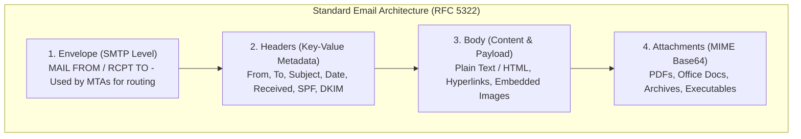
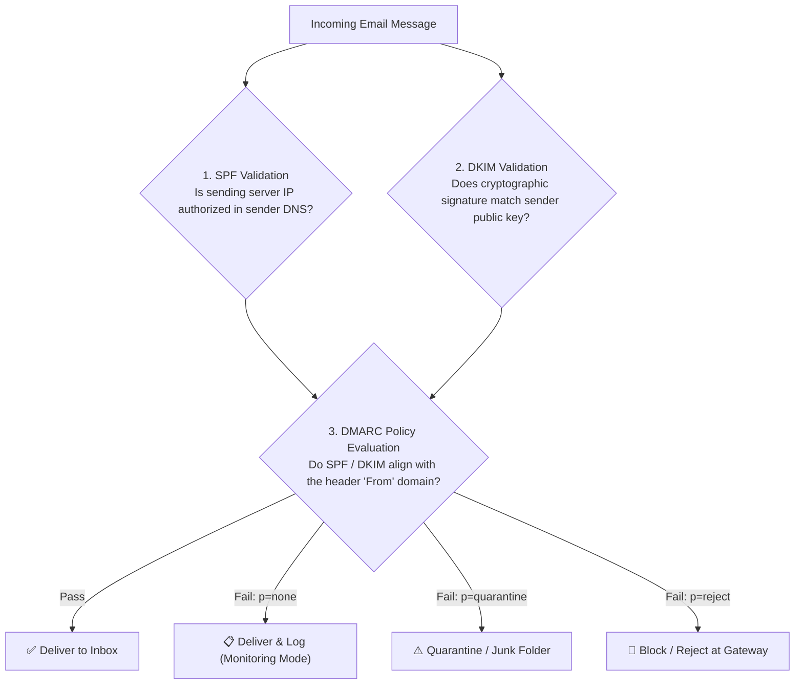

# Lab 02: Phishing Analysis Part I — Fundamentals & Email Anatomy

> **Course:** Cybersecurity Operations (SOC Lab)  
> **Instructor:** Hussein Al-Selwi  
> **Total Slides:** 22 Slides  
> **Source Presentation:** `Lab2_Phishing_Analysis .html`  

### 📋 Overview
Comprehensive manual covering social engineering tactics, the anatomy of email structures, envelope vs MIME sender headers, email authentication (SPF, DKIM, DMARC), URL obfuscation techniques, and attachment triage.

---

## 📑 Table of Contents

- [Slide 01: Introduction](#slide-01-introduction)
- [Slide 02: Domain Objectives](#slide-02-domain-objectives)
- [Slide 03: Introduction to Phishing](#slide-03-introduction-to-phishing)
- [Slide 04: How Phishing Works](#slide-04-how-phishing-works)
- [Slide 05: Real-World Case Studies](#slide-05-real-world-case-studies)
- [Slide 06: Phishing Attack Types](#slide-06-phishing-attack-types)
- [Slide 07: Common Attacker Objectives](#slide-07-common-attacker-objectives)
- [Slide 08: Phishing Attack Techniques](#slide-08-phishing-attack-techniques)
- [Slide 09: Email Structure](#slide-09-email-structure)
- [Slide 10: Email Header](#slide-10-email-header)
- [Slide 11: Email Body](#slide-11-email-body)
- [Slide 12: URLs in Phishing Emails](#slide-12-urls-in-phishing-emails)
- [Slide 13: Malicious Attachments](#slide-13-malicious-attachments)
- [Slide 14: Email Address Anatomy](#slide-14-email-address-anatomy)
- [Slide 15: Email Fundamentals](#slide-15-email-fundamentals)
- [Slide 16: Email Communication Flow](#slide-16-email-communication-flow)
- [Slide 17: Mail Agents](#slide-17-mail-agents)
- [Slide 18: Email Protocols](#slide-18-email-protocols)
- [Slide 19: Analysis Methodology](#slide-19-analysis-methodology)
- [Slide 20: Header Analysis](#slide-20-header-analysis)
- [Slide 21: Authentication Analysis](#slide-21-authentication-analysis)
- [Slide 22: Content Analysis](#slide-22-content-analysis)

---

## Slide 01: Introduction

> **Category:** `INCIDENT DETECTION & RESPONSE`

### Phishing Analysis

Understanding, identifying, and dissecting phishing attacks — from email anatomy to real-world breach case studies.

Lab 02 — Email-Based Threat Analysis

> [!NOTE] 🎙️ **Instructor Lecture Notes**
> Welcome students to Lab 2. This lab focuses specifically on phishing — one of the most common and effective initial-access techniques used by attackers.

---

## Slide 02: Domain Objectives

> **Category:** `LAB OVERVIEW`

- Understand the fundamentals of phishing and its prevalence
- Learn a strong methodology for analyzing phishing emails
- Develop hands-on skills in analyzing email content , headers , and tracing senders
- Gain an understanding in identifying and analyzing malicious URLs and attachments
- Explore both proactive and reactive defense strategies against phishing
- Learn to document and communicate phishing analysis findings proficiently

> [!NOTE] 🎙️ **Instructor Lecture Notes**
> Walk through each objective briefly so students know what they should be able to do by the end of this lab.

---

## Slide 03: Introduction to Phishing

> **Category:** `FOUNDATIONS`

Phishing is a social engineering attack in which an attacker impersonates a trusted entity to trick a victim into revealing sensitive information, clicking a malicious link, or executing malicious code.

- **Most Common Vector**: Phishing remains the #1 initial-access technique used in breaches, leading nearly every major attack chain.
- **Exploits Trust, Not Code**: It targets human psychology — urgency, authority, fear, curiosity — rather than purely technical flaws.
- **Low Cost, High Yield**: Attackers can send thousands of emails for almost no cost; even a tiny success rate yields valuable access.

> [!IMPORTANT]
> Objective of a phishing attack: the ultimate goal is almost always to gain unauthorized access — to an account, a network, or funds — by manipulating a person rather than breaking a system. This lab focuses primarily on email-based phishing .

> [!NOTE] 🎙️ **Instructor Lecture Notes**
> Define phishing clearly, emphasize it relies on social engineering rather than purely technical exploitation, and introduce the attacker's underlying objective before going deeper into mechanics in the next slide.

---

## Slide 04: How Phishing Works

> **Category:** `ATTACK MECHANICS`

Phishing works through psychological manipulation rather than technical hacking — attackers use deliberate psychological tricks and social-engineering techniques to exploit human emotion and judgment, pushing the victim to act before they stop to think.

- **Urgency**: "Act within 24 hours" — artificial time pressure that short-circuits careful judgment.
- **Trust / Authority**: Impersonating IT, a bank, an executive, or a known brand to borrow their credibility.
- **Fear**: Threats of account suspension, legal trouble, or financial loss to provoke a reflexive reaction.
- **Familiarity**: Mimicking a coworker, known vendor, or a tool the victim already uses daily, so the message feels routine rather than suspicious. Example: a fake "Slack: you have a new message" notification styled like the real thing, sent from a look-alike domain.
- **Scarcity**: Implying a limited supply or a one-time chance, so the victim acts before thinking it through. Example: "Only 2 license renewals left at this price — confirm your Office 365 subscription now to avoid losing access."

> [!NOTE] 🎙️ **Instructor Lecture Notes**
> Cover the psychological levers first (urgency, trust, fear, familiarity, scarcity) then walk through the attack chain step by step: attacker sends phishing email, victim clicks the link, credentials get harvested. Emphasize how fast and silent this chain is.

---

## Slide 05: Real-World Case Studies

> **Category:** `REAL-WORLD IMPACT`

A single email, link, or stolen credential can cascade into operational shutdowns, financial ruin, and even physical-world consequences.

- **Spear-Phishing → Stolen Token Seeds**: A spear-phishing email titled "2011 Recruitment Plan" carried an Excel attachment with a hidden Adobe Flash zero-day, letting attackers exfiltrate SecurID seed values later used against defense contractors.
- **Fake Zoom Invite**: A co-founder clicked a fake Zoom invite link, installing malware that gave attackers control of the firm's email and let them approve fraudulent wire transfers.
- **Spear-Phishing → BlackEnergy**: Spear-phishing emails with malicious Office macro attachments delivered BlackEnergy malware seven months before Sandworm cut the power.
- **CEO Fraud / BEC**: Attackers impersonated executives by email to trick the finance department into wiring funds overseas — no system breach required.

> [!IMPORTANT]
> Analyst's note: Even a security vendor specializing in authentication was breached by a deliberately unremarkable phishing email — proof that technical sophistication elsewhere doesn't compensate for one person opening one attachment.

> [!NOTE] 🎙️ **Instructor Lecture Notes**
> Walk through all four cases on this single slide. RSA SecurID (2011) is a textbook spear-phishing case: a malicious Excel attachment with an embedded Flash zero-day let attackers steal SecurID seed values, which were later used to attack defense contractors.

---

## Slide 06: Phishing Attack Types

> **Category:** `TAXONOMY`

Phishing isn't one technique — it's a category with several variants, differing by delivery channel and how precisely the target is selected.

- **Phishing**: Mass, generic emails cast wide to as many recipients as possible, hoping a small percentage bite.
- **Spear-Phishing**: Targeted at a specific individual or organization, personalized with researched details to seem credible.
- **Whaling**: Spear-phishing aimed specifically at "big fish" — executives, finance officers, or other high-value targets.
- **Smishing**: Phishing delivered over SMS text messages, often with a malicious link disguised as a delivery or bank alert.
- **Vishing**: Voice-call phishing — attackers impersonate IT support, banks, or government over the phone to extract info.
- **Quishing**: QR-code phishing — a malicious QR code redirects a scanning phone to a credential-harvesting page.

> [!NOTE] 🎙️ **Instructor Lecture Notes**
> Cover the channels/targeting-scope variants of phishing: generic email phishing, spear-phishing (targeted), whaling (targets executives), smishing (SMS), vishing (voice/phone), and quishing (malicious QR codes). Emphasize that these differ mainly by delivery channel and target specificity, not by underlying psychology.

---

## Slide 07: Common Attacker Objectives

> **Category:** `ATTACKER MOTIVATION`

Regardless of the channel used, most phishing campaigns are working toward one of three underlying goals.

- **Information Gathering**: Reconnaissance to map an organization's structure, vendors, or systems — fuel for a later, more convincing attack. Attackers favor this approach because it lets them collect intelligence without direct interaction whenever possible, staying unnoticed while they build a profile of the target.
- **Credential Harvesting**: Tricking the victim into typing their username and password into a fake login page the attacker controls.
- **Malware Delivery**: Using a link or attachment to get malicious code running directly on the victim's device.

> [!IMPORTANT]
> Note: These objectives often chain together — information gathering in one campaign can feed a more convincing spear-phish later, which then harvests credentials or delivers malware.

> [!NOTE] 🎙️ **Instructor Lecture Notes**
> Cover the three main 'why' categories behind a phishing attack: gathering information for later use, harvesting credentials directly, and delivering malware. These often overlap within a single campaign.

---

## Slide 08: Phishing Attack Techniques

> **Category:** `ATTACK TECHNIQUES`

Beyond the message itself, attackers rely on specific technical tricks to make the deception convincing and to slip past filters.

URL Manipulation Look-alike domains, typosquatting, URL shorteners, and subdomain tricks that disguise a malicious link's real destination. Typosquatting: micros0ft.com or paypa1.com — a slight misspelling close enough to pass a quick glance. Homograph attack: аpple.com using a Cyrillic "а" instead of Latin "a" — visually identical, entirely different domain. URL shortener: bit.ly/3xK9z2 hides the real destination until after the click.

- **Email Spoofing & Impersonation**: Forging the From: address or display name so the message appears to come from a trusted sender, exploiting the lack of built-in sender verification in SMTP.
- **Encoding**: Obfuscating links or payloads with Base64, URL encoding, or HTML character entities so the malicious content is unreadable to filters but renders normally for the victim.
- **Malicious Attachments**: Weaponized files — macro-enabled documents, double extensions, or password-protected archives — that deliver malware once the victim opens them.
- **Abuse of Legitimate Services**: Hosting phishing pages on trusted platforms (Google Forms, SharePoint, cloud storage) so links pass reputation and spam filters undetected.

> [!NOTE] 🎙️ **Instructor Lecture Notes**
> Cover the technical methods attackers use to make phishing convincing: spoofing/impersonation of sender identity, URL manipulation, encoding/obfuscation of malicious content, malicious attachments, and abuse of legitimate services to bypass filters.

---

## Slide 09: Email Structure

> **Category:** `ANATOMY OF AN EMAIL`



Every email — legitimate or malicious — is built from the same basic parts. Knowing what's normal in each makes anomalies easier to spot.

```email-header
HEADER From: "IT Support" <support@accounts-secure-verify.com> To: j.doe@company.com Subject: Action Required: Verify Your Account
From: "IT Support" <support@accounts-secure-verify.com>
To: j.doe@company.com Subject: Action Required: Verify Your Account
BODY Dear Customer, your access will be suspended within 24 hours unless you verify your identity immediately.
URL Verify My Account → (hover reveals true destination)
Verify My Account → (hover reveals true destination)
ATTACHMENT Invoice_2024.pdf
```

- **↑ Header**: Routing metadata: From, To, Subject, Received hops, and authentication results.
- **↑ Body**: The visible message content — text, HTML formatting, and embedded social-engineering cues.
- **↑ URLs**: Embedded links — often disguised, shortened, or pointing to look-alike domains.
- **↑ Attachments**: Files riding along with the message — common vehicle for malware delivery.

> [!NOTE] 🎙️ **Instructor Lecture Notes**
> Transition slide into the email-structure section. Walk through the labeled diagram top to bottom: header, body, URL, and attachment, pointing out that every email — legitimate or malicious — is built from these same basic parts.

---

## Slide 10: Email Header

> **Category:** `COMPONENT 01`

The header carries routing and authentication metadata — usually hidden from the average user, but essential for an analyst.

```email-header
HEADER From: "IT Support" <support@accounts-secure-verify.com> To: j.doe@company.com Subject: Action Required: Verify Your Account Received: from mail.accounts-secure-verify.com [203.0.113.42] ... SPF: fail DKIM: none DMARC: fail
From: "IT Support" <support@accounts-secure-verify.com>
To: j.doe@company.com
Subject: Action Required: Verify Your Account
Received: from mail.accounts-secure-verify.com [203.0.113.42] ...
SPF: fail DKIM: none DMARC: fail
```

- **From / Display Name**: Easily spoofed — attackers set any display name they like, regardless of the actual sending address.
- **Received Chain**: Each mail hop adds a line — read bottom-up to trace the message's true origin path.
- **SPF / DKIM / DMARC**: Authentication results that verify whether the sending server was actually authorized for that domain.

> [!NOTE] 🎙️ **Instructor Lecture Notes**
> Walk through each header field shown in the mockup. Emphasize that From: display names are trivially spoofable, while Received: chains and authentication results (SPF/DKIM/DMARC) are much harder to fake.

---

## Slide 11: Email Body

> **Category:** `COMPONENT 02`

The body is where social engineering happens — the visible text and formatting designed to provoke a reaction.

```email-header
BODY Dear Customer, We detected unusual activity on your account. Your access will be suspended within 24 hours unless you verify your identity immediately. Verify My Account →
```

Common Manipulation Tactics Urgency — artificial deadlines and threats of account loss Authority — impersonating IT, executives, or known brands Fear — warnings of security breaches or legal action What to Examine Generic greetings ("Dear Customer") instead of your actual name Mismatched branding, logos, or formatting quality Hidden link destinations beneath styled button text

> [!NOTE] 🎙️ **Instructor Lecture Notes**
> Discuss the body as the social-engineering surface: urgency language, spoofed branding, poor grammar (sometimes), and HTML tricks that hide the true destination of links.

---

## Slide 12: URLs in Phishing Emails

> **Category:** `COMPONENT 03`

Malicious links rarely look obviously malicious — attackers rely on visual tricks to disguise the real destination.

```email-header
URL Displayed text: www.paypal.com/account/verify Actual destination: hxxp://paypa1-secure.verify-account.ru/login.php
Displayed text: www.paypal.com/account/verify
Actual destination: hxxp://paypa1-secure.verify-account.ru/login.php
```

- **Look-alike Domains**: Character substitution (paypa1.com), extra words (paypal-secure.com), or different TLDs (.ru, .cn, .xyz).
- **URL Shorteners**: bit.ly, tinyurl, and similar services hide the real destination behind a short, unreadable link.
- **Subdomain Abuse**: paypal.com.verify-login.net — the real domain is "verify-login.net"; "paypal.com" is just a subdomain label.

> [!IMPORTANT]
> Analyst's tip: Always hover over (never click) a link to preview the real URL, and read domains from right to left, identifying the actual registrable domain before trusting anything in front of it.

> [!NOTE] 🎙️ **Instructor Lecture Notes**
> Cover URL obfuscation techniques: look-alike domains, URL shorteners, subdomain tricks, and the importance of hovering to reveal the real destination before clicking.

---

## Slide 13: Malicious Attachments

> **Category:** `COMPONENT 04`

Attachments remain one of the most direct ways to deliver malware — once opened, the victim's own actions execute the payload.

```email-header
ATTACHMENT Invoice_2024.pdf.exe (1.2 MB)
```

- **Double Extensions**: Invoice.pdf.exe — Windows hides the real extension by default, so it appears as a harmless PDF.
- **Macro-Enabled Office Files**: .docm / .xlsm files that prompt "Enable Content" to run a malicious macro on open — used in the Ukraine grid attack.
- **Password-Protected Archives**: ZIP files with the password inside the email body, specifically to evade automated antivirus/sandbox scanning.
- **ISO / IMG Containers**: Disk image files that bypass "Mark of the Web" browser-download warnings applied to regular files.

> [!NOTE] 🎙️ **Instructor Lecture Notes**
> Cover common malicious file types and techniques: macro-enabled Office docs, double extensions, password-protected archives to evade scanning, and ISO/IMG files used to bypass mark-of-the-web protections.

---

## Slide 14: Email Address Anatomy

> **Category:** `EMAIL ADDRESSES`

Every email address has three structural parts — and attackers manipulate each one to impersonate trusted senders.

j.doe LOCAL PART @ company DOMAIN . com TLD

Legitimate j.doe@company.com support@microsoft.com Spoofed / Look-alike j.doe@cornpany.com (rn instead of m) support@microsoft-secure.com (wrong domain entirely)

> [!NOTE] 🎙️ **Instructor Lecture Notes**
> Break down the anatomy of an email address into local part, domain, and TLD. This sets up the skill of spotting spoofed or look-alike sender addresses covered in earlier technique slides.

---

## Slide 15: Email Fundamentals

> **Category:** `TECHNICAL FOUNDATIONS`

To analyze a phishing email effectively, you first need to understand how legitimate email actually travels across the internet — the client, the mail servers, the DNS lookup, and the agents and protocols involved.

> [!IMPORTANT]
> Why this matters: Spoofed headers, mismatched routing, and forged sender fields are easiest to catch when you know what authentic email transmission looks like under the hood.

> [!NOTE] 🎙️ **Instructor Lecture Notes**
> Transition slide into the technical/protocol section. Set up why understanding the underlying email communication flow matters for phishing analysis — you need to know what 'normal' looks like before you can spot what's abnormal in headers.

---

## Slide 16: Email Communication Flow

> **Category:** `CLIENT → SERVER → DNS`



Sending an email involves a relay between the email client , the mail server , and a DNS lookup to find the right destination.

Sender Client SMTP → SMTP Server (outgoing) DNS MX Lookup Recipient Mail Server POP/IMAP → Recipient Client

1. **Step 1**: Client → SMTP server
2. **Step 2**: SMTP queries DNS for recipient's MX record
3. **Step 3**: Delivered to recipient's mail server
4. **Step 4**: Client retrieves via POP/IMAP

> [!NOTE] 🎙️ **Instructor Lecture Notes**
> Walk through the animation: the client sends mail via SMTP to its outgoing server, which performs a DNS MX lookup to find the recipient's mail server, delivers the message over SMTP, and the recipient retrieves it from their server using POP or IMAP.

---

## Slide 17: Mail Agents

> **Category:** `ARCHITECTURE`

Tracing one real email from Bob to Alice shows exactly where each agent type — MUA , MTA , and MDA — sits along the path.

Bob (Sender) MUA SMTP → Bob's Mail Server (Gmail) MTA relay across intermediate MTAs Alice's Mail Server (Yahoo) MTA MDA POP3/IMAP → Alice (Recipient) MUA

- **Mail User Agent** `[MUA]`: The email client the person actually uses — Outlook, Gmail's web interface, Apple Mail. It composes, sends, and displays messages on behalf of the user.
- **Mail Transfer Agent** `[MTA]`: The server software that relays mail between servers using SMTP — it's what moves a message from Bob's provider, across the internet, to Alice's provider.
- **Mail Delivery Agent** `[MDA]`: Takes the message handed off by the final MTA and deposits it into the recipient's actual mailbox, where it waits to be retrieved via POP3/IMAP.

> [!IMPORTANT]
> Analyst's tip: Gmail and Yahoo each run both the MTA (relay) and MDA (mailbox delivery) roles on the same servers — they're logically distinct agents, but commonly bundled into one platform. Each MTA hop in between adds a Received: line you can trace in the header.

> [!NOTE] 🎙️ **Instructor Lecture Notes**
> Walk through the concrete Bob-to-Alice journey: Bob's client (MUA) hands the message to Bob's Gmail server over SMTP. Gmail's MTA relays it across several intermediate MTA hops on the internet until it reaches Alice's Yahoo server, where the MDA deposits it into her mailbox. Alice's client (MUA) then retrieves it via POP3/IMAP. Emphasize that MTA and MDA roles often live on the same physical mail server (Gmail, Yahoo) even though they are logically distinct agents.

---

## Slide 18: Email Protocols

> **Category:** `PROTOCOLS`

A small set of protocols, each with one job, work together to move and retrieve every email.

- **SMTP(port 25 / 587)**: Simple Mail Transfer Protocol — used to send and relay mail between the client and outgoing servers, and between servers.
- **DNS (MX Record)(port 53)**: Resolves which mail server is responsible for a domain — checked before delivery so the message reaches the right destination.
- **POP3(port 110)**: Post Office Protocol — downloads mail to one device and typically removes it from the server.
- **IMAP(port 143)**: Internet Message Access Protocol — keeps mail synced on the server, so multiple devices see the same mailbox state.

> [!IMPORTANT]
> Analyst's tip: None of these protocols verify sender identity by default — that's why SPF, DKIM, and DMARC exist as separate authentication layers checked at the header level.

> [!NOTE] 🎙️ **Instructor Lecture Notes**
> Cover the core protocols by function: SMTP for sending/relaying, POP3 and IMAP for retrieval (and the difference between them), and DNS MX records for routing. This formalizes what students just saw in the animation.

---

## Slide 19: Analysis Methodology

> **Category:** `METHODOLOGY`

### Phishing Analysis Methodology

A structured, repeatable process for working through any suspicious email — from first triage to final report.

1 Initial Triage Quickly assess and prioritize 2 Header and Sender Examination Investigate MTAs, addresses, IPs, etc. Identify the true origin and check authenticity 3 Content Examination Analyze email content for language, formatting, etc. Look for social engineering red flags 4 URL Examination Utilize tools to inspect URLs and domains 5 Attachment Examination Securely extract and analyze attachments Checking file reputation and sandboxing 6 Defense Measures Take reactive defense actions (if needed) Take proactive defense actions Communicate with users and stakeholders 7 Documentation and Reporting Maintain records of findings, verdicts, and actions taken through detailed reports Close out alerts and tickets

> [!NOTE] 🎙️ **Instructor Lecture Notes**
> Walk through the 8-step methodology in order: Initial Triage, Header and Sender Examination, Content Examination, URL Examination, Attachment Examination, Contextual Examination, Defense Measures, and Documentation and Reporting. This is the structured process students will apply during hands-on analysis.

---

## Slide 20: Header Analysis

> **Category:** `METHOD DEEP DIVE`

The header is the first place to verify whether a message is what it claims to be — most of it is invisible to the average recipient.

- **Trace the Received: Chain**: Each mail hop prepends a Received: line. Read from the bottom up — the bottom-most entry is closest to the true origin, since every later hop is added on top.
- **Compare From / Reply-To / Return-Path**: Legitimate mail usually has these aligned to the same domain. A mismatch — e.g. From: your bank, Reply-To: a free webmail address — is a strong red flag.
- **Check the Sending IP**: Cross-reference the originating IP in the first Received: line against the domain's known mail infrastructure or a reputation/geolocation lookup.
- **Inspect the Display Name**: "IT Support" can sit in front of any address. Always check the actual address in angle brackets, not just the friendly name shown by the mail client.

> [!IMPORTANT]
> Analyst's tip: Header fields like From: are trivially spoofed because SMTP has no built-in sender verification — that's exactly why authentication protocols like SPF, DKIM, and DMARC exist as a separate check, covered next.

> [!NOTE] 🎙️ **Instructor Lecture Notes**
> Deep-dive into step 2 of the methodology. Walk through reading the Received: chain bottom-up to trace true origin, checking From/Reply-To/Return-Path for mismatches, and cross-referencing the sending IP.

---

## Slide 21: Authentication Analysis

> **Category:** `METHOD DEEP DIVE`

SMTP never verified who a sender really was — SPF, DKIM, and DMARC were added afterward to close that gap. An analyst checks all three results in the header.

- **SPF**: Sender Policy Framework — the domain publishes a DNS record listing which IPs are allowed to send mail for it. The receiving server checks the sending IP against that list. Result: pass / fail / softfail / none
- **DKIM**: DomainKeys Identified Mail — the sender signs the message with a private key; the receiver checks that signature against a public key published in DNS to confirm the message wasn't altered in transit. Result: pass / fail / none
- **DMARC**: Domain-based Message Authentication, Reporting & Conformance — ties SPF and DKIM together and tells receiving servers what to do if both fail: monitor, quarantine, or reject. Result: pass / fail (policy: none / quarantine / reject)

```email-header
HEADER From: "IT Support" <support@accounts-secure-verify.com> SPF: fail DKIM: none DMARC: fail (p=reject)
From: "IT Support" <support@accounts-secure-verify.com>
SPF: fail DKIM: none DMARC: fail (p=reject)
```

> [!IMPORTANT]
> Analyst's tip: All three failing at once, as above, is a near-certain spoof. But check individually — a forwarded legitimate email can fail SPF/DKIM for benign reasons, so always read the result in context rather than treating any single failure as definitive proof.

> [!NOTE] 🎙️ **Instructor Lecture Notes**
> Deep-dive into the email authentication protocols referenced earlier: SPF validates the sending server's IP against the domain's published list, DKIM verifies a cryptographic signature proving the message wasn't altered, and DMARC ties the two together with a policy telling receivers what to do on failure.

---

## Slide 22: Content Analysis

> **Category:** `METHOD DEEP DIVE`

With the header and authentication checked, the next step is reading the body itself closely for signs it wasn't written — or wasn't meant to be read — the normal way.

- **Grammar & Spelling Errors**: Awkward phrasing, inconsistent tense, and spelling mistakes are common in phishing emails, especially those translated or template-generated rather than written natively by the claimed sender.
- **Urgency & Pressure Language**: Phrases like "act now," "your account will be suspended," or "verify immediately" are designed to short-circuit careful reading — a legitimate sender rarely needs a countdown.
- **Encoded or Hidden Content**: Check the raw source for Base64-encoded blocks, suspicious HTML entities, or zero-width/invisible characters used to hide text from spam filters while still rendering to the reader.
- **Formatting & Branding Inconsistencies**: Mismatched logos, off-brand colors or fonts, and a signature that doesn't match the claimed organization's usual style are easy to miss at a glance but stand out under close reading.

> [!IMPORTANT]
> Analyst's tip: Always view the raw source rather than the rendered email — hidden characters and encoded payloads are invisible in a normal mail client but stand out immediately in plain text.

> [!NOTE] 🎙️ **Instructor Lecture Notes**
> Deep-dive into step 3 of the methodology. Cover reading the body for grammar/spelling mistakes, urgency and pressure language, encoded or hidden content, and formatting/branding inconsistencies.

---

## 🎯 Summary & Key Takeaways

- **Module:** Lab 02: Phishing Analysis Part I — Fundamentals & Email Anatomy

- **Core Competencies Developed:** Hands-on triage, log analysis, threat hunting, and defensive incident response.

- **Course Reference:** Cybersecurity Operations Practical Labs by **Hussein Al-Selwi**.
