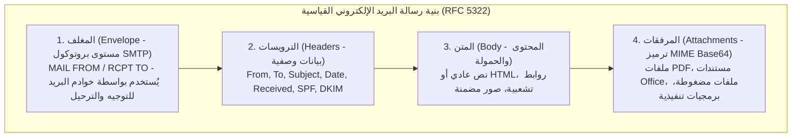

# المعمل 02: تحليل هجمات التصيد الاحتيالي - الجزء الأول: المفاهيم وتشريح الرسائل (Phishing Analysis I)

> **المقرر:** عمليات الأمن السيبراني (مختبر الـ SOC - Cybersecurity Operations)  
> **المحاضر:** Hussein Al-Selwi  
> **إجمالي عدد الشرائح:** 22 شريحة  
> **العرض التقديمي المصدري:** `Lab2_Phishing_Analysis_AR.html`  

### 📋 نبذة عامة وأهداف الوحدة التدريبية
دليل متخصص وشامل لتحليل البريد الاحتيالي: أساليب وتكتيكات الهندسة الاجتماعية، البنية التشريحية للبريد الإلكتروني (المغلف Envelope مقابل الترويسات الظاهرة Headers والمتن والمرفقات)، آليات المصادقة الرقمية الثلاثية (SPF, DKIM, DMARC)، حيل تزييف الروابط وتمويهها، وفحص المرفقات المشبوهة.

---

## 📑 جدول المحتويات

- [الشريحة 01: المقدمة](#slide-01-المقدمة)
- [الشريحة 02: أهداف المعمل](#slide-02-أهداف-المعمل)
- [الشريحة 03: مقدمة في التصيد الاحتيالي](#slide-03-مقدمة-في-التصيد-الاحتيالي)
- [الشريحة 04: كيف تعمل هجمات التصيد؟](#slide-04-كيف-تعمل-هجمات-التصيد؟)
- [الشريحة 05: دراسات حالة لاختراقات واقعية شهيرة](#slide-05-دراسات-حالة-لاختراقات-واقعية-شهيرة)
- [الشريحة 06: أنواع وتصنيفات هجمات التصيد](#slide-06-أنواع-وتصنيفات-هجمات-التصيد)
- [الشريحة 07: أهداف المهاجمين من وراء التصيد](#slide-07-أهداف-المهاجمين-من-وراء-التصيد)
- [الشريحة 08: تقنيات وأساليب الخداع في التصيد](#slide-08-تقنيات-وأساليب-الخداع-في-التصيد)
- [الشريحة 09: الهيكل الأساسي للبريد الإلكتروني](#slide-09-الهيكل-الأساسي-للبريد-الإلكتروني)
- [الشريحة 10: تشريح ترويسة البريد (Email Header)](#slide-10-تشريح-ترويسة-البريد-email-header)
- [الشريحة 11: تشريح جسم ومحتوى البريد (Email Body)](#slide-11-تشريح-جسم-ومحتوى-البريد-email-body)
- [الشريحة 12: الروابط الخبيثة في رسائل التصيد](#slide-12-الروابط-الخبيثة-في-رسائل-التصيد)
- [الشريحة 13: المرفقات الخبيثة وتجاوز الحماية](#slide-13-المرفقات-الخبيثة-وتجاوز-الحماية)
- [الشريحة 14: تشريح عنوان البريد الإلكتروني](#slide-14-تشريح-عنوان-البريد-الإلكتروني)
- [الشريحة 15: بنية نقل البريد الإلكتروني](#slide-15-بنية-نقل-البريد-الإلكتروني)
- [الشريحة 16: مسار تدفق ونقل البريد الإلكتروني](#slide-16-مسار-تدفق-ونقل-البريد-الإلكتروني)
- [الشريحة 17: وكلاء وخوادم البريد (Mail Agents)](#slide-17-وكلاء-وخوادم-البريد-mail-agents)
- [الشريحة 18: بروتوكولات ومنافذ البريد الإلكتروني](#slide-18-بروتوكولات-ومنافذ-البريد-الإلكتروني)
- [الشريحة 19: منهجية تحليل رسائل التصيد](#slide-19-منهجية-تحليل-رسائل-التصيد)
- [الشريحة 20: التحليل الجنائي للترويسة (Headers)](#slide-20-التحليل-الجنائي-للترويسة-headers)
- [الشريحة 21: تحليل بروتوكولات المصادقة (SPF/DKIM/DMARC)](#slide-21-تحليل-بروتوكولات-المصادقة-spf-dkim-dmarc)
- [الشريحة 22: تحليل نصوص ومحتوى الرسالة](#slide-22-تحليل-نصوص-ومحتوى-الرسالة)

---

## الشريحة 01: المقدمة

> **التصنيف / الفئة:** `كشف التهديدات والاستجابة للحوادث · IDR`

### Phishing Analysis

فهم وتشريح وتحديد هجمات التصيد الاحتيالي — من بنية البريد الإلكتروني وحتى دراسات حالة اختراقات واقعية.

المعمل 02 — تحليل التهديدات القائمة على البريد الإلكتروني

> [!NOTE] 🎙️ **ملاحظات وتوجيهات المحاضر (Instructor Lecture Notes)**
> رحب بالطلاب في المعمل 2. يركز هذا المعمل خصيصاً على هجمات التصيد الاحتيالي (Phishing) — وهي واحدة من أكثر تقنيات الوصول الأولي (Initial Access) انتشاراً وفاعلية لدى المخترقين في العالم.

---

## الشريحة 02: أهداف المعمل

> **التصنيف / الفئة:** `نظرة عامة على المعمل`

### الأهداف التعليمية للمعمل

- فهم أساسيات التصيد الاحتيالي ومدى انتشاره كمدخل رئيسي للاختراقات
- تعلم منهجية صارمة ومنظمة لتحليل رسائل البريد المشبوهة
- Develop hands-on skills in analyzing email content , headers , and tracing senders
- Gain an understanding in identifying and analyzing malicious URLs and attachments
- Explore both proactive and reactive defense strategies against phishing
- Learn to document and communicate phishing analysis findings proficiently

> [!NOTE] 🎙️ **ملاحظات وتوجيهات المحاضر (Instructor Lecture Notes)**
> استعرض أهداف المعمل بإيجاز ليعرف الطلاب ما سيكتسبونه بنهاية الجلسة من مهارات في تشريح الإيميلات وفحص الترويسات والمصادقة وتطبيق منهجية الفرز الاحترافية.

---

## الشريحة 03: مقدمة في التصيد الاحتيالي

> **التصنيف / الفئة:** `الأساسيات`

### مقدمة في التصيد الاحتيالي (Phishing Fundamentals)

Phishing is a social engineering attack in which an attacker impersonates a trusted entity to trick a victim into revealing sensitive information, clicking a malicious link, or executing malicious code.

- **Most Common Vector**: يظل التصيد الوسيلة رقم 1 في العالم لنيل موطئ القدم الأول (Initial Access) في معظم الاختراقات الكبرى.
- **Exploits Trust, Not Code**: يستهدف علم النفس البشري — الاستعجال، الخوف، الفضول، وانتحال السلطة — بدلاً من الثغرات البرمجية المعقدة.
- **Low Cost, High Yield**: تكلفة إرسال آلاف الرسائل تكاد تكون معدومة؛ ونسبة نجاح ضئيلة جداً (1%) تكفي لاختراق شبكة المؤسسة بالكامل!

> [!IMPORTANT]
> أهداف هجوم التصيد: the ultimate goal is almost always to gain unauthorized access — to an account, a network, or funds — by manipulating a person rather than breaking a system. This lab focuses primarily on email-based phishing .

> [!NOTE] 🎙️ **ملاحظات وتوجيهات المحاضر (Instructor Lecture Notes)**
> عرّف التصيد بوضوح: هجوم يعتمد على الهندسة الاجتماعية وخداع البشر بدلاً من استغلال الثغرات البرمجية البحتة. وضح أهدافه: سرقة الحسابات، زرع برمجيات خبيثة، أو تحويل الأموال. وبيّن أنه الوسيلة رقم 1 للوصول الأولي عالمياً.

---

## الشريحة 04: كيف تعمل هجمات التصيد؟

> **التصنيف / الفئة:** `ATTACK آلية العمل`

### كيف تنجح هجمات التصيد؟ السيكولوجيا وسلسلة الهجوم

يعتمد التصيد على التلاعب النفسي أكثر من الاختراق التقني — حيث يستغل المهاجمون العواطف البشرية لدفع الضحية للتصرف السريع دون تفكير:

- **1. الاستعجال والضغط الزمني (Urgency)**: "اتخذ إجراء خلال 24 ساعة وإلا سيتم إيقاف حسابك" — خلق ضغط زمني مصطنع لتعطيل التفكير المنطقي.
- **Trust / Authority**: انتحال صفة الدعم الفني، البنك، الرئيس التنفيذي، أو علامة تجارية كبرى لكسب الثقة الفورية.
- **3. التخويف والتهديد (Fear)**: التهديد بإغلاق الحساب، المساءلة القانونية، أو الخسارة المالية لإثارة رد فعل اندفاعي.
- **4. الألفة والاعتياد (Familiarity)**: تقليد رسائل الزملاء، الموردين المعتادين، أو إشعارات البرامج اليومية (مثل إشعار كاذب من Slack أو Teams برابط مزيف).
- **5. الندرة والفرص المحدودة (Scarcity)**: الإيحاء بوجود فرصة محدودة لا تعوض أو انتهاء تراخيص الخدمة لإجبار الضحية على التجاوب السريع.

> [!NOTE] 🎙️ **ملاحظات وتوجيهات المحاضر (Instructor Lecture Notes)**
> اشرح المحفزات النفسية التي يتلاعب بها المهاجم: الاستعجال (1. الاستعجال والضغط الزمني (Urgency))، الثقة وانتحال الشخصيات، الخوف من العقاب، الألفة بالروتين اليومي، والندرة. ثم استعرض تسلسل سلسلة الهجوم: إرسال الإيميل، النقر، حصاد كلمات المرور أو الاختراق.

---

## الشريحة 05: دراسات حالة لاختراقات واقعية شهيرة

> **التصنيف / الفئة:** `الأثر الواقعي في العالم الحقيقي`

### دروس من اختراقات كبرى بدأت برسالة تصيد واحدة

رسالة بريد إلكتروني واحدة، أو رابط مشبوه، يمكن أن يتدرج ليتحول إلى شلل في العمليات، خسائر مالية فادحة، وكوارث في العالم الحقيقي:

- **Spear-Phishing → Stolen Token Seeds**: إيميل تصيد موجه بعنوان "خطة التوظيف" يحمل ملف Excel استغل ثغرة Zero-Day في Flash، وسرق أسرار رموز التوثيق SecurID واستُخدم لاحقاً ضد وزارة الدفاع الأمريكية!
- **Fake Zoom Invite**: نقرة واحدة من المؤسس على رابط دعوة Zoom وهمي ثبتت برمجية خبيثة مكّنت المهاجمين من السيطرة على البريد وتحويل ملايين الدولارات وسقوط الشركة.
- **Spear-Phishing → BlackEnergy**: رسائل تصيد تحمل مرفقات وورد بماكرو خبيث زرعت برمجية BlackEnergy قبل 7 أشهر كاملة من قيام المهاجمين بقطع الكهرباء عن 230 ألف مواطن في عز الشتاء!
- **CEO Fraud / BEC**: انتحل المخترقون هوية الرئيس التنفيذي عبر البريد الإلكتروني وخدعوا قسم المحاسبة لتحويل 54 مليون دولار لحسابات خارجية — دون الحاجة لاختراق أي خادم!

> [!IMPORTANT]
> ملاحظة للمحلل: Even a security vendor specializing in authentication was breached by a deliberately unremarkable phishing email — proof that technical sophistication elsewhere doesn't compensate for one person opening one attachment.

> [!NOTE] 🎙️ **ملاحظات وتوجيهات المحاضر (Instructor Lecture Notes)**
> استعرض دراسات الحالة الأربع الواقعية: اختراق RSA عام 2011 بإيميل توظيف وملف إكسل خبيث سرق بذور الـ SecurID، واختراق Levitas بنقر رابط زوم وهمي كلف ملايين الدولارات، وانقطاع كهرباء أوكرانيا ببرمجية BlackEnergy عبر ماكرو خبيث، واحتيال FACC بالبريد.

---

## الشريحة 06: أنواع وتصنيفات هجمات التصيد

> **التصنيف / الفئة:** `TAXONOMY`

### تصنيفات هجمات التصيد وفق النطاق وقناة التوصيل

التصيد ليس مجرد أسلوب واحد — بل فئة واسعة تضم عدة أنواع تختلف حسب قناة التوصيل ومدى تخصيص واستهداف الضحية:

- **Phishing**: رسائل جماعية عامة تُرسل لملايين العناوين عشوائياً، أملاً في سقوط نسبة ضئيلة من الضحايا.
- **Spear-Phishing**: Targeted at a specific individual or organization, personalized with researched details to seem credible.
- **Whaling**: Spear-phishing aimed specifically at "big fish" — executives, finance officers, or other high-value targets.
- **Smishing**: Phishing delivered over SMS text messages, often with a malicious link disguised as a delivery or bank alert.
- **Vishing**: Voice-call phishing — attackers impersonate IT support, banks, or government over the phone to extract info.
- **Quishing**: QR-code phishing — a malicious QR code redirects a scanning phone to a credential-harvesting page.

> [!NOTE] 🎙️ **ملاحظات وتوجيهات المحاضر (Instructor Lecture Notes)**
> استعرض أنواع التصيد: التصيد العام، التصيد الموجه (2. التصيد الموجه (Spear Phishing))، تصيد كبار التنفيذيين (Whaling)، التصيد عبر الرسائل القصيرة (Smishing)، التصيد الصوتي (Vishing)، وتصيد رموز الاستجابة السريعة (Quishing QR). أكد أنها تختلف في قناة الإرسال ودقة الاستهداف.

---

## الشريحة 07: أهداف المهاجمين من وراء التصيد

> **التصنيف / الفئة:** `ATTACKER MOTIVATION`

### ماذا يريد المهاجم أن يحقق من هجوم التصيد؟

Regardless of the channel used, most phishing campaigns are working toward one of three underlying goals.

- **Information Gathering**: 4. الاستطلاع وجمع المعلومات to map an organization's structure, vendors, or systems — fuel for a later, more convincing attack. Attackers favor this approach because it lets them collect intelligence without direct interaction whenever possible, staying unnoticed while they build a profile of the target.
- **1. سرقة وحصاد بيانات الدخول**: Tricking the victim into typing their username and password into a fake login page the attacker controls.
- **2. زرع وتسليم البرمجيات الخبيثة**: Using a link or attachment to get malicious code running directly on the victim's device.

> [!IMPORTANT]
> Note: These objectives often chain together — information gathering in one campaign can feed a more convincing spear-phish later, which then harvests credentials or delivers malware.

> [!NOTE] 🎙️ **ملاحظات وتوجيهات المحاضر (Instructor Lecture Notes)**
> Cover the three main 'why' categories behind a phishing attack: gathering information for later use, harvesting credentials directly, and delivering malware. These often overlap within a single campaign.

---

## الشريحة 08: تقنيات وأساليب الخداع في التصيد

> **التصنيف / الفئة:** `ATTACK TECHNIQUES`

### أساليب وتقنيات التمويه والخداع الأكثر شيوعاً

Beyond the message itself, attackers rely on specific technical tricks to make the deception convincing and to slip past filters.

URL Manipulation Look-alike domains, typosquatting, URL shorteners, and subdomain tricks that disguise a malicious link's real destination. Typosquatting: micros0ft.com or paypa1.com — a slight misspelling close enough to pass a quick glance. Homograph attack: аpple.com using a Cyrillic "а" instead of Latin "a" — visually identical, entirely different domain. URL shortener: bit.ly/3xK9z2 hides the real destination until after the click.

- **Email Spoofing & Impersonation**: Forging the From: address or display name so the message appears to come from a trusted sender, exploiting the lack of built-in sender verification in SMTP.
- **Encoding**: Obfuscating links or payloads with Base64, URL encoding, or HTML character entities so the malicious content is unreadable to filters but renders normally for the victim.
- **المرفقات الخبيثة وأساليب تجاوز الفحص الأمني**: Weaponized files — macro-enabled documents, double extensions, or password-protected archives — that deliver malware once the victim opens them.
- **Abuse of Legitimate Services**: Hosting phishing pages on trusted platforms (Google Forms, SharePoint, cloud storage) so links pass reputation and spam filters undetected.

> [!NOTE] 🎙️ **ملاحظات وتوجيهات المحاضر (Instructor Lecture Notes)**
> Cover the technical methods attackers use to make phishing convincing: spoofing/impersonation of sender identity, URL manipulation, encoding/obfuscation of malicious content, malicious attachments, and abuse of legitimate services to bypass filters.

---

## الشريحة 09: الهيكل الأساسي للبريد الإلكتروني

> **التصنيف / الفئة:** `ANATOMY OF AN EMAIL`

### Email Structure



Every email — legitimate or malicious — is built from the same basic parts. Knowing what's normal in each makes anomalies easier to spot.

```email-header
HEADER From: "IT Support" <support@accounts-secure-verify.com> To: j.doe@company.com Subject: Action Required: Verify Your Account
From: "IT Support" <support@accounts-secure-verify.com>
To: j.doe@company.com Subject: Action Required: Verify Your Account
BODY Dear Customer, your access will be suspended within 24 hours unless you verify your identity immediately.
URL Verify My Account → (hover reveals true destination)
Verify My Account → (hover reveals true destination)
ATTACHMENT Invoice_2024.pdf
```

- **↑ Header**: Routing metadata: From, To, Subject, Received hops, and authentication results.
- **↑ Body**: The visible message content — text, HTML formatting, and embedded social-engineering cues.
- **↑ URLs**: Embedded links — often disguised, shortened, or pointing to look-alike domains.
- **↑ Attachments**: Files riding along with the message — common vehicle for malware delivery.

> [!NOTE] 🎙️ **ملاحظات وتوجيهات المحاضر (Instructor Lecture Notes)**
> Transition slide into the email-structure section. Walk through the labeled diagram top to bottom: header, body, URL, and attachment, pointing out that every email — legitimate or malicious — is built from these same basic parts.

---

## الشريحة 10: تشريح ترويسة البريد (Email Header)

> **التصنيف / الفئة:** `COMPONENT 01`

### Email Header

The header carries routing and authentication metadata — usually hidden from the average user, but essential for an analyst.

```email-header
HEADER From: "IT Support" <support@accounts-secure-verify.com> To: j.doe@company.com Subject: Action Required: Verify Your Account Received: from mail.accounts-secure-verify.com [203.0.113.42] ... SPF: fail DKIM: none DMARC: fail
From: "IT Support" <support@accounts-secure-verify.com>
To: j.doe@company.com
Subject: Action Required: Verify Your Account
Received: from mail.accounts-secure-verify.com [203.0.113.42] ...
SPF: fail DKIM: none DMARC: fail
```

- **From / الاسم الظاهر المعروض (Display Name)**: Easily spoofed — attackers set any display name they like, regardless of the actual sending address.
- **Received Chain**: Each mail hop adds a line — read bottom-up to trace the message's true origin path.
- **SPF / DKIM / DMARC**: Authentication results that verify whether the sending server was actually authorized for that domain.

> [!NOTE] 🎙️ **ملاحظات وتوجيهات المحاضر (Instructor Lecture Notes)**
> Walk through each header field shown in the mockup. Emphasize that From: display names are trivially spoofable, while Received: chains and authentication results (SPF/DKIM/DMARC) are much harder to fake.

---

## الشريحة 11: تشريح جسم ومحتوى البريد (Email Body)

> **التصنيف / الفئة:** `COMPONENT 02`

### Email Body

The body is where social engineering happens — the visible text and formatting designed to provoke a reaction.

```email-header
BODY Dear Customer, We detected unusual activity on your account. Your access will be suspended within 24 hours unless you verify your identity immediately. Verify My Account →
```

Common Manipulation Tactics 1. الاستعجال والضغط الزمني (Urgency) — artificial deadlines and threats of account loss Authority — impersonating IT, executives, or known brands 3. التخويف والتهديد (Fear) — warnings of security breaches or legal action What to Examine Generic greetings ("Dear Customer") instead of your actual name Mismatched branding, logos, or formatting quality Hidden link destinations beneath styled button text

> [!NOTE] 🎙️ **ملاحظات وتوجيهات المحاضر (Instructor Lecture Notes)**
> Discuss the body as the social-engineering surface: urgency language, spoofed branding, poor grammar (sometimes), and HTML tricks that hide the true destination of links.

---

## الشريحة 12: الروابط الخبيثة في رسائل التصيد

> **التصنيف / الفئة:** `COMPONENT 03`

### كيف يوظف المهاجمون الروابط الخبيثة في التصيد؟

Malicious links rarely look obviously malicious — attackers rely on visual tricks to disguise the real destination.

```email-header
URL Displayed text: www.paypal.com/account/verify Actual destination: hxxp://paypa1-secure.verify-account.ru/login.php
Displayed text: www.paypal.com/account/verify
Actual destination: hxxp://paypa1-secure.verify-account.ru/login.php
```

- **Look-alike Domains**: Character substitution (paypa1.com), extra words (paypal-secure.com), or different TLDs (.ru, .cn, .xyz).
- **2. خدمات تقصير الروابط (Shorteners)**: bit.ly, tinyurl, and similar services hide the real destination behind a short, unreadable link.
- **Subdomain Abuse**: paypal.com.verify-login.net — the real domain is "verify-login.net"; "paypal.com" is just a subdomain label.

> [!IMPORTANT]
> ملاحظة تاريخية للمحلل: Always hover over (never click) a link to preview the real URL, and read domains from right to left, identifying the actual registrable domain before trusting anything in front of it.

> [!NOTE] 🎙️ **ملاحظات وتوجيهات المحاضر (Instructor Lecture Notes)**
> Cover URL obfuscation techniques: look-alike domains, URL shorteners, subdomain tricks, and the importance of hovering to reveal the real destination before clicking.

---

## الشريحة 13: المرفقات الخبيثة وتجاوز الحماية

> **التصنيف / الفئة:** `COMPONENT 04`

### المرفقات الخبيثة وأساليب تجاوز الفحص الأمني

Attachments remain one of the most direct ways to deliver malware — once opened, the victim's own actions execute the payload.

```email-header
ATTACHMENT Invoice_2024.pdf.exe (1.2 MB)
```

- **Double Extensions**: Invoice.pdf.exe — Windows hides the real extension by default, so it appears as a harmless PDF.
- **Macro-Enabled Office Files**: .docm / .xlsm files that prompt "Enable Content" to run a malicious macro on open — used in the Ukraine grid attack.
- **Password-Protected Archives**: ZIP files with the password inside the email body, specifically to evade automated antivirus/sandbox scanning.
- **ISO / IMG Containers**: Disk image files that bypass "Mark of the Web" browser-download warnings applied to regular files.

> [!NOTE] 🎙️ **ملاحظات وتوجيهات المحاضر (Instructor Lecture Notes)**
> Cover common malicious file types and techniques: macro-enabled Office docs, double extensions, password-protected archives to evade scanning, and ISO/IMG files used to bypass mark-of-the-web protections.

---

## الشريحة 14: تشريح عنوان البريد الإلكتروني

> **التصنيف / الفئة:** `EMAIL ADDRESSES`

### Email Address Anatomy

Every email address has three structural parts — and attackers manipulate each one to impersonate trusted senders.

j.doe LOCAL PART @ company DOMAIN . com TLD

Legitimate j.doe@company.com support@microsoft.com Spoofed / Look-alike j.doe@cornpany.com (rn instead of m) support@microsoft-secure.com (wrong domain entirely)

> [!NOTE] 🎙️ **ملاحظات وتوجيهات المحاضر (Instructor Lecture Notes)**
> Break down the anatomy of an email address into local part, domain, and TLD. This sets up the skill of spotting spoofed or look-alike sender addresses covered in earlier technique slides.

---

## الشريحة 15: بنية نقل البريد الإلكتروني

> **التصنيف / الفئة:** `TECHNICAL الأساسيات`

### Email Fundamentals

To analyze a phishing email effectively, you first need to understand how legitimate email actually travels across the internet — the client, the mail servers, the DNS lookup, and the agents and protocols involved.

> [!IMPORTANT]
> Why this matters: Spoofed headers, mismatched routing, and forged sender fields are easiest to catch when you know what authentic email transmission looks like under the hood.

> [!NOTE] 🎙️ **ملاحظات وتوجيهات المحاضر (Instructor Lecture Notes)**
> Transition slide into the technical/protocol section. Set up why understanding the underlying email communication flow matters for phishing analysis — you need to know what 'normal' looks like before you can spot what's abnormal in headers.

---

## الشريحة 16: مسار تدفق ونقل البريد الإلكتروني

> **التصنيف / الفئة:** `CLIENT → SERVER → DNS`

### مسار تدفق ونقل البريد الإلكتروني خطوة بخطوة

```mermaid
flowchart TD
    Mail["رسالة بريد واردة"] --> SPF{"1. فحص SPF<br/>هل عنوان IP الخاص بالخادم المرسل مصرح به في سجلات DNS النطاق؟"}
    Mail --> DKIM{"2. فحص DKIM<br/>هل التوقيع الرقمي المشفر للرسالة يطابق المفتاح العام للنطاق؟"}
    SPF --> DMARC{"3. تقييم سياسة DMARC<br/>هل تطابق نطاق SPF و DKIM مع النطاق الظاهر في خانة From؟"}
    DKIM --> DMARC
    DMARC -->|نجاح (Pass)| Inbox["✅ تسليم فوري إلى صندوق الوارد (Inbox)"]
    DMARC -->|فشل مع سياسة p=none| Mon["📋 تسليم مع المراقبة والتسجيل في التقرير"]
    DMARC -->|فشل مع سياسة p=quarantine| Spam["⚠️ التحويل إلى مجلد الرسائل غير المرغوبة (Spam / Quarantine)"]
    DMARC -->|فشل مع سياسة p=reject| Drop["🚫 الحظر والرفض الكامل عند البوابة (Drop)"]
```

Sending an email involves a relay between the email client , the mail server , and a DNS lookup to find the right destination.

Sender Client SMTP → SMTP Server (outgoing) DNS MX Lookup Recipient Mail Server POP/IMAP → Recipient Client

1. **خطوة 1**: Client → SMTP server
2. **خطوة 2**: SMTP queries DNS for recipient's MX record
3. **خطوة 3**: Delivered to recipient's mail server
4. **خطوة 4**: Client retrieves via POP/IMAP

> [!NOTE] 🎙️ **ملاحظات وتوجيهات المحاضر (Instructor Lecture Notes)**
> Walk through the animation: the client sends mail via SMTP to its outgoing server, which performs a DNS MX lookup to find the recipient's mail server, delivers the message over SMTP, and the recipient retrieves it from their server using POP or IMAP.

---

## الشريحة 17: وكلاء وخوادم البريد (Mail Agents)

> **التصنيف / الفئة:** `ARCHITECTURE`

### Mail Agents

Tracing one real email from Bob to Alice shows exactly where each agent type — MUA , MTA , and MDA — sits along the path.

Bob (Sender) MUA SMTP → Bob's Mail Server (Gmail) MTA relay across intermediate MTAs Alice's Mail Server (Yahoo) MTA MDA POP3/IMAP → Alice (Recipient) MUA

- **Mail User Agent** `[MUA]`: The email client the person actually uses — Outlook, Gmail's web interface, Apple Mail. It composes, sends, and displays messages on behalf of the user.
- **Mail Transfer Agent** `[MTA]`: The server software that relays mail between servers using SMTP — it's what moves a message from Bob's provider, across the internet, to Alice's provider.
- **Mail 5. التسليم للصندوق (MDA) Agent** `[MDA]`: Takes the message handed off by the final MTA and deposits it into the recipient's actual mailbox, where it waits to be retrieved via POP3/IMAP.

> [!IMPORTANT]
> ملاحظة تاريخية للمحلل: Gmail and Yahoo each run both the MTA (relay) and MDA (mailbox delivery) roles on the same servers — they're logically distinct agents, but commonly bundled into one platform. Each MTA hop in between adds a Received: line you can trace in the header.

> [!NOTE] 🎙️ **ملاحظات وتوجيهات المحاضر (Instructor Lecture Notes)**
> Walk through the concrete Bob-to-Alice journey: Bob's client (MUA) hands the message to Bob's Gmail server over SMTP. Gmail's MTA relays it across several intermediate MTA hops on the internet until it reaches Alice's Yahoo server, where the MDA deposits it into her mailbox. Alice's client (MUA) then retrieves it via POP3/IMAP. Emphasize that MTA and MDA roles often live on the same physical mail server (Gmail, Yahoo) even though they are logically distinct agents.

---

## الشريحة 18: بروتوكولات ومنافذ البريد الإلكتروني

> **التصنيف / الفئة:** `PROTOCOLS`

### Email Protocols

A small set of protocols, each with one job, work together to move and retrieve every email.

- **SMTP(port 25 / 587)**: Simple Mail Transfer Protocol — used to send and relay mail between the client and outgoing servers, and between servers.
- **DNS (MX Record)(port 53)**: Resolves which mail server is responsible for a domain — checked before delivery so the message reaches the right destination.
- **POP3(port 110)**: Post Office Protocol — downloads mail to one device and typically removes it from the server.
- **IMAP(port 143)**: بروتوكول الوصول للرسائل — يبقي الرسائل متزامنة على الخادم لتراها كافة الأجهزة بنفس الحالة.

> [!IMPORTANT]
> ملاحظة تاريخية للمحلل: None of these protocols verify sender identity by default — that's why SPF, DKIM, and DMARC exist as separate authentication layers checked at the header level.

> [!NOTE] 🎙️ **ملاحظات وتوجيهات المحاضر (Instructor Lecture Notes)**
> Cover the core protocols by function: SMTP for sending/relaying, POP3 and IMAP for retrieval (and the difference between them), and DNS MX records for routing. This formalizes what students just saw in the animation.

---

## الشريحة 19: منهجية تحليل رسائل التصيد

> **التصنيف / الفئة:** `METHODOLOGY`

### منهجية محلل الـ SOC لتحليل رسائل التصيد الاحتيالي

عملية منظمة وقابلة للتكرار للتعامل مع أي بريد مشبوه — من الفرز الأولي وحتى كتابة التقرير النهائي:

1 Initial Triage Quickly assess and prioritize 2 Header and Sender Examination التحقيق في عناوين IP وخوادم النقل والمصادقة تحديد المصدر الحقيقي للرسالة والتحقق من صحتها 3 Content Examination تحليل لغة الرسالة والتنسيق بحثاً عن الخداع رصد علامات ومحفزات الهندسة الاجتماعية 4 URL Examination 4. فحص الروابط والنطاقات بالأدوات الآمنة 5 5. فحص المرفقات استخراج المرفقات بأمان وحساب قيم الهاش فحص سمعة الملفات وتشغيلها في بيئات معزولة 6 6. إجراءات الدفاع تنفيذ إجراءات الدفاع التفاعلي (الحظر والحجر) تعزيز الضوابط الاستباقية لتفادي التكرار التواصل مع الموظف المستهدف وأصحاب المصلحة 7 Documentation and Reporting توثيق الأدلة والنتائج والقرارات في تقرير مفصل إغلاق التنبيهات وتذاكر الحادثة الأمنية رسمياً

> [!NOTE] 🎙️ **ملاحظات وتوجيهات المحاضر (Instructor Lecture Notes)**
> استعرض خطوات المنهجية المنظمة لتحليل رسائل التصيد: الفرز الأولي، فحص الترويسة والمرسل، فحص المحتوى، فحص الروابط، فحص المرفقات، فحص السياق، إجراءات الدفاع، والتوثيق والتقارير. هذا هو المسار العملي الصارم الذي سيطبقه الطلاب.

---

## الشريحة 20: التحليل الجنائي للترويسة (Headers)

> **التصنيف / الفئة:** `METHOD DEEP DIVE`

### التحليل الجنائي لترويسة البريد وكشف التزييف

الترويسة هي أول مكان لإثبات ما إذا كانت الرسالة حقيقية أم منتحلة — ومعظم بياناتها مخفية عن المتلقي العادي:

- **Trace the Received: Chain**: Each mail hop prepends a Received: line. Read from the bottom up — the bottom-most entry is closest to the true origin, since every later hop is added on top.
- **Compare From / Reply-To / Return-Path**: في الإيميلات الشرعية تكون عناوين From و Reply-To و Return-Path تابعة لنفس الدومين. وأي اختلاف بينها هو علامة خطر كبرى.
- **Check the Sending IP**: Cross-reference the originating IP in the first Received: line against the domain's known mail infrastructure or a reputation/geolocation lookup.
- **Inspect the الاسم الظاهر المعروض (Display Name)**: يمكن كتابة "الدعم الفني" أمام أي إيميل. دقق دائماً في العنوان الفعلي داخل القوسين وليس الاسم الظاهر فقط.

> [!IMPORTANT]
> ملاحظة تاريخية للمحلل: Header fields like From: are trivially spoofed because SMTP has no built-in sender verification — that's exactly why authentication protocols like SPF, DKIM, and DMARC exist as a separate check, covered next.

> [!NOTE] 🎙️ **ملاحظات وتوجيهات المحاضر (Instructor Lecture Notes)**
> شرح متعمق للخطوة 2: تحليل الترويسات (Headers). قراءة سلسلة Received من الأسفل للأعلى لمعرفة أول خادم استلم الرسالة، ومقارنة From مع Reply-To و Return-Path لكشف التناقض، وفحص عنوان IP المرسل في قواعد بيانات السمعة.

---

## الشريحة 21: تحليل بروتوكولات المصادقة (SPF/DKIM/DMARC)

> **التصنيف / الفئة:** `METHOD DEEP DIVE`

### تحليل بروتوكولات مصادقة البريد (SPF, DKIM, DMARC)

لم يتضمن بروتوكول SMTP الأصلي أي تحقق من هوية المرسل — ولذلك أضيفت آليات SPF و DKIM و DMARC لسد هذه الثغرة. ويجب على المحلل فحص نتائجها الثلاث في الترويسة:

- **SPF**: 1. بروتوكول SPF (سجل سياسة المرسل) — the domain publishes a DNS record listing which IPs are allowed to send mail for it. The receiving server checks the sending IP against that list. Result: pass / fail / softfail / none
- **DKIM**: 2. بروتوكول DKIM (التوقيع الرقمي للبريد) — the sender signs the message with a private key; the receiver checks that signature against a public key published in DNS to confirm the message wasn't altered in transit. Result: pass / fail / none
- **DMARC**: 3. بروتوكول DMARC (تنسيق المصادقة والسياسات), Reporting & Conformance — ties SPF and DKIM together and tells receiving servers what to do if both fail: monitor, quarantine, or reject. Result: pass / fail (policy: none / quarantine / reject)

```email-header
HEADER From: "IT Support" <support@accounts-secure-verify.com> SPF: fail DKIM: none DMARC: fail (p=reject)
From: "IT Support" <support@accounts-secure-verify.com>
SPF: fail DKIM: none DMARC: fail (p=reject)
```

> [!IMPORTANT]
> ملاحظة تاريخية للمحلل: All three failing at once, as above, is a near-certain spoof. But check individually — a forwarded legitimate email can fail SPF/DKIM for benign reasons, so always read the result in context rather than treating any single failure as definitive proof.

> [!NOTE] 🎙️ **ملاحظات وتوجيهات المحاضر (Instructor Lecture Notes)**
> شرح متعمق لبروتوكولات المصادقة الثلاثة: SPF للتحقق من أن عنوان IP المرسل مصرح له في سجل DNS، DKIM للتحقق من التوقيع الرقمي المشفر وعدم تعديل الرسالة، و DMARC الذي يربط بينهما ويحدد ماذا يفعل خادم الاستقبال في حال الفشل (مراقبة، حجر، أو رفض).

---

## الشريحة 22: تحليل نصوص ومحتوى الرسالة

> **التصنيف / الفئة:** `METHOD DEEP DIVE`

### تحليل نصوص ومحتوى البريد الإلكتروني

بعد فحص الترويسة والمصادقة، تأتي خطوة التدقيق في محتوى الرسالة الداخلي لكشف أساليب الخداع المصممة لتضليل الضحية:

- **Grammar & Spelling Errors**: العبارات الركيكة، والأخطاء الإملائية، والترجمة الآلية شائعة في رسائل التصيد الجماعي.
- **1. الاستعجال والضغط الزمني (Urgency) & Pressure Language**: عبارات مثل "تصرف فوراً"، "سيتم تجميد حسابك"، أو "أكد بياناتك خلال ساعات" صُممت لمنع التفكير المتأني.
- **Encoded or Hidden Content**: فحص كود HTML بحثاً عن نصوص مشفرة بـ Base64 أو حروف مخفية (Zero-width characters) لخداع فلاتر الكلمات المحظورة.
- **Formatting & Branding Inconsistencies**: شعارات بجودة رديئة، ألوان غير مطابقة للهوية الرسمية، أو توقيع بريد لا يتناسب مع منصب الشخص المنتحل.

> [!IMPORTANT]
> ملاحظة تاريخية للمحلل: Always view the raw source rather than the rendered email — hidden characters and encoded payloads are invisible in a normal mail client but stand out immediately in plain text.

> [!NOTE] 🎙️ **ملاحظات وتوجيهات المحاضر (Instructor Lecture Notes)**
> شرح الخطوة 3: فحص نصوص ومحتوى الرسالة. البحث عن الأخطاء اللغوية والإملائية الناتجة عن الترجمة الآلية، عبارات الضغط والاستعجال، الأكواد المخفية المشفرة بـ Base64 في كود HTML، والتناقضات البصرية في الشعارات والتنسيق.

---

## 🎯 الخلاصة ومخرجات التعلم

- **الوحدة التدريبية:** المعمل 02: تحليل هجمات التصيد الاحتيالي - الجزء الأول: المفاهيم وتشريح الرسائل (Phishing Analysis I)

- **المهارات المكتسبة:** فهم عملي وتطبيقي عميق لكيفية الكشف، التحقيق، الاستجابة، وإدارة التهديدات الأمنية باحترافية داخل بيئة العمليات.

- **مرجع التدريب:** مختبر عمليات الأمن السيبراني العملي — إعداد وتقديم: **Hussein Al-Selwi**.
