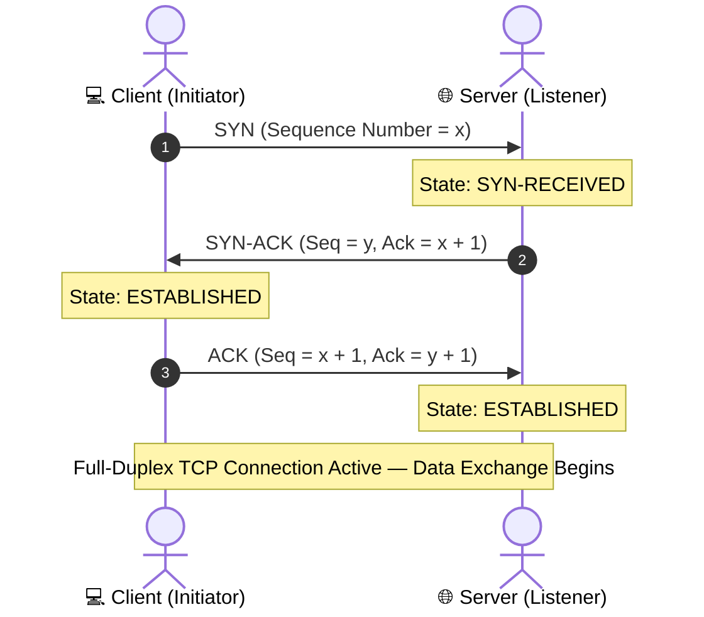

# Lecture 04: Network Security Fundamentals — Traffic & Wireshark

> **Course:** Cybersecurity Operations (SOC Lab)  
> **Instructor:** Hussein Al-Selwi  
> **Total Slides:** 17 Slides  
> **Source Presentation:** `Lecture4_Network_Security.html`  

### 📋 Overview
Core networking concepts for defensive analysts: the TCP/IP model, packet structure, 3-way handshake mechanics, port classifications, Berkeley Packet Filter (BPF) syntax, and hands-on traffic capture with Wireshark.

---

## 📑 Table of Contents

- [Slide 01: Introduction](#slide-01-introduction)
- [Slide 02: Domain Objectives](#slide-02-domain-objectives)
- [Slide 03: Why This Domain Matters](#slide-03-why-this-domain-matters)
- [Slide 04: Core Network Protocols](#slide-04-core-network-protocols)
- [Slide 05: IPv4 Header](#slide-05-ipv4-header)
- [Slide 06: TCP Header](#slide-06-tcp-header)
- [Slide 07: UDP Header](#slide-07-udp-header)
- [Slide 08: Three-Way Handshake](#slide-08-three-way-handshake)
- [Slide 09: Division of Ports](#slide-09-division-of-ports)
- [Slide 10: Common Ports](#slide-10-common-ports)
- [Slide 11: Demo: Handshake with tcpdump](#slide-11-demo-handshake-with-tcpdump)
- [Slide 12: Packet-Based Capture](#slide-12-packet-based-capture)
- [Slide 13: Flow-Based Capture](#slide-13-flow-based-capture)
- [Slide 14: Online Analysis](#slide-14-online-analysis)
- [Slide 15: Offline Analysis](#slide-15-offline-analysis)
- [Slide 16: Intro to tcpdump](#slide-16-intro-to-tcpdump)
- [Slide 17: tcpdump Capture Filters](#slide-17-tcpdump-capture-filters)

---

## Slide 01: Introduction

> **Category:** `INCIDENT DETECTION & RESPONSE`

### Network Security

Understanding network fundamentals, packet-level visibility, and the controls that detect and prevent attacks in transit.

Lab 04 – Network Traffic Capturing and Analyzing

> [!NOTE] 🎙️ **Instructor Lecture Notes**
> Welcome students to Lecture 4. This lecture shifts focus from email-based threats to the network layer itself — the medium every other domain ultimately depends on.

---

## Slide 02: Domain Objectives

> **Category:** `LECTURE OVERVIEW`

- Understand fundamental network security principles
- Explore network packets , flows , and security controls
- Develop skills in performing live packet captures using various tools
- Learn to investigate packet captures and perform network traffic analysis
- Configure and manage intrusion detection and prevention systems
- Learn to write and implement network prevention and detection rules

> [!NOTE] 🎙️ **Instructor Lecture Notes**
> Walk through each objective briefly so students know what they should be able to do by the end of this lecture. Emphasize the progression: understand fundamentals, then capture traffic, then analyze it, then finally configure detection/prevention systems and write rules.

---

## Slide 03: Why This Domain Matters

> **Category:** `WHY IT MATTERS`

### Everything Runs Through the Network

Every device, service, and user in an organization needs to communicate — and that communication happens over the network . It's the shared medium connecting everything together, which makes it one of the most important places to focus security attention.

NETWORK shared medium Endpoints & Devices Email & Web Traffic Cloud Services Servers & Databases IoT & OT Devices Remote Users

> [!IMPORTANT]
> The takeaway: before diving into specific tools and techniques, it helps to see the bigger picture — the network is the foundation that everything else in this course connects to.

> [!NOTE] 🎙️ **Instructor Lecture Notes**
> Keep this at an introductory level. The core idea: the network is the shared medium connecting every device, service, and user in an organization, which is why it's such an important place to focus security attention. Walk through the diagram showing how endpoints, email, cloud, servers, IoT, and remote users all connect through the same network fabric.

---

## Slide 04: Core Network Protocols

> **Category:** `NETWORKING BASICS`

Before looking at packet captures, it helps to know the protocols doing the work underneath. IP handles addressing and routing, while TCP and UDP handle getting data to the right application — one favoring reliability, the other favoring speed.

- **IP — Internet Protocol**: Responsible for addressing and routing — getting a packet from source to destination across networks. IPv4: 32-bit address · version field = 4 IPv6: 128-bit address · version field = 6
- **TCP — Transmission Control Protocol**: Reliable and connection-oriented. Sets up a connection first, then uses sequence numbers to track and reorder every byte sent — so lost data can be detected and retransmitted.
- **UDP — User Datagram Protocol**: Fast and connectionless. No handshake, no delivery guarantee — data is just sent. Ideal when speed matters more than perfection.

> [!IMPORTANT]
> Why this matters: TCP's handshake confirms both sides are ready before any data flows, and the sequence numbers exchanged during it are what let TCP detect missing or out-of-order segments later on. We'll walk through the handshake in detail shortly.

> [!NOTE] 🎙️ **Instructor Lecture Notes**
> Introduce the three protocols students will keep seeing throughout this domain. IP handles addressing and routing — mention the version field (4 vs 6) and address size (32-bit vs 128-bit). TCP is connection-oriented and reliable — walk through the three-way handshake (SYN, SYN-ACK, ACK) and explain how sequence numbers let the receiver detect loss and reorder segments, enabling retransmission. UDP skips all of that for speed — no handshake, no guaranteed delivery, used where speed matters more than reliability (DNS, streaming, VoIP, gaming).

---

## Slide 05: IPv4 Header

> **Category:** `PROTOCOL HEADERS`

Every IPv4 packet starts with a 20-byte header (before any data). Here's what each field carries:

Version 4 bits IHL 4 bits Type of Service 8 bits Total Length 16 bits Identification 16 bits Flags 3 bits Fragment Offset 13 bits TTL 8 bits Protocol 8 bits Header Checksum 16 bits Source IP Address 32 bits Destination IP Address 32 bits

Version IP version in use — 4 for IPv4. IHL Header length in 32-bit words; needed since Options can extend the header. Type of Service Requested priority/handling for the packet (e.g. low delay, high throughput). Total Length Full packet size in bytes, header plus data. Identification Unique ID used to reassemble a packet's fragments. Flags Controls whether the packet may be fragmented and if more fragments follow. Fragment Offset Position of this fragment within the original packet. TTL Hop limit — decremented by each router, packet is dropped at zero. Protocol Identifies the next-layer protocol — e.g. 6 for TCP, 17 for UDP. Header Checksum Verifies the header wasn't corrupted in transit. Source Address 32-bit IP address of the sender. Destination Address 32-bit IP address of the intended recipient.

> [!NOTE] 🎙️ **Instructor Lecture Notes**
> Walk through the IPv4 header field by field. Emphasize Version (always 4 here), IHL (header length in 32-bit words, needed because Options can extend it), Total Length (whole packet including data), and the Source/Destination address fields being 32 bits each.

---

## Slide 06: TCP Header

> **Category:** `PROTOCOL HEADERS`

The TCP header is where the handshake and sequence numbers from the last slide actually live:

Source Port 16 bits Destination Port 16 bits Sequence Number 32 bits Acknowledgment Number 32 bits Data Offset 4 bits Reserved 6 bits Flags 6 bits Window Size 16 bits Checksum 16 bits Urgent Pointer 16 bits

Source / Dest. Port Identify the sending and receiving application (e.g. port 443 for HTTPS). Sequence Number Position of this segment's data in the overall byte stream — the core of TCP's reliability. Acknowledgment Number Next sequence number the sender expects to receive back. Data Offset Header length in 32-bit words, same idea as IHL in IPv4. Flags Control bits like SYN, ACK, and FIN that drive the handshake and connection teardown. Window Size How much data the receiver can accept before needing an acknowledgment. Checksum Verifies the segment (header and data) wasn't corrupted in transit. Urgent Pointer Marks priority data within the segment, used only when the URG flag is set.

> [!NOTE] 🎙️ **Instructor Lecture Notes**
> Connect this back to the three-way handshake and sequence numbers covered earlier — point out where Sequence Number, Acknowledgment Number, and the Flags (SYN, ACK, FIN, etc.) physically live in the header.

---

## Slide 07: UDP Header

> **Category:** `PROTOCOL HEADERS`



UDP's header is only 8 bytes — no sequence numbers, no handshake fields, nothing tracking reliability. That simplicity is exactly what makes it fast.

Source Port 16 bits Destination Port 16 bits Length 16 bits Checksum 16 bits

Source Port Port the datagram was sent from (optional — can be zeroed if no reply is expected). Destination Port Port the datagram is addressed to on the receiving host. Length Size of the UDP header plus data, in bytes. Checksum Optional in IPv4 — verifies the datagram wasn't corrupted, but there's no retransmission if it fails.

> [!IMPORTANT]
> Compare to TCP: four simple fields versus TCP's sequence numbers, acknowledgments, and flags — the trade-off between UDP's speed and TCP's reliability, in header form.

> [!NOTE] 🎙️ **Instructor Lecture Notes**
> Contrast this directly with the TCP header — same job (get data to the right port) but a fraction of the fields, which is exactly why UDP is fast but offers no reliability guarantees on its own.

---

## Slide 08: Three-Way Handshake

> **Category:** `TCP IN DETAIL`

### The Three-Way Handshake

Before any data is exchanged, the client and server synchronize their sequence numbers through three TCP segments — this is what a SYN scan or a normal connection setup looks like at the packet level.

Client Server 1 SYN seq = 1000 2 SYN, ACK seq = 5000 · ack = 1001 3 ACK seq = 1001 · ack = 5001 ✓ Connection Established

> [!IMPORTANT]
> Reading the numbers: each side's sequence number marks where its byte stream starts, and each ack number confirms "I received everything up to this point, send the next byte." That's the whole trick behind TCP reliability.

> [!NOTE] 🎙️ **Instructor Lecture Notes**
> Walk through each arrow in order. Point out that the client picks an initial sequence number (here 1000) in the SYN. The server acknowledges it with ack = 1001 (client's seq + 1) while sending its own sequence number (5000) in the SYN-ACK. The client then acknowledges the server's sequence number with ack = 5001. This is the mechanism that lets both sides confirm they're synchronized before any real data is sent.

---

## Slide 09: Division of Ports

> **Category:** `PORTS & SERVICES`

A port is a 16-bit number (0–65535) that identifies which application or service on a host a connection belongs to. Combined with an IP address, it forms a full endpoint — e.g. 192.168.1.10:443 . Ports are divided into three ranges:

0 – 1023 Well-Known Ports Reserved for standard services (HTTP, DNS, SSH) and assigned by IANA. 1024 – 49151 Registered Ports Registered by vendors for specific applications, less strictly controlled. 49152 – 65535 Dynamic / Private Ports Assigned temporarily by the OS for outgoing client connections.

> [!IMPORTANT]
> In practice: a server listens on a well-known port (like 443 for HTTPS), while your browser connects out from a random dynamic port — that pairing is what uniquely identifies the conversation.

> [!NOTE] 🎙️ **Instructor Lecture Notes**
> Explain that a port is a 16-bit number (0-65535) that, combined with an IP address, identifies exactly which application on a host a connection belongs to. Then cover the three official ranges defined by IANA: well-known, registered, and dynamic/private.

---

## Slide 10: Common Ports

> **Category:** `PORTS & SERVICES`

The well-known ports you'll run into most often when reading traffic or logs:

21 FTP Transfers files between systems, usually without encryption. 22 SSH Encrypted remote command-line access and file transfer. 23 Telnet Remote command-line access sent entirely in plaintext, including credentials. 25 SMTP Sends email between mail servers. 53 DNS Resolves domain names into IP addresses. 80 HTTP Unencrypted web traffic between browser and server. 110 POP3 Downloads email from a server, typically removing it afterward. 135 RPC Microsoft's remote procedure call, used for inter-process communication. 139 NetBIOS Legacy Windows protocol for file and printer sharing on a local network. 143 IMAP Retrieves email while keeping messages synced on the server. 389 LDAP Queries centralized directory services such as Active Directory. 443 HTTPS HTTP secured with TLS/SSL encryption. 445 SMB Modern Windows file and printer sharing, replacing NetBIOS. 3389 RDP Graphical remote access to a Windows system's desktop. 8080 HTTP-Alt Common alternate port for HTTP, often used by proxies or app servers.

> [!NOTE] 🎙️ **Instructor Lecture Notes**
> These are the ports analysts see constantly in captures and logs. Group mentally into: file transfer/remote access (21,22,23,3389), email (25,110,143), web (80,443,8080), Windows/directory services (135,139,389,445), and DNS (53).

---

## Slide 11: Demo: Handshake with tcpdump

> **Category:** `DEMO`

### Handshake with tcpdump

Here's the same three-way handshake as it would appear in tcpdump output — this is exactly what you'll be looking for once we start capturing traffic ourselves.

```bash
$
sudo tcpdump -i eth0 host 93.184.216.34 and port 80 -n
09:14:02.000000 IP 192.168.1.10.51514 > 93.184.216.34.80: Flags
[S]
, seq 1000, win 64240, length 0
09:14:02.028000 IP 93.184.216.34.80 > 192.168.1.10.51514: Flags
[S.]
, seq 5000, ack 1001, win 65535, length 0
09:14:02.028100 IP 192.168.1.10.51514 > 93.184.216.34.80: Flags
[.]
, ack 5001, win 64240, length 0
```

> [!IMPORTANT]
> Reading tcpdump flags: [S] = SYN, [S.] = SYN-ACK, and [.] = an ACK with no other flags set — spotting this three-line pattern is the fastest way to find a handshake in raw output.

> [!NOTE] 🎙️ **Instructor Lecture Notes**
> This is a mock-up of tcpdump's default output capturing the same three-way handshake from the diagram. Walk through each line and connect the flags back to the diagram: [S] is SYN, [S.] is SYN-ACK, and [.] is a plain ACK. Point out the seq/ack numbers matching what was covered earlier.

---

## Slide 12: Packet-Based Capture

> **Category:** `CAPTURE APPROACHES`

Packet-based capture records the full contents of every packet — headers and payload — exactly as it crossed the wire. It's the most detailed level of visibility available, since nothing is summarized or thrown away.

> [!NOTE]
> EXAMPLE Capturing every segment of a login attempt with tcpdump — the full handshake, the request, and the response are each stored as individual packets, headers and all.

- **Advantages**: Full visibility into headers and payload content Deep forensic detail — every byte is preserved Works for reconstructing exact events, like a handshake or file transfer
- **Disadvantages**: Large storage footprint on busy networks Resource-intensive to capture and analyze at scale Encrypted traffic hides payload content even when captured

> [!NOTE] 🎙️ **Instructor Lecture Notes**
> Explain that packet-based capture records the full contents of every packet — headers and payload — exactly as it crossed the wire. This is the most detailed level of visibility possible, which is why tools like tcpdump and Wireshark work this way. But that detail comes at a storage and processing cost, especially on high-throughput links.

---

## Slide 13: Flow-Based Capture

> **Category:** `CAPTURE APPROACHES`

Flow-based capture summarizes an entire conversation between two endpoints into a single record — source/destination IP and port, protocol, packet count, byte count, and duration — instead of storing every packet. Common implementations include NetFlow, IPFIX, and sFlow.

> [!NOTE]
> EXAMPLE src=192.168.1.10:51514   dst=93.184.216.34:80   proto=TCP packets=142   bytes=98,304   duration=4.2s One record for the entire session — not the individual SYN, SYN-ACK, or ACK packets.

- **Advantages**: Much smaller storage footprint than full packet capture Scales well on high-volume, enterprise-sized networks Good for spotting patterns — unusual volumes, beaconing, long sessions
- **Disadvantages**: No payload visibility — content of the traffic is never seen Can't reconstruct exact packet-level events Misses content-based threats hidden inside the payload

> [!NOTE] 🎙️ **Instructor Lecture Notes**
> Explain that flow-based capture summarizes a conversation between two endpoints into a single record instead of storing every packet. Mention NetFlow, IPFIX, and sFlow as real-world examples. This scales far better on high-volume networks but sacrifices payload visibility.

---

## Slide 14: Online Analysis

> **Category:** `ANALYSIS APPROACHES`

Online analysis (also called live or real-time analysis) inspects traffic as it crosses the network, without necessarily saving it first. This is how tools that need to react immediately — like an IDS/IPS or a live monitoring dashboard — actually work.

> [!NOTE]
> EXAMPLE Running tcpdump -i eth0 and watching packets print to the screen live, or an IDS evaluating every connection attempt the moment it happens and firing an alert instantly.

- **Advantages**: Immediate detection and alerting as events happen Enables instant action — blocking a connection in progress No need to store the full capture for later review
- **Disadvantages**: Limited time to analyze any single packet in depth Can struggle to keep up on very high-throughput links Harder to spot complex patterns that only emerge over time

> [!NOTE] 🎙️ **Instructor Lecture Notes**
> Explain that online (live/real-time) analysis inspects traffic as it crosses the network, without necessarily saving it first. This is how IDS/IPS and live monitoring dashboards work — traffic is evaluated on the fly so action can be taken immediately, but there's limited time to look deeply at any one packet.

---

## Slide 15: Offline Analysis

> **Category:** `ANALYSIS APPROACHES`

Offline analysis (also called retrospective analysis) captures traffic to a file first and reviews it afterward, with no time pressure. This is the typical incident-response workflow when digging into what really happened.

> [!NOTE]
> EXAMPLE Running tcpdump -w capture.pcap during an incident, then opening that file in Wireshark hours or days later to trace exactly what happened, packet by packet.

- **Advantages**: No time pressure — packets can be replayed and reviewed repeatedly Supports deep, thorough forensic investigation Can correlate events across long time periods
- **Disadvantages**: Requires storage for the captured data Detection is delayed — the event has already happened Not useful for blocking an attack while it's in progress

> [!NOTE] 🎙️ **Instructor Lecture Notes**
> Explain that offline (retrospective) analysis captures traffic to a file first and analyzes it afterward, with no time pressure. This is the typical incident-response workflow — capture now, investigate thoroughly later, often in a tool like Wireshark.

---

## Slide 16: Intro to tcpdump

> **Category:** `TOOLS`

tcpdump is a command-line, packet-based capture tool built on libpcap . It's available on nearly every Linux/Unix system, making it one of the fastest ways to capture and inspect traffic without installing anything extra.

```bash
$
sudo tcpdump -i eth0 -n port 443
# -i eth0 → capture on interface eth0
# -n → don't resolve hostnames (faster, cleaner output)
# port 443 → only show traffic on port 443
```

-i Interface to capture on, e.g. eth0 . -n Skip DNS/hostname resolution for faster output. -c Stop after capturing a set number of packets. -w Write captured packets to a file for later analysis. -r Read and display packets from a saved capture file. -v / -vv Increase output verbosity for more packet detail. host / port Filter traffic to a specific IP address or port. and / or Combine multiple filters, e.g. host X and port 80 .

> [!IMPORTANT]
> Coming up: the next lab puts this into practice — running live captures with tcpdump and reading the output the way we just walked through.

> [!NOTE] 🎙️ **Instructor Lecture Notes**
> Introduce tcpdump as the packet-based capture tool students will use hands-on. Built on libpcap, available on nearly every Linux/Unix system, lightweight and scriptable from the command line. Walk through the basic syntax and the most common flags, then preview that upcoming labs will use it directly.

---

## Slide 17: tcpdump Capture Filters

> **Category:** `TOOLS`

Raw traffic is noisy — capture filters use Berkeley Packet Filter (BPF) syntax to narrow tcpdump down to exactly the traffic you care about.

```bash
$
sudo tcpdump -i eth0 src 192.168.1.10 and dst port 443 and tcp
# only TCP traffic, from 192.168.1.10, headed to port 443
```

Filter Keywords

host <ip> Match traffic to or from a specific address. src <ip> Match traffic only from a specific source address. dst <ip> Match traffic only to a specific destination address. port <num> Match traffic on a given port, in either direction. src port / dst port Narrow a port filter to just the source or destination side. net <subnet> Match traffic within a network, e.g. net 192.168.1.0/24 .

Protocols

tcp Only TCP traffic — connections, handshakes, most application traffic. udp Only UDP traffic — DNS, streaming, VoIP, and similar. icmp Only ICMP traffic — pings and network diagnostic messages. arp Only ARP traffic — local address resolution requests and replies.

Combining Filters

and Both conditions must match, e.g. host X and port 80 . or Either condition may match, e.g. port 80 or port 443 . not Excludes traffic matching a condition, e.g. not port 22 .

> [!NOTE] 🎙️ **Instructor Lecture Notes**
> Wrap up the tool section by covering how to actually narrow a capture down using BPF (Berkeley Packet Filter) syntax. Go through host/src/dst/port/net first, then the protocol keywords, then show how and/or/not combine them into precise filters like the example command.

---

## 🎯 Summary & Key Takeaways

- **Module:** Lecture 04: Network Security Fundamentals — Traffic & Wireshark

- **Core Competencies Developed:** Hands-on triage, log analysis, threat hunting, and defensive incident response.

- **Course Reference:** Cybersecurity Operations Practical Labs by **Hussein Al-Selwi**.
