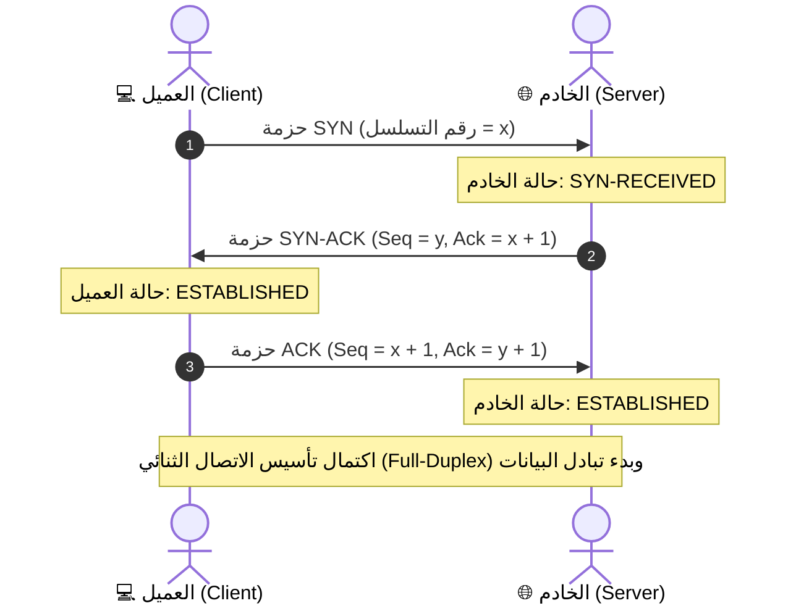

# المحاضرة 04: أساسيات أمن الشبكات - تحليل حركة المرور وحزم البيانات و Wireshark

> **المقرر:** عمليات الأمن السيبراني (مختبر الـ SOC - Cybersecurity Operations)  
> **المحاضر:** Hussein Al-Selwi  
> **إجمالي عدد الشرائح:** 17 شريحة  
> **العرض التقديمي المصدري:** `Lecture4_Network_Security_AR.html`  

### 📋 نبذة عامة وأهداف الوحدة التدريبية
المفاهيم الشبكية الجوهرية لمحلل مركز العمليات (SOC Analyst): طبقات نموذج TCP/IP، تشريح حزم البيانات (IP / TCP / UDP Headers)، تفاصيل مصافحة الـ TCP الثلاثية (3-Way Handshake)، تقسيمات المنافذ وأنواعها، فلاتر الالتقاط المتقدمة (BPF)، والتحليل العملي لحركة المرور باستخدام Wireshark.

---

## 📑 جدول المحتويات

- [الشريحة 01: المقدمة](#slide-01-المقدمة)
- [الشريحة 02: أهداف المعمل](#slide-02-أهداف-المعمل)
- [الشريحة 03: أهمية أمن الشبكات](#slide-03-أهمية-أمن-الشبكات)
- [الشريحة 04: بروتوكولات الشبكة الأساسية](#slide-04-بروتوكولات-الشبكة-الأساسية)
- [الشريحة 05: ترويسة بروتوكول IPv4](#slide-05-ترويسة-بروتوكول-ipv4)
- [الشريحة 06: ترويسة بروتوكول TCP](#slide-06-ترويسة-بروتوكول-tcp)
- [الشريحة 07: ترويسة بروتوكول UDP](#slide-07-ترويسة-بروتوكول-udp)
- [الشريحة 08: المصافحة الثلاثية (TCP 3-Way Handshake)](#slide-08-المصافحة-الثلاثية-tcp-3-way-handshake)
- [الشريحة 09: تقسيم وتصنيف منافذ الشبكة](#slide-09-تقسيم-وتصنيف-منافذ-الشبكة)
- [الشريحة 10: أشهر المنافذ المستخدمة والمهددة](#slide-10-أشهر-المنافذ-المستخدمة-والمهددة)
- [الشريحة 11: تطبيق عملي: المصافحة بـ tcpdump](#slide-11-تطبيق-عملي-المصافحة-بـ-tcpdump)
- [الشريحة 12: الالتقاط القائم على الحزم الكاملة](#slide-12-الالتقاط-القائم-على-الحزم-الكاملة)
- [الشريحة 13: الالتقاط القائم على التدفقات (Flows)](#slide-13-الالتقاط-القائم-على-التدفقات-flows)
- [الشريحة 14: التحليل اللحظي المباشر (Online)](#slide-14-التحليل-اللحظي-المباشر-online)
- [الشريحة 15: التحليل اللاحق المسترجع (Offline)](#slide-15-التحليل-اللاحق-المسترجع-offline)
- [الشريحة 16: مقدمة إلى أداة tcpdump](#slide-16-مقدمة-إلى-أداة-tcpdump)
- [الشريحة 17: فلاتر الالتقاط في tcpdump (BPF)](#slide-17-فلاتر-الالتقاط-في-tcpdump-bpf)

---

## الشريحة 01: المقدمة

> **التصنيف / الفئة:** `كشف التهديدات والاستجابة للحوادث · IDR`

### Network Security

فهم أساسيات الشبكات، والرؤية الشاملة على مستوى الحزم (Packets)، والضوابط الأمنية لكشف ومنع الهجمات أثناء انتقالها عبر الشبكة.

المعمل 04 – التقاط وتحليل حركة مرور الشبكة

> [!NOTE] 🎙️ **ملاحظات وتوجيهات المحاضر (Instructor Lecture Notes)**
> رحب بالطلاب في المحاضرة 4. ينتقل هذا المعمل بتركيزنا من تهديدات البريد الإلكتروني إلى طبقة الشبكة نفسها — الوسيط الحيوي الذي تعتمد عليه كافة الأنظمة والخدمات في المؤسسة.

---

## الشريحة 02: أهداف المعمل

> **التصنيف / الفئة:** `نظرة عامة على المعمل`

### الأهداف التعليمية للمعمل

- Understand fundamental network security principles
- Explore network packets , flows , and security controls
- Develop skills in performing live packet captures using various tools
- Learn to investigate packet captures and perform network traffic analysis
- Configure and manage intrusion detection and prevention systems
- Learn to write and implement network prevention and detection rules

> [!NOTE] 🎙️ **ملاحظات وتوجيهات المحاضر (Instructor Lecture Notes)**
> استعرض أهداف المعمل بإيجاز ليعرف الطلاب ما سيكتسبونه بنهاية المحاضرة. أكد على التدرج المنطقي: فهم الأساسيات، التقاط الحزم، تحليل حركة المرور، ثم ضبط أنظمة كشف ومنع التطفل وكتابة القواعد الأمنية.

---

## الشريحة 03: أهمية أمن الشبكات

> **التصنيف / الفئة:** `WHY IT MATTERS`

### كل شيء في المؤسسة يمر عبر الشبكة

Every device, service, and user in an organization needs to communicate — and that communication happens over the network . It's the shared medium connecting everything together, which makes it one of the most important places to focus security attention.

NETWORK shared medium الأجهزة الطرفية (Endpoints) & Devices البريد الإلكتروني & Web Traffic السحابة (Cloud) Services الخوادم (Servers) & Databases أجهزة IoT & OT Devices الوصول عن بُعد (VPN) Users

> [!IMPORTANT]
> الخلاصة الأمنية: before diving into specific tools and techniques, it helps to see the bigger picture — the network is the foundation that everything else in this course connects to.

> [!NOTE] 🎙️ **ملاحظات وتوجيهات المحاضر (Instructor Lecture Notes)**
> قدّم الفكرة التأسيسية: الشبكة هي الشريان والوسيط المشترك الذي يربط كل جهاز ومستخدم وخادم وخدمة سحابية في المؤسسة، ولهذا السبب تعد نقطة التركيز الأهم في الدفاع السيبراني. وضح كيف تمر كل حركة المرور عبر نسيج الشبكة.

---

## الشريحة 04: بروتوكولات الشبكة الأساسية

> **التصنيف / الفئة:** `NETWORKING BASICS`

### البروتوكولات الأساسية: IP و TCP و UDP

Before looking at packet captures, it helps to know the protocols doing the work underneath. IP handles addressing and routing, while TCP and UDP handle getting data to the right application — one favoring reliability, the other favoring speed.

- **IP — Internet Protocol**: Responsible for addressing and routing — getting a packet from source to destination across networks. IPv4: 32-bit address · version field = 4 IPv6: 128-bit address · version field = 6
- **TCP — Transmission Control Protocol**: Reliable and connection-oriented. Sets up a connection first, then uses sequence numbers to track and reorder every byte sent — so lost data can be detected and retransmitted.
- **UDP — User Datagram Protocol**: Fast and connectionless. No handshake, no delivery guarantee — data is just sent. Ideal when speed matters more than perfection.

> [!IMPORTANT]
> لماذا تهمنا هذه الفروقات؟ TCP's handshake confirms both sides are ready before any data flows, and the sequence numbers exchanged during it are what let TCP detect missing or out-of-order segments later on. We'll walk through the handshake in detail shortly.

> [!NOTE] 🎙️ **ملاحظات وتوجيهات المحاضر (Instructor Lecture Notes)**
> قدّم البروتوكولات الثلاثة الأساسية: IP للعنونة والتوجيه (IPv4 32-bit مقابل IPv6 128-bit). و TCP الموثوق والمعتمد على الاتصال والمصافحة الثلاثية (SYN, SYN-ACK, ACK) مع أرقام التسلسل لإعادة الإرسال عند الفقد. و UDP السريع بدون مصافحة أو ضمان وصول، المستخدم لخدمات مثل DNS والبث الصوتي والمرئي.

---

## الشريحة 05: ترويسة بروتوكول IPv4

> **التصنيف / الفئة:** `ترويسات البروتوكولات`

### تشريح ترويسة حزمة IPv4

تبدأ كل حزمة IPv4 بترويسة أساسية بحجم 20 بايت (قبل البيانات الفعلية). إليك وظيفة كل حقل:

Version 4 bits IHL 4 bits Type of Service 8 bits Total Length 16 bits Identification 16 bits Flags 3 bits Fragment Offset 13 bits TTL 8 bits Protocol 8 bits Header Checksum 16 bits Source IP Address 32 bits Destination IP Address 32 bits

Version IP version in use — 4 for IPv4. IHL Header length in 32-bit words; needed since Options can extend the header. Type of Service Requested priority/handling for the packet (e.g. low delay, high throughput). Total Length Full packet size in bytes, header plus data. Identification Unique ID used to reassemble a packet's fragments. Flags Controls whether the packet may be fragmented and if more fragments follow. Fragment Offset Position of this fragment within the original packet. TTL Hop limit — decremented by each router, packet is dropped at zero. Protocol Identifies the next-layer protocol — e.g. 6 for TCP, 17 for UDP. Header Checksum Verifies the header wasn't corrupted in transit. Source Address 32-bit IP address of the sender. Destination Address 32-bit IP address of the intended recipient.

> [!NOTE] 🎙️ **ملاحظات وتوجيهات المحاضر (Instructor Lecture Notes)**
> استعرض ترويسة IPv4 حقلاً بحقل. أكد على Version (4 دائماً هنا)، و IHL (طول الترويسة بكلمات 32-bit)، و Total Length (طول الحزمة كاملة مع البيانات)، و TTL (عمر الحزمة)، وحقلي عنوان المصدر والوجهة (32 بت لكل منهما).

---

## الشريحة 06: ترويسة بروتوكول TCP

> **التصنيف / الفئة:** `ترويسات البروتوكولات`

### تشريح ترويسة بروتوكول TCP

تحتوي ترويسة TCP على أرقام التسلسل والأعلام المسؤولة عن بناء الاتصال وضمان موثوقيته:

Source Port 16 bits Destination Port 16 bits Sequence Number 32 bits Acknowledgment Number 32 bits Data Offset 4 bits Reserved 6 bits Flags 6 bits Window Size 16 bits Checksum 16 bits Urgent Pointer 16 bits

Source / Dest. Port Identify the sending and receiving application (e.g. port 443 for HTTPS). Sequence Number Position of this segment's data in the overall byte stream — the core of TCP's reliability. Acknowledgment Number Next sequence number the sender expects to receive back. Data Offset Header length in 32-bit words, same idea as IHL in IPv4. Flags Control bits like SYN, ACK, and FIN that drive the handshake and connection teardown. Window Size How much data the receiver can accept before needing an acknowledgment. Checksum Verifies the segment (header and data) wasn't corrupted in transit. Urgent Pointer Marks priority data within the segment, used only when the URG flag is set.

> [!NOTE] 🎙️ **ملاحظات وتوجيهات المحاضر (Instructor Lecture Notes)**
> اربط هذا بالمصافحة الثلاثية وأرقام التسلسل. بيّن للطلاب أين تقع أرقام التسلسل (Seq)، والإشعار بالاستلام (Ack)، والأعلام (Flags مثل SYN, ACK, FIN, RST) داخل ترويسة TCP.

---

## الشريحة 07: ترويسة بروتوكول UDP

> **التصنيف / الفئة:** `ترويسات البروتوكولات`

### تشريح ترويسة بروتوكول UDP (بسيطة وخفيفة)



UDP's header is only 8 bytes — no sequence numbers, no handshake fields, nothing tracking reliability. That simplicity is exactly what makes it fast.

Source Port 16 bits Destination Port 16 bits Length 16 bits Checksum 16 bits

Source Port Port the datagram was sent from (optional — can be zeroed if no reply is expected). Destination Port Port the datagram is addressed to on the receiving host. Length Size of the UDP header plus data, in bytes. Checksum Optional in IPv4 — verifies the datagram wasn't corrupted, but there's no retransmission if it fails.

> [!IMPORTANT]
> Compare to TCP: four simple fields versus TCP's sequence numbers, acknowledgments, and flags — the trade-off between UDP's speed and TCP's reliability, in header form.

> [!NOTE] 🎙️ **ملاحظات وتوجيهات المحاضر (Instructor Lecture Notes)**
> Contrast this directly with the TCP header — same job (get data to the right port) but a fraction of the fields, which is exactly why UDP is fast but offers no reliability guarantees on its own.

---

## الشريحة 08: المصافحة الثلاثية (TCP 3-Way Handshake)

> **التصنيف / الفئة:** `TCP IN DETAIL`

### المصافحة الثلاثية لإنشاء اتصال TCP

Before any data is exchanged, the client and server synchronize their sequence numbers through three TCP segments — this is what a SYN scan or a normal connection setup looks like at the packet level.

Client Server 1 SYN seq = 1000 2 SYN, ACK seq = 5000 · ack = 1001 3 ACK seq = 1001 · ack = 5001 ✓ تم إنشاء الاتصال بنجاح — يبدأ تبادل البيانات

> [!IMPORTANT]
> Reading the numbers: each side's sequence number marks where its byte stream starts, and each ack number confirms "I received everything up to this point, send the next byte." That's the whole trick behind TCP reliability.

> [!NOTE] 🎙️ **ملاحظات وتوجيهات المحاضر (Instructor Lecture Notes)**
> Walk through each arrow in order. Point out that the client picks an initial sequence number (here 1000) in the SYN. The server acknowledges it with ack = 1001 (client's seq + 1) while sending its own sequence number (5000) in the SYN-ACK. The client then acknowledges the server's sequence number with ack = 5001. This is the mechanism that lets both sides confirm they're synchronized before any real data is sent.

---

## الشريحة 09: تقسيم وتصنيف منافذ الشبكة

> **التصنيف / الفئة:** `PORTS & SERVICES`

### تقسيم وتصنيف نطاقات منافذ الشبكة (Ports)

A port is a 16-bit number (0–65535) that identifies which application or service on a host a connection belongs to. Combined with an IP address, it forms a full endpoint — e.g. 192.168.1.10:443 . Ports are divided into three ranges:

0 – 1023 المنافذ المعروفة (Well-Known Ports) Reserved for standard services (HTTP, DNS, SSH) and assigned by IANA. 1024 – 49151 المنافذ المسجلة (Registered Ports) Registered by vendors for specific applications, less strictly controlled. 49152 – 65535 المنافذ الديناميكية والمؤقتة (Ephemeral) Assigned temporarily by the OS for outgoing client connections.

> [!IMPORTANT]
> In practice: a server listens on a well-known port (like 443 for HTTPS), while your browser connects out from a random dynamic port — that pairing is what uniquely identifies the conversation.

> [!NOTE] 🎙️ **ملاحظات وتوجيهات المحاضر (Instructor Lecture Notes)**
> Explain that a port is a 16-bit number (0-65535) that, combined with an IP address, identifies exactly which application on a host a connection belongs to. Then cover the three official ranges defined by IANA: well-known, registered, and dynamic/private.

---

## الشريحة 10: أشهر المنافذ المستخدمة والمهددة

> **التصنيف / الفئة:** `PORTS & SERVICES`

### Common Ports

The well-known ports you'll run into most often when reading traffic or logs:

21 FTP Transfers files between systems, usually without encryption. 22 SSH Encrypted remote command-line access and file transfer. 23 Telnet الوصول عن بُعد (VPN) command-line access sent entirely in plaintext, including credentials. 25 SMTP Sends email between mail servers. 53 DNS Resolves domain names into IP addresses. 80 HTTP Unencrypted web traffic between browser and server. 110 POP3 Downloads email from a server, typically removing it afterward. 135 RPC Microsoft's remote procedure call, used for inter-process communication. 139 NetBIOS Legacy Windows protocol for file and printer sharing on a local network. 143 IMAP Retrieves email while keeping messages synced on the server. 389 LDAP Queries centralized directory services such as Active Directory. 443 HTTPS HTTP secured with TLS/SSL encryption. 445 SMB Modern Windows file and printer sharing, replacing NetBIOS. 3389 RDP Graphical remote access to a Windows system's desktop. 8080 HTTP-Alt Common alternate port for HTTP, often used by proxies or app servers.

> [!NOTE] 🎙️ **ملاحظات وتوجيهات المحاضر (Instructor Lecture Notes)**
> These are the ports analysts see constantly in captures and logs. Group mentally into: file transfer/remote access (21,22,23,3389), email (25,110,143), web (80,443,8080), Windows/directory services (135,139,389,445), and DNS (53).

---

## الشريحة 11: تطبيق عملي: المصافحة بـ tcpdump

> **التصنيف / الفئة:** `DEMO`

### Handshake with tcpdump

Here's the same three-way handshake as it would appear in tcpdump output — this is exactly what you'll be looking for once we start capturing traffic ourselves.

```bash
$
sudo tcpdump -i eth0 host 93.184.216.34 and port 80 -n
09:14:02.000000 IP 192.168.1.10.51514 > 93.184.216.34.80: Flags
[S]
, seq 1000, win 64240, length 0
09:14:02.028000 IP 93.184.216.34.80 > 192.168.1.10.51514: Flags
[S.]
, seq 5000, ack 1001, win 65535, length 0
09:14:02.028100 IP 192.168.1.10.51514 > 93.184.216.34.80: Flags
[.]
, ack 5001, win 64240, length 0
```

> [!IMPORTANT]
> Reading tcpdump flags: [S] = SYN, [S.] = SYN-ACK, and [.] = an ACK with no other flags set — spotting this three-line pattern is the fastest way to find a handshake in raw output.

> [!NOTE] 🎙️ **ملاحظات وتوجيهات المحاضر (Instructor Lecture Notes)**
> This is a mock-up of tcpdump's default output capturing the same three-way handshake from the diagram. Walk through each line and connect the flags back to the diagram: [S] is SYN, [S.] is SYN-ACK, and [.] is a plain ACK. Point out the seq/ack numbers matching what was covered earlier.

---

## الشريحة 12: الالتقاط القائم على الحزم الكاملة

> **التصنيف / الفئة:** `CAPTURE APPROACHES`

### الالتقاط القائم على الحزم الكاملة (Packet Capture)

Packet-based capture records the full contents of every packet — headers and payload — exactly as it crossed the wire. It's the most detailed level of visibility available, since nothing is summarized or thrown away.

> [!NOTE]
> EXAMPLE Capturing every segment of a login attempt with tcpdump — the full handshake, the request, and the response are each stored as individual packets, headers and all.

- **Advantages**: Full visibility into headers and payload content تفاصيل جنائية دقيقة للغاية — كل بايت محفوظ وموثق. إمكانية إعادة بناء الأحداث بدقة متناهية (مثل استخراج الملفات المنقولة).
- **Disadvantages**: استهلاك هائل لمساحات التخزين في الشبكات النشطة. يتطلب قدرات معالجة عالية عند التحليل على نطاق واسع. حركة المرور المشفرة (TLS) تخفي محتوى الحمولة حتى مع التقاطها.

> [!NOTE] 🎙️ **ملاحظات وتوجيهات المحاضر (Instructor Lecture Notes)**
> Explain that packet-based capture records the full contents of every packet — headers and payload — exactly as it crossed the wire. This is the most detailed level of visibility possible, which is why tools like tcpdump and Wireshark work this way. But that detail comes at a storage and processing cost, especially on high-throughput links.

---

## الشريحة 13: الالتقاط القائم على التدفقات (Flows)

> **التصنيف / الفئة:** `CAPTURE APPROACHES`

### الالتقاط القائم على التدفقات (NetFlow / IPFIX)

Flow-based capture summarizes an entire conversation between two endpoints into a single record — source/destination IP and port, protocol, packet count, byte count, and duration — instead of storing every packet. Common implementations include NetFlow, IPFIX, and sFlow.

> [!NOTE]
> EXAMPLE src=192.168.1.10:51514   dst=93.184.216.34:80   proto=TCP packets=142   bytes=98,304   duration=4.2s One record for the entire session — not the individual SYN, SYN-ACK, or ACK packets.

- **Advantages**: مساحة تخزين أصغر بكثير مقارنة بالالتقاط الكامل للحزم. قابل للتطبيق والتوسع بسهولة في شبكات الشركات العملاقة. ممتاز لرصد الأنماط الشاذة — أحجام النقل الضخمة والاتصال المتكرر (Beaconing).
- **Disadvantages**: لا يوفر رؤية لحمولة البيانات — لا يمكن رؤية محتوى ما تم نقله. لا يمكن إعادة بناء الأحداث التفصيلية على مستوى الحزم الفردية. لا يكشف التهديدات الخفية المعتمدة على محتوى الحمولة.

> [!NOTE] 🎙️ **ملاحظات وتوجيهات المحاضر (Instructor Lecture Notes)**
> اشرح الالتقاط القائم على التدفقات (الالتقاط القائم على التدفقات (NetFlow / IPFIX)): تلخيص المحادثة بين جهازين في سجل واحد يوضح (من اتصل بمن، ومتى، وكمية البيانات) بدلاً من حفظ الحزم. اذكر NetFlow و IPFIX كأمثلة. يتوسع بسهولة في شبكات الشركات الكبرى لكنه يضحي برؤية محتوى البيانات.

---

## الشريحة 14: التحليل اللحظي المباشر (Online)

> **التصنيف / الفئة:** `منهجيات التحليل`

### التحليل اللحظي المباشر في الوقت الفعلي (Online)

Online analysis (also called live or real-time analysis) inspects traffic as it crosses the network, without necessarily saving it first. This is how tools that need to react immediately — like an IDS/IPS or a live monitoring dashboard — actually work.

> [!NOTE]
> EXAMPLE Running tcpdump -i eth0 and watching packets print to the screen live, or an IDS evaluating every connection attempt the moment it happens and firing an alert instantly.

- **Advantages**: اكتشاف وتنبيه فوري لحظة وقوع الحدث الأمني. يمكّن من اتخاذ إجراء فوري — مثل قطع اتصال الهجوم الجاري. لا يشترط حفظ مساحات تخزين هائلة لمراجعة البيانات لاحقاً.
- **Disadvantages**: وقت المعالجة المتاح لكل حزمة محدود جداً لتجنب تأخير الشبكة. قد يعاني من صعوبة مواكبة السرعات الفائقة في الشبكات الضخمة. يصعب عليه رصد الأنماط المعقدة البطيئة التي تتضح عبر فترات زمنية طويلة.

> [!NOTE] 🎙️ **ملاحظات وتوجيهات المحاضر (Instructor Lecture Notes)**
> اشرح التحليل اللحظي المباشر (التحليل اللحظي المباشر في الوقت الفعلي (Online)): فحص حركة المرور مباشرة أثناء تدفقها في الشبكة لاتخاذ قرارات فورية مثل الحظر، كما تفعل أنظمة IDS/IPS. ميزته السرعة الفائقة، ولكن وقته محدود جداً لفحص كل حزمة بعمق.

---

## الشريحة 15: التحليل اللاحق المسترجع (Offline)

> **التصنيف / الفئة:** `منهجيات التحليل`

### التحليل اللاحق المسترجع (Offline / Retrospective)

Offline analysis (also called retrospective analysis) captures traffic to a file first and reviews it afterward, with no time pressure. This is the typical incident-response workflow when digging into what really happened.

> [!NOTE]
> EXAMPLE Running tcpdump -w capture.pcap during an incident, then opening that file in Wireshark hours or days later to trace exactly what happened, packet by packet.

- **Advantages**: لا يوجد ضغط وقت — يمكن إعادة تشغيل الحزم ومراجعتها مراراً وتكراراً. يدعم التحقيقات الجنائية العميقة والمفصلة لجميع الأدلة. إمكانية ربط الأحداث ببعضها عبر فترات زمنية متباعدة.
- **Disadvantages**: يتطلب توفير مساحات تخزين كافية لملفات الالتقاط المحفوظة. الكشف يكون متأخراً بعد وقوع الحادثة بالفعل. لا يمنع الهجوم اللحظي أثناء حدوثه على أرض الواقع.

> [!NOTE] 🎙️ **ملاحظات وتوجيهات المحاضر (Instructor Lecture Notes)**
> اشرح التحليل غير المباشر (التحليل اللاحق المسترجع (Offline / Retrospective)): حفظ حركة المرور في ملف PCAP أولاً، ثم تحليلها لاحقاً دون أي ضغط زمني. هذا هو مسار عمل التحقيق الجنائي والاستجابة للحوادث — سجل الآن، وحقق بعمق لاحقاً باستخدام أدوات مثل Wireshark.

---

## الشريحة 16: مقدمة إلى أداة tcpdump

> **التصنيف / الفئة:** `الأدوات التطبيقية`

### مقدمة إلى أداة التقاط الحزم tcpdump

tcpdump is a command-line, packet-based capture tool built on libpcap . It's available on nearly every Linux/Unix system, making it one of the fastest ways to capture and inspect traffic without installing anything extra.

```bash
$
sudo tcpdump -i eth0 -n port 443
# -i eth0 → capture on interface eth0
# -n → don't resolve hostnames (faster, cleaner output)
# port 443 → only show traffic on port 443
```

-i Interface to capture on, e.g. eth0 . -n Skip DNS/hostname resolution for faster output. -c Stop after capturing a set number of packets. -w Write captured packets to a file for later analysis. -r Read and display packets from a saved capture file. -v / -vv Increase output verbosity for more packet detail. host / port Filter traffic to a specific IP address or port. and / or Combine multiple filters, e.g. host X and port 80 .

> [!IMPORTANT]
> ما سنتناوله قريباً: the next lab puts this into practice — running live captures with tcpdump and reading the output the way we just walked through.

> [!NOTE] 🎙️ **ملاحظات وتوجيهات المحاضر (Instructor Lecture Notes)**
> قدّم أداة tcpdump كأداة الالتقاط الأساسية التي سيستخدمها الطلاب عملياً. مبنية على مكتبة libpcap، ومتوفرة في كل توزيعات لينكس، خفيفة وقابلة للأتمتة عبر سطر الأوامر. اشرح البنية الأساسية والأعلام الأكثر استخداماً.

---

## الشريحة 17: فلاتر الالتقاط في tcpdump (BPF)

> **التصنيف / الفئة:** `الأدوات التطبيقية`

### فلاتر الالتقاط في tcpdump بصيغة BPF

Raw traffic is noisy — capture filters use Berkeley Packet Filter (BPF) syntax to narrow tcpdump down to exactly the traffic you care about.

```bash
$
sudo tcpdump -i eth0 src 192.168.1.10 and dst port 443 and tcp
# only TCP traffic, from 192.168.1.10, headed to port 443
```

كلمات الفلترة الأساسية

host <ip> Match traffic to or from a specific address. src <ip> Match traffic only from a specific source address. dst <ip> Match traffic only to a specific destination address. port <num> Match traffic on a given port, in either direction. src port / dst port Narrow a port filter to just the source or destination side. net <subnet> Match traffic within a network, e.g. net 192.168.1.0/24 .

بروتوكولات الفلترة

tcp Only TCP traffic — connections, handshakes, most application traffic. udp Only UDP traffic — DNS, streaming, VoIP, and similar. icmp Only ICMP traffic — pings and network diagnostic messages. arp Only ARP traffic — local address resolution requests and replies.

أدوات دمج الفلاتر المركبة

and يجب تحقق كلا الشرطين معاً (AND), e.g. host X and port 80 . or Either condition may match, e.g. port 80 or port 443 . not Excludes traffic matching a condition, e.g. not port 22 .

> [!NOTE] 🎙️ **ملاحظات وتوجيهات المحاضر (Instructor Lecture Notes)**
> اختم المعمل بشرح كيفية تضييق نطاق الالتقاط باستخدام فلاتر BPF (Berkeley Packet Filter). اشرح كلمات الفلترة: host, src, dst, port, net، ثم كلمات البروتوكولات tcp, udp, icmp، ثم أدوات الربط and, or, not لتركيب فلاتر دقيقة ومحكمة.

---

## 🎯 الخلاصة ومخرجات التعلم

- **الوحدة التدريبية:** المحاضرة 04: أساسيات أمن الشبكات - تحليل حركة المرور وحزم البيانات و Wireshark

- **المهارات المكتسبة:** فهم عملي وتطبيقي عميق لكيفية الكشف، التحقيق، الاستجابة، وإدارة التهديدات الأمنية باحترافية داخل بيئة العمليات.

- **مرجع التدريب:** مختبر عمليات الأمن السيبراني العملي — إعداد وتقديم: **Hussein Al-Selwi**.
