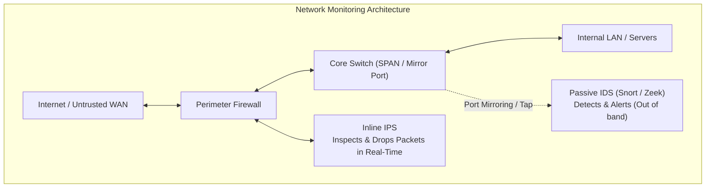

# Lecture 05-06: Network Security Part II — IDS, IPS & Network Monitoring

> **Course:** Cybersecurity Operations (SOC Lab)  
> **Instructor:** Hussein Al-Selwi  
> **Total Slides:** 24 Slides  
> **Source Presentation:** `Lecture5+6_Network_Security_Part_II .html`  

### 📋 Overview
Network detection technologies: passive Network Taps and SPAN ports vs inline Intrusion Prevention, rule-based vs anomaly-based detection, Snort rule syntax, and Zeek network metadata analysis.

---

## 📑 Table of Contents

- [Slide 01: Introduction](#slide-01-introduction)
- [Slide 02: Lecture Roadmap](#slide-02-lecture-roadmap)
- [Slide 03: Saving Captures (-w)](#slide-03-saving-captures-w)
- [Slide 04: Reading Captures (-r)](#slide-04-reading-captures-r)
- [Slide 05: Timestamp Options](#slide-05-timestamp-options)
- [Slide 06: Useful Display Flags](#slide-06-useful-display-flags)
- [Slide 07: Analyzing Output with grep](#slide-07-analyzing-output-with-grep)
- [Slide 08: cut, sort & uniq](#slide-08-cut-sort-uniq)
- [Slide 09: Intro to Wireshark](#slide-09-intro-to-wireshark)
- [Slide 10: Capture Filters (Wireshark)](#slide-10-capture-filters-wireshark)
- [Slide 11: Display Filters (Wireshark)](#slide-11-display-filters-wireshark)
- [Slide 12: Statistics & Analysis](#slide-12-statistics-analysis)
- [Slide 13: Follow Stream & Export](#slide-13-follow-stream-export)
- [Slide 14: Intro to Snort](#slide-14-intro-to-snort)
- [Slide 15: How Snort Works](#slide-15-how-snort-works)
- [Slide 16: Snort Modes](#slide-16-snort-modes)
- [Slide 17: Snort's Files & Directories](#slide-17-snort-s-files-directories)
- [Slide 18: Running Snort's Modes](#slide-18-running-snort-s-modes)
- [Slide 19: Running Snort in IPS Mode](#slide-19-running-snort-in-ips-mode)
- [Slide 20: Snort Rule Syntax](#slide-20-snort-rule-syntax)
- [Slide 21: Writing a Rule — Examples](#slide-21-writing-a-rule-examples)
- [Slide 22: Applying a Custom Rule & Alert Mode](#slide-22-applying-a-custom-rule-alert-mode)
- [Slide 23: Writing the Analysis Report](#slide-23-writing-the-analysis-report)
- [Slide 24: Recap](#slide-24-recap)

---

## Slide 01: Introduction

> **Category:** `INCIDENT DETECTION & RESPONSE`

### Network Security Part II

An examination of network traffic analysis using tcpdump and Wireshark, followed by an introduction to real-time intrusion detection with Snort.

Lab 05+06 – tcpdump Analysis, Wireshark, and Snort

> [!NOTE] 🎙️ **Instructor Lecture Notes**
> Welcome students to Lecture 5. This lecture moves from capturing traffic (Lab 4) into actually analyzing it — first at the command line with tcpdump and Unix text tools, then visually with Wireshark, then into active detection with Snort.

---

## Slide 02: Lecture Roadmap

> **Category:** `LECTURE OVERVIEW`

### Where We're Headed

Lab 4 covered live capturing. This lecture is about making sense of what we captured — and then acting on it.

1. **Step 1**: tcpdump — save, read & analyze
2. **Step 2**: Wireshark — visual analysis
3. **Step 3**: Snort — intrusion detection
4. **Step 4**: Snort rules — writing detections

- Save and replay tcpdump capture files, and slice them up with everyday Linux tools
- Navigate the Wireshark GUI, apply capture and display filters, and use its statistics/export tools
- Understand how Snort works as an intrusion detection/prevention system
- Write a basic Snort rule from scratch

> [!NOTE] 🎙️ **Instructor Lecture Notes**
> Walk through the four stops of this lecture so students see the arc: we already know how to capture traffic, now we learn to save/replay/analyze it (tcpdump), then visualize it (Wireshark), then move from passive analysis to active detection (Snort), and finally learn to write our own detection rules.

---

## Slide 03: Saving Captures (-w)

> **Category:** `TCPDUMP`

### Saving a Capture File



Watching packets scroll by is fine for a quick check, but real analysis needs a saved file you can revisit, share, or load into Wireshark. The -w flag writes raw packets to disk instead of printing them.

```bash
$
sudo tcpdump -i eth0 -w capture.pcap
# -w capture.pcap → write raw packets to capture.pcap
# console stays quiet — packets are being written, not printed
$
sudo tcpdump -i eth0 -c 500 -w capture.pcap
# stop automatically after 500 packets
```

-w <file> Write captured packets in raw (binary) form to a file. .pcap Standard capture file extension — readable by tcpdump, Wireshark, and most analysis tools. -c <n> Stop the capture automatically after n packets — useful for bounded, repeatable saves. Ctrl+C Stops an open-ended capture manually and finalizes the file.

> [!IMPORTANT]
> Why this matters: a saved capture is evidence — the same file can be reopened days later, handed to another analyst, or dropped straight into Wireshark for a visual look.

> [!NOTE] 🎙️ **Instructor Lecture Notes**
> Explain why we save captures instead of just watching them scroll by: file capture lets us analyze later, share with a team, or feed into other tools like Wireshark or Snort. -w writes raw packets (not the printed text) to a .pcap file, so the console will look quiet while it captures.

---

## Slide 04: Reading Captures (-r)

> **Category:** `TCPDUMP`

### Reading a Saved Capture

Once traffic is saved, -r reads it back — printing packets exactly as if they were captured live. Every filter and flag we already know still works.

```bash
$
tcpdump -r capture.pcap
# replays every packet stored in capture.pcap
$
tcpdump -r capture.pcap port 443
# still works with capture filters — only show port 443 traffic
```

-r <file> Read and print packets from a saved capture file instead of a live interface. Filters still apply Capture filters (host, port, protocol) narrow down what's read, not just what's captured.

> [!NOTE] 🎙️ **Instructor Lecture Notes**
> Show the mirror-image flag: -r reads a saved .pcap and prints it just like a live capture would, so every filter and flag from Lab 4 still applies. Combine with capture filters to replay only part of a saved file.

---

## Slide 05: Timestamp Options

> **Category:** `TCPDUMP`

### Timestamp Flags

Timestamps matter a lot in an investigation — timing tells you what happened first, how fast something moved, and helps you correlate with logs elsewhere. tcpdump's -t family of flags controls how timestamps print.

```bash
# default (wall-clock time, no flag)
14:22:05.123456 IP 10.0.0.5.51422 > 93.184.216.34.443: Flags [S]
# -t → no timestamp at all
IP 10.0.0.5.51422 > 93.184.216.34.443: Flags [S]
# -tt → raw Unix epoch seconds
1721394125.123456 IP 10.0.0.5.51422 > 93.184.216.34.443: Flags [S]
# -ttt → delta (ms) since the previous printed packet
000000.045213 IP 10.0.0.5.51422 > 93.184.216.34.443: Flags [S]
# -tttt → full date + wall-clock time
2026-07-19 14:22:05.123456 IP 10.0.0.5.51422 > 93.184.216.34.443: Flags [S]
```

-t Suppresses the timestamp entirely — cleanest output when timing doesn't matter. (default) Prints wall-clock time in HH:MM:SS.ffffff format. -tt Prints raw Unix epoch time — easy to sort and script against. -ttt Prints the time delta since the previous packet — great for spotting bursts or gaps. -tttt Prints full date and wall-clock time — best for correlating with other logs.

> [!NOTE] 🎙️ **Instructor Lecture Notes**
> Walk through the escalating timestamp flags side by side using the same packet so students see exactly what each one changes: -t removes the timestamp entirely, default shows wall-clock time, -tt shows raw epoch seconds, -ttt shows delta from the previous printed packet, -tttt shows full date + wall-clock time.

---

## Slide 06: Useful Display Flags

> **Category:** `TCPDUMP`

Beyond timestamps, a handful of flags control exactly how much of each packet gets printed — from just the header down to the raw payload bytes.

```bash
$
tcpdump -r capture.pcap -A port 80
# prints payload as ASCII — readable HTTP requests, cookies, etc.
GET /login.php HTTP/1.1
Host: example.com
Cookie: session=abc123...
```

-c <n> Stop after printing/capturing n packets. -A Print packet payload as ASCII text — ideal for spotting plaintext HTTP, credentials, or commands. -x Print packet payload as hexadecimal. -X Print payload as hex and ASCII side by side — the most complete view of raw bytes. -n Don't resolve IP addresses to hostnames. -nn Don't resolve hostnames or port numbers to service names — shows raw port numbers too. --count Prints only the total number of matching packets instead of printing each one — a fast way to check volume before diving into full output.

> [!WARNING]
> Watch for: -A only shows readable text — encrypted traffic (TLS/HTTPS) will just look like noise. It works best on unencrypted protocols like HTTP, FTP, or Telnet.

> [!NOTE] 🎙️ **Instructor Lecture Notes**
> Cover the flags students will reach for constantly during analysis: -c to limit output, -A to see payload as readable ASCII (great for spotting plaintext credentials or HTTP requests), -x/-X for hex dumps when the content isn't printable text, and -n/-nn to control name/port resolution.

---

## Slide 07: Analyzing Output with grep

> **Category:** `ANALYZING PCAP OUTPUT`

### Filtering Output with grep

tcpdump's printed output is just plain text — which means every classic Linux text tool works on it. grep searches for a pattern across thousands of lines instantly.

```bash
$
tcpdump -r capture.pcap -n | grep "192.168.1.50"
# only lines mentioning this specific IP address
$
tcpdump -r capture.pcap -n | grep -c "Flags \[S\]"
# -c here counts matching lines → how many SYN packets total
$
tcpdump -r capture.pcap -A | grep -i "password"
# -i → case-insensitive search inside ASCII payloads
```

grep "pattern" Prints only the lines that contain the given pattern. -i Case-insensitive matching. -c Counts matching lines instead of printing them (grep's own -c , not tcpdump's). -v Inverts the match — shows lines that do not contain the pattern. -E Enables extended regex — lets you use | (or), + , ? , and {} without backslash-escaping them.

> [!IMPORTANT]
> The pipe (|): the pipe symbol sends tcpdump's output directly into grep as input — this is the pattern behind everything on the next slide too.

> [!NOTE] 🎙️ **Instructor Lecture Notes**
> Introduce the idea that tcpdump's text output is just lines of text, so every standard Unix text tool works on it. Start with grep for finding specific patterns — an IP, a flag, a keyword — across a huge capture without scrolling manually.

---

## Slide 08: cut, sort & uniq

> **Category:** `ANALYZING PCAP OUTPUT`

### cut , sort & uniq

Chaining a few more tools together turns raw output into a real answer — like "who is talking the most on this network?" This exact pattern shows up constantly in log analysis.

```bash
$
tcpdump -r capture.pcap -n | cut -d' ' -f3 | cut -d'.' -f1-4 | sort | uniq -c | sort -nr | head
# cut -d' ' -f3 → pull out the 3rd space-separated field (source IP.port)
# cut -d'.' -f1-4 → trim off the trailing .port, keep just the IP
# sort → group identical IPs together (required before uniq)
# uniq -c → collapse duplicates into "count value"
# sort -nr → rank counts from highest to lowest
# head → show just the top results
```

cut -d -f -d sets the delimiter, -f picks which field(s) to keep. sort Sorts lines alphabetically/numerically — groups duplicates next to each other. sort -n / -nr Sorts numerically; -r reverses it to descending order. uniq Removes adjacent duplicate lines — must be pre-sorted to work correctly. uniq -c Prefixes each unique line with how many times it occurred. head / tail Shows just the first / last few lines of the result.

> [!IMPORTANT]
> Why this matters: the same grep | cut | sort | uniq -c | sort -nr chain works on almost any text-based log — firewall logs, auth logs, web server logs — not just pcaps.

> [!NOTE] 🎙️ **Instructor Lecture Notes**
> Bring it together with a realistic 'top talkers' one-liner: cut pulls out just the field we care about (the source IP), sort groups identical values together (required before uniq works), uniq -c collapses duplicates into counts, and a final sort -nr ranks them from most to least frequent. Emphasize that this chain is a classic log-analysis pattern used everywhere, not just for pcaps.

---

## Slide 09: Intro to Wireshark

> **Category:** `WIRESHARK`

### What Is Wireshark?

Wireshark is a graphical network protocol analyzer — it captures and displays packets the same way tcpdump does, but with a full interface for browsing, filtering, and drilling into individual packets visually.

- **tcpdump**: Command-line, text output, fast and scriptable — best for servers, remote sessions, and automation.
- **Wireshark**: Graphical, interactive, deeply detailed — best for close inspection, teaching, and visual pattern-spotting.

> [!IMPORTANT]
> They work together: a .pcap file saved by tcpdump's -w flag opens directly in Wireshark — capture on a headless server, analyze visually on your laptop.

> [!NOTE] 🎙️ **Instructor Lecture Notes**
> Position Wireshark as the visual counterpart to tcpdump: same underlying capture engine (libpcap), but a full GUI for browsing, filtering, and drilling into packets interactively. Mention that pcap files created by tcpdump open directly in Wireshark — the two tools are complementary, not competing.

---

## Slide 10: Capture Filters (Wireshark)

> **Category:** `WIRESHARK`

### Capture Filters

Good news — Wireshark's capture filters use the exact same BPF syntax as tcpdump. If you know host , port , and and/or/not from Lab 4, you already know these.

```bash
# typed into: Capture > Options > Capture Filter (before starting)
host 192.168.1.10 and port 443
tcp and not port 22
```

Applied before capture Capture filters decide what gets recorded in the first place — dropped packets are gone for good. Same BPF syntax host , src , dst , port , net , tcp/udp/icmp/arp , and/or/not all work identically to tcpdump. Where to set it Capture > Options, or typed directly into the filter box on the initial capture screen.

> [!WARNING]
> Don't confuse the two: capture filters (BPF syntax) and display filters (next slide, different syntax) look similar but aren't interchangeable — typing a display filter into the capture filter box will error out.

> [!NOTE] 🎙️ **Instructor Lecture Notes**
> Point out that Wireshark's capture filters use the exact same BPF syntax as tcpdump's capture filters from Lab 4 — host, port, tcp/udp, and/or/not all carry over directly. The difference is just where you type them: the Capture Options dialog before starting a capture, not typed on a command line.

---

## Slide 11: Display Filters (Wireshark)

> **Category:** `WIRESHARK`

### Display Filters

Display filters use Wireshark's own field-based syntax — they only hide or show packets already captured; nothing is discarded, so you can always loosen the filter later.

```bash
ip.addr == 192.168.1.10
# any packet where this IP is source OR destination
tcp.port == 443
# TCP traffic on port 443, either direction
http
# show only HTTP packets
ip.addr == 192.168.1.10 && tcp.port == 443
# combine conditions with && (and) / || (or)
```

protocol.field General pattern — ip.addr , tcp.port , http.request , dns.qry.name , etc. == / != Equals / not-equals comparison. && / || Combine filters — both must match / either may match. ! Negation — e.g. !arp hides ARP traffic. Green / red bar Wireshark's filter bar turns green for valid syntax, red (or pink) for invalid.

> [!IMPORTANT]
> Handy shortcut: right-click any field in the packet detail pane and choose "Apply as Filter" — Wireshark writes the correct display filter syntax for you automatically.

> [!NOTE] 🎙️ **Instructor Lecture Notes**
> Contrast with the previous slide: display filters use Wireshark's own field-based syntax (protocol.field == value) and only hide/show packets already captured — nothing is discarded. Walk through common examples: ip.addr, tcp.port, http, and combining with && / ||. Mention the filter bar turns green/red to indicate valid/invalid syntax.

---

## Slide 12: Statistics & Analysis

> **Category:** `WIRESHARK`

### Statistics Menu

The Statistics menu gives a bird's-eye view of an entire capture in seconds — no manual scrolling required.

- **Protocol Hierarchy**: Breaks down the whole capture by protocol layer, showing percentage and packet count for each — a quick "what kind of traffic is this?" view.
- **Conversations**: Lists every pair of endpoints that exchanged traffic, with byte and packet counts each way — the "who talked to whom" view.
- **Endpoints**: Per-host totals — every IP that appears, and how much traffic it sent or received overall.
- **File Statistics**: Breaks down the capture file itself — size, duration, average packet rate, and average bytes/sec — a quick health check on the capture before diving into the traffic.

> [!NOTE] 🎙️ **Instructor Lecture Notes**
> Introduce Wireshark's Statistics menu as the fastest way to get a bird's-eye view of a whole capture without scrolling packet by packet. Cover Protocol Hierarchy (breakdown by protocol), Conversations (who talked to whom, and how much), and Endpoints (per-host totals).

---

## Slide 13: Follow Stream & Export

> **Category:** `WIRESHARK`

### Follow Stream & Export Objects

Two features turn packet-level noise into something directly readable or usable.

Follow TCP Stream Right-click a packet → Follow → TCP Stream Reassembles the entire conversation, both directions, in order Turns dozens of packets into one readable request/response view Perfect for reading a full HTTP exchange or plaintext login attempt Export Objects File → Export Objects → protocol (HTTP, SMB, etc.) Pulls actual transferred files — images, documents, executables — straight out of the capture Only works on unencrypted protocols, since content must be visible Useful for recovering malware samples or exfiltrated files during an investigation

> [!IMPORTANT]
> Wrapping up tcpdump & Wireshark: we've now covered capturing, saving, reading, filtering, and analyzing traffic two different ways. Next, we shift from analyzing traffic after the fact to detecting threats in it as they happen — with Snort.

> [!NOTE] 🎙️ **Instructor Lecture Notes**
> Cover two of the most practically useful analysis features: Follow TCP Stream reassembles an entire conversation (both directions, in order) into one readable view — great for reading a full HTTP exchange. File > Export Objects pulls actual files (images, executables, documents) directly out of a capture when they were transferred over an unencrypted protocol like HTTP.

---

## Slide 14: Intro to Snort

> **Category:** `SNORT`

### What Is Snort?

Snort is an open-source, rule-based network intrusion detection and prevention system (IDS/IPS). Instead of us reading packets manually, Snort inspects traffic against a set of rules and alerts — or blocks — automatically.

- **IDS — Intrusion Detection**: Watches a copy of traffic (passive) and alerts when something matches a rule. Doesn't sit in the traffic path, so it can never block anything itself.
- **IPS — Intrusion Prevention**: Sits inline, directly in the traffic path, so it can actively drop or block traffic that matches a rule — not just alert on it.

> [!IMPORTANT]
> Snort can be either: the same engine runs as a passive IDS or an inline IPS depending on how it's deployed and configured — the detection logic (the rules) stays the same either way.

> [!NOTE] 🎙️ **Instructor Lecture Notes**
> Introduce Snort as the shift from passive analysis to active detection. Explain the IDS vs IPS distinction clearly: IDS watches and alerts, IPS sits inline and can block. Snort can run in either mode depending on deployment. Mention it's open-source and rule-based, which sets up the rules section later.

---

## Slide 15: How Snort Works

> **Category:** `SNORT`

Every packet that reaches Snort moves through the same four-stage pipeline before a decision gets made:

1. **Step 1**: Packet Decoder
2. **Step 2**: Preprocessors
3. **Step 3**: Detection Engine
4. **Step 4**: Output / Logging

Packet Decoder Captures raw packets off the wire and breaks them into their protocol layers (Ethernet, IP, TCP/UDP, etc.). Preprocessors Normalize and prepare traffic — reassembling fragments, handling protocol anomalies — before rules are checked. Detection Engine Compares the processed packet against every loaded rule, looking for a match on the rule's conditions. Output / Logging On a match, Snort executes the rule's action — alert, log, or (in IPS mode) drop the packet.

> [!WARNING]
> Rules are everything: without a loaded ruleset, the detection engine has nothing to compare traffic against — Snort is only as good as the rules it's running.

> [!NOTE] 🎙️ **Instructor Lecture Notes**
> Walk through Snort's processing pipeline in order: packets come in through the sniffer/decoder, get normalized and inspected by preprocessors (handling things like fragmentation and protocol anomalies), then hit the detection engine which compares traffic against loaded rules, and finally matches trigger the output/logging stage (alert, log, or drop).

---

## Slide 16: Snort Modes

> **Category:** `SNORT`

### Snort's Three Modes

Snort can run at three increasing levels of capability, chosen with different command-line flags:

1. **Sniffer Mode**: Reads packets off the wire and prints them to the console — same idea as tcpdump, no rules involved.
2. **Packet Logger Mode**: Saves captured packets to disk for later review — analysis happens afterward, not in real time.
3. **Network IDS Mode**: Loads a ruleset and runs the full detection engine — traffic is actively compared against rules and alerts fire in real time.

> [!IMPORTANT]
> NIDS mode is what we care about most: it's the mode that actually uses the rules we're about to write — sniffer and logger modes are useful for testing, but detection only happens in NIDS mode.

> [!NOTE] 🎙️ **Instructor Lecture Notes**
> Cover the three operating modes Snort can run in, from simplest to most complete: sniffer mode just prints packets (like tcpdump), packet logger mode saves them to disk, and NIDS mode applies the rule engine to actually detect and alert. This ties back to the pipeline on the previous slide — NIDS mode is the only one that uses the detection engine.

---

## Slide 17: Snort's Files & Directories

> **Category:** `SNORT`

Before running Snort, it helps to know where everything actually lives on disk — this is what the -c and -l flags point to:

```bash
/etc/snort/
├── snort.conf
# main config file — loaded with -c
└── rules/
├── local.rules
# your own custom rules
└── community.rules
# official / downloaded rulesets
/var/log/snort/
# alerts & packet logs — written to with -l
├── alert
# alert messages (fast/full format)
└── snort.log.*
# raw logged packets, if logging packets too
```

/etc/snort/snort.conf The main config file — sets variables like HOME_NET , and include s the rule files. Loaded with -c . /etc/snort/rules/ Where rule files live. local.rules is where custom rules go; other files hold the official/downloaded ruleset. /var/log/snort/ Default log directory — where alerts and (optionally) raw packet logs are written. Set with -l . alert Inside the log directory: the plain-text file where triggered alerts are recorded, one per match.

> [!IMPORTANT]
> These paths can be custom: the layout above is the common default on most Linux distros, but any config, rules, or log path can be pointed elsewhere with -c and -l .

> [!NOTE] 🎙️ **Instructor Lecture Notes**
> Before running any commands, orient students to where things actually live on disk. The config file (snort.conf) is the entry point — it sets variables and includes the rule files. Rules live in a rules directory, split into the official ruleset and a local.rules file for custom rules. Logs and alerts go to a log directory, which is what the -l flag on the previous and next slides points to. This slide is the map that makes the -c and -l flags make sense.

---

## Slide 18: Running Snort's Modes

> **Category:** `SNORT`

Each mode from the last slide maps to a specific combination of command-line flags:

```bash
# 1. Sniffer Mode — just print packets, no rules
$
sudo snort -i eth0
# -i sets the interface to listen on — packets print straight to console
# 2. Packet Logger Mode — save packets to disk
$
sudo snort -i eth0 -l /var/log/snort
# -l sets the log path — switches Snort from printing to saving
# 3. Network IDS/IPS Mode — load rules, alert in real time
$
sudo snort -A console -l /var/log/snort -c /etc/snort/snort.conf -q
# -c loads the config + ruleset, -A sets alert style, -q runs quietly
```

-i <iface> Network interface to listen on, e.g. eth0 — required in every mode for live capture. -l <path> Where to write logs (Packet Logger mode) or alerts (NIDS mode) instead of just printing to console. -c <file> Loads a config file (with rules included) — this is what turns on the detection engine. -A <style> Alert output style, e.g. console — controls how matches are reported. -q Quiet mode — suppresses the startup banner and init messages, so only alerts show.

> [!NOTE] 🎙️ **Instructor Lecture Notes**
> Make the three modes from the previous slide concrete with real commands. Sniffer mode is just -i to pick an interface and print packets — no config, no rules. Packet logger mode adds -l to write to a directory instead of just printing. NIDS/NIPS mode is the real deal: -c loads the config and ruleset, -A sets the alert style, -l sets where alerts/logs go, and -q runs quietly (suppresses the banner and init messages) so only alerts show. Point out that -i is needed for live capture in every mode, and -c is the flag that actually turns on detection.

---

## Slide 19: Running Snort in IPS Mode

> **Category:** `SNORT`

NIDS mode only watches traffic — it can alert, but the packet still reaches its destination. To actually block traffic, Snort has to run inline , as an IPS. Three things change together:

-Q Switches Snort from passive to inline mode — traffic is intercepted before it reaches its destination, not just copied and observed. --daq Selects the inline acquisition module that actually routes packets through Snort — afpacket bridges two NICs so traffic passes through Snort on its way between them. drop (in rules) Rules must use the drop action instead of alert — alert still only logs a match, it never blocks the packet.

```bash
# AFPACKET inline mode — bridges two interfaces so traffic flows through Snort
$
sudo snort -q -A console -i enp0s3:enp0s8 -c /etc/snort/snort.conf --daq afpacket -Q
# enp0s3:enp0s8 pairs the NICs — packets in on one side are inspected, then forwarded (or dropped)
```

> [!IMPORTANT]
> All three pieces are required: -Q without a drop rule still only alerts; a drop rule without -Q and an inline DAQ has no traffic path to actually block.

> [!NOTE] 🎙️ **Instructor Lecture Notes**
> Take NIDS mode one step further into NIPS mode — actually blocking traffic, not just alerting on it. Three things have to change together: the -Q flag puts Snort inline instead of passive, the DAQ module (afpacket bridging two NICs, or NFQ via iptables) is what actually routes traffic through Snort so it can be dropped, and rules must use the drop action instead of alert. Emphasize that missing any one of the three means traffic passes through untouched even if Snort logs a match.

---

## Slide 20: Snort Rule Syntax

> **Category:** `SNORT RULES`

### Anatomy of a Rule

Every Snort rule has two parts: a header (what traffic to look at) and a set of options in parentheses (what to check for, and what to call it).

```email-header
HEADER alert tcp any any -> 192.168.1.0/24 80
alert tcp any any -> 192.168.1.0/24 80
OPTIONS ( msg:"Possible web probe"; content:"/admin"; sid:1000001; rev:1; )
( msg:"Possible web probe"; content:"/admin"; sid:1000001; rev:1; )
```

Header Fields

action alert , log , pass , or (in IPS mode) drop — what to do on a match. protocol tcp , udp , icmp , or ip . src / dst IP Source and destination address or network — any matches everything. src / dst port Source and destination port — any matches every port. -> Direction operator — traffic must flow from the left side to the right side to match.

Common Options

msg Human-readable description shown in the alert. content A specific string or byte pattern to search for in the packet payload. sid Unique rule ID number — required, and must not collide with other rules. rev Revision number of the rule — increments each time the rule is updated.

> [!NOTE] 🎙️ **Instructor Lecture Notes**
> Break a Snort rule into its two halves: the header (action, protocol, source/dest IP and port, direction operator) and the options in parentheses (msg, content, sid, and more, separated by semicolons). Walk through each header field left to right, then the most common options. This sets up the worked examples on the next slide.

---

## Slide 21: Writing a Rule — Examples

> **Category:** `SNORT RULES`

### Writing a Rule

Let's put the syntax to work with two small, realistic rules.

> [!NOTE]
> EXAMPLE 1 — DETECT PING SWEEPS alert icmp any any -> 192.168.1.0/24 any (msg:"ICMP ping detected"; sid:1000010; rev:1;) alert on any ICMP packet from anywhere, headed to our 192.168.1.0/24 network, on any port — label it "ICMP ping detected" and give it a unique ID.

> [!NOTE]
> EXAMPLE 2 — DETECT A SUSPICIOUS HTTP REQUEST alert tcp any any -> 192.168.1.0/24 80 (msg:"Possible directory traversal attempt"; content:"../../"; sid:1000011; rev:1;) alert on any TCP traffic headed to port 80 on our network, where the payload contains the string "../../" — a classic sign of a directory-traversal attempt.

> [!WARNING]
> Always pick a unique sid: custom rules should use sid numbers starting at 1,000,000 — lower numbers are reserved for the official Snort ruleset, and reusing one will cause conflicts.

> [!NOTE] 🎙️ **Instructor Lecture Notes**
> Walk through two concrete worked examples using the syntax from the previous slide. Example 1: detect any ICMP (ping) traffic reaching the local network — simple, no content matching needed. Example 2: detect a suspicious keyword inside HTTP traffic using the content option, tied to a real-sounding scenario like detecting a directory-traversal attempt. For each, read the rule left to right and explain what it means in plain English.

---

## Slide 22: Applying a Custom Rule & Alert Mode

> **Category:** `SNORT RULES`

A rule only matters once it's loaded and Snort is actually watching traffic with it:

```bash
# 1. Add the rule to a local rules file
$
echo 'alert icmp any any -> 192.168.1.0/24 any (msg:"ICMP ping detected"; sid:1000010; rev:1;)' >> /etc/snort/rules/local.rules
# 2. Make sure snort.conf includes it
include $RULE_PATH/local.rules
# 3. Run in NIDS mode with alerts printed to console
$
sudo snort -A console -l /var/log/snort -c /etc/snort/snort.conf -q
```

> [!NOTE]
> SAMPLE ALERT OUTPUT [**] [1:1000010:1] ICMP ping detected [**] 07/27-14:22:05.123456 10.0.0.5 -> 192.168.1.10 ICMP TTL:64 ID:1 IpLen:20 DgmLen:84

Alert Output Formats (-A)

-A console Prints full alerts directly to the terminal in real time — best for live demos and testing. -A fast Compact, one-line-per-alert format — timestamp, message, and addresses only. -A full Verbose, detailed alert written to the log file — the default when logging to disk. -A none Disables alerting entirely — useful when only packet logging is needed.

> [!NOTE] 🎙️ **Instructor Lecture Notes**
> Close the loop between writing a rule and seeing it fire. Show where a custom rule actually lives — a local.rules file, included from snort.conf — then run Snort in NIDS mode with -A to control how alerts are reported. Walk through the -A options (fast, full, console, cmg) and show what a real alert looks like on the console so students recognize it when they see it in the lab.

---

## Slide 23: Writing the Analysis Report

> **Category:** `REPORTING`

Analysis isn't finished when the capture is understood — it's finished when it's written up. After analyzing a pcap file, the analyst documents the findings in a structured report:

1. Executive Summary A short, non-technical overview of what happened, its impact, and severity — written for managers, not analysts. 2. Scope & Objectives What was analyzed (which capture, timeframe, hosts) and the question the investigation was trying to answer. 3. Methodology & Tools The tools and techniques used — e.g. tcpdump for capture, Wireshark for inspection, Snort for rule-based detection. 4. Findings & Analysis The technical detail: what the traffic showed, suspicious patterns, and how conclusions were reached. 5. Indicators of Compromise Concrete artifacts — IPs, domains, ports, payloads, or rule matches — that others can use to detect the same activity. 6. Recommendations & Conclusion Actionable next steps (block, patch, monitor, write a new rule) and a brief summary tying the findings together.

> [!IMPORTANT]
> Order matters: start non-technical (executive summary) and get progressively more technical — readers should be able to stop after section 1 and still understand what happened.

> [!NOTE] 🎙️ **Instructor Lecture Notes**
> Wrap up the analysis workflow by covering the deliverable: after analyzing a pcap file with tcpdump, Wireshark, or Snort, the analyst's job isn't done until it's written up. Walk through each report section and what belongs in it — executive summary for non-technical stakeholders, then progressively more technical detail down to recommendations.

---

## Slide 24: Recap

> **Category:** `RECAP`

### Bringing It Together

We went from raw packets to automated detection — four tools, one investigative workflow:

Save & replay captures with tcpdump ( -w / -r ) Read timestamps & payloads ( -t , -A , -X ) Slice output with grep, cut, sort, uniq Navigate Wireshark's GUI, filters & statistics Understand Snort's IDS/IPS pipeline & modes Write a basic Snort detection rule

> [!NOTE] 🎙️ **Instructor Lecture Notes**
> Close the lecture by tying the four tools back together into one investigative workflow: capture and save with tcpdump, slice it with Unix tools or explore it visually in Wireshark, then move to Snort for ongoing, automated detection using rules we now know how to write. Preview that the next lab will put all of this into hands-on practice.

---

## 🎯 Summary & Key Takeaways

- **Module:** Lecture 05-06: Network Security Part II — IDS, IPS & Network Monitoring

- **Core Competencies Developed:** Hands-on triage, log analysis, threat hunting, and defensive incident response.

- **Course Reference:** Cybersecurity Operations Practical Labs by **Hussein Al-Selwi**.
