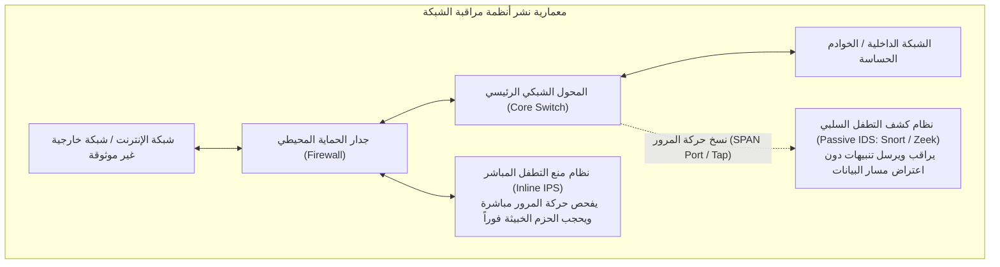

# المحاضرة 05-06: أمن الشبكات - الجزء الثاني: أنظمة كشف ومنع التطفل والمراقبة الشبكية (IDS / IPS)

> **المقرر:** عمليات الأمن السيبراني (مختبر الـ SOC - Cybersecurity Operations)  
> **المحاضر:** Hussein Al-Selwi  
> **إجمالي عدد الشرائح:** 24 شريحة  
> **العرض التقديمي المصدري:** `Lecture5+6_Network_Security_Part_II_AR.html`  

### 📋 نبذة عامة وأهداف الوحدة التدريبية
تقنيات الحماية والمراقبة الشبكية المتقدمة: المقارنة بين نقاط التوصيل السلبية (Network TAPs) ومنافذ النسخ (SPAN) مقابل أجهزة الحماية المباشرة في مسار البيانات (Inline IPS)، المقارنة بين كشف التواقيع وكشف السلوكيات الشاذة، كتابة وتفعيل قواعد Snort، وتحليل البيانات الوصفية لحركة المرور عبر Zeek.

---

## 📑 جدول المحتويات

- [الشريحة 01: المقدمة](#slide-01-المقدمة)
- [الشريحة 02: خارطة طريق المحاضرة](#slide-02-خارطة-طريق-المحاضرة)
- [الشريحة 03: حفظ ملفات الالتقاط (-w)](#slide-03-حفظ-ملفات-الالتقاط-w)
- [الشريحة 04: قراءة ملفات الالتقاط (-r)](#slide-04-قراءة-ملفات-الالتقاط-r)
- [الشريحة 05: Timestamp Options](#slide-05-timestamp-options)
- [الشريحة 06: أهم خيارات عرض البيانات](#slide-06-أهم-خيارات-عرض-البيانات)
- [الشريحة 07: فلترة النتائج باستخدام grep](#slide-07-فلترة-النتائج-باستخدام-grep)
- [الشريحة 08: cut, sort & uniq](#slide-08-cut-sort-uniq)
- [الشريحة 09: مقدمة إلى برنامج Wireshark](#slide-09-مقدمة-إلى-برنامج-wireshark)
- [الشريحة 10: فلاتر الالتقاط في Wireshark](#slide-10-فلاتر-الالتقاط-في-wireshark)
- [الشريحة 11: فلاتر العرض في Wireshark](#slide-11-فلاتر-العرض-في-wireshark)
- [الشريحة 12: Statistics & Analysis](#slide-12-statistics-analysis)
- [الشريحة 13: Follow Stream & Export](#slide-13-follow-stream-export)
- [الشريحة 14: مقدمة إلى نظام كشف التطفل Snort](#slide-14-مقدمة-إلى-نظام-كشف-التطفل-snort)
- [الشريحة 15: معمارية وآلية عمل Snort](#slide-15-معمارية-وآلية-عمل-snort)
- [الشريحة 16: أوضاع تشغيل Snort الثلاثة](#slide-16-أوضاع-تشغيل-snort-الثلاثة)
- [الشريحة 17: ملفات ومسارات نظام Snort](#slide-17-ملفات-ومسارات-نظام-snort)
- [الشريحة 18: أوامر تشغيل أوضاع Snort](#slide-18-أوامر-تشغيل-أوضاع-snort)
- [الشريحة 19: تشغيل Snort في وضع المنع (IPS)](#slide-19-تشغيل-snort-في-وضع-المنع-ips)
- [الشريحة 20: بنية وصيغة قواعد Snort](#slide-20-بنية-وصيغة-قواعد-snort)
- [الشريحة 21: أمثلة عملية لكتابة قواعد Snort](#slide-21-أمثلة-عملية-لكتابة-قواعد-snort)
- [الشريحة 22: Applying a Custom Rule & Alert Mode](#slide-22-applying-a-custom-rule-alert-mode)
- [الشريحة 23: كتابة تقرير التحليل الجنائي للشبكة](#slide-23-كتابة-تقرير-التحليل-الجنائي-للشبكة)
- [الشريحة 24: الملخص الشامل للمحاضرة](#slide-24-الملخص-الشامل-للمحاضرة)

---

## الشريحة 01: المقدمة

> **التصنيف / الفئة:** `كشف التهديدات والاستجابة للحوادث · IDR`

### Network Security Part II

تحليل حركة مرور الشبكة باستخدام tcpdump و Wireshark، متبوعاً بمقدمة عملية لأنظمة كشف التطفل اللحظي باستخدام Snort.

المعمل 05+06 – تحليل tcpdump و Wireshark ونظام Snort

> [!NOTE] 🎙️ **ملاحظات وتوجيهات المحاضر (Instructor Lecture Notes)**
> رحب بالطلاب في المحاضرة 5 و 6. تنتقل هذه الجلسة من مجرد التقاط حركة المرور (المعمل 4) إلى تحليلها الفعلي وتفكيكها — أولاً عبر سطر الأوامر بأداة tcpdump وأدوات معالجة النصوص في لينكس، ثم رسومياً ببرنامج Wireshark، وصولاً للكشف الفوري النشط عبر نظام Snort.

---

## الشريحة 02: خارطة طريق المحاضرة

> **التصنيف / الفئة:** `نظرة عامة على المحاضرة`

### خارطة طريق المحاضرة: من الحزم إلى الكشف الآلي

غطى المعمل الرابع التقاط الحزم الحية. أما اليوم فسنركز على فهم وتحليل ما التقطناه — ثم اتخاذ الإجراءات الدفاعية المناسبة:

1. **خطوة 1**: tcpdump — save, read & analyze
2. **خطوة 2**: Wireshark — visual analysis
3. **خطوة 3**: Snort — intrusion detection
4. **خطوة 4**: Snort rules — writing detections

- Save and replay tcpdump capture files, and slice them up with everyday Linux tools
- Navigate the Wireshark GUI, apply capture and display filters, and use its statistics/export tools
- Understand how Snort works as an intrusion detection/prevention system
- Write a basic Snort rule from scratch

> [!NOTE] 🎙️ **ملاحظات وتوجيهات المحاضر (Instructor Lecture Notes)**
> استعرض خارطة طريق المعمل: بعد أن تعلمنا الالتقاط، نتعلم اليوم حفظ وإعادة تشغيل وتحليل الحزم (tcpdump)، ثم التحليل البصري عبر (Wireshark)، ثم الانتقال من التحليل السلبي للكشف الإيجابي الفعال (Snort)، وأخيراً كتابة قواعد الكشف بأنفسنا.

---

## الشريحة 03: حفظ ملفات الالتقاط (-w)

> **التصنيف / الفئة:** `TCPDUMP`

### حفظ حزم الشبكة في ملف خارجي (-w)



Watching packets scroll by is fine for a quick check, but real analysis needs a saved file you can revisit, share, or load into Wireshark. The -w flag writes raw packets to disk instead of printing them.

```bash
$
sudo tcpdump -i eth0 -w capture.pcap
# -w capture.pcap → write raw packets to capture.pcap
# console stays quiet — packets are being written, not printed
$
sudo tcpdump -i eth0 -c 500 -w capture.pcap
# stop automatically after 500 packets
```

-w <file> Write captured packets in raw (binary) form to a file. .pcap Standard capture file extension — readable by tcpdump, Wireshark, and most analysis tools. -c <n> Stop the capture automatically after n packets — useful for bounded, repeatable saves. Ctrl+C Stops an open-ended capture manually and finalizes the file.

> [!IMPORTANT]
> لماذا يعد هذا جوهرياً؟ a saved capture is evidence — the same file can be reopened days later, handed to another analyst, or dropped straight into Wireshark for a visual look.

> [!NOTE] 🎙️ **ملاحظات وتوجيهات المحاضر (Instructor Lecture Notes)**
> اشرح لماذا نحفظ الحزم بدلاً من مجرد مشاهدتها تمر في الشاشة: حفظ الملف يتيح التحليل اللاحق، ومشاركته مع الفريق الجنائي، أو تمريره لأدوات مثل Wireshark و Snort. الخيار -w يكتب الحزم الخام في ملف PCAP دون طباعة نصوص على الشاشة أثناء الالتقاط.

---

## الشريحة 04: قراءة ملفات الالتقاط (-r)

> **التصنيف / الفئة:** `TCPDUMP`

### قراءة وفحص ملفات الالتقاط المحفوظة (-r)

Once traffic is saved, -r reads it back — printing packets exactly as if they were captured live. Every filter and flag we already know still works.

```bash
$
tcpdump -r capture.pcap
# replays every packet stored in capture.pcap
$
tcpdump -r capture.pcap port 443
# still works with capture filters — only show port 443 traffic
```

-r <file> Read and print packets from a saved capture file instead of a live interface. Filters still apply Capture filters (host, port, protocol) narrow down what's read, not just what's captured.

> [!NOTE] 🎙️ **ملاحظات وتوجيهات المحاضر (Instructor Lecture Notes)**
> اعرض الخيار المقابل: -r لقراءة ملف PCAP محفوظ وإعادة عرضه كما لو كان التقاطاً حياً، وتنطبق عليه كافة فلاتر وأعلام المعمل 4. ادمجه مع فلاتر BPF لعرض حركة مرور محددة فقط من داخل الملف الضخم.

---

## الشريحة 05: Timestamp Options

> **التصنيف / الفئة:** `TCPDUMP`

### خيارات التحكم بتنسيق الوقت والتاريخ في tcpdump

Timestamps matter a lot in an investigation — timing tells you what happened first, how fast something moved, and helps you correlate with logs elsewhere. tcpdump's -t family of flags controls how timestamps print.

```bash
# default (wall-clock time, no flag)
14:22:05.123456 IP 10.0.0.5.51422 > 93.184.216.34.443: Flags [S]
# -t → no timestamp at all
IP 10.0.0.5.51422 > 93.184.216.34.443: Flags [S]
# -tt → raw Unix epoch seconds
1721394125.123456 IP 10.0.0.5.51422 > 93.184.216.34.443: Flags [S]
# -ttt → delta (ms) since the previous printed packet
000000.045213 IP 10.0.0.5.51422 > 93.184.216.34.443: Flags [S]
# -tttt → full date + wall-clock time
2026-07-19 14:22:05.123456 IP 10.0.0.5.51422 > 93.184.216.34.443: Flags [S]
```

-t Suppresses the timestamp entirely — cleanest output when timing doesn't matter. (default) Prints wall-clock time in HH:MM:SS.ffffff format. -tt Prints raw Unix epoch time — easy to sort and script against. -ttt Prints the time delta since the previous packet — great for spotting bursts or gaps. -tttt Prints full date and wall-clock time — best for correlating with other logs.

> [!NOTE] 🎙️ **ملاحظات وتوجيهات المحاضر (Instructor Lecture Notes)**
> استعرض خيارات الوقت (خيارات التحكم بتنسيق الوقت والتاريخ في tcpdump) جنباً إلى جنب على نفس الحزمة: -t لإلغاء الوقت تماماً، الوضع الافتراضي يعرض وقت الساعة، -tt يعرض ثواني Epoch، و -ttt يعرض الفارق الزمني (Delta) بالمللي ثانية عن الحزمة السابقة، و -tttt يعرض التاريخ الكامل مع التوقيت.

---

## الشريحة 06: أهم خيارات عرض البيانات

> **التصنيف / الفئة:** `TCPDUMP`

### أهم خيارات عرض البيانات وتفكيك الحمولات

إلى جانب التوقيت، تتحكم مجموعة من الأعلام في كمية التفاصيل المعروضة — من مجرد الترويسة وحتى بايتات الحمولة الأولية:

```bash
$
tcpdump -r capture.pcap -A port 80
# prints payload as ASCII — readable HTTP requests, cookies, etc.
GET /login.php HTTP/1.1
Host: example.com
Cookie: session=abc123...
```

-c <n> Stop after printing/capturing n packets. -A Print packet payload as ASCII text — ideal for spotting plaintext HTTP, credentials, or commands. -x Print packet payload as hexadecimal. -X Print payload as hex and ASCII side by side — the most complete view of raw bytes. -n Don't resolve IP addresses to hostnames. -nn Don't resolve hostnames or port numbers to service names — shows raw port numbers too. --count Prints only the total number of matching packets instead of printing each one — a fast way to check volume before diving into full output.

> [!WARNING]
> تنبيه أمني هام: -A only shows readable text — encrypted traffic (TLS/HTTPS) will just look like noise. It works best on unencrypted protocols like HTTP, FTP, or Telnet.

> [!NOTE] 🎙️ **ملاحظات وتوجيهات المحاضر (Instructor Lecture Notes)**
> استعرض الأعلام الأكثر استخداماً في التحقيق: -c لتحديد عدد الحزم، -A لعرض الحمولة كنص ASCII مقروء (رائع لكشف كلمات المرور والـ HTTP غير المشفر)، -x/-X لعرض الـ Hex Dump، و -n/-nn لمنع ترجمة الأسماء والمنافذ لتسريع العرض.

---

## الشريحة 07: فلترة النتائج باستخدام grep

> **التصنيف / الفئة:** `ANALYZING PCAP OUTPUT`

### Filtering Output with grep

tcpdump's printed output is just plain text — which means every classic Linux text tool works on it. grep searches for a pattern across thousands of lines instantly.

```bash
$
tcpdump -r capture.pcap -n | grep "192.168.1.50"
# only lines mentioning this specific IP address
$
tcpdump -r capture.pcap -n | grep -c "Flags \[S\]"
# -c here counts matching lines → how many SYN packets total
$
tcpdump -r capture.pcap -A | grep -i "password"
# -i → case-insensitive search inside ASCII payloads
```

grep "pattern" Prints only the lines that contain the given pattern. -i Case-insensitive matching. -c Counts matching lines instead of printing them (grep's own -c , not tcpdump's). -v Inverts the match — shows lines that do not contain the pattern. -E Enables extended regex — lets you use | (or), + , ? , and {} without backslash-escaping them.

> [!IMPORTANT]
> The pipe (|): the pipe symbol sends tcpdump's output directly into grep as input — this is the pattern behind everything on the next slide too.

> [!NOTE] 🎙️ **ملاحظات وتوجيهات المحاضر (Instructor Lecture Notes)**
> Introduce the idea that tcpdump's text output is just lines of text, so every standard Unix text tool works on it. Start with grep for finding specific patterns — an IP, a flag, a keyword — across a huge capture without scrolling manually.

---

## الشريحة 08: cut, sort & uniq

> **التصنيف / الفئة:** `ANALYZING PCAP OUTPUT`

### cut , sort & uniq

Chaining a few more tools together turns raw output into a real answer — like "who is talking the most on this network?" This exact pattern shows up constantly in log analysis.

```bash
$
tcpdump -r capture.pcap -n | cut -d' ' -f3 | cut -d'.' -f1-4 | sort | uniq -c | sort -nr | head
# cut -d' ' -f3 → pull out the 3rd space-separated field (source IP.port)
# cut -d'.' -f1-4 → trim off the trailing .port, keep just the IP
# sort → group identical IPs together (required before uniq)
# uniq -c → collapse duplicates into "count value"
# sort -nr → rank counts from highest to lowest
# head → show just the top results
```

cut -d -f -d sets the delimiter, -f picks which field(s) to keep. sort Sorts lines alphabetically/numerically — groups duplicates next to each other. sort -n / -nr Sorts numerically; -r reverses it to descending order. uniq Removes adjacent duplicate lines — must be pre-sorted to work correctly. uniq -c Prefixes each unique line with how many times it occurred. head / tail Shows just the first / last few lines of the result.

> [!IMPORTANT]
> لماذا يعد هذا جوهرياً؟ the same grep | cut | sort | uniq -c | sort -nr chain works on almost any text-based log — firewall logs, auth logs, web server logs — not just pcaps.

> [!NOTE] 🎙️ **ملاحظات وتوجيهات المحاضر (Instructor Lecture Notes)**
> Bring it together with a realistic 'top talkers' one-liner: cut pulls out just the field we care about (the source IP), sort groups identical values together (required before uniq works), uniq -c collapses duplicates into counts, and a final sort -nr ranks them from most to least frequent. Emphasize that this chain is a classic log-analysis pattern used everywhere, not just for pcaps.

---

## الشريحة 09: مقدمة إلى برنامج Wireshark

> **التصنيف / الفئة:** `WIRESHARK`

### ما هو برنامج Wireshark؟ ولماذا نستخدمه؟

Wireshark is a graphical network protocol analyzer — it captures and displays packets the same way tcpdump does, but with a full interface for browsing, filtering, and drilling into individual packets visually.

- **tcpdump**: Command-line, text output, fast and scriptable — best for servers, remote sessions, and automation.
- **Wireshark**: Graphical, interactive, deeply detailed — best for close inspection, teaching, and visual pattern-spotting.

> [!IMPORTANT]
> They work together: a .pcap file saved by tcpdump's -w flag opens directly in Wireshark — capture on a headless server, analyze visually on your laptop.

> [!NOTE] 🎙️ **ملاحظات وتوجيهات المحاضر (Instructor Lecture Notes)**
> Position Wireshark as the visual counterpart to tcpdump: same underlying capture engine (libpcap), but a full GUI for browsing, filtering, and drilling into packets interactively. Mention that pcap files created by tcpdump open directly in Wireshark — the two tools are complementary, not competing.

---

## الشريحة 10: فلاتر الالتقاط في Wireshark

> **التصنيف / الفئة:** `WIRESHARK`

### Capture Filters

Good news — Wireshark's capture filters use the exact same BPF syntax as tcpdump. If you know host , port , and and/or/not from Lab 4, you already know these.

```bash
# typed into: Capture > Options > Capture Filter (before starting)
host 192.168.1.10 and port 443
tcp and not port 22
```

Applied before capture Capture filters decide what gets recorded in the first place — dropped packets are gone for good. Same BPF syntax host , src , dst , port , net , tcp/udp/icmp/arp , and/or/not all work identically to tcpdump. Where to set it Capture > Options, or typed directly into the filter box on the initial capture screen.

> [!WARNING]
> Don't confuse the two: capture filters (BPF syntax) and display filters (next slide, different syntax) look similar but aren't interchangeable — typing a display filter into the capture filter box will error out.

> [!NOTE] 🎙️ **ملاحظات وتوجيهات المحاضر (Instructor Lecture Notes)**
> Point out that Wireshark's capture filters use the exact same BPF syntax as tcpdump's capture filters from Lab 4 — host, port, tcp/udp, and/or/not all carry over directly. The difference is just where you type them: the Capture Options dialog before starting a capture, not typed on a command line.

---

## الشريحة 11: فلاتر العرض في Wireshark

> **التصنيف / الفئة:** `WIRESHARK`

### Display Filters

Display filters use Wireshark's own field-based syntax — they only hide or show packets already captured; nothing is discarded, so you can always loosen the filter later.

```bash
ip.addr == 192.168.1.10
# any packet where this IP is source OR destination
tcp.port == 443
# TCP traffic on port 443, either direction
http
# show only HTTP packets
ip.addr == 192.168.1.10 && tcp.port == 443
# combine conditions with && (and) / || (or)
```

protocol.field General pattern — ip.addr , tcp.port , http.request , dns.qry.name , etc. == / != Equals / not-equals comparison. && / || Combine filters — both must match / either may match. ! Negation — e.g. !arp hides ARP traffic. Green / red bar Wireshark's filter bar turns green for valid syntax, red (or pink) for invalid.

> [!IMPORTANT]
> Handy shortcut: right-click any field in the packet detail pane and choose "Apply as Filter" — Wireshark writes the correct display filter syntax for you automatically.

> [!NOTE] 🎙️ **ملاحظات وتوجيهات المحاضر (Instructor Lecture Notes)**
> Contrast with the previous slide: display filters use Wireshark's own field-based syntax (protocol.field == value) and only hide/show packets already captured — nothing is discarded. Walk through common examples: ip.addr, tcp.port, http, and combining with && / ||. Mention the filter bar turns green/red to indicate valid/invalid syntax.

---

## الشريحة 12: Statistics & Analysis

> **التصنيف / الفئة:** `WIRESHARK`

### Statistics Menu

The Statistics menu gives a bird's-eye view of an entire capture in seconds — no manual scrolling required.

- **1. الهيكل الهرمي للبروتوكولات (Protocol Hierarchy)**: Breaks down the whole capture by protocol layer, showing percentage and packet count for each — a quick "what kind of traffic is this?" view.
- **2. المحادثات الثنائية (Conversations)**: Lists every pair of endpoints that exchanged traffic, with byte and packet counts each way — the "who talked to whom" view.
- **3. نقاط النهاية المتصلة (Endpoints)**: Per-host totals — every IP that appears, and how much traffic it sent or received overall.
- **File Statistics**: Breaks down the capture file itself — size, duration, average packet rate, and average bytes/sec — a quick health check on the capture before diving into the traffic.

> [!NOTE] 🎙️ **ملاحظات وتوجيهات المحاضر (Instructor Lecture Notes)**
> Introduce Wireshark's Statistics menu as the fastest way to get a bird's-eye view of a whole capture without scrolling packet by packet. Cover 1. الهيكل الهرمي للبروتوكولات (Protocol Hierarchy) (breakdown by protocol), 2. المحادثات الثنائية (Conversations) (who talked to whom, and how much), and 3. نقاط النهاية المتصلة (Endpoints) (per-host totals).

---

## الشريحة 13: Follow Stream & Export

> **التصنيف / الفئة:** `WIRESHARK`

### تتبع الجلسات واستخراج الملفات المنقولة جنائياً

Two features turn packet-level noise into something directly readable or usable.

Follow TCP Stream Right-click a packet → Follow → TCP Stream Reassembles the entire conversation, both directions, in order Turns dozens of packets into one readable request/response view Perfect for reading a full HTTP exchange or plaintext login attempt Export Objects File → Export Objects → protocol (HTTP, SMB, etc.) Pulls actual transferred files — images, documents, executables — straight out of the capture Only works on unencrypted protocols, since content must be visible Useful for recovering malware samples or exfiltrated files during an investigation

> [!IMPORTANT]
> Wrapping up tcpdump & Wireshark: we've now covered capturing, saving, reading, filtering, and analyzing traffic two different ways. Next, we shift from analyzing traffic after the fact to detecting threats in it as they happen — with Snort.

> [!NOTE] 🎙️ **ملاحظات وتوجيهات المحاضر (Instructor Lecture Notes)**
> Cover two of the most practically useful analysis features: Follow TCP Stream reassembles an entire conversation (both directions, in order) into one readable view — great for reading a full HTTP exchange. File > Export Objects pulls actual files (images, executables, documents) directly out of a capture when they were transferred over an unencrypted protocol like HTTP.

---

## الشريحة 14: مقدمة إلى نظام كشف التطفل Snort

> **التصنيف / الفئة:** `SNORT`

### ما هو نظام Snort؟ ولماذا نحتاجه؟

Snort is an open-source, rule-based network intrusion detection and prevention system (IDS/IPS). Instead of us reading packets manually, Snort inspects traffic against a set of rules and alerts — or blocks — automatically.

- **IDS — Intrusion Detection**: Watches a copy of traffic (passive) and alerts when something matches a rule. Doesn't sit in the traffic path, so it can never block anything itself.
- **IPS — Intrusion Prevention**: Sits inline, directly in the traffic path, so it can actively drop or block traffic that matches a rule — not just alert on it.

> [!IMPORTANT]
> Snort can be either: the same engine runs as a passive IDS or an inline IPS depending on how it's deployed and configured — the detection logic (the rules) stays the same either way.

> [!NOTE] 🎙️ **ملاحظات وتوجيهات المحاضر (Instructor Lecture Notes)**
> Introduce Snort as the shift from passive analysis to active detection. Explain the IDS vs IPS distinction clearly: IDS watches and alerts, IPS sits inline and can block. Snort can run in either mode depending on deployment. Mention it's open-source and rule-based, which sets up the rules section later.

---

## الشريحة 15: معمارية وآلية عمل Snort

> **التصنيف / الفئة:** `SNORT`

### How Snort Works

Every packet that reaches Snort moves through the same four-stage pipeline before a decision gets made:

1. **خطوة 1**: Packet Decoder
2. **خطوة 2**: Preprocessors
3. **خطوة 3**: Detection Engine
4. **خطوة 4**: Output / Logging

Packet Decoder Captures raw packets off the wire and breaks them into their protocol layers (Ethernet, IP, TCP/UDP, etc.). Preprocessors Normalize and prepare traffic — reassembling fragments, handling protocol anomalies — before rules are checked. Detection Engine Compares the processed packet against every loaded rule, looking for a match on the rule's conditions. Output / Logging On a match, Snort executes the rule's action — alert, log, or (in IPS mode) drop the packet.

> [!WARNING]
> Rules are everything: without a loaded ruleset, the detection engine has nothing to compare traffic against — Snort is only as good as the rules it's running.

> [!NOTE] 🎙️ **ملاحظات وتوجيهات المحاضر (Instructor Lecture Notes)**
> Walk through Snort's processing pipeline in order: packets come in through the sniffer/decoder, get normalized and inspected by preprocessors (handling things like fragmentation and protocol anomalies), then hit the detection engine which compares traffic against loaded rules, and finally matches trigger the output/logging stage (alert, log, or drop).

---

## الشريحة 16: أوضاع تشغيل Snort الثلاثة

> **التصنيف / الفئة:** `SNORT`

### Snort's Three Modes

Snort can run at three increasing levels of capability, chosen with different command-line flags:

1. **1. وضع الالتقاط البسيط (Sniffer Mode)**: Reads packets off the wire and prints them to the console — same idea as tcpdump, no rules involved.
2. **2. وضع تسجيل الحزم (Packet Logger Mode)**: Saves captured packets to disk for later review — analysis happens afterward, not in real time.
3. **Network IDS Mode**: Loads a ruleset and runs the full detection engine — traffic is actively compared against rules and alerts fire in real time.

> [!IMPORTANT]
> NIDS mode is what we care about most: it's the mode that actually uses the rules we're about to write — sniffer and logger modes are useful for testing, but detection only happens in NIDS mode.

> [!NOTE] 🎙️ **ملاحظات وتوجيهات المحاضر (Instructor Lecture Notes)**
> Cover the three operating modes Snort can run in, from simplest to most complete: sniffer mode just prints packets (like tcpdump), packet logger mode saves them to disk, and NIDS mode applies the rule engine to actually detect and alert. This ties back to the pipeline on the previous slide — NIDS mode is the only one that uses the detection engine.

---

## الشريحة 17: ملفات ومسارات نظام Snort

> **التصنيف / الفئة:** `SNORT`

### Snort's Files & Directories

Before running Snort, it helps to know where everything actually lives on disk — this is what the -c and -l flags point to:

```bash
/etc/snort/
├── snort.conf
# main config file — loaded with -c
└── rules/
├── local.rules
# your own custom rules
└── community.rules
# official / downloaded rulesets
/var/log/snort/
# alerts & packet logs — written to with -l
├── alert
# alert messages (fast/full format)
└── snort.log.*
# raw logged packets, if logging packets too
```

/etc/snort/snort.conf The main config file — sets variables like HOME_NET , and include s the rule files. Loaded with -c . /etc/snort/rules/ Where rule files live. local.rules is where custom rules go; other files hold the official/downloaded ruleset. /var/log/snort/ Default log directory — where alerts and (optionally) raw packet logs are written. Set with -l . alert Inside the log directory: the plain-text file where triggered alerts are recorded, one per match.

> [!IMPORTANT]
> These paths can be custom: the layout above is the common default on most Linux distros, but any config, rules, or log path can be pointed elsewhere with -c and -l .

> [!NOTE] 🎙️ **ملاحظات وتوجيهات المحاضر (Instructor Lecture Notes)**
> Before running any commands, orient students to where things actually live on disk. The config file (snort.conf) is the entry point — it sets variables and includes the rule files. Rules live in a rules directory, split into the official ruleset and a local.rules file for custom rules. Logs and alerts go to a log directory, which is what the -l flag on the previous and next slides points to. This slide is the map that makes the -c and -l flags make sense.

---

## الشريحة 18: أوامر تشغيل أوضاع Snort

> **التصنيف / الفئة:** `SNORT`

### Running Snort's Modes

Each mode from the last slide maps to a specific combination of command-line flags:

```bash
# 1. 1. وضع الالتقاط البسيط (Sniffer Mode) — just print packets, no rules
$
sudo snort -i eth0
# -i sets the interface to listen on — packets print straight to console
# 2. 2. وضع تسجيل الحزم (Packet Logger Mode) — save packets to disk
$
sudo snort -i eth0 -l /var/log/snort
# -l sets the log path — switches Snort from printing to saving
# 3. Network IDS/IPS Mode — load rules, alert in real time
$
sudo snort -A console -l /var/log/snort -c /etc/snort/snort.conf -q
# -c loads the config + ruleset, -A sets alert style, -q runs quietly
```

-i <iface> Network interface to listen on, e.g. eth0 — required in every mode for live capture. -l <path> Where to write logs (Packet Logger mode) or alerts (NIDS mode) instead of just printing to console. -c <file> Loads a config file (with rules included) — this is what turns on the detection engine. -A <style> Alert output style, e.g. console — controls how matches are reported. -q Quiet mode — suppresses the startup banner and init messages, so only alerts show.

> [!NOTE] 🎙️ **ملاحظات وتوجيهات المحاضر (Instructor Lecture Notes)**
> Make the three modes from the previous slide concrete with real commands. Sniffer mode is just -i to pick an interface and print packets — no config, no rules. Packet logger mode adds -l to write to a directory instead of just printing. NIDS/NIPS mode is the real deal: -c loads the config and ruleset, -A sets the alert style, -l sets where alerts/logs go, and -q runs quietly (suppresses the banner and init messages) so only alerts show. Point out that -i is needed for live capture in every mode, and -c is the flag that actually turns on detection.

---

## الشريحة 19: تشغيل Snort في وضع المنع (IPS)

> **التصنيف / الفئة:** `SNORT`

### Running Snort in IPS Mode

NIDS mode only watches traffic — it can alert, but the packet still reaches its destination. To actually block traffic, Snort has to run inline , as an IPS. Three things change together:

-Q Switches Snort from passive to inline mode — traffic is intercepted before it reaches its destination, not just copied and observed. --daq Selects the inline acquisition module that actually routes packets through Snort — afpacket bridges two NICs so traffic passes through Snort on its way between them. drop (in rules) Rules must use the drop action instead of alert — alert still only logs a match, it never blocks the packet.

```bash
# AFPACKET inline mode — bridges two interfaces so traffic flows through Snort
$
sudo snort -q -A console -i enp0s3:enp0s8 -c /etc/snort/snort.conf --daq afpacket -Q
# enp0s3:enp0s8 pairs the NICs — packets in on one side are inspected, then forwarded (or dropped)
```

> [!IMPORTANT]
> المتطلبات الثلاثة لتفعيل وضع المنع (IPS): -Q without a drop rule still only alerts; a drop rule without -Q and an inline DAQ has no traffic path to actually block.

> [!NOTE] 🎙️ **ملاحظات وتوجيهات المحاضر (Instructor Lecture Notes)**
> Take NIDS mode one step further into NIPS mode — actually blocking traffic, not just alerting on it. Three things have to change together: the -Q flag puts Snort inline instead of passive, the DAQ module (afpacket bridging two NICs, or NFQ via iptables) is what actually routes traffic through Snort so it can be dropped, and rules must use the drop action instead of alert. Emphasize that missing any one of the three means traffic passes through untouched even if Snort logs a match.

---

## الشريحة 20: بنية وصيغة قواعد Snort

> **التصنيف / الفئة:** `SNORT RULES`

### Anatomy of a Rule

Every Snort rule has two parts: a header (what traffic to look at) and a set of options in parentheses (what to check for, and what to call it).

```email-header
HEADER alert tcp any any -> 192.168.1.0/24 80
alert tcp any any -> 192.168.1.0/24 80
OPTIONS ( msg:"Possible web probe"; content:"/admin"; sid:1000001; rev:1; )
( msg:"Possible web probe"; content:"/admin"; sid:1000001; rev:1; )
```

حقول ترويسة القاعدة (Rule Header)

action alert , log , pass , or (in IPS mode) drop — what to do on a match. protocol tcp , udp , icmp , or ip . src / dst IP Source and destination address or network — any matches everything. src / dst port Source and destination port — any matches every port. -> Direction operator — traffic must flow from the left side to the right side to match.

أهم خيارات الفحص الوصفية (Rule Options)

msg Human-readable description shown in the alert. content A specific string or byte pattern to search for in the packet payload. sid Unique rule ID number — required, and must not collide with other rules. rev Revision number of the rule — increments each time the rule is updated.

> [!NOTE] 🎙️ **ملاحظات وتوجيهات المحاضر (Instructor Lecture Notes)**
> فكك قاعدة Snort إلى نصفين رئيسيين: الترويسة (الإجراء، البروتوكول، IP ومنفذ المصدر والوجهة، واتجاه السهم)، والخيارات بين القوسين (الرسالة msg، المحتوى content، المعرف sid، والمراجعة rev، مفصولة بفواصل منقوطة). هذا يؤسس للأمثلة العملية في الشريحة التالية.

---

## الشريحة 21: أمثلة عملية لكتابة قواعد Snort

> **التصنيف / الفئة:** `SNORT RULES`

### Writing a Rule

دعنا نطبق هذه البنية البرمجية عملياً عبر قاعدتين أمنيتين واقعيتين:

> [!NOTE]
> المثال 1 — كشف عمليات فحص الشبكة بـ Ping (ICMP) alert icmp any any -> 192.168.1.0/24 any (msg:"ICMP ping detected"; sid:1000010; rev:1;) alert on any ICMP packet from anywhere, headed to our 192.168.1.0/24 network, on any port — label it "ICMP ping detected" and give it a unique ID.

> [!NOTE]
> المثال 2 — كشف محاولة قراءة ملفات النظام عبر الويب alert tcp any any -> 192.168.1.0/24 80 (msg:"Possible directory traversal attempt"; content:"../../"; sid:1000011; rev:1;) alert on any TCP traffic headed to port 80 on our network, where the payload contains the string "../../" — a classic sign of a directory-traversal attempt.

> [!WARNING]
> قاعدة هامة لاختيار رقم الـ SID: custom rules should use sid numbers starting at 1,000,000 — lower numbers are reserved for the official Snort ruleset, and reusing one will cause conflicts.

> [!NOTE] 🎙️ **ملاحظات وتوجيهات المحاضر (Instructor Lecture Notes)**
> استعرض مثالين عمليين تطبيقيين: المثال 1 لكشف هجمات فحص الـ Ping عبر ICMP نحو الشبكة المحلية (بسيط بدون فحص محتوى). والمثال 2 لكشف محاولة اختراق HTTP مشبوهة بالبحث عن نصوص معينة (مثل etc/passwd) باستخدام خيار content وتجاهل حالة الأحرف nocase.

---

## الشريحة 22: Applying a Custom Rule & Alert Mode

> **التصنيف / الفئة:** `SNORT RULES`

### تطبيق القاعدة المخصصة واختبار أنماط التنبيه (-A)

لا قيمة لأي قاعدة أمنية حتى يتم تحميلها في النظام ويبدأ Snort بمراقبة الشبكة بها فعلياً:

```bash
# 1. كتابة وإضافة القاعدة داخل ملف local.rules
$
echo 'alert icmp any any -> 192.168.1.0/24 any (msg:"ICMP ping detected"; sid:1000010; rev:1;)' >> /etc/snort/rules/local.rules
# 2. التأكد من استدعاء الملف داخل snort.conf
include $RULE_PATH/local.rules
# 3. تشغيل Snort في وضع كشف التطفل مع طباعة التنبيهات على الشاشة
$
sudo snort -A console -l /var/log/snort -c /etc/snort/snort.conf -q
```

> [!NOTE]
> نموذج لخرج التنبيه الحقيقي على الشاشة: [**] [1:1000010:1] ICMP ping detected [**] 07/27-14:22:05.123456 10.0.0.5 -> 192.168.1.10 ICMP TTL:64 ID:1 IpLen:20 DgmLen:84

صيغ وتنسيقات إخراج التنبيهات (-A)

-A console Prints full alerts directly to the terminal in real time — best for live demos and testing. -A fast Compact, one-line-per-alert format — timestamp, message, and addresses only. -A full Verbose, detailed alert written to the log file — the default when logging to disk. -A none Disables alerting entirely — useful when only packet logging is needed.

> [!NOTE] 🎙️ **ملاحظات وتوجيهات المحاضر (Instructor Lecture Notes)**
> أغلق الدائرة بين كتابة القاعدة ورؤيتها تعمل وتطلق تنبيهات حقيقية! وضح أين يوضع كود القاعدة (ملف local.rules)، والتأكد من استدعائه في snort.conf، ثم تشغيل Snort بالعلم -A console لرؤية التنبيه فوراً في الشاشة. استعرض أشكال مخرجات التنبيه المختلفة.

---

## الشريحة 23: كتابة تقرير التحليل الجنائي للشبكة

> **التصنيف / الفئة:** `إعداد التقارير الأمنية`

### كتابة تقرير التحليل الجنائي لحركة الشبكة

لا ينتهي التحليل الأمني بمجرد فهم ما حدث في الحزم — بل ينتهي بتوثيقه رسمياً في تقرير احترافي يضم الأقسام الستة التالية:

1. الملخص التنفيذي (Executive Summary) A short, non-technical overview of what happened, its impact, and severity — written for managers, not analysts. 2. النطاق والأهداف (Scope & Objectives) What was analyzed (which capture, timeframe, hosts) and the question the investigation was trying to answer. 3. المنهجية والأدوات (Methodology & Tools) The tools and techniques used — e.g. tcpdump for capture, Wireshark for inspection, Snort for rule-based detection. 4. النتائج والتحليل الفني المفصل (Findings) The technical detail: what the traffic showed, suspicious patterns, and how conclusions were reached. 5. مؤشرات الاختراق (IOCs Table) Concrete artifacts — IPs, domains, ports, payloads, or rule matches — that others can use to detect the same activity. 6. التوصيات والإجراءات التصحيحية Actionable next steps (block, patch, monitor, write a new rule) and a brief summary tying the findings together.

> [!IMPORTANT]
> ملاحظة تنظيمية هامة: start non-technical (executive summary) and get progressively more technical — readers should be able to stop after section 1 and still understand what happened.

> [!NOTE] 🎙️ **ملاحظات وتوجيهات المحاضر (Instructor Lecture Notes)**
> اختم مسار التحليل بالمخرج النهائي المطلوب: فبعد تحليل ملف PCAP بـ tcpdump أو Wireshark أو Snort، لا تنتهي مهمة المحلل حتى يوثق ما وجده في تقرير رسمي. استعرض أقسام التقرير: الملخص التنفيذي للإدارة، النطاق، المنهجية، النتائج الفنية، المؤشرات (IOCs)، والتوصيات.

---

## الشريحة 24: الملخص الشامل للمحاضرة

> **التصنيف / الفئة:** `الملخص الشامل`

### الخلاصة: من الحزم الأولية إلى الكشف الآلي الذكي

تدرجنا من الحزم الخام إلى الكشف الآلي المؤتمت — أربع أدوات قوية في مسار عمل جنائي موحد:

حفظ وإعادة تشغيل حزم الشبكة باحترافية عبر tcpdump ( -w / -r ) Read timestamps & payloads ( -t , -A , -X ) استخراج الإحصائيات والأجهزة الأكثر نشاطاً بأدوات لينكس التحليل البصري العميق وفلاتر العرض وتتبع الجلسات في Wireshark فهم معمارية وأوضاع عمل أنظمة كشف ومنع التطفل (Snort) تصميم وكتابة واختبار قواعد كشف التطفل المخصصة

> [!NOTE] 🎙️ **ملاحظات وتوجيهات المحاضر (Instructor Lecture Notes)**
> اختم المحاضرة بربط الأدوات الأربع في سير عمل تحقيقي موحد: الالتقاط والحفظ بـ tcpdump، التشريح بأدوات لينكس أو الفحص البصري بـ Wireshark، ثم الانتقال لـ Snort للكشف الآلي المستمر عبر قواعد نعرف كيف نكتبها بأنفسنا. بشّر الطلاب بأن المعمل القادم سيطبق كل هذا عملياً.

---

## 🎯 الخلاصة ومخرجات التعلم

- **الوحدة التدريبية:** المحاضرة 05-06: أمن الشبكات - الجزء الثاني: أنظمة كشف ومنع التطفل والمراقبة الشبكية (IDS / IPS)

- **المهارات المكتسبة:** فهم عملي وتطبيقي عميق لكيفية الكشف، التحقيق، الاستجابة، وإدارة التهديدات الأمنية باحترافية داخل بيئة العمليات.

- **مرجع التدريب:** مختبر عمليات الأمن السيبراني العملي — إعداد وتقديم: **Hussein Al-Selwi**.
