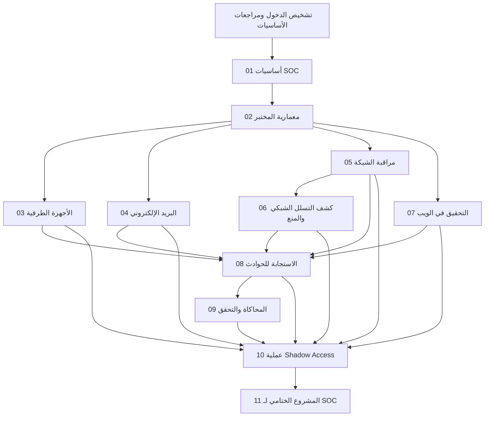

# خريطة المتطلبات السابقة

> **الحالة:** مسودة — تسلسل التقدم وبوابات الجاهزية المقترحة.

## بوابة الجاهزية عند الدخول

استخدم [ملف دخول المتعلم وقائمة الجاهزية](learner-readiness-checklist.md). خط الأساس المقترح هو الإلمام العام بالحاسوب وأساسيات IP والشبكات وWindows وLinux والويب والبريد الإلكتروني وتسجيل الأدلة. لا تُشترط خبرة سابقة في SOC. تؤدي الفجوات إلى خطة مراجعة ودعم بدلاً من تغيير المخرجات دون إشعار.

## بوابات المتطلبات السابقة للوحدات

| الوحدة | الحد الأدنى من أدلة الجاهزية |
|---|---|
| 01 | إكمال التشخيص الأولي وتسجيل احتياجات الدعم |
| 02 | فهم مفاهيم سير العمل في الوحدة 01؛ وإلمام أساسي بالمضيف والشبكة أو إكمال مراجعة تأسيسية |
| 03 | جاهزية مختبر الوحدة 02؛ وقدرة المتعلم على العثور على سجلات Windows وشرح سياق العملية الأساسي |
| 04 | مختبر الوحدة 02 أو عناصر رسائل منقحة يوفرها المدرب؛ وإلمام أساسي بمفردات URL والبريد الإلكتروني |
| 05 | مختبر الوحدة 02 أو ملف PCAP مقدم؛ وأساسيات IP وTCP وUDP وDNS وHTTP |
| 06 | تفسير الحزم والبروتوكولات في الوحدة 05؛ ومصدر pfSense/Suricata أو حزمة تنبيهات/PCAP يوفرها المدرب |
| 07 | مختبر الوحدة 02 أو سجلات ويب مقدمة؛ وأساسيات طلبات HTTP واستجاباتها |
| 08 | الوحدات 01–07 أو تكافؤ يوافق عليه المدرب؛ وجاهزية التعامل مع الأدلة |
| 09 | الوحدات 03 و05 و06 و08؛ وإحاطة بالسلامة وبوابة جاهزية القياس عن بُعد |
| 10 | الوحدات 03–09 أو حزم أدلة مكافئة معتمدة؛ وتحديد مصدر جميع العناصر وسجل منشئها |
| 11 | الوحدات 01–10 أو تكافؤ موثق ومعتمد من المدرب؛ وإصدار موجز التقييم |

## الافتراضات والقيود

- تؤسس الوحدة 01 مفردات SOC المشتركة وسير العمل.
- توفر الوحدة 02 البيئة العملية؛ ولا يجوز الاستعاضة عنها بصورة أو مجموعة بيانات مجهزة من المدرب إلا مع توثيق ذلك.
- تعلّم الوحدات 03–07 مجالات أدلة محددة.
- تجمع الوحدة 08 التحقيق ضمن التعامل مع الحوادث.
- تتطلب الوحدة 09 فهماً للسلوكيات والقياس عن بُعد الجاري اختباره.
- تدمج الوحدتان 10 و11 القدرات السابقة وتقيّمانها.
- تُدرج قدرة البريد في الوحدة 04 ضمن عملية Shadow Access بواسطة عنصر `.eml` منقح؛ ويظل Mailpit اختيارياً.

راجع هذا المخطط مقابل محتوى الدروس الفعلي وجاهزية المختبر والجدول النهائي قبل الاعتماد.
