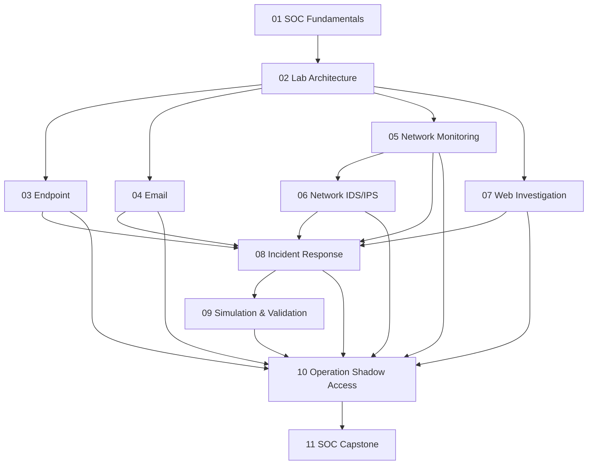

# Prerequisite Map

> **Status:** draft — proposed progression

## Assumptions
- Module 01 establishes shared SOC vocabulary and analyst workflow.
- Module 02 provides the practical environment.
- Modules 03–07 teach focused evidence domains.
- Module 08 consolidates investigation into incident handling.
- Module 09 requires understanding of the behaviors and telemetry being validated.
- Modules 10 and 11 integrate and assess the preceding capabilities.

Review this graph against actual lesson content, lab readiness, and the final schedule before approval.
