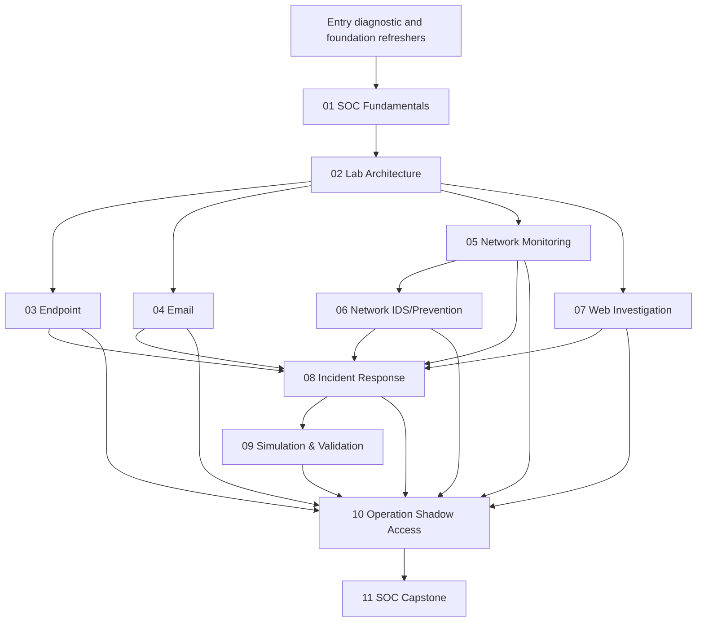

# Prerequisite Map

> **Status:** draft — proposed progression and readiness gates.

## Entry readiness gate
Use the [Learner Entry Profile & Readiness Checklist](learner-readiness-checklist.md). Proposed baseline: general computer literacy plus basic IP/network, Windows, Linux, web/email, and evidence-recording familiarity. No prior SOC employment is assumed. Gaps trigger a refresher/support plan rather than an unannounced change to outcomes.

## Module prerequisite gates
| Module | Minimum readiness evidence |
|---|---|
| 01 | Entry diagnostic completed; support needs recorded |
| 02 | Module 01 workflow concepts; basic host/network familiarity or completed refresher |
| 03 | Module 02 lab ready; learner can locate Windows logs and explain basic process context |
| 04 | Module 02 lab or instructor-provided sanitized message artifacts; basic URL/email vocabulary |
| 05 | Module 02 lab or supplied PCAP; IP/TCP/UDP/DNS/HTTP fundamentals |
| 06 | Module 05 packet/protocol interpretation; pfSense/Suricata source or instructor-provided alert/PCAP pack |
| 07 | Module 02 lab or supplied web logs; HTTP request/response basics |
| 08 | Modules 01–07 or instructor-approved equivalency; evidence-handling readiness |
| 09 | Modules 03, 05, 06, and 08; safety briefing and telemetry-readiness gate |
| 10 | Modules 03–09 or approved equivalent evidence packs; all source artifacts identified by provenance |
| 11 | Modules 01–10 or documented instructor-approved equivalency; assessment brief issued |

## Assumptions and constraints
- Module 01 establishes shared SOC vocabulary and workflow.
- Module 02 provides the practical environment; a prepared instructor image/dataset may substitute only when documented.
- Modules 03–07 teach focused evidence domains.
- Module 08 consolidates investigation into incident handling.
- Module 09 requires understanding of behaviors and telemetry under test.
- Modules 10 and 11 integrate and assess preceding capabilities.
- Module 04 email capability is included in Operation Shadow Access through a sanitized `.eml` artifact; Mailpit remains optional.

Review this graph against actual lesson content, lab readiness, and the final schedule before approval.
