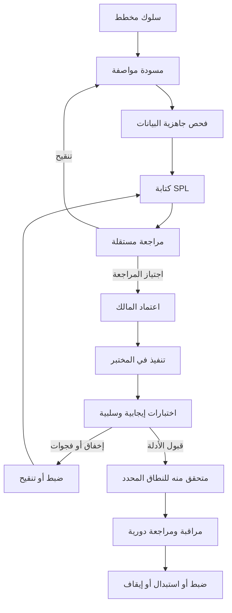

# دورة حياة الكشف

> **الحالة:** مسودة إجراءات.

## دورة الحياة

## تعريف المراحل

- `planned`: السلوك مرشح؛ ولا توجد مواصفة مكتملة.
- `draft`: تجري صياغة المواصفة وSPL الأولية.
- `in-review`: اكتمل فحص المؤلف وطُلبت مراجعة مستقلة.
- `approved`: قبل مالك المشروع التصميم؛ وقد يظل التنفيذ أثناء التشغيل بانتظار الإنجاز.
- `implemented`: أُعد في المختبر المستهدف؛ وقد يظل التحقق بانتظار الإنجاز.
- `validated`: اجتازت الاختبارات الموثقة للبيئة والنطاق المسجلين.
- `tuning`: يجري تعديل المنطق أو الحدود استجابةً لسلوك مرصود.
- `deprecated`: لم يعد موصى به؛ احتفظ بالمبرر ومرجع البديل.

## بوابات مطلوبة

1. **بوابة السلوك:** حدد السلوك وأهميته.
2. **بوابة القياس عن بُعد:** أثبت توفر الحقول ومصدر الحدث المطلوبين.
3. **بوابة المنطق:** اكتب SPL بنطاق محدود وافتراضات صريحة.
4. **بوابة المراجعة:** مراجعة مستقلة للصحة والسلامة والجودة وقابلية الصيانة.
5. **بوابة المالك:** اعتماد صريح من مالك المشروع.
6. **بوابة التنفيذ:** سجل البيئة والإصدار الفعليين.
7. **بوابة التحقق:** نفّذ حالات الاختبار واحفظ الأدلة.
8. **بوابة الصيانة:** أعد المراجعة عند تغير المصادر أو الإصدارات أو الحقول أو المنطق أو افتراضات التهديد.

## منع تضخيم الحالة

اجتياز مراجعة التوثيق ليس اختباراً أثناء التشغيل. وتنفيذ بحث بنجاح لا يثبت فعالية الكشف. كما أن الاختبار الإيجابي دون اختبارات سلبية ذات صلة غير مكتمل. اذكر بدقة ما اختُبر وأين ومتى.
