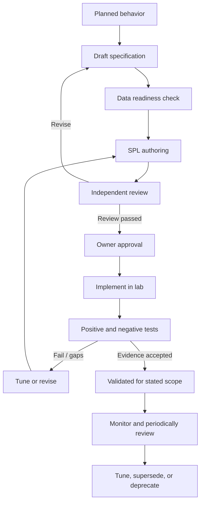

# Detection Lifecycle

> **Status:** draft process.

## Lifecycle

## Stage definitions
- `planned`: behavior is a candidate; no complete specification.
- `draft`: specification and initial SPL are being authored.
- `in-review`: author self-check is complete; independent review requested.
- `approved`: Project Owner accepted the design; runtime implementation may still be pending.
- `implemented`: configured in the target lab; validation may still be pending.
- `validated`: documented tests passed for the recorded environment and scope.
- `tuning`: logic or thresholds are being adjusted due to observed behavior.
- `deprecated`: no longer recommended; retain rationale and replacement reference.

## Required gates
1. **Behavior gate:** define behavior and why it matters.
2. **Telemetry gate:** prove required fields and event source are available.
3. **Logic gate:** write SPL with bounded scope and explicit assumptions.
4. **Review gate:** independent review for correctness, safety, quality, and maintainability.
5. **Owner gate:** explicit Project Owner approval.
6. **Implementation gate:** record actual target environment and version.
7. **Validation gate:** execute test cases and preserve evidence.
8. **Maintenance gate:** review when sources, versions, fields, logic, or threat assumptions change.

## No status inflation
A passing documentation review is not a runtime test. A successful search execution is not proof of detection efficacy. A positive test without relevant negative tests is incomplete. State exactly what was tested, where, and when.
