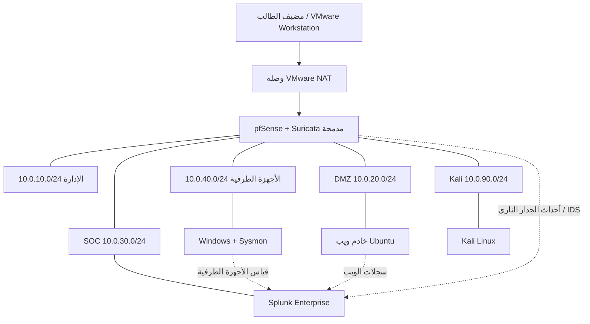

# البنية المنطقية

> الحالة: تصميم مقترح؛ التحقق من النشر بانتظار التنفيذ.

## مخطط المكونات

تمثل الخطوط المتقطعة مسارات منطقية للقياس، لا بروتوكولاً أو منفذاً مؤكداً.

## واجهات pfSense

| الواجهة | المقطع | البوابة |
|---|---|---|
| WAN | وصلة VMware NAT | يحددها VMware |
| MGMT | الإدارة | `10.0.10.1/24` |
| SOC | SOC | `10.0.30.1/24` |
| DMZ | DMZ | `10.0.20.1/24` |
| ENDPOINT | الأجهزة الطرفية | `10.0.40.1/24` |
| KALI | Kali | `10.0.90.1/24` |

أنشئ شبكة WAN واحدة خلف NAT وخمس شبكات VMware داخلية معزولة. أرقام VMnet خيارات تنفيذية ويجب تسجيلها في ورقة الطالب.

## المواضع والقيود

- pfSense هو الموجّه الوحيد بين المناطق الداخلية؛ لا تضف محولات تتجاوز الجدار الناري.
- يوجد Splunk Enterprise في منطقة SOC ولا يُعرض على WAN.
- تتصل Windows وUbuntu وKali كلٌ بمنطقتها المخصصة فقط.
- يجب ألا يستخدم Kali وضع Bridged مطلقاً.
- استخدم وحدة تحكم VMware كمسار استعادة عند تعطل شبكة الإدارة.
- تجنب تداخل الشبكات الفرعية وخوادم DHCP المتنافسة.
- أعد DNS وNTP عمداً لضمان ترابط الأحداث.

قرارات مفتوحة: معرّفات VMnet الدقيقة، وDHCP مقابل العناوين الثابتة، ومسار الوصول الإداري، وموضع Mailpit الاختياري، وطريقة تصدير قياس pfSense/Suricata المختبرة.
