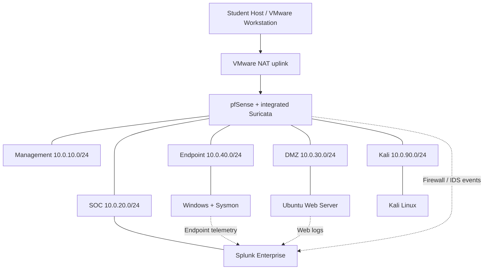

# Logical Topology

> Status: proposed design; deployment validation is pending.

## Component diagram

Dashed lines represent logical telemetry paths, not a confirmed protocol or port.

## pfSense interfaces

| Interface | Segment | Gateway |
|---|---|---|
| WAN | VMware NAT uplink | VMware-assigned |
| MGMT | Management | 10.0.10.1/24 |
| SOC | SOC | 10.0.20.1/24 |
| DMZ | DMZ | 10.0.30.1/24 |
| ENDPOINT | Endpoint | 10.0.40.1/24 |
| KALI | Kali | 10.0.90.1/24 |

Create one NAT-backed WAN network and five isolated internal VMware networks. VMnet numbers are implementation choices and must be recorded in the student worksheet.

## Placement and constraints
- pfSense is the only router between internal zones; do not add bypass adapters.
- Splunk Enterprise resides in SOC and is not exposed to WAN.
- Windows, Ubuntu, and Kali each attach only to their designated zone.
- Kali must never use Bridged mode.
- Use VMware console as the recovery path if management networking fails.
- Avoid subnet overlap and competing DHCP servers.
- Configure DNS and NTP deliberately for reliable event correlation.

Open decisions: exact VMnet identifiers, DHCP versus static addressing, management access path, optional Mailpit placement, and tested pfSense/Suricata telemetry export method.
