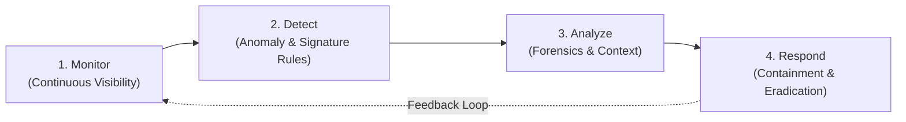
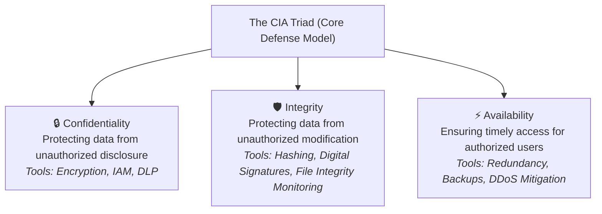
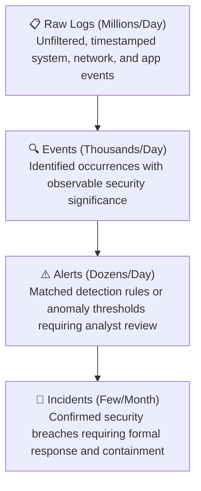
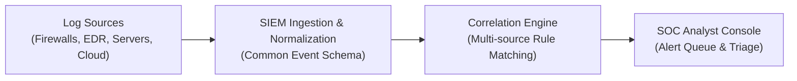

# Lab 01: Security Operations & Incident Response Fundamentals

> **Course:** Cybersecurity Operations (SOC Lab)  
> **Instructor:** Hussein Al-Selwi  
> **Total Slides:** 30 Slides  
> **Source Presentation:** `lab1_IDR.html`  

### 📋 Overview

Foundational guide on modern SOC architecture, the CIA Triad, analyst workflow lifecycle, logs vs events vs alerts vs incidents, and defensive security tooling (SIEM, SOAR, EDR, IDS/IPS, Firewalls).

---

## 📑 Table of Contents

- [Slide 01: Introduction](#slide-01-introduction)
- [Slide 02: Domain Objectives](#slide-02-domain-objectives)
- [Slide 03: What is a SOC?](#slide-03-what-is-a-soc)
- [Slide 04: The Core Role of a SOC](#slide-04-the-core-role-of-a-soc)
- [Slide 05: SOC Models & Structures](#slide-05-soc-models-structures)
- [Slide 06: SOC Roles and Responsibilities](#slide-06-soc-roles-and-responsibilities)
- [Slide 07: People, Process & Technology](#slide-07-people-process-technology)
- [Slide 08: Protecting the CIA Triad](#slide-08-protecting-the-cia-triad)
- [Slide 09: Reactive Operations](#slide-09-reactive-operations)
- [Slide 10: Proactive Operations](#slide-10-proactive-operations)
- [Slide 11: A Day in the Life of a SOC Analyst](#slide-11-a-day-in-the-life-of-a-soc-analyst)
- [Slide 12: Scenario: Insider Data Exfiltration](#slide-12-scenario-insider-data-exfiltration)
- [Slide 13: Logs, Events, Alerts, and Incidents](#slide-13-logs-events-alerts-and-incidents)
- [Slide 14: Security Information and Event Management (SIEM)](#slide-14-security-information-and-event-management-siem)
- [Slide 15: Security Orchestration, Automation and Response (SOAR)](#slide-15-security-orchestration-automation-and-response-soar)
- [Slide 16: Incident Management Tools](#slide-16-incident-management-tools)
- [Slide 17: Network Security Monitoring (NSM)](#slide-17-network-security-monitoring-nsm)
- [Slide 18: Firewalls: Network Firewall, NGFW & WAF](#slide-18-firewalls-network-firewall-ngfw-waf)
- [Slide 19: Intrusion Detection System (IDS)](#slide-19-intrusion-detection-system-ids)
- [Slide 20: Intrusion Prevention System (IPS)](#slide-20-intrusion-prevention-system-ips)
- [Slide 21: Endpoint Detection and Response (EDR)](#slide-21-endpoint-detection-and-response-edr)
- [Slide 22: Threat Intelligence Platform (TIP)](#slide-22-threat-intelligence-platform-tip)
- [Slide 23: Forensics Tools](#slide-23-forensics-tools)
- [Slide 24: Malware Analysis Tools](#slide-24-malware-analysis-tools)
- [Slide 25: Measuring SOC Performance](#slide-25-measuring-soc-performance)
- [Slide 26: Common Threats: Social & Software-Based](#slide-26-common-threats-social-software-based)
- [Slide 27: Common Threats: Identity & Insider Risk](#slide-27-common-threats-identity-insider-risk)
- [Slide 28: Common Threats: Advanced Persistent Threats (APTs)](#slide-28-common-threats-advanced-persistent-threats-apts)
- [Slide 29: Common Threats: Network, Data & Supply Chain](#slide-29-common-threats-network-data-supply-chain)
- [Slide 30: Key Takeaways](#slide-30-key-takeaways)

---

## Slide 01: Introduction

> **Category:** `SECURITY OPERATIONS & INCIDENT RESPONSE`

### Introduction to Security Operations and Incident Response

Lab 1 — Security Operations Fundamentals

Instructor: Hussein Al-Selwi

> [!NOTE] 🎙️ **Instructor Lecture Notes**
> Welcome students to the course. Explain that Security Operations and Incident Response are two of the most important disciplines in defensive cybersecurity. This course will provide the knowledge and practical skills required to detect, investigate, and respond to security incidents.

---

## Slide 02: Domain Objectives

> **Category:** `DOMAIN OBJECTIVES`

- Understand the core functions of a SOC and its role.
- Explore the daily tasks and responsibilities of a SOC Analyst.
- Familiarize with different SOC models, roles, and organizational structures .
- Learn metrics which evaluate the effectiveness of security operations.
- Understand various tools used within SOCs for monitoring, detection, analysis, and response.
- Identify and understand common threats faced by organizations.

> [!NOTE] 🎙️ **Instructor Lecture Notes**
> Walk through each objective so students know what they are expected to achieve by the end of the lab session.

---

## Slide 03: What is a SOC?

> **Category:** `FOUNDATIONS`

### What is a Security Operations Center (SOC)?

A Security Operations Center (SOC) is a centralized unit responsible for monitoring, detecting, analyzing, and responding to cybersecurity threats.

- **Primary Responsibilities**: Continuous monitoring, detection of suspicious activity, investigation of alerts, and coordination of IR.
- **Asset Protection**: Safeguarding organizational data, systems, and infrastructure from internal and external threats.
- **Key Goal**: Reduce organizational risk through continuous monitoring and rapid response.

> [!IMPORTANT]
> Cybersecurity is not a one-time activity — a SOC runs 24/7 and operates in two modes: proactive (threat hunting, hardening) and reactive (triage, investigation, response).

> [!NOTE] 🎙️ **Instructor Lecture Notes**
> Emphasize that a SOC is not necessarily a physical room. It can be a distributed team working together to defend an organization against cyber threats.

---

## Slide 04: The Core Role of a SOC

> **Category:** `MISSION`

The SOC operational cycle is the fundamental mission of every Security Operations Center and the foundation of all SOC activities.

01. **Monitor**: Observe systems, endpoints, networks, and logs 24/7
02. **Detect**: Identify suspicious or malicious activity
03. **Analyze**: Investigate alerts and determine their significance
04. **Respond**: Contain, mitigate, and recover from threats

5. **Step 1**: Monitor
6. **Step 2**: Detect
7. **Step 3**: Analyze
8. **Step 4**: Respond

> [!NOTE] 🎙️ **Instructor Lecture Notes**
> This cycle represents the fundamental mission of every Security Operations Center and serves as the foundation for many SOC activities.

---

## Slide 05: SOC Models & Structures

> **Category:** `ORGANIZATIONAL STRUCTURES`

### SOC Models and Organizational Structures

Organizations choose different SOC structures based on budget , expertise , and operational requirements .

- **Internal SOC** `[IN-HOUSE]`: Security operations managed entirely by the organization . Full control, direct integration with internal teams and systems.
- **Managed Security Service Provider** `[MSSP]`: Security monitoring and operations outsourced to a third-party provider . Cost-effective with access to specialized expertise.
- **Hybrid SOC** `[HYBRID]`: Combines internal security teams with external security services . Balances control with scalability and cost efficiency.

> [!IMPORTANT]
> The choice of SOC model depends on an organization's size, budget, regulatory requirements , and the maturity of its internal security capabilities.

> [!NOTE] 🎙️ **Instructor Lecture Notes**
> Discuss the advantages and challenges of each model and explain why organizations choose different SOC structures based on budget, expertise, and operational requirements.

---

## Slide 06: SOC Roles and Responsibilities

> **Category:** `TEAMS & ROLES`

A structured tier system ensures high efficiency and ensures expert focus is applied where it is needed most.

ESCALATION FLOW TIER 1 — TRIAGE TIER 2 — INVESTIGATE TIER 3 — HUNT T1 Tier 1 Analyst (Triage) Initial alert review · Alert triage · Basic investigations · Escalation of confirmed threats T2 Tier 2 Analyst (Incident Analysis) Advanced investigations · Incident analysis · Root cause analysis · Threat validation T3 Tier 3 Analyst (Expert / Hunt) Expert-level investigations · Detection engineering · Threat hunting · Malware analysis Other Specialized SOC Roles Incident Responder Threat Intel Analyst Security Engineer SOC Manager

> [!NOTE] 🎙️ **Instructor Lecture Notes**
> Explain that escalation between tiers allows organizations to handle large volumes of alerts efficiently.

---

---

## Slide 07: People, Process & Technology

> **Category:** `THREE PILLARS`

### The Three Pillars of a Security Operations Center

A successful SOC relies on three fundamental components working in harmony.

PEOPLE PROCESS TECHNOLOGY SOC SUCCESS

- **People**: SOC Analysts · Incident Responders · Threat Hunters · Security Engineers · SOC Managers
- **Process**: Monitoring Procedures · Alert Triage · IR Workflows · Escalation Procedures · Reporting Standards
- **Technology**: SIEM Platforms · EDR Solutions · IDS/IPS · Threat Intel Platforms · Forensic Tools

> [!NOTE] 🎙️ **Instructor Lecture Notes**
> Emphasize that technology alone cannot secure an organization. Effective security operations require skilled personnel, well-defined procedures, and appropriate tools working together.

---

## Slide 08: Protecting the CIA Triad

> **Category:** `SECURITY PRINCIPLES`

### How a SOC Protects the CIA Triad

The primary goal of a SOC is to protect three core principles of information security.

EXAMPLE: RANSOMWARE ATTACK Ransomware encrypts files and demands payment — it primarily attacks Availability (data and systems become unusable). If the attacker also exfiltrates data before encrypting, Confidentiality is compromised too. How People, Process & Technology Respond People SOC analysts detect the encryption activity, isolate the affected host, and notify the incident response team and management. Process The incident response playbook is triggered: containment, eradication, and recovery from clean backups follow a predefined runbook. Technology EDR isolates the endpoint, SIEM correlates the alert, and backup systems restore encrypted files to recover availability. Outcome Availability is restored from backups

> [!NOTE] 🎙️ **Instructor Lecture Notes**
> Use a ransomware example to show that ransomware primarily attacks Availability (and often Confidentiality via data theft), then walk through how People, Process, and Technology each contribute to the response.

---

## Slide 09: Reactive Operations

> **Category:** `REACTIVE OPS`

### Reactive Security Operations

Reactive activities occur after suspicious activity or an alert has been identified.

Security Monitoring Continuously observe systems and networks for anomalies. Threat Detection Identify suspicious or malicious activity through alerts and correlation. Incident Response Contain and mitigate security incidents to limit damage. Digital Forensics Collect and analyze evidence to determine what happened. Malware Analysis Analyze malicious software to understand its behavior and impact. INCIDENT TIMELINE 1 Alert Triggered ↓ 2 Investigation ↓ 3 Response ↓ ✓ Recovery Goal: Respond quickly and effectively to security incidents.

> [!NOTE] 🎙️ **Instructor Lecture Notes**
> Explain that reactive operations focus on investigating and responding to events that have already occurred or been detected.

---

## Slide 10: Proactive Operations

> **Category:** `PROACTIVE OPS`

### Proactive Security Operations

Proactive activities help identify and reduce threats before incidents occur.

THREAT INTEL HUNTING VULN MGMT INTEL Threat Intelligence Collect and analyze information about current and emerging threats to stay ahead of adversaries. HUNT Threat Hunting Actively search for hidden threats within the environment that evade automated detection. VULN Vulnerability Management Identify, assess, and remediate security weaknesses before they can be exploited. Improved visibility Earlier threat detection Reduced attack surface Stronger security posture

> [!NOTE] 🎙️ **Instructor Lecture Notes**
> Explain that mature SOCs spend significant effort on proactive security because preventing incidents is often more effective than responding to them.

---

## Slide 11: A Day in the Life of a SOC Analyst

> **Category:** `A DAY IN THE SOC`

A typical day involves balancing continuous vigilance with deep technical investigation.

Typical Daily Activities Review security dashboards Monitor incoming alerts Perform alert triage Investigate suspicious activities Escalate confirmed incidents Document findings Collaborate with security teams SOC analysts prioritize incoming alerts, resolving low-risk alerts quickly while dedicating deeper time to complex threats. EXAMPLE WORKFLOW TIMELINE 01 Review Alerts Start of shift: Triage alerts on SIEM/dashboard. 02 Investigate Query endpoint logs, network packet data, and threat intel. 03 Determine Impact Assess if systems are compromised and estimate blast radius. 04 Escalate or Close Pass critical incidents to Tier 2/Incident Response or close false positives. 05 Document Findings Write triage logs, update tickets, and share recommendations.

> [!NOTE] 🎙️ **Instructor Lecture Notes**
> Explain that analysts spend much more time investigating and documenting than simply watching dashboards.

---

## Slide 12: Scenario: Insider Data Exfiltration

> **Category:** `ROLES IN ACTION`

A walkthrough of how a single alert moves through the SOC tier structure — and what each role contributes along the way.

> [!IMPORTANT]
> Setup: An employee in the finance department uploads several gigabytes of customer records to a personal cloud storage account late on a Friday night, shortly after submitting their resignation.

1. **Tier 1 Analyst — Triage**: A DLP alert fires for an unusually large outbound data transfer. The Tier 1 analyst confirms the alert isn't a false positive, checks the user and data volume, and escalates since it involves sensitive customer data.
2. **Tier 2 Analyst — Investigation**: Correlates the alert with HR records (recent resignation), reviews endpoint and identity logs for the account, and confirms this is a credible insider threat rather than routine business activity. Opens a formal incident.
3. **Tier 3 Analyst — Deep Dive & Hunt**: Performs forensic analysis of the workstation, reconstructs the full timeline of file access, and threat-hunts for similar exfiltration patterns across other accounts to rule out a broader campaign.
4. **SOC Manager — Coordination & Decision**: Coordinates with HR, Legal, and IT to revoke account access immediately, decides whether law enforcement or regulatory notification is required, and ensures the incident is documented for the post-incident review.

> [!NOTE] 🎙️ **Instructor Lecture Notes**
> Walk through this scenario tier by tier. Emphasize how each tier adds context the previous tier couldn't see, and how the SOC Manager's role is coordination and decision-making rather than hands-on investigation.

---

## Slide 13: Logs, Events, Alerts, and Incidents

> **Category:** `SEC FLOWS`

### Understanding Logs, Events, Alerts, and Incidents

Security teams differentiate between these four terms to triage and respond to threats efficiently.

LOG Log A record generated by a system, application, or device documenting an activity. Example: User login recorded in Windows Event Logs. EVENT Security Event Any observable occurrence that may have security significance. Example: Multiple failed login attempts. ALERT Alert A notification generated when suspicious activity matches a predefined rule or condition. Example: Brute-force attack detected. INCIDENT Incident A confirmed security event that requires investigation and response. Example: Successful account compromise. LOG EVENT ALERT INCIDENT Action Required

> [!NOTE] 🎙️ **Instructor Lecture Notes**
> Students often confuse these terms. Emphasize that not every log becomes an event, not every event generates an alert, and not every alert becomes an incident.

---

## Slide 14: Security Information and Event Management (SIEM)

> **Category:** `SIEM`

A SIEM is a centralized platform that collects, stores, correlates, and analyzes security logs from multiple systems and devices across an organization, giving analysts a single pane of glass to detect and investigate threats.

Common Uses Log collection & aggregation Event correlation Alert generation Threat detection Popular Industry Products Splunk Enterprise Security Microsoft Sentinel IBM QRadar Elastic Security ArcSight DASHBOARD SCREENSHOT

> [!NOTE] 🎙️ **Instructor Lecture Notes**
> Security Information and Event Management (SIEM) — explain the purpose of this tool category, its core function within the SOC, and how it fits into the detection and response lifecycle.

---

## Slide 15: Security Orchestration, Automation and Response (SOAR)

> **Category:** `SOAR`

A SOAR platform connects security tools together and uses automated playbooks to enrich alerts, orchestrate workflows across systems, and execute repetitive response actions — freeing analysts to focus on higher-value investigation work.

Common Uses Playbook automation Response automation Tool integration Reducing analyst workload Popular Industry Products Palo Alto Cortex XSOAR Splunk SOAR Microsoft Sentinel SOAR IBM Resilient SOAR Swimlane PLAYBOOK SCREENSHOT

> [!NOTE] 🎙️ **Instructor Lecture Notes**
> Security Orchestration, Automation and Response (SOAR) — explain the purpose of this tool category, its core function within the SOC, and how it fits into the detection and response lifecycle.

---

## Slide 16: Incident Management Tools

> **Category:** `INCIDENT MANAGEMENT`

An Incident Management (case management/ticketing) tool helps SOC teams document investigations, track incidents from detection to closure, assign tasks, and coordinate response activities across the team.

Common Uses Incident tracking Workflow management Escalation management Collaboration Popular Industry Products TheHive ServiceNow SecOps Jira Service Management IBM Resilient Cortex XSOAR INVESTIGATION CASE SCREENSHOT

> [!NOTE] 🎙️ **Instructor Lecture Notes**
> Incident Management Tools — explain the purpose of this tool category, its core function within the SOC, and how it fits into the detection and response lifecycle.

---

## Slide 17: Network Security Monitoring (NSM)

> **Category:** `NSM`

Network Security Monitoring tools capture and analyze network traffic and metadata to detect malicious activity, reconstruct sessions, and provide the visibility needed for network-based threat hunting and forensics.

Common Uses Full packet capture Traffic analysis Protocol & metadata logging Network forensics Popular Industry Products Zeek (Bro) Wireshark Security Onion Corelight Darktrace NETWORK TRAFFIC SCREENSHOT

> [!NOTE] 🎙️ **Instructor Lecture Notes**
> Network Security Monitoring (NSM) — explain the purpose of this tool category, its core function within the SOC, and how it fits into the detection and response lifecycle.

---

## Slide 18: Firewalls: Network Firewall, NGFW & WAF

> **Category:** `FIREWALL`

A firewall enforces rules to allow or block traffic between network segments. A Next-Generation Firewall (NGFW) extends this with application awareness, identity-based policies, and built-in intrusion prevention, while a Web Application Firewall (WAF) protects web applications by filtering and monitoring HTTP/HTTPS traffic for attacks like SQL injection and XSS.

Network Firewall Filters traffic by IP, port, and protocol rules. NGFW Adds app awareness, IPS, and identity-based control. WAF Protects web apps from OWASP Top 10 attacks. Common Uses Traffic filtering Access control Application visibility Web app protection Popular Industry Products Palo Alto NGFW Fortinet FortiGate Cisco Secure Firewall Cloudflare WAF AWS WAF FIREWALL CONSOLE SCREENSHOT

> [!NOTE] 🎙️ **Instructor Lecture Notes**
> Firewalls: Network Firewall, NGFW & WAF — explain the purpose of this tool category, its core function within the SOC, and how it fits into the detection and response lifecycle.

---

## Slide 19: Intrusion Detection System (IDS)

> **Category:** `IDS`

An IDS passively monitors network or host traffic for signatures of known attacks and anomalous behavior, generating alerts for analysts to review — but it does not block traffic itself.

Common Uses Network monitoring Signature & anomaly detection Alert generation Passive visibility Popular Industry Products Snort Suricata Zeek Cisco Secure IDS IDS ALERTS SCREENSHOT

> [!NOTE] 🎙️ **Instructor Lecture Notes**
> Intrusion Detection System (IDS) — explain the purpose of this tool category, its core function within the SOC, and how it fits into the detection and response lifecycle.

---

## Slide 20: Intrusion Prevention System (IPS)

> **Category:** `IPS`

An IPS sits inline with network traffic and actively blocks malicious activity in real time as it detects it, going a step beyond an IDS by preventing the attack rather than only alerting on it.

Common Uses Inline traffic inspection Real-time blocking Signature matching Popular Industry Products Cisco Secure IPS Palo Alto Threat Prevention Suricata (IPS mode) Trend Micro TippingPoint IPS BLOCKING SCREENSHOT

> [!NOTE] 🎙️ **Instructor Lecture Notes**
> Intrusion Prevention System (IPS) — explain the purpose of this tool category, its core function within the SOC, and how it fits into the detection and response lifecycle.

---

## Slide 21: Endpoint Detection and Response (EDR)

> **Category:** `EDR`

An EDR platform continuously monitors endpoint devices, recording process, file, registry, and network activity to detect and respond to threats directly on the host.

Common Uses Endpoint monitoring Malware detection Threat hunting Incident investigation Remote containment Many EDR platforms include UEBA (User and Entity Behavior Analytics) as part of their detection capability — baselining normal behavior and flagging deviations that may indicate compromise or insider threats. Popular Industry Products CrowdStrike Falcon Microsoft Defender for Endpoint SentinelOne VMware Carbon Black EDR CONSOLE SCREENSHOT

> [!NOTE] 🎙️ **Instructor Lecture Notes**
> Endpoint Detection and Response (EDR) — explain the purpose of this tool category, its core function within the SOC, and how it fits into the detection and response lifecycle. Mention that EDR platforms commonly include UEBA as part of their detection capability, rather than treating UEBA as a separate category.

---

## Slide 22: Threat Intelligence Platform (TIP)

> **Category:** `TIP`

A Threat Intelligence Platform collects, organizes, enriches, and distributes threat intelligence — such as IOCs, TTPs, and threat actor profiles — from internal and external sources so analysts can add context to alerts and anticipate emerging threats.

Common Uses IOC management Threat enrichment Threat actor tracking Intelligence sharing Campaign analysis Popular Industry Products MISP OpenCTI Recorded Future Anomali ThreatConnect THREAT FEEDS SCREENSHOT

> [!NOTE] 🎙️ **Instructor Lecture Notes**
> Threat Intelligence Platform (TIP) — explain the purpose of this tool category, its core function within the SOC, and how it fits into the detection and response lifecycle.

---

## Slide 23: Forensics Tools

> **Category:** `FORENSICS`

Digital forensics tools allow analysts to acquire, preserve, and analyze evidence from disks, memory, and devices in a forensically sound manner — reconstructing what happened during an incident while maintaining chain of custody for legal or HR proceedings.

Common Uses Disk & memory imaging Artifact recovery Timeline reconstruction Chain of custody Evidence analysis Popular Industry Products Autopsy EnCase Forensic FTK (Forensic Toolkit) Volatility (memory) Magnet AXIOM FORENSIC ANALYSIS SCREENSHOT

> [!NOTE] 🎙️ **Instructor Lecture Notes**
> Forensics Tools — explain the purpose of this tool category, its core function within the SOC, and how it fits into the detection and response lifecycle.

---

## Slide 24: Malware Analysis Tools

> **Category:** `MALWARE ANALYSIS`

Malware analysis tools let analysts safely examine suspicious files and binaries — through static inspection or dynamic execution in a sandbox — to determine their behavior, capabilities, and indicators of compromise without risking production systems.

Common Uses Static analysis Dynamic/behavioral analysis Sandboxing Reverse engineering IOC extraction Popular Industry Products VirusTotal Any.Run Cuckoo Sandbox IDA Pro Ghidra MALWARE REPORT SCREENSHOT

> [!NOTE] 🎙️ **Instructor Lecture Notes**
> Malware Analysis Tools — explain the purpose of this tool category, its core function within the SOC, and how it fits into the detection and response lifecycle.

---

## Slide 25: Measuring SOC Performance

> **Category:** `SOC METRICS`

Security Operations Centers use key performance metrics to measure and improve response capabilities.

MTTD Mean Time to Detect Average time to identify a threat. MTTR Mean Time to Respond Average time to contain and resolve threats. Why Metrics Matter Measure SOC effectiveness Identify bottlenecks Improve response capacity Support decisions SOC LIVE PERFORMANCE METRICS SYSTEM ACTIVE MTTD (Time to Detect) 12m ▼ 74% MTTR (Time to Respond) 48m ▼ 81% Alert vs. Incident Volume (Monthly Trend) OCT NOV DEC Alert Vol (45K) Incident Vol (18) F/P Rate (4.2%)

> [!NOTE] 🎙️ **Instructor Lecture Notes**
> Explain that metrics help SOC managers understand whether the SOC is improving over time and where resources should be allocated.

---

## Slide 26: Common Threats: Social & Software-Based

> **Category:** `THREAT LANDSCAPE · 1 OF 4`

SOC teams monitor and respond to a wide variety of cyber threats. We start with attacks that target people directly and malicious software that runs on victim systems.

Social Engineering Psychological manipulation that tricks people into revealing sensitive information, granting access, or performing actions that compromise security. Includes: Phishing — fraudulent emails, messages, or sites designed to steal credentials or deliver malware — along with pretexting, baiting, and vishing. Malware Malicious software — including viruses, worms, and trojans — designed to disrupt, damage, or gain unauthorized access to systems. Includes: Ransomware — malware that encrypts files or systems and demands payment for their recovery, one of the most disruptive threats SOC teams face today. Fileless Malware Malicious activity that operates in memory rather than writing files to disk, often abusing legitimate tools (e.g. PowerShell, WMI) to evade traditional signature-based detection.

> [!NOTE] 🎙️ **Instructor Lecture Notes**
> Explain that these threats will be explored throughout the course and that SOC analysts must be capable of identifying indicators associated with each attack type. Phishing is the most common entry vector for social engineering; ransomware is the most disruptive form of malware — call out both explicitly.

---

## Slide 27: Common Threats: Identity & Insider Risk

> **Category:** `THREAT LANDSCAPE · 2 OF 4`

These threats exploit trust and legitimate access rather than technical vulnerabilities alone, which makes them harder to detect with traditional perimeter tools.

Identity and Account Compromise Unauthorized access to user or system accounts through stolen credentials, password spraying, session hijacking, or token theft — often the entry point for larger attacks. Insider Threats Threats originating from employees, contractors, or trusted users — whether malicious, negligent, or compromised — who already have legitimate access to systems and data.

> [!IMPORTANT]
> Both threats are typically detected through identity and access monitoring — abnormal logins, privilege escalation, and UEBA-driven behavioral baselines rather than signature-based tools.

> [!NOTE] 🎙️ **Instructor Lecture Notes**
> Emphasize that identity-based and insider threats often bypass perimeter defenses entirely because they exploit trusted access rather than a technical flaw.

---

## Slide 28: Common Threats: Advanced Persistent Threats (APTs)

> **Category:** `THREAT LANDSCAPE · 3 OF 4`

### Advanced Persistent Threats (APTs)

APTs are sophisticated, well-resourced threat actors — often state-sponsored — who maintain long-term, stealthy access inside a network to conduct espionage, sabotage, or data theft over months or years.

Defining Characteristics Advanced — custom tooling, zero-days, and skilled operators Persistent — long-term footholds, sometimes undetected for years Threat — deliberate, targeted, and well-funded, often nation-state backed Combines multiple techniques: social engineering, malware, and identity compromise into one campaign Why SOC Analysts Track Them Recognize known group TTPs (tactics, techniques, and procedures) Map detections to frameworks like MITRE ATT&CK Anticipate campaign goals based on attributed actors

APT Reference & Tracking Resources CrowdStrike Adversary Universe · Google Cloud Threat Intel · Rapid7 InsightIDR · MITRE ATT&CK Groups

> [!NOTE] 🎙️ **Instructor Lecture Notes**
> APTs deserve their own slide since they combine several other threat types (social engineering, malware, identity compromise) into a long-running campaign. APT groups are tracked and catalogued by major threat intelligence vendors — point students to the reference list for further research and encourage them to look up a named group.

---

## Slide 29: Common Threats: Network, Data & Supply Chain

> **Category:** `THREAT LANDSCAPE · 4 OF 4`

The final group covers threats aimed at availability, data confidentiality, unknown vulnerabilities, and trusted third parties.

Distributed Denial of Service (DDoS) Coordinated attempts to overwhelm systems, networks, or services with traffic, making them unavailable to legitimate users. Data Breach Unauthorized access, exfiltration, or exposure of sensitive, confidential, or regulated data — resulting in financial, legal, and reputational impact. Zero-Day Exploits Attacks that exploit previously unknown software vulnerabilities before a patch or fix is available, leaving defenders with no prior signature to detect them. Supply Chain Attacks Compromise of a trusted third-party vendor, software update, or hardware component to gain indirect access into an organization's environment.

Which Tool Catches What? DDoS → NSM / Firewall / IPS Data Breach → SIEM / UEBA / DLP Zero-Day → EDR / TIP / Forensics Supply Chain → TIP / SOAR / Forensics

> [!NOTE] 🎙️ **Instructor Lecture Notes**
> Wrap up the threat landscape section by connecting these attack types back to the SOC lifecycle and the tools covered earlier in the lab — ask students which tool would catch each threat before revealing the mapping.

---

## Slide 30: Key Takeaways

> **Category:** `LAB SUMMARY`

By the end of this lab, you should understand:

The purpose and role of a Security Operations Center The Monitor → Detect → Analyze → Respond lifecycle Different SOC models and organizational structures The importance of People, Process, and Technology Reactive and proactive SOC functions The difference between logs, events, alerts, and incidents The responsibilities of SOC analysts Common SOC tools and technologies Major cyber threats — from social engineering and malware to APTs and supply chain attacks

> [!NOTE] 🎙️ **Instructor Lecture Notes**
> Briefly revisit each topic and emphasize that these concepts form the foundation for the remainder of the course.

---

## 🎯 Summary & Key Takeaways

- **Module:** Lab 01: Security Operations & Incident Response Fundamentals

- **Core Competencies Developed:** Hands-on triage, log analysis, threat hunting, and defensive incident response.

- **Course Reference:** Cybersecurity Operations Practical Labs by **Hussein Al-Selwi**.
