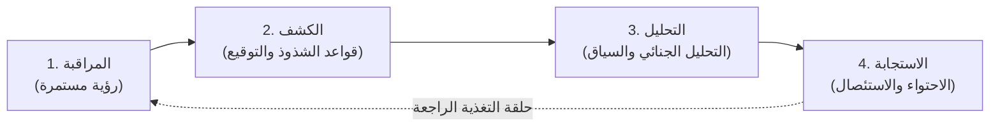
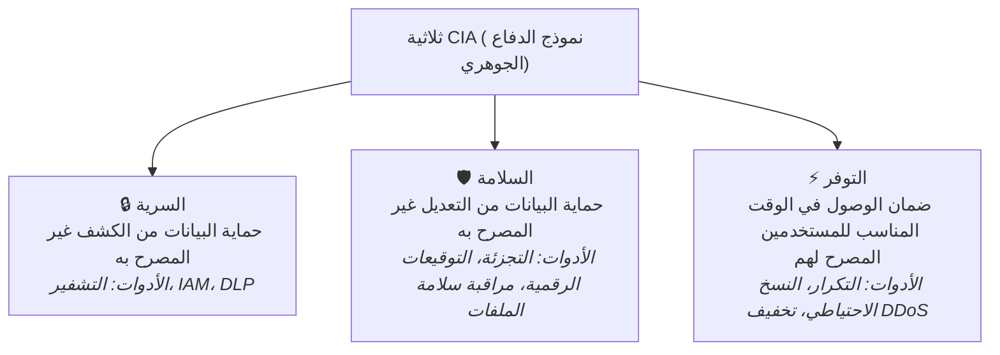
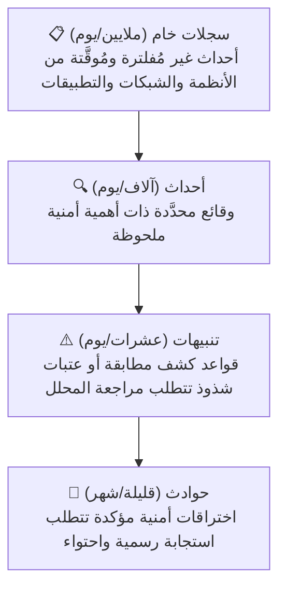
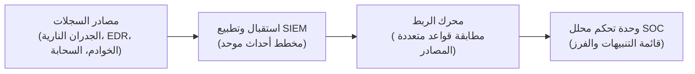

# المختبر 01: أساسيات عمليات الأمن والاستجابة للحوادث

المقرر: عمليات الأمن السيبراني (مختبر SOC)
المدرّب: حسين الصلوي
إجمالي الشرائح: 30 شريحة
العرض الأصلي: lab1_IDR.html

📋 نظرة عامة

دليل تأسيسي حول بنية مركز عمليات الأمن (SOC) الحديثة، وثلاثية CIA، ودورة حياة عمل المحلل، والفرق بين السجلات والأحداث والتنبيهات والحوادث، وأدوات الأمن الدفاعي (SIEM، SOAR، EDR، IDS/IPS، الجدران النارية).

---

## 📑 فهرس المحتويات

· الشريحة 01: مقدمة
· الشريحة 02: أهداف المجال
· الشريحة 03: ما هو SOC؟
· الشريحة 04: الدور الأساسي لمركز SOC
· الشريحة 05: نماذج وهياكل SOC
· الشريحة 06: الأشخاص والعمليات والتقنية
· الشريحة 07: حماية ثلاثية CIA
· الشريحة 08: العمليات التفاعلية
· الشريحة 09: العمليات الاستباقية
· الشريحة 10: يوم في حياة محلل SOC
· الشريحة 11: أدوار ومسؤوليات SOC
· الشريحة 12: سيناريو: تسريب بيانات من الداخل
· الشريحة 13: السجلات والأحداث والتنبيهات والحوادث
· الشريحة 14: إدارة معلومات وأحداث الأمن (SIEM)
· الشريحة 15: التنسيق والأتمتة والاستجابة الأمنية (SOAR)
· الشريحة 16: أدوات إدارة الحوادث
· الشريحة 17: مراقبة أمن الشبكة (NSM)
· الشريحة 18: الجدران النارية: الجدار التقليدي وNGFW وWAF
· الشريحة 19: نظام كشف التسلل (IDS)
· الشريحة 20: نظام منع التسلل (IPS)
· الشريحة 21: كشف واستجابة نقطة النهاية (EDR)
· الشريحة 22: منصة استخبارات التهديدات (TIP)
· الشريحة 23: أدوات التحليل الجنائي
· الشريحة 24: أدوات تحليل البرمجيات الخبيثة
· الشريحة 25: قياس أداء مركز SOC
· الشريحة 26: التهديدات الشائعة: الاجتماعية والبرمجية
· الشريحة 27: التهديدات الشائعة: الهوية والمخاطر الداخلية
· الشريحة 28: التهديدات الشائعة: التهديدات المتقدمة المستمرة (APTs)
· الشريحة 29: التهديدات الشائعة: الشبكة والبيانات وسلسلة التوريد
· الشريحة 30: الخلاصات الرئيسية

---

## الشريحة 01: مقدمة

الفئة: عمليات الأمن والاستجابة للحوادث

مقدمة في عمليات الأمن والاستجابة للحوادث

المختبر 1 — أساسيات عمليات الأمن

المدرّب: حسين الصلوي

[!NOTE] 🎙️ ملاحظات المحاضرة للمدرّب
رحّب بالطلاب في الدورة. اشرح أن عمليات الأمن والاستجابة للحوادث من أهم تخصصات الأمن السيبراني الدفاعي. وستوفّر هذه الدورة المعرفة والمهارات العملية اللازمة للكشف عن الحوادث الأمنية والتحقيق فيها والاستجابة لها.

---

## الشريحة 02: أهداف المجال

الفئة: أهداف المجال

· فهم الوظائف الأساسية لمركز عمليات الأمن (SOC) ودوره.
· استكشاف المهام اليومية والمسؤوليات لمحلل SOC.
· التعرّف على نماذج SOC المختلفة وأدوارها وهياكلها التنظيمية.
· تعلّم المقاييس التي تُقيّم فعالية عمليات الأمن.
· فهم الأدوات المتنوعة المستخدمة داخل مراكز SOC للمراقبة والكشف والتحليل والاستجابة.
· تحديد التهديدات الشائعة التي تواجهها المؤسسات وفهمها.

[!NOTE] 🎙️ ملاحظات المحاضرة للمدرّب
استعرض كل هدف حتى يعرف الطلاب ما المتوقع منهم تحقيقه بنهاية جلسة المختبر.

---

## الشريحة 03: ما هو SOC؟

الفئة: الأساسيات

ما هو مركز عمليات الأمن (SOC)؟

مركز عمليات الأمن (SOC) هو وحدة مركزية مسؤولة عن مراقبة التهديدات السيبرانية والكشف عنها وتحليلها والاستجابة لها.

· المسؤوليات الأساسية: المراقبة المستمرة، وكشف النشاط المشبوه، والتحقيق في التنبيهات، وتنسيق الاستجابة للحوادث.
· حماية الأصول: صون بيانات المؤسسة وأنظمتها وبنيتها التحتية من التهديدات الداخلية والخارجية.
· الهدف الرئيسي: تقليل مخاطر المؤسسة من خلال المراقبة المستمرة والاستجابة السريعة.

[!IMPORTANT]
الأمن السيبراني ليس نشاطًا لمرة واحدة — فمركز SOC يعمل على مدار الساعة 24/7 في نمطين: استباقي (اصطياد التهديدات، التحصين) وتفاعلي (الفرز، التحقيق، الاستجابة).

[!NOTE] 🎙️ ملاحظات المحاضرة للمدرّب
أكّد أن مركز عمليات الأمن ليس بالضرورة غرفة مادية، بل يمكن أن يكون فريقًا موزّعًا يعمل معًا للدفاع عن المؤسسة ضد التهديدات السيبرانية.

---

## الشريحة 04: الدور الأساسي لمركز SOC

الفئة: المهمة

دورة عمليات SOC هي المهمة الأساسية لكل مركز عمليات أمن والأساس الذي ترتكز عليه جميع أنشطته.

1. المراقبة: مراقبة الأنظمة والأجهزة والشبكات والسجلات على مدار الساعة 24/7
2. الكشف: تحديد النشاط المشبوه أو الخبيث
3. التحليل: التحقيق في التنبيهات وتحديد مدى أهميتها
4. الاستجابة: احتواء التهديدات وتخفيفها والتعافي منها
5. الخطوة 1: المراقبة
6. الخطوة 2: الكشف
7. الخطوة 3: التحليل
8. الخطوة 4: الاستجابة

[!NOTE] 🎙️ ملاحظات المحاضرة للمدرّب
تمثّل هذه الدورة المهمة الأساسية لكل مركز عمليات أمن، وهي أساس كثير من أنشطة SOC.

---

## الشريحة 05: نماذج وهياكل SOC

الفئة: الهياكل التنظيمية

نماذج SOC والهياكل التنظيمية

تختار المؤسسات هياكل SOC مختلفة بناءً على **الميزانية**، **والخبرة**، **والاحتياجات التشغيلية**.

· SOC الداخلي [داخلي]: تُدار عمليات الأمن بالكامل من قِبل المؤسسة. تحكّم كامل، وتكامل مباشر مع الفرق والأنظمة الداخلية.
· مزود خدمات أمنية مُدارة [MSSP]: تُستَعهَد المراقبة وعمليات الأمن لطرف ثالث. فعال من حيث التكلفة مع إتاحة الوصول إلى خبرة متخصصة.
· SOC الهجين [هجين]: يجمع بين فرق الأمن الداخلية والخدمات الأمنية الخارجية. يوازن بين التحكّم والقابلية للتوسّع وكفاءة التكلفة.

[!IMPORTANT]
يعتمد اختيار نموذج SOC على حجم المؤسسة وميزانيتها والمتطلبات التنظيمية ومستوى نضج قدراتها الأمنية الداخلية.

[!NOTE] 🎙️ ملاحظات المحاضرة للمدرّب
ناقش مزايا وتحديات كل نموذج، واشرح لماذا تختار المؤسسات هياكل SOC مختلفة بناءً على الميزانية والخبرة والاحتياجات التشغيلية.

---

## الشريحة 06: الأشخاص والعمليات والتقنية

الفئة: الركائز الثلاث

الركائز الثلاث لمركز عمليات الأمن

يعتمد مركز SOC الناجح على ثلاثة مكوّنات أساسية تعمل بتناغم.

الأشخاص — العمليات — التقنية — نجاح SOC

· الأشخاص: محللو SOC · المستجيبون للحوادث · صائدو التهديدات · مهندسو الأمن · مديرو SOC
· العمليات: إجراءات المراقبة · فرز التنبيهات · سير عمل الاستجابة للحوادث · إجراءات التصعيد · معايير التقارير
· التقنية: منصات SIEM · حلول EDR · أنظمة IDS/IPS · منصات استخبارات التهديدات · أدوات التحليل الجنائي

[!NOTE] 🎙️ ملاحظات المحاضرة للمدرّب
أكّد أن التقنية وحدها لا تحمي المؤسسة. فعمليات الأمن الفعّالة تتطلب كوادر ماهرة وإجراءات واضحة وأدوات مناسبة تعمل معًا.

---

الشريحة 07: حماية ثلاثية CIA

الفئة: مبادئ الأمن

كيف يحمي مركز SOC ثلاثية CIA

الهدف الأساسي لمركز SOC هو حماية ثلاثة مبادئ جوهرية لأمن المعلومات.

مثال: هجوم برامج الفدية — تقوم برامج الفدية بتشفير الملفات وطلب الفدية، وهي تستهدف أساسًا التوفر (تصبح البيانات والأنظمة غير قابلة للاستخدام). وإذا سُرّبت البيانات قبل التشفير تُصبح السرية أيضًا منتهكة. كيف يستجيب الأشخاص والعمليات والتقنية — الأشخاص: يكشف محللو SOC نشاط التشفير، ويعزلون المضيف المصاب، ويُبلغون فريق الاستجابة للحوادث والإدارة. العمليات: يتم تشغيل دليل الاستجابة للحوادث: الاحتواء والاستئصال والاستعادة من نسخ احتياطية سليمة بحسب إجراءات محددة مسبقًا. التقنية: يعزل EDR الطرفية، ويربط SIEM التنبيه، وتُعيد أنظمة النسخ الاحتياطي الملفات المشفّرة لاستعادة التوفر. النتيجة: يُستعاد التوفر من النسخ الاحتياطية.

[!NOTE] 🎙️ ملاحظات المحاضرة للمدرّب
استخدم مثال برامج الفدية لتوضيح أنها تهاجم أساسًا التوفر (وغالبًا السرية عبر سرقة البيانات)، ثم اشرح كيف يسهم الأشخاص والعمليات والتقنية في الاستجابة.

---

الشريحة 08: العمليات التفاعلية

الفئة: العمليات التفاعلية

عمليات الأمن التفاعلية

تحدث الأنشطة التفاعلية بعد تحديد نشاط مشبوه أو تنبيه.

المراقبة الأمنية — المراقبة المستمرة للأنظمة والشبكات بحثًا عن الحالات الشاذة. كشف التهديدات — تحديد النشاط المشبوه أو الخبيث عبر التنبيهات والربط. الاستجابة للحوادث — احتواء الحوادث الأمنية وتخفيفها للحد من الأضرار. التحليل الجنائي الرقمي — جمع الأدلة وتحليلها لتحديد ما حدث. تحليل البرمجيات الخبيثة — تحليل البرمجيات الخبيثة لفهم سلوكها وتأثيرها. الجدول الزمني للحادث 1 إطلاق تنبيه ↓ 2 التحقيق ↓ 3 الاستجابة ↓ ✓ التعافي — الهدف: الاستجابة السريعة والفعالة للحوادث الأمنية.

[!NOTE] 🎙️ ملاحظات المحاضرة للمدرّب
اشرح أن العمليات التفاعلية تركّز على التحقيق والاستجابة للأحداث التي وقعت فعلاً أو تم كشفها.

---

الشريحة 09: العمليات الاستباقية

الفئة: العمليات الاستباقية

عمليات الأمن الاستباقية

تساعد الأنشطة الاستباقية على تحديد التهديدات وتقليلها قبل وقوع الحوادث.

استخبارات التهديدات · الاصطياد · إدارة الثغرات

· استخبارات التهديدات (INTEL): جمع وتحليل المعلومات حول التهديدات الحالية والناشئة للبقاء في المقدمة.
· اصطياد التهديدات (HUNT): البحث النشط عن تهديدات خفية داخل البيئة تتفادى الكشف الآلي.
· إدارة الثغرات (VULN): تحديد نقاط الضعف الأمنية وتقييمها ومعالجتها قبل استغلالها.

✔ رؤية مُحسّنة · ✔ كشف تهديدات أبكر · ✔ سطح هجوم أصغر · ✔ وضع أمني أقوى

[!NOTE] 🎙️ ملاحظات المحاضرة للمدرّب
اشرح أن مراكز SOC الناضجة تخصص جهدًا كبيرًا للأمن الاستباقي لأن الوقاية من الحوادث غالبًا أكثر فاعلية من الاستجابة لها.

---

الشريحة 10: يوم في حياة محلل SOC

الفئة: يوم في SOC

يتضمّن اليوم النموذجي موازنة بين اليقظة المستمرة والتحقيق التقني العميق.

الأنشطة اليومية النموذجية — مراجعة لوحات التحكم الأمنية · مراقبة التنبيهات الواردة · إجراء فرز التنبيهات · التحقيق في الأنشطة المشبوهة · تصعيد الحوادث المؤكدة · توثيق النتائج · التعاون مع الفرق الأمنية. يرتب محللو SOC أولويات التنبيهات، فيحلّون التنبيهات منخفضة الخطورة بسرعة، ويمنحون التهديدات المعقدة وقتًا أعمق. مثال على سير العمل اليومي 01 مراجعة التنبيهات — بداية الوردية: فرز التنبيهات على SIEM/لوحة التحكم. 02 التحقيق — استعلام سجلات الأجهزة، بيانات حزم الشبكة، واستخبارات التهديدات. 03 تحديد التأثير — تقييم ما إذا كانت الأنظمة قد اختُرقت وتقدير نطاق التأثير. 04 التصعيد أو الإغلاق — تصعيد الحوادث الحرجة إلى المستوى الثاني/الاستجابة، أو إغلاق الإنذارات الكاذبة. 05 توثيق النتائج — كتابة سجلات الفرز، تحديث التذاكر، ومشاركة التوصيات.

[!NOTE] 🎙️ ملاحظات المحاضرة للمدرّب
اشرح أن المحللين يقضون وقتًا أطول بكثير في التحقيق والتوثيق مما يقضونه في مشاهدة لوحات المعلومات.

---

الشريحة 11: أدوار ومسؤوليات SOC

الفئة: الفرق والأدوار

يضمن نظام المستويات المنظم كفاءة عالية وتركيز الخبراء حيث تشتد الحاجة إليهم.

مسار التصعيد — المستوى 1 — الفرز · المستوى 2 — التحقيق · المستوى 3 — الاصطياد

· T1 — محلل المستوى الأول (الفرز): مراجعة أولية للتنبيهات · فرز التنبيهات · تحقيقات أساسية · تصعيد التهديدات المؤكدة
· T2 — محلل المستوى الثاني (تحليل الحوادث): تحقيقات متقدمة · تحليل الحوادث · تحليل السبب الجذري · التحقق من التهديدات
· T3 — محلل المستوى الثالث (خبير/اصطياد): تحقيقات على مستوى الخبراء · هندسة الكشف · اصطياد التهديدات · تحليل البرمجيات الخبيثة

أدوار SOC المتخصصة الأخرى: مستجيب الحوادث · محلل استخبارات التهديدات · مهندس الأمن · مدير SOC

[!NOTE] 🎙️ ملاحظات المحاضرة للمدرّب
اشرح أن التصعيد بين المستويات يسمح للمؤسسات بالتعامل مع أحجام كبيرة من التنبيهات بكفاءة.

---

الشريحة 12: سيناريو: تسريب بيانات من الداخل

الفئة: الأدوار أثناء العمل

جولة على انتقال تنبيه واحد عبر هيكل مستويات SOC — وما يسهم به كل دور خلال ذلك.

[!IMPORTANT]
السيناريو: يقوم موظف في قسم المالية برفع عدة جيجابايت من سجلات العملاء إلى حساب تخزين سحابي شخصي في وقت متأخر من ليلة الجمعة، بعد فترة وجيزة من تقديم استقالته.

1. محلل المستوى الأول — الفرز: يُطلق تنبيه DLP بسبب نقل بيانات خارجي كبير غير معتاد. يتأكد المحلل من أن التنبيه ليس إنذارًا كاذبًا، ويتحقق من المستخدم وحجم البيانات، ثم يصعّده لأنه يتعلق ببيانات عملاء حساسة.
2. محلل المستوى الثاني — التحقيق: يربط التنبيه بسجلات الموارد البشرية (استقالة حديثة)، ويراجع سجلات الجهاز والهوية للحساب، ويؤكد أنه تهديد داخلي موثوق وليس نشاطًا تجاريًا روتينيًا. يفتح حادثة رسمية.
3. محلل المستوى الثالث — تعميق واصطياد: يجري تحليلًا جنائيًا لمحطة العمل، ويعيد بناء الخط الزمني الكامل للوصول إلى الملفات، ويصطاد أنماط تسريب مماثلة عبر الحسابات الأخرى لاستبعاد حملة أوسع.
4. مدير SOC — التنسيق والقرار: ينسّق مع الموارد البشرية والقانونية وتقنية المعلومات لإلغاء صلاحية الحساب فورًا، ويقرر ما إذا كان الإبلاغ عن الجريمة أو الجهة التنظيمية مطلوبًا، ويضمن توثيق الحادثة للمراجعة اللاحقة.

[!NOTE] 🎙️ ملاحظات المحاضرة للمدرّب
تنقّل في السيناريو مستوى بمستوى، وأبرز كيف يضيف كل مستوى سياقًا لم يستطع المستوى الأدنى رؤيته، وكيف يتمثّل دور مدير SOC في التنسيق واتخاذ القرار لا في التحقيق الميداني.

---

الشريحة 13: السجلات والأحداث والتنبيهات والحوادث

الفئة: تدفقات الأمن

فهم السجلات والأحداث والتنبيهات والحوادث

تفرّق الفرق الأمنية بين هذه المصطلحات الأربعة لفرز التهديدات والاستجابة لها بكفاءة.

السجل (LOG) — سجل يُنشئه نظام أو تطبيق أو جهاز يوثّق نشاطًا ما. مثال: تسجيل دخول مستخدم في سجلات أحداث Windows.
الحدث الأمني (EVENT) — أي واقعة قابلة للملاحظة قد تكون لها أهمية أمنية. مثال: محاولات دخول متكررة فاشلة.
التنبيه (ALERT) — إشعار يُطلَق عندما يطابق نشاط مشبوه قاعدة أو شرطًا محددًا مسبقًا. مثال: كشف هجوم القوة الغاشمة.
الحادثة (INCIDENT) — حدث أمني مؤكد يتطلب التحقيق والاستجابة. مثال: اختراق ناجح لحساب.

سجل → حدث → تنبيه → حادثة — يتطلب إجراء

[!NOTE] 🎙️ ملاحظات المحاضرة للمدرّب
يخلط الطلاب غالبًا بين هذه المصطلحات. أكّد أن ليس كل سجل يُصبح حدثًا، وليس كل حدث يُولّد تنبيهًا، وليس كل تنبيه يُصبح حادثة.

---

الشريحة 14: إدارة معلومات وأحداث الأمن (SIEM)

الفئة: SIEM

منصة SIEM منصة مركزية تجمع سجلات الأمن من أنظمة وأجهزة متعددة في المؤسسة وتخزنها وتربطها وتحللها، لتوفّر للمحللين "زجاجاً واحداً" للكشف عن التهديدات والتحقيق فيها.

الاستخدامات الشائعة — جمع السجلات وتجميعها · ربط الأحداث · توليد التنبيهات · كشف التهديدات
أشهر المنتجات في الصناعة: Splunk Enterprise Security · Microsoft Sentinel · IBM QRadar · Elastic Security · ArcSight
لقطة شاشة للوحة التحكم

[!NOTE] 🎙️ ملاحظات المحاضرة للمدرّب
إدارة معلومات وأحداث الأمن (SIEM) — اشرح الغرض من هذه الفئة من الأدوات، وظيفتها الجوهرية في SOC، وكيف تتكامل مع دورة الكشف والاستجابة.

---

الشريحة 15: التنسيق والأتمتة والاستجابة الأمنية (SOAR)

الفئة: SOAR

تربط منصة SOAR الأدوات الأمنية ببعضها وتستخدم سيناريوهات مؤتمتة لإثراء التنبيهات، وتنسيق سير العمل عبر الأنظمة، وتنفيذ إجراءات استجابة متكررة — مما يتيح للمحللين التركيز على أعمال التحقيق ذات القيمة الأعلى.

الاستخدامات الشائعة — أتمتة سيناريوهات الاستجابة · أتمتة الاستجابة · تكامل الأدوات · تقليل عبء المحللين
أشهر المنتجات في الصناعة: Palo Alto Cortex XSOAR · Splunk SOAR · Microsoft Sentinel SOAR · IBM Resilient SOAR · Swimlane
لقطة شاشة لكتاب اللعب

[!NOTE] 🎙️ ملاحظات المحاضرة للمدرّب
التنسيق والأتمتة والاستجابة الأمنية (SOAR) — اشرح الغرض من هذه الفئة من الأدوات، وظيفتها الجوهرية في SOC، وكيف تتكامل مع دورة الكشف والاستجابة.

---

الشريحة 16: أدوات إدارة الحوادث

الفئة: إدارة الحوادث

تساعد أداة إدارة الحوادث (إدارة الحالات/التذاكر) فرق SOC على توثيق التحقيقات، وتتبع الحوادث من الكشف إلى الإغلاق، وإسناد المهام، وتنسيق أنشطة الاستجابة عبر الفريق.

الاستخدامات الشائعة — تتبع الحوادث · إدارة سير العمل · إدارة التصعيد · التعاون
أشهر المنتجات في الصناعة: TheHive · ServiceNow SecOps · Jira Service Management · IBM Resilient · Cortex XSOAR
لقطة شاشة لحالة تحقيق

[!NOTE] 🎙️ ملاحظات المحاضرة للمدرّب
أدوات إدارة الحوادث — اشرح الغرض من هذه الفئة من الأدوات، وظيفتها الجوهرية في SOC، وكيف تتكامل مع دورة الكشف والاستجابة.

---

الشريحة 17: مراقبة أمن الشبكة (NSM)

الفئة: NSM

تلتقط أدوات مراقبة أمن الشبكة حركة الشبكة والبيانات الوصفية (Metadata) وتحللها لكشف النشاط الخبيث، وإعادة بناء الجلسات، وتوفير الرؤية اللازمة لاصطياد التهديدات الشبكية والتحليل الجنائي.

الاستخدامات الشائعة — التقاط كامل للحزم · تحليل حركة المرور · تسجيل البروتوكولات والبيانات الوصفية · التحليل الجنائي الشبكي
أشهر المنتجات في الصناعة: Zeek (Bro) · Wireshark · Security Onion · Corelight · Darktrace
لقطة شاشة لحركة مرور الشبكة

[!NOTE] 🎙️ ملاحظات المحاضرة للمدرّب
مراقبة أمن الشبكة (NSM) — اشرح الغرض من هذه الفئة من الأدوات، وظيفتها الجوهرية في SOC، وكيف تتكامل مع دورة الكشف والاستجابة.

---

الشريحة 18: الجدران النارية: الجدار التقليدي وNGFW وWAF

الفئة: الجدار الناري

يفرض الجدار الناري قواعد للسماح أو حجب حركة المرور بين مقاطع الشبكة. ويوسّع الجدار الناري من الجيل التالي (NGFW) هذا النطاق عبر الوعي بالتطبيقات، والسياسات القائمة على الهوية، والمنع المدمج للتسلل، بينما يحمي جدار حماية تطبيقات الويب (WAF) تطبيقات الويب عبر ترشيح حركة HTTP/HTTPS ومراقبتها بحثًا عن هجمات مثل حقن SQL وXSS.

· الجدار الناري الشبكي: يرشّح حركة المرور وفق قواعد IP والمنفذ والبروتوكول.
· NGFW: يضيف الوعي بالتطبيقات، ومنع التسلل (IPS)، والتحكم القائم على الهوية.
· WAF: يحمي تطبيقات الويب من هجمات OWASP Top 10.

الاستخدامات الشائعة — ترشيح حركة المرور · التحكم في الوصول · وضوح التطبيقات · حماية تطبيقات الويب
أشهر المنتجات في الصناعة: Palo Alto NGFW · Fortinet FortiGate · Cisco Secure Firewall · Cloudflare WAF · AWS WAF
لقطة شاشة لوحدة تحكم الجدار الناري

[!NOTE] 🎙️ ملاحظات المحاضرة للمدرّب
الجدران النارية: التقليدي وNGFW وWAF — اشرح الغرض من هذه الفئة من الأدوات، وظيفتها الجوهرية في SOC، وكيف تتكامل مع دورة الكشف والاستجابة.

---

الشريحة 19: نظام كشف التسلل (IDS)

الفئة: IDS

يراقب نظام كشف التسلل (IDS) بشكل سلبي حركة الشبكة أو المضيف بحثًا عن توقيعات الهجمات المعروفة والسلوك الشاذ، ويولّد تنبيهات للمحللين لمراجعتها — لكنه لا يحجب حركة المرور بنفسه.

الاستخدامات الشائعة — مراقبة الشبكة · كشف التوقيعات والشذوذ · توليد التنبيهات · رؤية سلبية
أشهر المنتجات في الصناعة: Snort · Suricata · Zeek · Cisco Secure IDS
لقطة شاشة تنبيهات IDS

[!NOTE] 🎙️ ملاحظات المحاضرة للمدرّب
نظام كشف التسلل (IDS) — اشرح الغرض من هذه الفئة من الأدوات، وظيفتها الجوهرية في SOC، وكيف تتكامل مع دورة الكشف والاستجابة.

---

الشريحة 20: نظام منع التسلل (IPS)

الفئة: IPS

يجلس نظام منع التسلل (IPS) على مسار حركة المرور بشكل مضمّن ويحجب النشاط الخبيث فورًا لحظة اكتشافه، فيتجاوز IDS بمنع الهجوم لا بمجرد التنبيه عليه.

الاستخدامات الشائعة — فحص حركة المرور المضمّنة · الحجب الفوري · مطابقة التوقيعات
أشهر المنتجات في الصناعة: Cisco Secure IPS · Palo Alto Threat Prevention · Suricata (وضع IPS) · Trend Micro TippingPoint
لقطة شاشة الحجب

[!NOTE] 🎙️ ملاحظات المحاضرة للمدرّب
نظام منع التسلل (IPS) — اشرح الغرض من هذه الفئة من الأدوات، وظيفتها الجوهرية في SOC، وكيف تتكامل مع دورة الكشف والاستجابة.

---

الشريحة 21: كشف واستجابة نقطة النهاية (EDR)

الفئة: EDR

تراقب منصة EDR أجهزة نقاط النهاية بشكل مستمر، وتسجّل نشاط العمليات والملفات والسجل (Registry) والشبكة للكشف عن التهديدات والاستجابة لها مباشرة على المضيف.

الاستخدامات الشائعة — مراقبة نقاط النهاية · كشف البرمجيات الخبيثة · اصطياد التهديدات · التحقيق في الحوادث · الاحتواء عن بُعد

تتضمّن كثير من منصات EDR قدرة UEBA (تحليل سلوك المستخدم والكيانات) كجزء من قدرة الكشف لديها — عبر بناء خط أساس للسلوك الطبيعي وتمييز الانحرافات التي قد تشير إلى اختراق أو تهديدات داخلية.
أشهر المنتجات في الصناعة: CrowdStrike Falcon · Microsoft Defender for Endpoint · SentinelOne · VMware Carbon Black
لقطة شاشة لوحدة تحكم EDR

[!NOTE] 🎙️ ملاحظات المحاضرة للمدرّب
كشف واستجابة نقطة النهاية (EDR) — اشرح الغرض من هذه الفئة من الأدوات، وظيفتها الجوهرية في SOC، وكيف تتكامل مع دورة الكشف والاستجابة. اذكر أن منصات EDR تتضمن عادةً UEBA كجزء من قدرة الكشف لديها، بدلاً من اعتبار UEBA فئة منفصلة.

---

الشريحة 22: منصة استخبارات التهديدات (TIP)

الفئة: TIP

تجمع منصة استخبارات التهديدات (TIP) استخبارات التهديدات وتنظمها وتُثريها وتوزعها — مثل مؤشرات الاختراق (IOCs) والتكتيكات والتقنيات والإجراءات (TTPs) وملفات الفاعلين — من مصادر داخلية وخارجية ليتمكن المحللون من إضافة السياق إلى التنبيهات واستباق التهديدات الناشئة.

الاستخدامات الشائعة — إدارة مؤشرات الاختراق · إثراء التهديدات · تتبع فاعلي التهديدات · تبادل الاستخبارات · تحليل الحملات
أشهر المنتجات في الصناعة: MISP · OpenCTI · Recorded Future · Anomali · ThreatConnect
لقطة شاشة موجزات التهديدات

[!NOTE] 🎙️ ملاحظات المحاضرة للمدرّب
منصة استخبارات التهديدات (TIP) — اشرح الغرض من هذه الفئة من الأدوات، وظيفتها الجوهرية في SOC، وكيف تتكامل مع دورة الكشف والاستجابة.

---

الشريحة 23: أدوات التحليل الجنائي

الفئة: التحليل الجنائي

تتيح أدوات التحليل الجنائي الرقمي للمحللين الحصول على الأدلة من الأقراص والذاكرة والأجهزة والحفاظ عليها وتحليلها بطريقة سليمة جنائيًا — لإعادة بناء ما حدث أثناء الحادثة مع الحفاظ على سلسلة الحفظ للإجراءات القانونية أو إجراءات الموارد البشرية.

الاستخدامات الشائعة — استنساخ الأقراص والذاكرة · استعادة الآثار · إعادة بناء الخط الزمني · سلسلة الحفظ · تحليل الأدلة
أشهر المنتجات في الصناعة: Autopsy · EnCase Forensic · FTK (Forensic Toolkit) · Volatility (ذاكرة) · Magnet AXIOM
لقطة شاشة التحليل الجنائي

[!NOTE] 🎙️ ملاحظات المحاضرة للمدرّب
أدوات التحليل الجنائي — اشرح الغرض من هذه الفئة من الأدوات، وظيفتها الجوهرية في SOC، وكيف تتكامل مع دورة الكشف والاستجابة.

---

الشريحة 24: أدوات تحليل البرمجيات الخبيثة

الفئة: تحليل البرمجيات الخبيثة

تتيح أدوات تحليل البرمجيات الخبيثة للمحللين فحص الملفات والثنائيات المشبوهة بأمان — عبر الفحص الساكن أو التنفيذ الديناميكي في صندوق رمل (Sandbox) — لتحديد سلوكها وقدراتها ومؤشرات اختراقها دون تعريض أنظمة الإنتاج للخطر.

الاستخدامات الشائعة — التحليل الساكن · التحليل الديناميكي/السلوكي · الصندوق الرملي · الهندسة العكسية · استخراج مؤشرات الاختراق
أشهر المنتجات في الصناعة: VirusTotal · Any.Run · Cuckoo Sandbox · IDA Pro · Ghidra
لقطة شاشة تقرير البرمجيات الخبيثة

[!NOTE] 🎙️ ملاحظات المحاضرة للمدرّب
أدوات تحليل البرمجيات الخبيثة — اشرح الغرض من هذه الفئة من الأدوات، وظيفتها الجوهرية في SOC، وكيف تتكامل مع دورة الكشف والاستجابة.

---

الشريحة 25: قياس أداء مركز SOC

الفئة: مقاييس SOC

تستخدم مراكز عمليات الأمن مقاييس الأداء الرئيسية لقياس قدرات الاستجابة وتحسينها.

· MTTD — متوسط الوقت للكشف: متوسط الوقت لتحديد تهديد ما.
· MTTR — متوسط الوقت للاستجابة: متوسط الوقت لاحتواء التهديدات وحلّها.

لماذا تُهمّ المقاييس: قياس فعالية SOC · تحديد نقاط الاختناق · تحسين قدرة الاستجابة · دعم القرارات

مقاييس الأداء الحية — النظام نشط

· MTTD (الوقت للكشف): 12 دقيقة ▼ 74%
· MTTR (الوقت للاستجابة): 48 دقيقة ▼ 81%
· حجم التنبيهات مقابل الحوادث (اتجاه شهري): أكتوبر — نوفمبر — ديسمبر
  · حجم التنبيهات (45 ألف) · حجم الحوادث (18) · معدل الإنذارات الكاذبة (4.2%)

[!NOTE] 🎙️ ملاحظات المحاضرة للمدرّب
اشرح أن المقاييس تساعد مديري SOC على فهم ما إذا كان المركز يتحسّن مع مرور الوقت وأين ينبغي توجيه الموارد.

---

الشريحة 26: التهديدات الشائعة: الاجتماعية والبرمجية

الفئة: مشهد التهديدات · 1 من 4

تراقب فرق SOC وتستجيب لمجموعة واسعة من التهديدات السيبرانية. نبدأ بالهجمات التي تستهدف الأشخاص مباشرة والبرمجيات الخبيثة التي تعمل على أنظمة الضحايا.

· الهندسة الاجتماعية: تلاعب نفسي يخدع الأشخاص للكشف عن معلومات حساسة أو منح وصول أو القيام بإجراءات تخترق الأمن. يتضمن: التصيّد (Phishing) — رسائل بريد أو رسائل أو مواقع احتيالية مصممة لسرقة بيانات الاعتماد أو إيصال برمجيات خبيثة — إلى جانب الاستمالة المسبقة (Pretexting) والإغراء (Baiting) والتصيّد الصوتي (Vishing).
· البرمجيات الخبيثة (Malware): برمجيات ضارة — تشمل الفيروسات والديدان وأحصنة طروادة — مصممة لتعطيل الأنظمة أو إتلافها أو الحصول على وصول غير مصرح به. يتضمن: برامج الفدية (Ransomware) — برمجيات تشفّر الملفات أو الأنظمة وتطلب دفع فدية لاستعادتها، وهي من أخطر التهديدات التي تواجه فرق SOC اليوم.
· البرمجيات الخبيثة عديمة الملفات (Fileless Malware): نشاط خبيث يعمل في الذاكرة بدلاً من كتابة ملفات على القرص، ويستغل غالبًا أدوات مشروعة (مثل PowerShell وWMI) لتفادي الكشف التقليدي القائم على التوقيعات.

[!NOTE] 🎙️ ملاحظات المحاضرة للمدرّب
اشرح أن هذه التهديدات ستُستكشف عبر الدورة، وأن محللي SOC يجب أن يكونوا قادرين على تحديد المؤشرات المرتبطة بكل نوع هجوم. التصيّد هو أكثر نواقل الهندسة الاجتماعية شيوعًا؛ وبرامج الفدية هي أخطر أشكال البرمجيات الخبيثة — أبرز كليهما صراحةً.

---

الشريحة 27: التهديدات الشائعة: الهوية والمخاطر الداخلية

الفئة: مشهد التهديدات · 2 من 4

تستغل هذه التهديدات الثقة والوصول المشروع بدلاً من الثغرات التقنية وحدها، مما يجعل من الصعب كشفها بأدوات المحيط التقليدية.

· اختراق الهوية والحساب: وصول غير مصرح به إلى حسابات المستخدمين أو الأنظمة عبر بيانات اعتماد مسروقة، أو رشّ كلمات المرور، أو اختطاف الجلسات، أو سرقة الرموز — وغالبًا يكون نقطة الدخول لهجمات أكبر.
· التهديدات الداخلية (Insider Threats): تهديدات تنشأ من الموظفين أو المتعاقدين أو المستخدمين الموثوقين — سواء كانت خبيثة أو إهمالية أو مخترقة — ممن لديهم بالفعل وصول مشروع إلى الأنظمة والبيانات.

[!IMPORTANT]
يُكشف كلا التهديدين عادةً عبر مراقبة الهوية والوصول — تسجيلات دخول غير طبيعية، وتصعيد الامتيازات، وخطوط أساس سلوكية مدعومة بـ UEBA بدلاً من الأدوات القائمة على التوقيعات.

[!NOTE] 🎙️ ملاحظات المحاضرة للمدرّب
أكّد أن التهديدات القائمة على الهوية والداخلية غالبًا ما تتجاوز دفاعات المحيط تمامًا لأنها تستغل وصولاً موثوقًا بدلاً من ثغرة تقنية.

---

الشريحة 28: التهديدات الشائعة: التهديدات المتقدمة المستمرة (APTs)

الفئة: مشهد التهديدات · 3 من 4

التهديدات المتقدمة المستمرة (APTs)

الـ APTs فاعلو تهديد متطورون وذوو موارد كبيرة — وغالبًا مدعومون من دول — يحافظون على وصول خفي طويل الأمد داخل الشبكة لإجراء التجسس أو التخريب أو سرقة البيانات على مدى أشهر أو سنوات.

السمات المميزة

· متقدم (Advanced) — أدوات مخصصة، ثغرات يوم الصفر، ومشغلون ماهرون.
· مستمر (Persistent) — موطئ قدم طويل الأمد، قد يبقى دون اكتشاف لسنوات.
· تهديد (Threat) — متعمّد وموجّه وجيد التمويل، وغالبًا بدعم من دولة.
· يجمع بين تقنيات متعددة: الهندسة الاجتماعية، والبرمجيات الخبيثة، واختراق الهوية في حملة واحدة.

لماذا يتتبع محللو SOC هذه التهديدات؟ التعرّف على TTPs المجموعات المعروفة · ربط عمليات الكشف بأطر مثل MITRE ATT&CK · توقّع أهداف الحملات بناءً على الفاعلين المنسوبين.

موارد مرجعية وتتبّع APTs: CrowdStrike Adversary Universe · Google Cloud Threat Intel · Rapid7 InsightIDR · MITRE ATT&CK Groups

[!NOTE] 🎙️ ملاحظات المحاضرة للمدرّب
تستحق APTs شريحة خاصة بها لأنها تجمع عدة أنواع تهديدات أخرى (الهندسة الاجتماعية، البرمجيات الخبيثة، اختراق الهوية) في حملة طويلة الأمد. تتتبع بائعات استخبارات التهديدات الكبرى مجموعات APTs وتفهرسها — وجّه الطلاب إلى قائمة المراجع لمزيد من البحث وشجّعهم على البحث عن مجموعة محددة بالاسم.

---

الشريحة 29: التهديدات الشائعة: الشبكة والبيانات وسلسلة التوريد

الفئة: مشهد التهديدات · 4 من 4

تغطي المجموعة الأخيرة تهديدات تستهدف التوفر، وسرية البيانات، والثغرات غير المعروفة، والأطراف الثالثة الموثوقة.

· هجمات الحرمان الموزع من الخدمة (DDoS): محاولات منسقة لإغراق الأنظمة أو الشبكات أو الخدمات بحركة المرور، مما يجعلها غير متاحة للمستخدمين الشرعيين.
· اختراق البيانات (Data Breach): وصول غير مصرح به أو تسريب أو كشف بيانات حساسة أو سرية أو منظمة — مما ينتج عنه تأثير مالي وقانوني وسمعي.
· استغلال ثغرات يوم الصفر (Zero-Day): هجمات تستغل ثغرات برمجية غير معروفة سابقًا قبل توفر تصحيح أو إصلاح، مما يترك للمدافعين أي توقيع مسبق للكشف عنها.
· هجمات سلسلة التوريد (Supply Chain): اختراق مورّد طرف ثالث موثوق، أو تحديث برمجي، أو مكوّن عتادي للوصول غير المباشر إلى بيئة المؤسسة.

أي أداة تكشف أي تهديد؟

التهديد الأداة
DDoS NSM / الجدار الناري / IPS
اختراق البيانات SIEM / UEBA / DLP
يوم الصفر EDR / TIP / التحليل الجنائي
سلسلة التوريد TIP / SOAR / التحليل الجنائي

[!NOTE] 🎙️ ملاحظات المحاضرة للمدرّب
اختتم قسم مشهد التهديدات بربط أنواع الهجمات هذه بدورة حياة SOC والأدوات التي غطتها المحاضرة سابقًا — اسأل الطلاب أي أداة ستكشف كل تهديد قبل كشف المطابقة.

---

الشريحة 30: الخلاصات الرئيسية

الفئة: ملخص المختبر

بنهاية هذا المختبر، ينبغي أن تفهم:

· الغرض من مركز عمليات الأمن (SOC) ودوره.
· دورة الحياة: المراقبة → الكشف → التحليل → الاستجابة.
· نماذج SOC المختلفة والهياكل التنظيمية.
· أهمية الأشخاص والعمليات والتقنية.
· الوظائف التفاعلية والاستباقية لمركز SOC.
· الفرق بين السجلات والأحداث والتنبيهات والحوادث.
· مسؤوليات محللي SOC.
· الأدوات والتقنيات الشائعة في SOC.
· التهديدات السيبرانية الرئيسية — من الهندسة الاجتماعية والبرمجيات الخبيثة إلى APTs وهجمات سلسلة التوريد.

[!NOTE] 🎙️ ملاحظات المحاضرة للمدرّب
راجع كل موضوع باختصار وأكّد أن هذه المفاهيم تشكّل الأساس لبقية الدورة.

---

🎯 الملخص والخلاصات الرئيسية

· الوحدة: المختبر 01: أساسيات عمليات الأمن والاستجابة للحوادث
· الكفاءات الأساسية المكتسبة: الفرز العملي، تحليل السجلات، اصطياد التهديدات، والاستجابة الدفاعية للحوادث.
· المرجع الدراسي: مختبرات عمليات الأمن السيبراني العملية — حسين الصلوي.